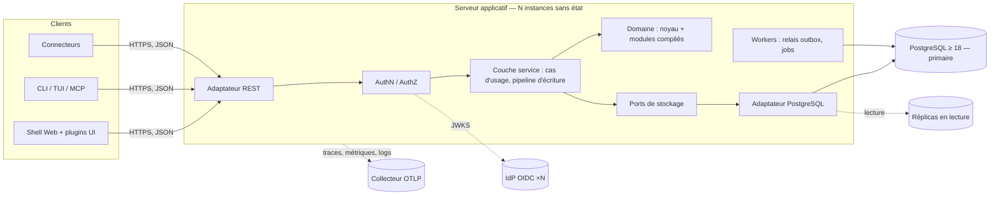
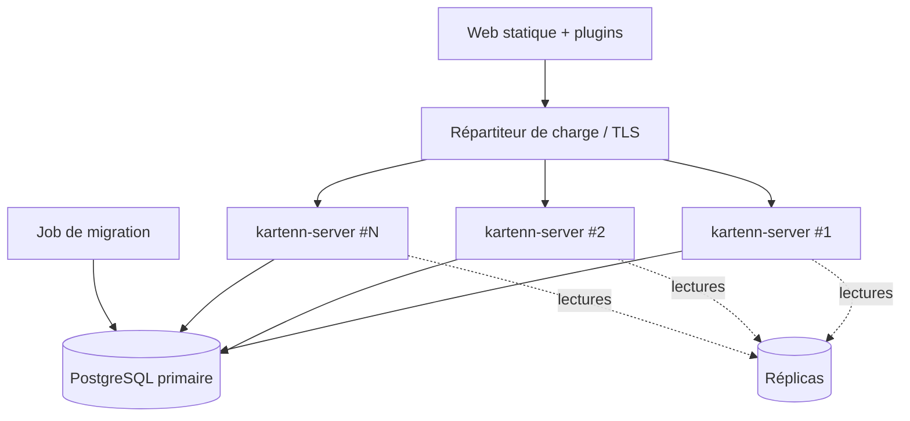

# Architecture

## Vue d'ensemble



## Composants

| Composant | Responsabilité | Données possédées |
|---|---|---|
| Domaine — noyau | Familles d'adresses ; entités, sites, domaines, préfixes, plages, adresses ; règles de validité ; types de valeurs et arbres d'héritage (résolveur de référence) | Aucune persistance directe (types et règles purs) |
| Domaine — modules | Objets, propriétés, règles, permissions d'un domaine fonctionnel (VLAN, machines, Politique…) | Leurs tables, via leurs migrations |
| Couche service | Cas d'usage ; pipeline d'écriture ; transactions ; maintenance des origines et différentiel des propriétés (calcul ensembliste délégué à l'adaptateur) ; audit ; outbox | Changesets, journal d'audit, outbox |
| Ports de stockage | Interfaces définies par le domaine et la couche service (lecture datée, écriture de versions, verrous) | — |
| Adaptateur PostgreSQL | Implémente les ports ; contraintes en base (dernier rempart) ; requêtes temporelles | Schéma PostgreSQL |
| Adaptateur REST | Ressources, sérialisation, erreurs RFC 9457, pagination, OpenAPI | — |
| AuthN / AuthZ | Basic (comptes de service, secours), OIDC (JWT multi-émetteurs) ; évaluation RBAC | Comptes de service, rôles, liaisons |
| Workers | Relais outbox (webhooks, invalidations), jobs longs (imports, rapports) ; répartis sans doublon | État des jobs |
| Shell Web | Navigation, vues du noyau, hôte des plugins UI ; client de l'API | — |
| Connecteurs | Import / synchronisation depuis des sources externes via l'API | Correspondances d'identifiants (dans kartenn) |

## Pipeline d'écriture

Toute écriture, unitaire, par lot ou issue d'un connecteur, suit le même chemin (D11,
ADR 0006).

```mermaid
sequenceDiagram
  participant C as Client
  participant R as REST
  participant A as AuthN/AuthZ
  participant S as Service
  participant D as Domaine
  participant P as PostgreSQL
  C->>R: changeset (opérations, valid_period, motif)
  R->>A: identité, permissions sur les objets visés
  A-->>R: refus 401/403 ou poursuite
  R->>S: soumettre
  S->>D: règles locales (sans base)
  S->>P: BEGIN ; verrous sur les portées touchées
  S->>P: écrire les versions dans la transaction (temps système = horodatage de transaction)
  S->>D: invariants globaux sur l'état final, à toute la période visée
  S->>P: maintenir les origines des propriétés ; différentiel (003)
  S->>A: permission sur l'effet (003/REQ-003-18), approbation requise ?
  alt refus
    S->>P: ROLLBACK ; journaliser le refus (transaction séparée)
    S-->>C: erreur RFC 9457 (règles, objets)
  else approbation requise
    S->>P: ROLLBACK ; enregistrer le changeset en attente (transaction séparée)
    S-->>C: 202, changeset en attente
  else appliqué
    S->>P: journal d'audit + outbox ; COMMIT
    S-->>C: 200/201, anomalies, différentiel
  end
```

Règles :
- les contraintes PostgreSQL rejouent les invariants critiques (unicité temporelle,
  non-chevauchement) : la validation applicative donne les messages, la base garantit
  sous concurrence (D15) ;
- un changeset en attente est **revalidé** à son application (D11) ;
- l'horodatage système est celui de la transaction PostgreSQL (`now()`), jamais celui
  d'une instance (D9).

## Modularité (D6, ADR 0001)

| Couche | Mécanisme | Ajout d'un module |
|---|---|---|
| Domaine, service, données | Crates Rust du workspace, sélectionnées par features ; un module déclare ses dépendances (DAG), ses migrations, ses propriétés, ses règles, ses permissions, ses ressources REST | Recompilation + migration |
| Interfaces | Binaires séparés, clients REST | Indépendant |
| Frontend | Plugins ES modules enregistrant des Custom Elements, découverts via l'endpoint de capacités | À chaud |
| Connecteurs | Processus externes, clients REST | À chaud |

Contrat de module (à détailler dans la conception 002/003) : identifiant et version ;
dépendances ; migrations ; types d'objets et leurs ancres de périmètre ; propriétés et
types de valeurs ; règles de validation (identifiant, sévérité) ; sources de valeurs
attendues ; permissions ; ressources REST ; contribution au graphe de topologie ;
plugin UI éventuel.

Organisation du workspace (les crates `kartenn-rest` et `kartenn-auth` sont la cible des
specs 005 et 006 ; voir
[`../practices/rust-build.md`](../practices/rust-build.md)) :

```
crates/
  kartenn-core/        familles d'adresses, objets du noyau, règles, propriétés
  kartenn-service/     cas d'usage, pipeline d'écriture, différentiel
  kartenn-store-pg/    adaptateur PostgreSQL (sqlx), migrations du noyau
  kartenn-rest/        adaptateur REST (axum), OpenAPI (utoipa)
  kartenn-auth/        Basic, OIDC, RBAC
  kartenn-server/      binaire : composition, configuration, observabilité
  kartenn-bench/       jeu synthétique et bancs des budgets (REQ-002-45, REQ-003-26)
  kartenn-<module>/    un module métier (vlan, machines, policy…)
  kartenn-workspace-hack/
web/
  shell/               Vue 3 + TypeScript
  sdk/                 SDK de plugins (TypeScript)
```

Règle de dépendance : `kartenn-core` ne dépend d'aucun adaptateur ni d'aucune crate
d'infrastructure (HTTP, SQL).

## Déploiement (D9, D35, ADR 0012)



- Instances **sans état** ; sessions portées par des jetons ; aucun cache local faisant
  autorité.
- Un **job de migration** dédié, exécuté une fois avant le déploiement des instances.
- Tâches de fond réparties par verrous en base : le relais d'outbox prend un verrou
  consultatif par consommateur ; l'ordonnanceur des autres tâches (expiration des
  changesets en attente, pseudonymisation, partitions d'historique) est la cible de la
  spec 006, avec `FOR UPDATE SKIP LOCKED`.
- Lectures sur réplicas possibles, sauf lecture de ses propres écritures (lecture sur
  le primaire après un changeset).
- Livrables : images OCI (serveur, migration, web statique), module NixOS ;
  configuration 12-factor ; OpenTelemetry (OTLP) ; sondes `/health/live`, `/health/ready`.
