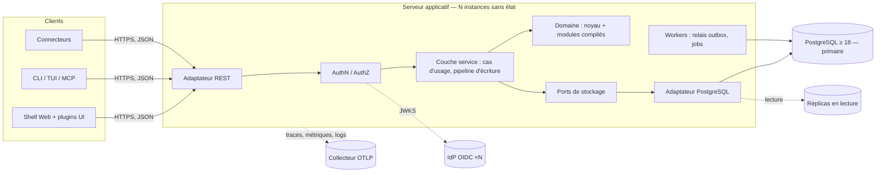
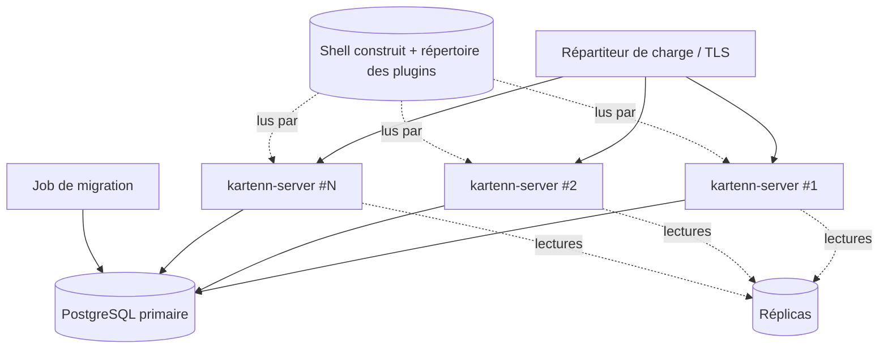

# Architecture

## Vue d'ensemble



## Composants

| Composant | Responsabilité | Données possédées |
|---|---|---|
| Domaine — noyau | Familles d'adresses ; entités, sites, domaines, préfixes, plages, adresses ; règles de validité ; types de valeurs et arbres d'héritage (résolveur de référence) | Aucune persistance directe (types et règles purs) |
| Domaine — modules | Objets, propriétés, règles, permissions d'un domaine fonctionnel (VLAN, machines, Politique…) | Leurs tables, via leurs migrations |
| Couche service | Cas d'usage ; pipeline d'écriture ; transactions ; maintenance des origines et différentiel des propriétés (calcul ensembliste délégué à l'adaptateur) ; audit ; outbox | Changesets, journal d'audit, outbox |
| Journal d'audit (012) | Événements typés remis au port `AuditJournal`, écrits dans la transaction de l'action (échec fermé) ; scellement par lots chaînés, relais vers les sorties d'audit, purge par criticité, vérification | Schéma `audit` |
| Télémétrie (`kartenn-telemetry`) | Capture unique des événements `tracing`, files bornées par sortie (stdout, fichier, journald, syslog, OTLP), masquage ; OpenTelemetry (traces, métriques, logs) ; sorties d'audit (`AuditSink`) | — |
| Binaire (`kartenn-server`) | Composition : configuration, sorties, tâches de scellement et de relais, arrêt propre ; sous-commandes `migrate`, `run`, `audit verify`, `audit purge`, `breakglass create` ; configuration `[auth]` | — |
| `syslog-sender` | Bibliothèque autonome (MPL-2.0) : messages RFC 5424 et RFC 3164, transports local, UDP, TCP, TLS avec comptage d'octets | — |
| Ports de stockage | Interfaces définies par le domaine et la couche service (lecture datée, écriture de versions, verrous) | — |
| Adaptateur PostgreSQL | Implémente les ports ; contraintes en base (dernier rempart) ; requêtes temporelles | Schéma PostgreSQL |
| Adaptateur REST | Ressources, sérialisation, erreurs RFC 9457, pagination, OpenAPI | — |
| Authentification (`kartenn-auth`) | Trousseau de clés (HKDF par usage), cookies scellés, flux OIDC du BFF, jetons d'accès RFC 9068, secrets des comptes de service, comptes de secours (Argon2id, TOTP) ; derrière les ports `Identities`, `SecretHasher`, `BreakglassVerifier` de la couche service | — |
| Autorisation (service et adaptateur) | Port `Authorizer` ; décisions et administration dans la couche service ; visibilités et prédicats SQL dans l'adaptateur PostgreSQL (`PgAuthorizer`, ADR 0021) | Identités, rôles, liaisons, rattachements, secrets |
| Workers | Relais outbox (webhooks, invalidations), jobs longs (imports, rapports) ; répartis sans doublon | État des jobs |
| Shell Web | Navigation, vues du noyau, changesets et brouillon local, administration ; hôte des plugins UI ; client de l'API ; servi par kartenn-server sur la même origine que l'API (spec 007, ADR 0025) | Brouillon et préférences dans le navigateur (IndexedDB, `localStorage`), effacés à la déconnexion |
| Clients Python (`kartenn`, `kartenn-cli`) | Bibliothèque et CLI découvertes depuis le contrat servi : catalogue dérivé, commandes des modules sans nouvelle version du client ; OIDC natif, changesets, imports (spec 023, ADR 0035) | Catalogue en cache et configuration XDG, jetons au trousseau |
| Connecteurs | Import / synchronisation depuis des sources externes via l'API | Correspondances d'identifiants (dans kartenn) |

## Pipeline d'écriture

Toute écriture, unitaire, par lot ou issue d'un connecteur, suit le même chemin (D11,
ADR 0006).

```mermaid
sequenceDiagram
  participant C as Client
  participant R as REST
  participant A as AuthN/AuthZ
  participant S as Service
  participant D as Domaine
  participant P as PostgreSQL
  C->>R: changeset (opérations, valid_period, motif)
  R->>A: identité (session, jeton, Basic)
  A-->>R: refus 401 ou sujet (identité, émetteur, groupes)
  R->>S: soumettre
  S->>D: règles locales (sans base)
  S->>P: BEGIN ; verrous sur les portées touchées
  S->>P: écrire les versions dans la transaction (temps système = horodatage de transaction)
  S->>D: invariants globaux sur l'état final, à toute la période visée
  S->>P: maintenir les origines des propriétés ; différentiel (003)
  S->>P: permissions sur les objets écrits et sur l'effet, dans la transaction (005, 003/REQ-003-18) ; approbation requise ?
  alt refus
    S->>P: ROLLBACK ; journaliser le refus (transaction séparée)
    S-->>C: erreur RFC 9457 (règles, objets)
  else approbation requise
    S->>P: ROLLBACK ; enregistrer le changeset en attente (transaction séparée)
    S-->>C: 202, changeset en attente
  else appliqué
    S->>P: journal d'audit + outbox ; COMMIT
    S-->>C: 200/201, anomalies, différentiel
  end
```

Règles :
- les contraintes PostgreSQL rejouent les invariants critiques (unicité temporelle,
  non-chevauchement) : la validation applicative donne les messages, la base garantit
  sous concurrence (D15) ;
- un changeset en attente est **revalidé** à son application (D11) ;
- l'horodatage système est celui de la transaction PostgreSQL (`now()`), jamais celui
  d'une instance (D9) ;
- les verrous consultatifs de la transaction sérialisent les écritures par portée
  (domaines, modules, clés nommées ; [ADR 0015](../adr/0015-serialisation-ecritures-par-domaine.md)) ;
  une clé nommée est verrouillée par son seau, l'un de 1024 (`hashtext(clé) & 1023`),
  seaux distincts pris en ordre croissant en une requête, pour ne pas épuiser la table
  des verrous de PostgreSQL sur un changeset de milliers de clés (amendement du
  2026-10-22).

## Modularité (D6, ADR 0001)

| Couche | Mécanisme | Ajout d'un module |
|---|---|---|
| Domaine, service, données | Crates Rust du workspace, sélectionnées par features ; un module déclare ses dépendances (DAG), ses migrations, ses propriétés, ses règles, ses permissions, ses ressources REST | Recompilation + migration |
| Interfaces | Binaires séparés, clients REST | Indépendant |
| Frontend | Plugins ES modules enregistrant des Custom Elements, découverts via l'endpoint de capacités | À chaud |
| Connecteurs | Processus externes, clients REST | À chaud |

Contrat de module ([ADR 0026](../adr/0026-contrat-de-module.md), acceptée, amendements 1
à 4 ; implémenté par la 008, éprouvé par la 009, complété pour la v0.2 par la 016 et
pendant la 010) :
identifiant et version ;
dépendances ; migrations ; types d'objets et leurs ancres de périmètre ; propriétés et
types de valeurs ; règles de validation (identifiant, sévérité) ; sources de valeurs
attendues ; permissions ; ressources REST ; contribution au graphe de topologie ;
plugin UI éventuel.

Forme dans le code (`kartenn-service::module`) :

- `Module` décrit statiquement le module : nom, version, dépendances, types d'objets
  (`ObjectType` : parent, propriétaire obligatoire, site, ancrage de domaine),
  déclarations de propriétés, permissions, règles, références (`Reference`, politique
  `OnClose` : refus, cascade, mise à nul), types d'arêtes, migrations, opérations ;
  `handler()` rend son gestionnaire.
- `ModuleHandler` agit dans la transaction du changeset par `ModuleTx` : `prepare`
  (complète l'opération sur l'état courant), `plan` (sans base : objet, domaines, clés
  de verrou, opérations du noyau planifiées), `reads` (droits de lecture sur les objets
  cités), `apply`, `close`/`restore`, `referrers`/`nullify` (dépendants), `diff`
  (section du différentiel), `check` (règles sur l'état final, `Findings`), `measure`
  (mesures lues par les politiques d'approbation, sur la transaction et le même
  contexte), `ended` (fin d'une proposition : rejet, retrait, expiration, dans la même
  transaction), `review` (permission du valideur quand le module exige une revue),
  `run_job` (tâche de fond, transaction propre), `edges` (lecture hors
  changeset par `ModuleRead`) ; `ModuleTx::emit` écrit un événement du module avec le
  journal de la transaction.
- `Module` déclare aussi, pour la v0.2 (016) : `jobs`, `events`, `measures`,
  `default_policies` (installées une seule fois) et `review_operations` (opérations
  qu'un valideur peut joindre ; un module qui exige une revue force la proposition).
- Pendant la 010 : `type_permissions` (un type se lit et s'écrit sous des permissions
  déclarées par le module au lieu de `<type>.read`/`.write`, S15),
  `operation_permissions` (amendement 3 : permission propre à une opération, même
  vérification et mêmes portées ; une permission inconnue du module est refusée au
  démarrage du registre), `ModuleTx::actors()` (auteur, demandeur, validateur, posés par
  le seul pipeline) et `run_job_findings` (amendement 4 : les constats d'une tâche de
  fond sont journalisés dans un changeset système, avertissements ouverts en anomalies,
  objets réévalués refermés).
- `ModuleRegistry` ordonne les modules selon le DAG, refuse noms, collections,
  permissions et règles en collision, et complète les catalogues du processus.
- Le serveur compose le registre selon ses features (`vlan`, `machines`, `policy` qui
  active `machines`, `flow` qui active `policy` ; défaut : toutes). Le module politique
  (`kartenn-policy`, spec 010) évalue ses verdicts en mémoire sur un instantané versionné
  ([ADR 0030](../adr/0030-evaluation-sur-instantane.md)) et livre un convertisseur hors
  ligne (feature `import`, binaire `kartenn-policy-import`) ; `kartenn-server openapi` écrit le contrat de référence du build. Un module
  sert ses routes avec `kartenn_rest::kit`.

Modules livrés : `vlan` (008 ; groupes et VLAN 802.1Q, propriété `vlan.vlan` des
réseaux) et `machines` (009, dépend de `vlan` ; clusters, machines, interfaces,
rattachements d'adresses).

Organisation du workspace (voir
[`../practices/rust-build.md`](../practices/rust-build.md)) :

```
crates/
  kartenn-core/        familles d'adresses, objets du noyau, règles, propriétés
  kartenn-service/     cas d'usage, pipeline d'écriture, différentiel
  kartenn-store-pg/    adaptateur PostgreSQL (sqlx), migrations du noyau
  kartenn-rest/        adaptateur REST (axum) : routes, DTO, problèmes, curseurs,
                       quotas, CSRF ; OpenAPI (utoipa) ; service du shell et
                       registre des plugins (`web`, spec 007)
  kartenn-auth/        trousseau, OIDC, jetons, secrets, comptes de secours
  kartenn-server/      binaire : composition, configuration, observabilité
  kartenn-bench/       jeu synthétique et bancs des budgets (REQ-002-45, REQ-003-26,
                       REQ-005-29)
  kartenn-<module>/    un module métier (vlan, machines, policy…)
  kartenn-dev-idp/     émetteur OIDC de développement et de test, jamais livré (007/W16)
  kartenn-workspace-hack/
web/                   espace pnpm (ADR 0024)
  shell/               Vue 3 + TypeScript (AGPL-3.0)
  sdk/                 SDK de plugins `@kartenn/sdk` (TypeScript, MPL-2.0)
  plugins/<nom>/       plugins de première partie (example, vlan…), MPL-2.0
  e2e/                 parcours Playwright contre le vrai serveur
```

Le contrat de référence de l'API (`specs/006-api-rest/openapi-v1.json`) est écrit par
`kartenn-server openapi`, seul à connaître les modules du build (008-8).

Règle de dépendance : `kartenn-core` ne dépend d'aucun adaptateur ni d'aucune crate
d'infrastructure (HTTP, SQL).

## Déploiement (D9, D35, ADR 0012)



- Chaque instance sert le shell (`[web] root`) et les plugins (`[web] plugins_dir`) sur
  la même origine que l'API, avec la CSP et les en-têtes de cache (spec 007, ADR 0025) ;
  le répertoire est le même partout (même paquet ou volume partagé). Un serveur statique
  derrière le même répartiteur reste possible ; il pose alors lui-même ces en-têtes.

- Instances **sans état** ; sessions portées par un cookie chiffré (ADR 0020) ; aucun
  cache local faisant autorité : l'état des identités est gardé 5 s au plus par
  instance (l'instance qui le change l'oublie aussitôt), les droits sont relus à chaque
  requête (005/K15).
- Un **job de migration** dédié, exécuté une fois avant le déploiement des instances.
- Tâches de fond réparties par verrous en base : le relais d'outbox prend un verrou
  consultatif par consommateur, le scellement de l'audit et chaque relais d'audit le
  leur ; chacune lit à partir de son plancher (`pass_floor`) et vide son retard par lots
  successifs à chaque tour ; les autres tâches (expiration des changesets en
  attente, réévaluation des valeurs attendues, réécriture de l'indicateur `public`,
  purge des clés d'idempotence, imports) sont des lignes de la table `job`, réclamées
  sous bail par `FOR UPDATE SKIP LOCKED` (ADR 0023, spec 006).
  Les partitions d'historique demandent le propriétaire du schéma : le job de migration
  les crée trois mois à l'avance, et se relance au moins chaque mois (004-25).
- Lectures sur réplicas possibles, sauf lecture de ses propres écritures (lecture sur
  le primaire après un changeset).
- Livrables (spec 015, ADR 0029, D35 amendée) : un `flake.nix` qui suit le nixpkgs de
  devenv et construit le paquet `kartenn` (binaire, shell construit, plugins `vlan` et
  `machines`, en fichiers réels) ; **une seule image OCI** non root et sans shell, qui
  sert d'instance (`run`), de job de migration (`migrate`) et d'amorçage
  (`breakglass create`) ; le module NixOS `services.kartenn` (migration en unité oneshot
  relancée chaque mois, une unité `kartenn@<nom>` par instance qui en dépend,
  `DynamicUser`, secrets par `LoadCredential=`, durcissement noté 1,1 par
  `systemd-analyze security`), éprouvé par une machine virtuelle (`checks.vm`) ;
  configuration 12-factor ; OpenTelemetry (OTLP) ; sondes `/health/live`, `/health/ready`.
  Documentation de l'exploitant : `docs/exploitation/` ; intégration continue neutre :
  `scripts/ci.sh`.
- Le rôle d'instance (membre de `kartenn_app`) lit `_sqlx_migrations` (migration 0054),
  et rien d'autre de ce que gère sqlx : `/health/ready` compare la dernière migration
  appliquée à celle du binaire ; une migration interrompue se rejoue (chaque fichier dans
  sa transaction, version inscrite au commit).
