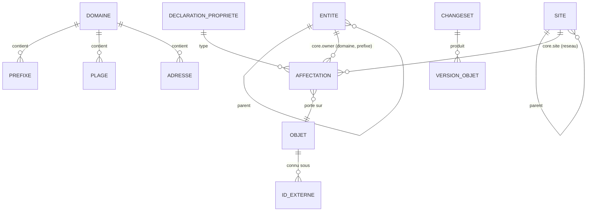

# Données

## Modèle conceptuel du noyau (002, 003)

Attributs du noyau (002/REQ-002-48, A10) :

| Objet | Attributs |
|---|---|
| Entité | UUID, slug, parent |
| Site | UUID, slug, parent |
| Domaine | UUID, slug |
| Préfixe | UUID, domaine, valeur CIDR, nature (conteneur, réseau), point à point, anycast (réseau seulement) |
| Plage | UUID, domaine, début, fin, usage (DHCP, réservée, statique) |
| Adresse | UUID, domaine, valeur, usage (hôte, passerelle, VIP, anycast, réservée) |

Plus, pour chaque objet : période de validité applicative et période système ; pour les
préfixes, plages et adresses, deux colonnes **dérivées** : `public` (classement dans
l'espace public, 002/A3 ; une plage est publique si sa première ou sa dernière adresse
l'est) et `registry_version` (version du registre IANA qui l'a calculé).

L'entité propriétaire et le site ne sont pas des attributs : ce sont les propriétés du
noyau `core.owner` (référence vers une entité, portée par les domaines et les préfixes,
héritée le long de l'arbre d'adressage, obligatoire sur les domaines) et `core.site`
(référence vers un site, portée par les réseaux) (ADR 0014, 002-22).

Les relations parent-enfant de l'adressage ne sont **pas stockées** : elles sont
déduites de l'inclusion CIDR dans le domaine, à la date considérée (D34). Une
matérialisation est permise comme cache, jamais comme vérité.

Tout attribut descriptif (nom affiché, FQDN, description…) est une **propriété** (003).

## Propriétés (003)

- **Déclaration** : clé `<espace>.<nom>`, type et paramètres, cardinalité, objets
  porteurs, héritabilité et arbre suivi, obligations portées, permission, approbation.
  Bitemporelle.
- **Valeurs de listes fermées** : bitemporelles ; elles se closent, sans effacement.
- **Affectation** : (objet, propriété) → valeur, ou « aucune valeur » ; provenance
  (saisie ou source de valeurs attendues et version).
- **Valeur résolue** : affectation propre, sinon celle de l'ancêtre le plus proche dans
  l'arbre suivi : adressage (domaine, préfixes, plages, adresses), entités ou sites, par
  leurs parents datés ; les porteurs d'une propriété héritable sont des objets de son
  arbre (003/P16). Pour les propriétés héritables, kartenn matérialise l'**objet
  d'origine** (`property_origin`, bitemporelle), jamais la valeur, et le maintient dans
  la transaction de chaque changeset ; pas de ligne sans origine (ADR 0016, 003/P9,
  P13). La valeur se lit par jointure sur l'affectation de l'origine.
- **Tables** (migrations 0011 à 0017) : `property_declaration`, `property_enum_value`,
  `property_obligation`, `property_assignment` (colonnes typées, une affectation par
  objet et propriété sur une période), `property_origin` ; historique de temps système
  pour chacune (ADR 0017) ; `changeset_diff` pour le
  détail du différentiel ; `expected_source_state` pour la réévaluation des écarts ; la
  vue `carrier_object` (migration 0022) réunit tous les objets porteurs.
- **Obligations** : portée domaine, type d'objet ou entité ; la portée d'une entité
  couvre les objets dont le `core.owner` résolu est l'entité ou une descendante, et les
  entités de ce sous-arbre (003/P16).
- **Déclarations de module** : synchronisées depuis le code par un changeset de l'auteur
  système (003/P12).

## Temps (D8, D10, ADR 0005)

- Périodes en `[début, fin)` (`tstzrange`), fin infinie pour « en cours » ; périodes
  vides interdites.
- **Temps applicatif** (`valid_period`) : fourni par l'utilisateur ; planification
  et correction du passé.
- **Temps système** (`[sys_start, sys_end)`) : fixé à l'horodatage de la transaction ; les
  versions historiques sont immuables et forment une chaîne contiguë par objet ; une
  version écrite puis remplacée dans la même transaction n'y entre pas (ADR 0017).
- Les contraintes ne portent que sur les versions **courantes** côté système.
- PostgreSQL 18 ne fournit ni tables versionnées système ni `FOR PORTION OF` : kartenn
  les implémente (voir
  [`../reference/temporel-sql2011-postgresql.md`](../reference/temporel-sql2011-postgresql.md)).
- Implémentation : table courante et table d'historique par type d'objet, déclencheur
  générique (ADR 0017) ; découpage « FOR PORTION OF » par la fonction `kartenn_portion`
  (004-8).

## Changesets, audit, outbox (D11)

- Un **changeset** (table `changeset`, migrations 0003, 0020) : auteur, motif,
  requête d'origine, période applicative visée, rétroactivité, nature (`direct`,
  `approval`, `proposal`), état (`applied`, `refused`, `pending`, `rejected`,
  `withdrawn`, `expired`, `failed_revalidation`), violations, avertissements, résumé du
  différentiel, droits manquants d'une proposition, valideur et motif de rejet. Le
  détail du différentiel est dans `changeset_diff` (clé de propriété, objet, avant,
  après), ses opérations dans `changeset_operation`.
- Chaque version d'objet référence le changeset qui l'a produite (audit complet).
- **Anomalies** (`anomaly`, migration 0007) : avertissement ouvert sur un objet, acquitté
  avec un motif, rouvert quand l'objet change, clos quand la règle ne se déclenche plus ;
  listées par règle, domaine et entité (REQ-002-36).
- L'**outbox** reçoit, dans la même transaction, un événement CloudEvents 1.0 par
  changeset appliqué (`org.kartenn.changeset.applied`, `id` = UUID du changeset ;
  données : changeset, domaines, objets, auteur, valideur, résumé du différentiel) et un
  événement par changement d'état d'un changeset en attente
  (`org.kartenn.changeset.<état>`, `id` = `<uuid>/<état>`). L'ordre est garanti par
  domaine d'adressage ; chaque consommateur enregistre ses livraisons
  (`outbox_delivery`) (ADR 0018).

## Journal d'audit (spec 012, ADR 0019)

- Schéma `audit` (migrations 0023, 0025), en **ajout seul** pour le rôle applicatif
  (`SELECT`, `INSERT` ; ni `UPDATE` ni `DELETE`) :
  - `audit.event` : un événement attribué (acteur, méthode d'authentification, source,
    cible, résultat, motif, changeset, `trace_id`, instance), partitionné par criticité
    (`low`, `normal`, `high`) puis par mois de `recorded_at` ; index par `seq`, par
    acteur, par nom, et GIN sur les identifiants visés (recherche par objet) ;
  - `audit.seal` : lots chaînés, `hash` = SHA-256 du hash précédent, du nombre et des
    empreintes des membres (JCS, RFC 8785), signature Ed25519 facultative ;
  - `audit.sealed` : appartenance d'un événement à un sceau et son empreinte, conservée
    après la purge de l'événement ;
  - `audit.delivery` : livraisons par sortie (au moins une fois, sans trou) ;
  - `audit.purge` : purges consignées (partition, nombre, dernier sceau couvert) ;
  - `audit.instance_key` : clés publiques des instances qui signent.
- **Rétention** par criticité (par défaut `low` 90 j, `normal` 365 j, `high` 1095 j) :
  une partition mensuelle échue n'est supprimée que si tous ses événements sont scellés
  et livrés à chaque sortie, par le propriétaire du schéma.
- **Planchers** (`pass_floor`, migration 0027) : le scellement, chaque relais d'audit et
  chaque consommateur de l'outbox lisent à partir d'un plancher sous lequel tout est
  traité ; il monte une fois terminées les transactions qui auraient pu détenir un
  numéro inférieur, et une passe horaire relit depuis zéro.
- Volume mesuré (banc `bench-telemetry`) : environ 8 Kio par lecture auditée d'une page
  de 100 objets, dont 5,8 Kio dans l'index GIN par objet ; réglable par
  `audit.read_ids_max` et `audit.retention_days.low` (L25).
- **Propriété sensible** : attribut `sensitive` d'une déclaration (migration 0024) ; sa
  lecture produit `data.sensitive.read` en criticité `high`.
- **Filtres changés à chaud** : `observability_override` (migration 0026), une ligne par
  sortie jusqu'à son expiration.

## Stockage PostgreSQL (D15, ADR 0004)

- Préfixes en `cidr`, adresses en `inet` ; jamais de texte utilisateur transmis tel quel
  (PostgreSQL accepte des formes abrégées héritées des classes).
- Unicité temporelle des préfixes :
  `EXCLUDE USING GIST (domain_id WITH =, prefix inet_ops WITH =, valid_period WITH &&)`
  sur les versions courantes. **Pas** de `UNIQUE … WITHOUT OVERLAPS` sur une colonne
  `inet`/`cidr` en PostgreSQL 18 : la classe par défaut de btree_gist y est défectueuse
  (voir [`../reference/postgresql-18-reseau.md`](../reference/postgresql-18-reseau.md)).
- Plages : type intervalle `inetrange` sans `subtype_diff`, `CHECK` de famille, exclusion
  de chevauchement par domaine (002/A12, prototype 001).
- Index d'inclusion : ceux des contraintes d'exclusion
  `(domain_id, prefix inet_ops, valid_period)` ; pas d'index `inet_ops` autonome, les
  budgets tenant sans lui (002/A14).
- Identifiants : UUID v7 (`uuidv7()`, PostgreSQL 18).
- Registres IANA à usage spécial : embarqués dans le code, chargés par le job de
  migration dans `special_registry`, une copie par version (REQ-002-34) ; un rapport
  liste les objets dont `public` changerait sous une nouvelle version.

## Migrations

- Une suite de migrations par module, ordonnée selon le DAG des dépendances.
- Exécutées par un job dédié, jamais au démarrage des instances (D9).
- Les propriétés déclarées par un module évoluent avec le code du module, synchronisées
  par le job de migration (003/P12).
