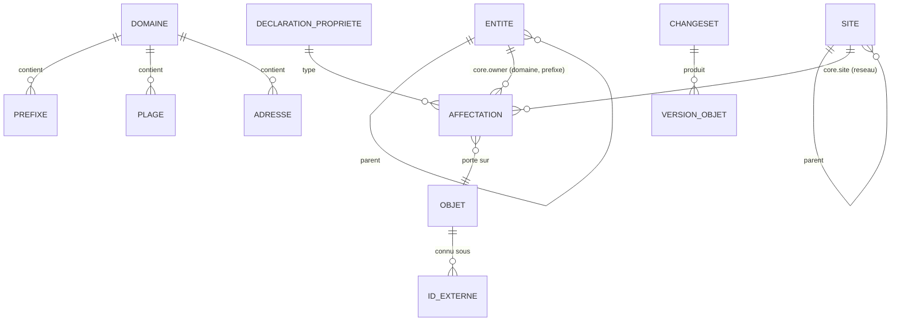

# Données

## Modèle conceptuel du noyau (002, 003)

Attributs du noyau (002/REQ-002-48, A10) :

| Objet | Attributs |
|---|---|
| Entité | UUID, slug, parent |
| Site | UUID, slug, parent |
| Domaine | UUID, slug |
| Préfixe | UUID, domaine, valeur CIDR, nature (conteneur, réseau), point à point, anycast (réseau seulement) |
| Plage | UUID, domaine, début, fin, usage (DHCP, réservée, statique) |
| Adresse | UUID, domaine, valeur, usage (hôte, passerelle, VIP, anycast, réservée) |

Plus, pour chaque objet : période de validité applicative et période système.

L'entité propriétaire et le site ne sont pas des attributs : ce sont les propriétés du
noyau `core.owner` (référence vers une entité, portée par les domaines et les préfixes,
héritée le long de l'arbre d'adressage, obligatoire sur les domaines) et `core.site`
(référence vers un site, portée par les réseaux) (ADR 0014, 002-22).

Les relations parent-enfant de l'adressage ne sont **pas stockées** : elles sont
déduites de l'inclusion CIDR dans le domaine, à la date considérée (D34). Une
matérialisation est permise comme cache, jamais comme vérité.

Tout attribut descriptif (nom affiché, FQDN, description…) est une **propriété** (003).

## Propriétés (003)

- **Déclaration** : clé `<espace>.<nom>`, type et paramètres, cardinalité, objets
  porteurs, héritabilité et arbre suivi, obligations portées, permission, approbation.
  Bitemporelle.
- **Valeurs de listes fermées** : bitemporelles ; elles se closent, sans effacement.
- **Affectation** : (objet, propriété) → valeur, ou « aucune valeur » ; provenance
  (saisie ou source de valeurs attendues et version).
- **Valeur résolue** : affectation propre, sinon celle de l'ancêtre le plus proche dans
  l'arbre suivi. Pour les propriétés héritables, kartenn matérialise l'**objet
  d'origine** (`property_origin`, bitemporelle), jamais la valeur, et le maintient dans
  la transaction de chaque changeset ; pas de ligne sans origine (ADR 0016, 003/P9,
  P13). La valeur se lit par jointure sur l'affectation de l'origine.
- **Tables** (migrations 0011 à 0017) : `property_declaration`, `property_enum_value`,
  `property_obligation`, `property_assignment` (colonnes typées, une affectation par
  objet et propriété sur une période), `property_origin` ; historique de temps système
  pour chacune (ADR 0017, proposé, accepté avec la 004) ; `changeset_diff` pour le
  détail du différentiel ; `expected_source_state` pour la réévaluation des écarts.
- **Déclarations de module** : synchronisées depuis le code par un changeset de l'auteur
  système (003/P12).

## Temps (D8, D10, ADR 0005)

- Périodes en `[début, fin)` (`tstzrange`), fin infinie pour « en cours » ; périodes
  vides interdites.
- **Temps applicatif** (`valid_period`) : fourni par l'utilisateur ; planification
  et correction du passé.
- **Temps système** (`[sys_start, sys_end)`) : fixé à l'horodatage de la transaction ; les
  versions historiques sont immuables et forment une chaîne contiguë par objet ; une
  version écrite puis remplacée dans la même transaction n'y entre pas (ADR 0017).
- Les contraintes ne portent que sur les versions **courantes** côté système.
- PostgreSQL 18 ne fournit ni tables versionnées système ni `FOR PORTION OF` : kartenn
  les implémente (voir
  [`../reference/temporel-sql2011-postgresql.md`](../reference/temporel-sql2011-postgresql.md)).
- Implémentation : table courante et table d'historique par type d'objet, déclencheur
  générique (ADR 0017) ; découpage « FOR PORTION OF » par la fonction `kartenn_portion`
  (004-8).

## Changesets, audit, outbox (D11)

- Un **changeset** : auteur, motif, opérations, période applicative visée, état
  (soumis, en attente d'approbation, appliqué, refusé), différentiel, anomalies.
- Chaque version d'objet référence le changeset qui l'a produite (audit complet).
- L'**outbox** reçoit un événement par changeset appliqué, dans la même transaction.

## Stockage PostgreSQL (D15, ADR 0004)

- Préfixes en `cidr`, adresses en `inet` ; jamais de texte utilisateur transmis tel quel
  (PostgreSQL accepte des formes abrégées héritées des classes).
- Unicité temporelle des préfixes :
  `EXCLUDE USING GIST (domain_id WITH =, prefix inet_ops WITH =, valid_period WITH &&)`
  sur les versions courantes. **Pas** de `UNIQUE … WITHOUT OVERLAPS` sur une colonne
  `inet`/`cidr` en PostgreSQL 18 : la classe par défaut de btree_gist y est défectueuse
  (voir [`../reference/postgresql-18-reseau.md`](../reference/postgresql-18-reseau.md)).
- Plages : type intervalle `inetrange` sans `subtype_diff`, `CHECK` de famille, exclusion
  de chevauchement par domaine (002/A12, prototype 001).
- Index d'inclusion : GiST ou SP-GiST `inet_ops`, nommé explicitement.
- Identifiants : UUID v7 (`uuidv7()`, PostgreSQL 18).
- Registres IANA à usage spécial : données versionnées embarquées (REQ-002-34).

## Migrations

- Une suite de migrations par module, ordonnée selon le DAG des dépendances.
- Exécutées par un job dédié, jamais au démarrage des instances (D9).
- Les propriétés déclarées par un module évoluent avec le code du module, synchronisées
  par le job de migration (003/P12).
