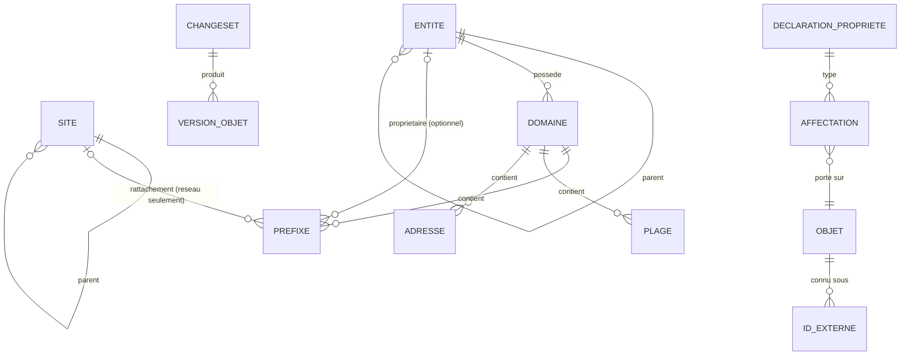

# Données

## Modèle conceptuel du noyau (002, 003)

Attributs du noyau (002/REQ-002-48, A10) :

| Objet | Attributs |
|---|---|
| Entité | UUID, slug, parent |
| Site | UUID, slug, parent |
| Domaine | UUID, slug, entité propriétaire |
| Préfixe | UUID, domaine, valeur CIDR, nature (conteneur, réseau), point à point, entité propriétaire (optionnelle), site (réseau seulement) |
| Plage | UUID, domaine, début, fin, usage (DHCP, réservée, statique) |
| Adresse | UUID, domaine, valeur, usage (hôte, passerelle, VIP, anycast, réservée) |

Plus, pour chaque objet : période de validité applicative et période système.

Les relations parent-enfant de l'adressage ne sont **pas stockées** : elles sont
déduites de l'inclusion CIDR dans le domaine, à la date considérée (D34). Une
matérialisation est permise comme cache, jamais comme vérité.

Tout attribut descriptif (nom affiché, FQDN, description…) est une **propriété** (003).

## Propriétés (003)

- **Déclaration** : clé `<espace>.<nom>`, type et paramètres, cardinalité, objets
  porteurs, héritabilité et arbre suivi, obligations portées, permission, approbation.
  Bitemporelle.
- **Valeurs de listes fermées** : bitemporelles ; elles se closent, sans effacement.
- **Affectation** : (objet, propriété) → valeur, ou « aucune valeur » ; provenance
  (saisie ou source de valeurs attendues et version).
- **Valeur résolue** : calculée ; matérialisée et maintenue de façon incrémentale pour
  tenir les budgets (D30, REQ-003-26).

## Temps (D8, D10, ADR 0005)

- Périodes en `[début, fin)` (`tstzrange`), fin infinie pour « en cours » ; périodes
  vides interdites.
- **Temps applicatif** (`valid_period`) : fourni par l'utilisateur ; planification
  et correction du passé.
- **Temps système** (`system_period`) : fixé à l'horodatage de la transaction ; les
  versions historiques sont immuables et forment une chaîne contiguë par objet.
- Les contraintes ne portent que sur les versions **courantes** côté système.
- PostgreSQL 18 ne fournit ni tables versionnées système ni `FOR PORTION OF` : kartenn
  les implémente (voir
  [`../reference/temporel-sql2011-postgresql.md`](../reference/temporel-sql2011-postgresql.md)).
- Choix d'implémentation (table courante + historique, ou table unique) : spec 004.

## Changesets, audit, outbox (D11)

- Un **changeset** : auteur, motif, opérations, période applicative visée, état
  (soumis, en attente d'approbation, appliqué, refusé), différentiel, anomalies.
- Chaque version d'objet référence le changeset qui l'a produite (audit complet).
- L'**outbox** reçoit un événement par changeset appliqué, dans la même transaction.

## Stockage PostgreSQL (D15, ADR 0004)

- Préfixes en `cidr`, adresses en `inet` ; jamais de texte utilisateur transmis tel quel
  (PostgreSQL accepte des formes abrégées héritées des classes).
- Unicité temporelle des préfixes :
  `EXCLUDE USING GIST (domain_id WITH =, prefix inet_ops WITH =, valid_period WITH &&)`
  sur les versions courantes. **Pas** de `UNIQUE … WITHOUT OVERLAPS` sur une colonne
  `inet`/`cidr` en PostgreSQL 18 : la classe par défaut de btree_gist y est défectueuse
  (voir [`../reference/postgresql-18-reseau.md`](../reference/postgresql-18-reseau.md)).
- Plages : type intervalle sur `inet` et exclusion de chevauchement (à prototyper).
- Index d'inclusion : GiST ou SP-GiST `inet_ops`, nommé explicitement.
- Identifiants : UUID v7 (`uuidv7()`, PostgreSQL 18).
- Registres IANA à usage spécial : données versionnées embarquées (REQ-002-34).

## Migrations

- Une suite de migrations par module, ordonnée selon le DAG des dépendances.
- Exécutées par un job dédié, jamais au démarrage des instances (D9).
- Les propriétés déclarées par un module évoluent par migration de ce module (003/P8).
