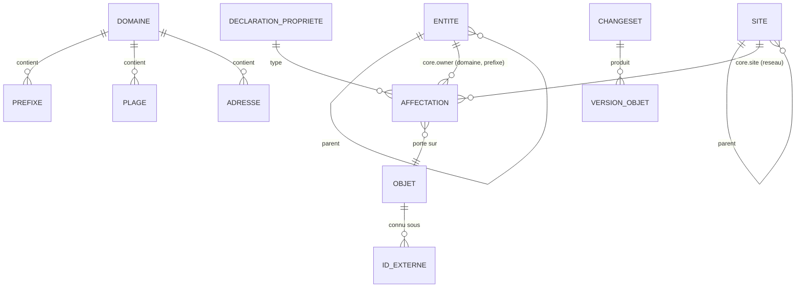

# Données

## Modèle conceptuel du noyau (002, 003)

Attributs du noyau (002/REQ-002-48, A10) :

| Objet | Attributs |
|---|---|
| Entité | UUID, slug, parent |
| Site | UUID, slug, parent |
| Domaine | UUID, slug |
| Préfixe | UUID, domaine, valeur CIDR, nature (conteneur, réseau), point à point, anycast (réseau seulement) |
| Plage | UUID, domaine, début, fin, usage (DHCP, réservée, statique) |
| Adresse | UUID, domaine, valeur, usage (hôte, passerelle, VIP, anycast, réservée) |

Plus, pour chaque objet : période de validité applicative et période système ; pour les
préfixes, plages et adresses, deux colonnes **dérivées** : `public` (classement dans
l'espace public, 002/A3 ; une plage est publique si sa première ou sa dernière adresse
l'est) et `registry_version` (version du registre IANA qui l'a calculé).

L'entité propriétaire et le site ne sont pas des attributs : ce sont les propriétés du
noyau `core.owner` (référence vers une entité, portée par les domaines et les préfixes,
héritée le long de l'arbre d'adressage, obligatoire sur les domaines) et `core.site`
(référence vers un site, portée par les réseaux) (ADR 0014, 002-22).

Les relations parent-enfant de l'adressage ne sont **pas stockées** : elles sont
déduites de l'inclusion CIDR dans le domaine, à la date considérée (D34). Une
matérialisation est permise comme cache, jamais comme vérité.

Tout attribut descriptif (nom affiché, FQDN, description…) est une **propriété** (003).

## Propriétés (003)

- **Déclaration** : clé `<espace>.<nom>`, type et paramètres, cardinalité, objets
  porteurs, héritabilité et arbre suivi, obligations portées, permission, approbation.
  Bitemporelle.
- **Valeurs de listes fermées** : bitemporelles ; elles se closent, sans effacement.
- **Affectation** : (objet, propriété) → valeur, ou « aucune valeur » ; provenance
  (saisie ou source de valeurs attendues et version).
- **Valeur résolue** : affectation propre, sinon celle de l'ancêtre le plus proche dans
  l'arbre suivi : adressage (domaine, préfixes, plages, adresses), entités ou sites, par
  leurs parents datés ; les porteurs d'une propriété héritable sont des objets de son
  arbre (003/P16). Pour les propriétés héritables, kartenn matérialise l'**objet
  d'origine** (`property_origin`, bitemporelle), jamais la valeur, et le maintient dans
  la transaction de chaque changeset ; pas de ligne sans origine (ADR 0016, 003/P9,
  P13). La valeur se lit par jointure sur l'affectation de l'origine.
- **Tables** (migrations 0011 à 0017) : `property_declaration`, `property_enum_value`,
  `property_obligation`, `property_assignment` (colonnes typées, une affectation par
  objet et propriété sur une période), `property_origin` ; historique de temps système
  pour chacune (ADR 0017) ; `changeset_diff` pour le
  détail du différentiel ; `expected_source_state` pour la réévaluation des écarts ; la
  vue `carrier_object` (migration 0022) réunit tous les objets porteurs.
- **Libellés** (spec 018, ADR 0040 ; migrations 0060, 0061) : colonne versionnée
  `labels jsonb` `{<langue>: <texte>}` (objet JSON, `{}` par défaut) sur
  `property_declaration`, `property_enum_value` et `role` (et les tables d'objets de la
  politique, migrations `policy` 0004, 0005) ; la colonne `label` d'un rôle et des objets
  de la politique a disparu, reprise d'abord comme libellé `fr` (seule langue des données
  de la v0.2). Une table de libellés non vide contient la langue par défaut
  (`core.label.invalid`). Les libellés des valeurs d'environnement vivent sur la valeur
  de liste fermée du noyau (Q-018-7). `label_revision` (une ligne) : révision des
  libellés stockés, incrémentée dans la transaction de tout changeset qui écrit une
  colonne `labels` (ce qui ordonne ces changesets entre eux) ; elle entre dans l'ETag du
  dictionnaire et l'événement `labels`. Les libellés compilés (permissions, règles,
  problèmes, sortes, états, natures, usages, FR et EN) vivent dans le code, non en base.
- **Obligations** : portée domaine, type d'objet ou entité ; la portée d'une entité
  couvre les objets dont le `core.owner` résolu est l'entité ou une descendante, et les
  entités de ce sous-arbre (003/P16).
- **Déclarations de module** : synchronisées depuis le code par un changeset de l'auteur
  système (003/P12).
- **Listes partagées** (migration 0045, REQ-016-2) : une liste fermée dont les
  `type_params` nomment `values_of` emprunte les valeurs d'une autre déclaration du même
  déclarant ; elles restent indexées par leur propriétaire, et toute lecture des valeurs
  passe par lui (règle `prop.declaration.values_of`). Limite connue : clore une liste
  dont une autre emprunte les valeurs n'est pas refusé.
- **Référence externe** (0046, REQ-016-3) : type de valeur `external_ref`, stocké en
  `jsonb` `{system, id, label}` (un tableau pour un ensemble) ; `system` est une valeur
  de la liste `core.external_system` (portée par `entity`) ; égalité et filtres par
  inclusion de `{system, id}` (le libellé est ignoré), filtre écrit
  `<système>:<identifiant>`.
- **Lecture groupée** (REQ-016-1, N9) : `resolved_many` (port `Reader`, service
  `reads::resolved_many`) rend les propriétés demandées de plusieurs objets, résolues et
  expliquées à une date, en un appel, sous les droits de l'appelant (objet illisible omis,
  valeur sensible masquée et sa lecture auditée). Le store lit les origines en quatre
  parts parallèles, par l'index partiel `property_origin_by_object` (0047) ; budget
  512 objets × 6 propriétés < 30 ms (mesuré à 25,4 ms au banc réduit avant l'index
  0047 ; à remesurer au calme).
- **Sources de valeurs attendues** (REQ-016-4, 5) : asynchrones, elles lisent dans la
  transaction du changeset (contexte : la date ; transaction passée à part). Une source
  rend aucun, un ou plusieurs candidats : un seul candidat donne la valeur par défaut et
  l'écart ; plusieurs ne donnent que des suggestions (`candidates` de la réponse de
  suggestion) ; les verdicts lisent toujours la valeur résolue (D23).

## Temps (D8, D10, ADR 0005)

- Périodes en `[début, fin)` (`tstzrange`), fin infinie pour « en cours » ; périodes
  vides interdites.
- **Temps applicatif** (`valid_period`) : fourni par l'utilisateur ; planification
  et correction du passé.
- **Temps système** (`[sys_start, sys_end)`) : fixé à l'horodatage de la transaction ; les
  versions historiques sont immuables et forment une chaîne contiguë par objet ; une
  version écrite puis remplacée dans la même transaction n'y entre pas (ADR 0017).
- Les contraintes ne portent que sur les versions **courantes** côté système.
- PostgreSQL 18 ne fournit ni tables versionnées système ni `FOR PORTION OF` : kartenn
  les implémente (voir
  [`../reference/temporel-sql2011-postgresql.md`](../reference/temporel-sql2011-postgresql.md)).
- Implémentation : table courante et table d'historique par type d'objet, déclencheur
  générique (ADR 0017) ; découpage « FOR PORTION OF » par la fonction `kartenn_portion`
  (004-8).

## Changesets, audit, outbox (D11)

- Un **changeset** (table `changeset`, migrations 0003, 0020) : auteur, motif,
  requête d'origine, période applicative visée, rétroactivité, nature (`direct`,
  `approval`, `proposal`), état (`applied`, `refused`, `pending`, `rejected`,
  `withdrawn`, `expired`, `failed_revalidation`), violations, avertissements, résumé du
  différentiel, droits manquants d'une proposition, valideur et motif de rejet. Le
  détail du différentiel est dans `changeset_diff` (clé de propriété, objet, avant,
  après), ses opérations dans `changeset_operation`. Depuis la 024 (0063), le valideur
  peut être l'auteur (« appliqué par son auteur », `approval.self`) ; `required_rights`
  garde aussi le motif d'une 202 de repli (`reason`) ; `draft_id` (0064, sans
  référence) nomme le brouillon d'origine ; index partiel `changeset (applied_at)
  WHERE state = 'applied'` (0065) pour les statistiques.
- **Brouillons** (`draft`, migration 0064 ; spec 024, REQ-024-1 à 7a) : auteur
  (`person`), titre (1 à 200 caractères), motif `{summary, description}`, opérations
  (`jsonb`, tableau d'`Operation` vérifié par le désérialiseur du contrat à chaque
  écriture), version (ETag), dates de création et de modification ; index
  `(author_id, updated_at desc)` et `(updated_at)` pour la rétention (tâche
  `draft-retention`, quotidienne, 90 jours). Pas d'historique bitemporel : un
  brouillon n'est pas une donnée du référentiel ; ses changements passent par l'outbox
  (`org.kartenn.draft.changed`, sans changeset), remis à son seul auteur.
- Chaque version d'objet référence le changeset qui l'a produite (audit complet).
- **Anomalies** (`anomaly`, migration 0007) : avertissement ouvert sur un objet, acquitté
  avec un motif, rouvert quand l'objet change, clos quand la règle ne se déclenche plus ;
  listées par règle, domaine et entité (REQ-002-36).
- L'**outbox** reçoit, dans la même transaction, un événement CloudEvents 1.0 par
  changeset appliqué (`org.kartenn.changeset.applied`, `id` = UUID du changeset ;
  données : changeset, domaines, objets, auteur, valideur, résumé du différentiel) et un
  événement par changement d'état d'un changeset en attente
  (`org.kartenn.changeset.<état>`, `id` = `<uuid>/<état>`). L'ordre est garanti par
  **clé d'ordre** (`outbox.order_keys`, migration 0050 ; ADR 0018, amendement 4 ;
  REQ-016-14) : les domaines d'adressage du changeset (`domain:<uuid>`) et les clés de
  verrou de ses opérations de module ; `domain_ids` reste pour les consommateurs de la
  v0.1. Chaque consommateur enregistre ses livraisons (`outbox_delivery`).
- **Événements de module** (REQ-016-15) : `org.kartenn.<module>.<nom>`, écrits avec le
  journal de leur transaction (une simulation ou un refus n'émet rien) ; ceux d'une
  tâche de fond n'ont pas de changeset (`outbox.changeset_id` nullable, 0052) et sont
  ordonnés sous `<module>:<tâche>`.
- **Imports** (`import`, `import_batch`, migrations 0003, 0040, 0057 ; REQ-006-17 à 19,
  006/H18) : états `uploading`, `sorting`, `ready`, `running`, `paused`, `done`,
  `cancelled` ; morceaux numérotés dans `import_chunk` (empreinte, taille) ; `error`
  (`jsonb`) garde le problème `invalid-import` du dernier tri échoué, effacé au
  démarrage suivant ; lots créés par la tâche `import:<id>` en une transaction avec le
  passage à `ready`.
- **Pour le compte d'un demandeur** (0055, REQ-016-12, 13) : `changeset.on_behalf_of`
  (identité `requester`) ; l'audit le porte dans les `details` de chaque événement de la
  requête, pas dans une colonne, pour ne pas changer la forme des événements déjà
  scellés. La validation d'une proposition enregistre dans `changeset.request` les
  opérations de revue jointes par le valideur (REQ-016-11 ; le rôle applicatif a
  `UPDATE (request)` sur `changeset`).

## Journal d'audit (spec 012, ADR 0019)

- Schéma `audit` (migrations 0023, 0025), en **ajout seul** pour le rôle applicatif
  (`SELECT`, `INSERT` ; ni `UPDATE` ni `DELETE`) :
  - `audit.event` : un événement attribué (acteur, méthode d'authentification, source,
    cible, résultat, motif, changeset, `trace_id`, instance), partitionné par criticité
    (`low`, `normal`, `high`) puis par mois de `recorded_at` ; index par `seq`, par
    acteur, par nom, et GIN sur les identifiants visés (recherche par objet) ;
  - `audit.seal` : lots chaînés, `hash` = SHA-256 du hash précédent, du nombre et des
    empreintes des membres (JCS, RFC 8785), signature Ed25519 facultative ;
  - `audit.sealed` : appartenance d'un événement à un sceau et son empreinte, conservée
    après la purge de l'événement ;
  - `audit.delivery` : livraisons par sortie (au moins une fois, sans trou) ;
  - `audit.purge` : purges consignées (partition, nombre, dernier sceau couvert) ;
  - `audit.instance_key` : clés publiques des instances qui signent.
- **Rétention** par criticité (par défaut `low` 90 j, `normal` 365 j, `high` 1095 j) :
  une partition mensuelle échue n'est supprimée que si tous ses événements sont scellés
  et livrés à chaque sortie, par le propriétaire du schéma.
- **Planchers** (`pass_floor`, migration 0027) : le scellement, chaque relais d'audit et
  chaque consommateur de l'outbox lisent à partir d'un plancher sous lequel tout est
  traité ; il monte une fois terminées les transactions qui auraient pu détenir un
  numéro inférieur, et une passe horaire relit depuis zéro.
- Volume mesuré (banc `bench-telemetry`) : environ 8 Kio par lecture auditée d'une page
  de 100 objets, dont 5,8 Kio dans l'index GIN par objet ; réglable par
  `audit.read_ids_max` et `audit.retention_days.low` (L25).
- **Propriété sensible** : attribut `sensitive` d'une déclaration (migration 0024) ; sa
  lecture produit `data.sensitive.read` en criticité `high`.
- **Filtres changés à chaud** : `observability_override` (migration 0026), une ligne par
  sortie jusqu'à son expiration.

## Identités et RBAC (spec 005, ADR 0021)

- **Identités** (`person`, étendue par les migrations 0028, 0055 et 0056) : `kind`
  (`person`, `service_account`, `breakglass`, `system`, `requester` — demandeur nommé par
  un compte de service, sans secret ni liaison, jamais connecté ; le rôle applicatif ne
  change jamais la sorte d'une identité, sauf `requester` → `person` à la première
  connexion par l'émetteur et le sujet qu'il porte, par la fonction
  `kartenn_promote_requester`), émetteur et `sub` pour une personne (une
  identité par couple), nom affiché seul, `disabled_at`, `revoked_after` (sessions
  ouvertes avant refusées), `last_login_groups` (groupes de l'IdP de la dernière
  connexion, écrasés à chaque connexion, pour la fiche d'identité ; sans date, qui
  suivrait l'activité : 005/K3 amendée, 025/Q-025-1 ; 0069, date retirée par 0070 ;
  effacés par la pseudonymisation). Le nom d'un compte de service ou de secours est unique dans
  sa sorte (migrations 0031, 0032) et sert d'identifiant de connexion.
- **Bitemporels** (déclencheur de versionnement, ADR 0017) : `role` (clé unique sur la
  période, `builtin` pour les rôles livrés), `role_permission`, `rbac_group` (clé unique
  sur la période, libellés par langue, `builtin` pour le groupe livré `secours` ;
  migration 0066), `group_member` (identité, ou émetteur et nom de groupe de l'IdP ; un
  membre une fois par groupe et par période), `binding` (groupe kartenn, rôle,
  périmètre : global, entité, site, domaine, préfixe ; clore un rôle ou un groupe clôt
  ses liaisons ; les anciennes colonnes de sujet, retirées par la 0068, ne restent que
  dans `binding_history`), `issuer_attachment` (entité, ou
  aucune pour un rattachement global). « Qui avait tel rôle à telle date » se lit par
  une lecture datée.
- **Non versionnés** : `service_secret` (empreinte HMAC-SHA-256 et identifiant de clé du
  trousseau, expiration, révocation ; deux actifs au plus par compte, contrainte
  différée) ; `breakglass_account` (empreinte Argon2id, secret TOTP scellé sous le
  trousseau, dernier pas TOTP accepté, échecs consécutifs, fin de validité), écrit par
  le seul propriétaire du schéma : le rôle applicatif n'y met à jour que le pas et les
  échecs ; `rbac_migration_report` (report des liaisons d'avant les groupes par la 0068 :
  groupes créés, liaisons d'émetteur entier retirées ; lu une fois par le job de
  migration, `reported_at`).
- **Fonction `kartenn_member_of`** (0066) : groupes kartenn d'une identité, de son
  émetteur et des groupes de son jeton à une date ; lue par les visibilités, les droits
  effectifs et les libellés.
- **Fonctions SQL** : `kartenn_owner` et `kartenn_site` (propriétaire et site résolus
  d'un objet, 0028) ; `kartenn_visible` (un objet dans une visibilité : global, domaine,
  sous-arbres, puis entités et sites, borné par le confinement ; 0029, réécrite en 0033
  pour tester d'abord les périmètres bon marché) ; `kartenn_scopes` (une portée de
  lecture JSON en tableaux typés, matérialisée une fois par requête, 0033).

## Objets des modules (ADR 0026 ; specs 008, 009)

- **`module_object`** (migration 0041), versionnée (ADR 0017) : chaque version d'un objet
  de module y est inscrite (identifiant, module, type qualifié `vlan.vlan`, parent du
  même module, domaine d'ancrage, période, changeset), dans la transaction qui l'écrit.
  Le noyau y trouve versions, ETag, historique, identifiants externes, anomalies,
  propriétés et annulation sans connaître les tables du module.
- **`module_migration`** (0041) : migrations appliquées par module, avec l'empreinte
  SHA-256 de leur SQL ; une migration modifiée arrête le job.
- **Ancres** (0042) : tout type de module porte `core.owner` (obligatoire si le type
  l'exige), hérité le long de l'arbre du module (`parent_id`) et matérialisé ;
  `kartenn_site` remonte cet arbre jusqu'au `core.site` le plus proche ; un type ancré
  dans un domaine entre dans la portée de ce domaine (`kartenn_visible`).
- **`changeset_diff_section`** (0043) : lignes des sections de différentiel des modules
  (section, objet, type, avant, après, période), paginées par
  `GET /v1/changesets/{id}/diff?section=`.
- **`property_obligation.origin`** (0044) : `module` (synchronisée avec le code du
  module) ou `admin` (ajoutée par changeset, jamais réécrite par la synchronisation).
- **Tâches de fond de module** (0051, REQ-016-16) : `job.module` et `job.enabled` ; le
  déploiement déclare `<module>.<tâche>` et désactive, sans la supprimer, une tâche que
  le build ne déclare plus ; une tâche désactivée n'est jamais réclamée.
- **Politiques d'approbation de module** (0053, REQ-016-7, 8) :
  `approval_policy.module_triggers` (couples `[mesure, seuil]` d'une mesure qu'un module
  du build déclare) et `origin` (`admin` ou `module`) ; `module_default_policy` retient
  les politiques par défaut déjà installées, jamais réinstallées.
- **Schéma par module** : le migrateur crée le schéma du module, en donne l'usage à
  `kartenn_app` et le place en tête du `search_path` de ses migrations ; les tables d'un
  module sont versionnées comme celles du noyau.
  - `vlan` : `vlan_group` (slug unique dans le temps, ancre entité, site ou domaine,
    plage de VID) et `vlan` (groupe, VID 1–4094, nom, statut `active`/`reserved`/
    `deprecated` ; VID et nom uniques par groupe dans le temps, par exclusions GiST). Le
    lien d'un réseau à son VLAN est la propriété `vlan.vlan`.
  - `machines` (migrations du module 0001 à 0003) : `cluster` (slug unique dans le temps),
    `machine` (nom d'hôte RFC 1123 en minuscules, unique par propriétaire résolu, contrôlé
    par l'application ; sorte ; hébergement par une machine ou un cluster ; appartenance à
    un cluster), `interface` (machine, nom unique par machine dans le temps, MAC EUI-48,
    mode 802.1Q `none`/`access`/`trunk` avec VLAN natif, d'accès et étiquetés),
    `attachment` (interface ↔ adresse, daté ; une adresse au plus une fois sauf usage
    partagé, copie `shared` de l'usage de l'adresse ; une adresse principale par famille et
    par interface ; exclusions GiST). Propriétés du module : `machines.interface_role`
    (liste livrée, extensible) et `machines.fqdn`. Règles :
    [catalogue des modules](regles-modules.md).
  - `policy` (spec 010, migrations du module 0001 à 0003) : `policy_axis` (propriété
    désignée comme axe, porteur arbre ou machine), `policy_value` (attributs d'une valeur
    d'axe par `property_key` et `value_key` : libellé, transverse, rang),
    `policy_flow_type`, `policy_service` (entrées transport et ports en `jsonb`),
    `policy_pattern`, `policy_rule` (effet `allow`/`deny`, termes source et destination
    par axe en `jsonb`, axes « même valeur », types, services, motifs requis, textes),
    `policy_condition`, `policy_signal`, `policy_exempt_role`, `policy_inference_rule`
    (axe, critères, valeurs, exception, priorité ; ancrée dans le domaine cité), toutes
    versionnées, clés uniques dans le temps par exclusions GiST ; `policy_revision`
    (compteurs `policy` et `inference`, clé du cache de l'instantané) ;
    `policy_inference_check` (curseur de la tâche d'écart d'inférence) ; `policy_report`
    et `policy_report_item` (rapport d'audit, purgé à 30 jours). Propriétés :
    `policy.environment` (axe imposé, héritable) et `policy.declared_environment` (sur les
    machines, valeurs partagées avec `policy.environment`, N7) ; axes d'exemple installés
    par `policy.examples.install`. Les objets de la politique n'ont pas d'ancre
    (administration globale, S15), sauf les règles d'inférence. Source de valeurs
    attendues `policy.inference` (provenance `source:policy.inference@<révision>#<règle>`).
  - `flow` (spec 011, migrations du module 0001 et 0002, [ADR 0031](../adr/0031-evaluations-de-flux-materialisees.md)) :
    `flow` (type `flow.flow` ancré sur l'entité par `core.owner` ; sorte `declared`,
    `observed` réservée v0.3 ; extrémités et service polymorphes, sans clé étrangère,
    contrôlés par les règles du module ; référence externe obligatoire, justification
    facultative ; fin facultative), `flow_waiver` (motif, risque, fin obligatoire, accordée
    par un autre que le demandeur), `flow_endpoint_address` (extrémités développées en
    adresses), `flow_evaluation` (verdict par paire et par segment de temps) et
    `flow_summary` (synthèse et issue par segment), toutes versionnées ; en ajout seul
    (`SELECT, INSERT` pour `kartenn_app`) : `flow_registration` (évaluation figée à
    l'enregistrement), `flow_rejection` (rejet d'une demande, alimenté par le crochet de
    fin de proposition) et `flow_notice` (avis d'échéance J-30, J-7 et terme, sans
    doublon). L'état d'un flux (demandé, programmé, actif, non conforme, dérogé, expiré,
    retiré, rejeté) et sa validité sont **dérivés** (date, synthèse, dérogation), jamais
    stockés ; les évaluations sont maintenues dans la transaction de tout changeset qui
    touche une extrémité, une valeur d'axe, un rattachement ou la politique (section de
    différentiel `flow.flows`). Index B-tree sur l'identifiant des flux et sur
    `flow_id` des tables dérivées (migration 0002) : les clés `WITHOUT OVERLAPS` sont des
    index GiST, lents à sonder par lot (`flow_id = ANY(…)`) pour la réévaluation.

## Stockage PostgreSQL (D15, ADR 0004)

- Préfixes en `cidr`, adresses en `inet` ; jamais de texte utilisateur transmis tel quel
  (PostgreSQL accepte des formes abrégées héritées des classes).
- Unicité temporelle des préfixes :
  `EXCLUDE USING GIST (domain_id WITH =, prefix inet_ops WITH =, valid_period WITH &&)`
  sur les versions courantes. **Pas** de `UNIQUE … WITHOUT OVERLAPS` sur une colonne
  `inet`/`cidr` en PostgreSQL 18 : la classe par défaut de btree_gist y est défectueuse
  (voir [`../reference/postgresql-18-reseau.md`](../reference/postgresql-18-reseau.md)).
- Plages : type intervalle `inetrange` sans `subtype_diff`, `CHECK` de famille, exclusion
  de chevauchement par domaine (002/A12, prototype 001).
- Index d'inclusion : ceux des contraintes d'exclusion
  `(domain_id, prefix inet_ops, valid_period)` ; pas d'index `inet_ops` autonome, les
  budgets tenant sans lui (002/A14).
- Identifiants : UUID v7 (`uuidv7()`, PostgreSQL 18).
- Listes : une lecture aux assertions courantes lit la table courante seule, dont
  l'index d'ordre (`*_keyset`) sert la page ; l'union avec l'historique (lecture passée)
  impose un tri. Suggestions par préfixe (018/REQ-018-23) : index du texte d'un préfixe
  et d'une adresse en collation `C` (`prefix_text_suggested`,
  `address_host_suggested`, migration 0062), qui servent `LIKE 'q%'` et l'ordre d'une
  page de suggestions ; machines : `interface_keyset`, `interface_name_pattern`
  (`machines` 0004) ; VLAN : `vlan_group_keyset` (`vlan` 0002). Une requête avec `q`
  se planifie avec sa valeur (instruction non nommée).
- Registres IANA à usage spécial : embarqués dans le code, chargés par le job de
  migration dans `special_registry`, une copie par version (REQ-002-34) ; un rapport
  liste les objets dont `public` changerait sous une nouvelle version.

## Migrations

- Une suite de migrations par module, ordonnée selon le DAG des dépendances.
- Exécutées par un job dédié, jamais au démarrage des instances (D9).
- Les propriétés déclarées par un module évoluent avec le code du module, synchronisées
  par le job de migration (003/P12).
- Les rôles livrés (005/K12) sont synchronisés de même, par un changeset de kartenn,
  avec leurs libellés FR/EN ; un libellé qu'un administrateur a posé est gardé
  (018/REQ-018-11).
- Les rôles personnalisés citant un nom de permission renommé (018, R3) sont migrés une
  fois par l'étape `rename_permissions` du job (changeset système : l'ancien nom clos, le
  nouveau ouvert) ; l'historique et l'audit gardent les anciens noms (R6).
