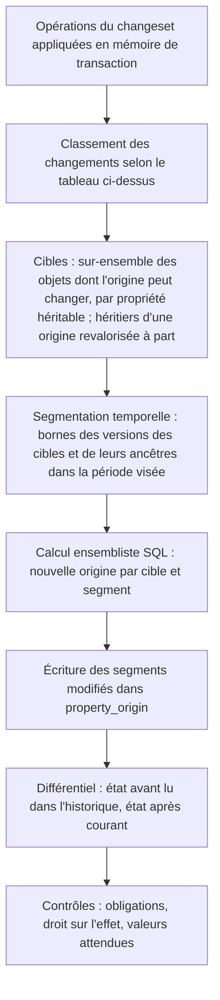

# 003 — Propriétés : conception

## Vue d'ensemble

Les propriétés sont un sous-système du noyau (`kartenn-core` pour les types, les arbres
et la résolution ; `kartenn-service` pour le pipeline ; `kartenn-store-pg` pour le
stockage). Le noyau lui-même déclare `core.owner` et `core.site` (002, ADR 0014) : la 003
est donc sur le chemin critique du RBAC.

Le point dur est la performance de la **résolution** sous trois contraintes à la fois :
héritage le long d'un arbre déduit (D34), bitemporel (D10), et différentiel avec contrôle
des droits à chaque changeset (REQ-003-18, 19). La décision centrale :

> L'**origine** de chaque propriété héritable (l'objet qui porte l'affectation
> applicable) est matérialisée dans une table versionnée comme les autres données (temps
> applicatif et temps système), maintenue **incrémentalement par la couche service dans
> la transaction du changeset**. La valeur se lit par jointure sur l'affectation de
> l'origine. Le différentiel porte sur les objets dont l'origine ou la valeur de
> l'origine change. (ADR 0016, amendé par P9 après le prototype 003.)

## Changements

### Déclarations (REQ-003-1 à 6)

**Modules.** Un module expose ses déclarations dans le code (descripteurs statiques :
clé, type et paramètres, cardinalité, porteurs, héritage et arbre, obligations,
source de valeurs attendues ; jamais d'approbation, 004/C6). La synchronisation
ci-dessous les enregistre et les fait évoluer, sous le contrôle de compatibilité de P8.

**Synchronisation des modules** (P12). Le code du module reste la seule source. Après les
migrations SQL, le job de migration appelle `sync_modules` : pour chaque module, il
compare ses descripteurs aux déclarations courantes de son espace et soumet les écarts
dans **un changeset** de l'auteur `système` (personne créée par migration), de motif
`module sync <module>@<version>` : déclaration d'une clé nouvelle, évolution d'une clé
modifiée (contrôlée par `check_evolution`), ajout des valeurs de liste fermée absentes,
clôture d'une clé disparue du code. Un refus fait échouer le déploiement. Les valeurs de
liste fermée ajoutées par un administrateur ne sont jamais closes par la synchronisation.
Le déclarant d'une opération n'est pas désérialisé depuis l'API : seule la
synchronisation peut déclarer au nom d'un module.

**Administrateurs.** Déclarations de l'espace `custom`, créées et modifiées par
changeset (opérations `declare_property`, `update_property`, `add_enum_value` ;
clôtures par `close` sur les types `property` et `enum_value`). Seuls les types intégrés
sont proposés (P1). Les porteurs d'une déclaration d'administrateur sont des types
connus du noyau, en attendant le registre des types des modules.

- `update_property` remplace la version courante à partir du début de la période du
  changeset, jusqu'à la fin de cette version ; les périodes bornées relèvent du découpage
  général (004-8).
- Clore une propriété clôt ses valeurs de liste fermée (ses composants, pas des
  dépendants) ; elle est refusée s'il reste des affectations sur la période (P8 : on les
  clôt dans le même changeset).
- Les obligations (003-10) se déclarent avec la propriété et évoluent avec elle
  (§ Obligations).

**Stockage** (temporel selon la 004) :

| Table | Contenu |
|---|---|
| `property_declaration` | `id`, `key`, `namespace`, `value_type`, `type_params` (JSON validé par le type), `cardinality` (`single`, `set`), `carriers` (types d'objets), `inherit_tree` (null, `addressing`, `entity`, `site`, ou arbre d'un module), `expected_source` (id, mode : `suggest`, `default`, `check`) |
| `property_obligation` | `property_id`, portée (`domain` + id, `entity` + id, ou `object_type`) |
| `property_enum_value` | `id`, `property_id`, `key` (`[a-z0-9-]`), période de validité |

La permission d'écriture d'une propriété est dérivée de sa clé : `prop.<key>.write`
(REQ-003-17) ; elle sera enregistrée au catalogue de permissions du RBAC à la
déclaration ; ce catalogue arrive avec la 005 (d'ici là, seuls les noms sont dérivés,
`kartenn-core`, `PropertyKey`).

**Compatibilité** (REQ-003-6). Un vérificateur compare l'ancienne et la nouvelle
déclaration ; pour chaque changement non trivialement compatible, il cherche des
affectations ou des valeurs résolues qui deviendraient invalides :

| Changement | Contrôle |
|---|---|
| Paramètres de type plus stricts (bornes, longueur, regex) | Revalider toutes les affectations courantes |
| Changement de type ou de cardinalité | Refusé s'il existe une affectation courante |
| Retrait d'un porteur | Refusé s'il existe une affectation sur ce type d'objet |
| Héritable → non héritable, ou changement d'arbre | Refusé si des valeurs résolues changeraient (objets sans affectation propre qui héritent) |
| Clôture d'une valeur de liste fermée | Refusée si une affectation courante la contient |
| Ajout d'obligation | Refusé si des objets de la portée n'ont pas de valeur résolue |

### Types de valeurs (REQ-003-7 à 10)

Trait `ValueType` dans `kartenn-core` : `parse`, `normalize`, `validate(params)`,
`encode` (vers la colonne de stockage), `compare` ; un module peut en enregistrer d'autres
(compilés). Types intégrés :

| Type | Normalisation et validation | Colonne |
|---|---|---|
| `enum` | valeur de liste fermée valide à la date de l'affectation | `v_uuid` / `v_uuids` |
| `text` | NFC ; pas de caractère de contrôle (catégorie Cc) ; longueur en points de code ; regex optionnelle (crate `regex`, sans retour arrière, donc sans risque de ReDoS) | `v_text` / `v_texts` |
| `int` | `i64`, bornes | `v_int` / `v_ints` |
| `bool` | — | `v_bool` |
| `date` | RFC 3339 `full-date` stricte | `v_date` / `v_dates` |
| `fqdn` | UTS #46 non transitional, `UseSTD3ASCIIRules`, `CheckHyphens`, longueurs DNS ; A-label, minuscules, sans point final ; refus des Fake A-labels et des noms en forme d'adresse IPv4 ([note](../../docs/reference/noms-dates-texte.md)) | `v_text` / `v_texts` |
| `ref` | UUID d'un objet du type cible, valide sur toute la période de l'affectation | `v_uuid` / `v_uuids` |

Ensembles : tableaux PostgreSQL triés et dédoublonnés à l'écriture (REQ-003-9), ce qui
rend l'égalité d'ensemble triviale (égalité de tableaux).

**Références** (REQ-003-10) : la clôture d'un objet cible est refusée s'il reste des
affectations qui le référencent sur la période ; contrôle applicatif, appuyé par un
index GIN sur `v_uuids` et B-tree sur `v_uuid`.

### Affectations (REQ-003-12, 13)

| Table | Contenu |
|---|---|
| `property_assignment` | `object_id`, `object_type`, `property_id`, `kind` (`value`, `cleared`), colonnes de valeur, `provenance` (`input`, ou `source:<id>@<version>`), période de validité, changeset |

Contrainte : une seule affectation par (objet, propriété) et par période.

Une affectation n'a pas d'identifiant propre : elle est désignée par (objet, propriété),
qui sert de clé de version (clé primaire `WITHOUT OVERLAPS` et index d'historique) ;
de même pour `property_origin`. Les déclarations, obligations et valeurs de liste fermée
ont un `id`. Une valeur porte exactement une colonne de valeur, une affectation
`cleared` aucune (contrainte `CHECK`). Migration 0011.

### Arbres d'héritage (REQ-003-11)

Trait `InheritanceTree` (`kartenn-core`) :

- `ancestors(object, at)` : chaîne ordonnée du parent à la racine ;
- `scope_of_change(change)` : ensemble des objets dont la chaîne d'ancêtres peut changer
  du fait d'un changement structurel, exprimé comme prédicat de requête.

| Arbre | Ancêtres | Portée d'un changement structurel |
|---|---|---|
| `addressing` | préfixes du domaine qui contiennent l'objet, triés par longueur décroissante, puis le domaine | tous les objets du domaine contenus dans l'ancienne **et** la nouvelle valeur du préfixe créé, clos, redimensionné ou dont la nature change |
| `entity` | parents stockés | descendants de l'entité déplacée |
| `site` | parents stockés | descendants du site déplacé |

Une adresse ou une plage a pour premier ancêtre son réseau, jamais une plage (P3).

### Résolution matérialisée (REQ-003-11 à 15, 25, 26) — ADR 0016

| Table | Contenu |
|---|---|
| `property_origin` | `object_id`, `property_id`, `origin_object_id` (objet qui porte l'affectation retenue, jamais nul : P13), période de validité, période système |

- Une ligne par (objet porteur ou héritier, propriété **héritable**) et par segment de
  temps applicatif où l'origine est constante. Les propriétés non héritables ne sont
  pas matérialisées : leur affectation est la valeur (P9).
- **Pas de ligne sans origine** (P13) : un objet sans affectation propre ni héritée n'a
  pas de ligne ; l'origine d'une ligne n'est jamais nulle (un effacement est une
  origine). Déclarer une propriété ou créer un objet n'écrit donc rien par défaut ; le
  filtre « absent » est une anti-jointure.
- **Valeur** : jointure de `origin_object_id` sur l'affectation courante de la même
  propriété (index `(property_id, object_id)` des affectations).
- **Versionnée en temps système** comme le reste (004) : `as_of` dans le passé se sert
  de l'historique de la table et de celui des affectations, sans recalcul (budget
  INV-33).
- **Explication** (REQ-003-14) : `origin_object_id` donne l'origine ; la chaîne est
  reconstituée par `ancestors(object, valid_at)` jusqu'à l'origine ; la provenance et la
  valeur remplacée viennent des affectations.

**Maintenance incrémentale** dans la transaction du changeset, après les écritures du
noyau. Le tableau donne les origines qui changent selon le changement
([prototype 003](../../docs/spikes/003-resolution.md)) ; les **écritures** sont
proportionnelles à ces changements, mais le **calcul** porte sur un sur-ensemble de
cibles (toute la portée de l'objet dont la présence d'affectation change ; voir la
mise en œuvre ci-dessous) :

| Changement | Effet sur `property_origin` | Différentiel |
|---|---|---|
| Valeur d'une affectation existante modifiée | aucun | objets dont l'origine est cet objet |
| Nouvelle affectation sur P, ou insertion d'un préfixe P qui en porte | pour les seules propriétés affectées sur P : objets de la portée de P dont l'origine est strictement plus haut que P → origine P | ces objets |
| Effacement ou suppression d'affectation, clôture ou redimensionnement de P | objets dont l'origine est P → ancêtre le plus proche portant une affectation | ces objets |
| Insertion d'un préfixe sans affectation | aucun | aucun |

- **Arrêt de propagation** : un descendant qui porte sa propre affectation borne la
  propagation (REQ-003-12) : son origine est lui-même, jamais un ancêtre, donc il n'est
  jamais ciblé par la règle 2.
- **Calcul ensembliste** : une requête par propriété héritable, pas de boucle objet par
  objet ; les candidats (l'objet, les préfixes de son domaine qui le contiennent, son
  domaine) sont trouvés en remontant de chaque cible ou en descendant des porteurs (voir
  la mise en œuvre).
- **Segmentation temporelle** : la période visée par le changeset est découpée aux bornes
  des versions des objets concernés (préfixes ancêtres et affectations) ; chaque segment
  est résolu, puis les segments adjacents de même valeur sont fusionnés.
- **Mise en œuvre (003-8)** : le service classe les écritures du changeset et donne
  les cibles par propriété (objets nouveaux ; sous-arbre d'un objet dont l'affectation
  est écrite ou retirée ; objet clos et objets dont il est l'origine ; tous les objets
  de l'arbre quand la déclaration change) ; l'adaptateur recalcule leurs segments à partir du
  début de la période du changeset jusqu'à l'infini (requête ensembliste
  `refresh_origins`), fusionne les segments contigus de même origine et n'écrit que les
  lignes qui diffèrent. **Ciblage (003-16)** : une affectation qui ne change que la
  valeur (l'objet portait déjà une affectation, valeur ou effacement, sur toute la
  fenêtre) ne déplace aucune origine : ses héritiers sont listés, rien n'est recalculé.
  Sinon toute la portée de l'objet est recalculée (sur-ensemble : seules les écritures
  sont proportionnelles aux changements d'origine ; mesuré suffisant au banc). Les
  candidats sont cherchés en remontant de chaque cible (un sondage d'index par cible) ou,
  à partir de 50 000 cibles, en descendant des objets qui portent une affectation dans
  les domaines des cibles (un parcours d'index par porteur) : même résultat, 8,6 s au
  lieu de 34 s pour 1,19·10⁶ cibles ; le test contre l'oracle couvre les deux sens.
- **Affectations** : opérations `assign_property`, `clear_property` (effacement
  explicite) et `unassign_property` sur la période du changeset ; la portion visée des
  affectations existantes est retirée (fonction `kartenn_unassign`, migration 0014).
  Clore un objet clôt ses affectations (ce sont ses attributs).
- **Arbres `entity` et `site`** : entités et sites existent avec leurs opérations (002-22),
  mais l'héritage le long de ces arbres n'est pas encore maintenu : une déclaration
  héritable sur l'un d'eux est refusée (`prop.declaration.invalid`) jusqu'à la tâche 18.
- **Héritiers** : l'origine est calculée pour tout objet de l'arbre d'adressage, porteur
  ou non (`core.owner` est porté par les domaines et préfixes, résolu sur les adresses).
- **Objets nouveaux** : résolus de la même façon, mais exclus du contrôle de droit sur
  l'effet (REQ-003-18).

### Obligations (REQ-003-16)

Après résolution, pour chaque propriété obligatoire dont la portée contient un objet
touché ou créé : toute valeur résolue absente (ou effacée) produit une erreur
`prop.assignment.required` listant les objets. Les valeurs par défaut (REQ-003-22) sont appliquées
**avant** ce contrôle.

- **Objets touchés** : ceux que le changeset crée, ceux dont l'origine a été recalculée
  et ceux qu'il affecte directement. Le contrôle porte sur toute la fenêtre du changeset
  (comme le différentiel) et sur les seuls porteurs de la portée.
- **Déclaration** : les obligations font partie de la déclaration (`obligations`, liste
  de portées) ; une déclaration nouvelle ou une évolution qui ajoute une portée est
  refusée si des objets de cette portée n'ont pas de valeur, en les listant
  (`prop.assignment.required`).
- **Portée « entité »** : refusée jusqu'à la tâche 18 (objets dont le propriétaire résolu
  est l'entité ou l'une de ses descendantes) ; seules les portées « domaine » et « type
  d'objet » sont acceptées.

### Droits (REQ-003-17, 18)

- **Affectation directe** : `prop.<key>.write` sur le périmètre de l'objet.
- **Effet indirect** : pour chaque (propriété, objet existant) du différentiel, même
  permission. L'appel au RBAC (005) est **groupé** : `authorize_many(subject,
  permission, objets)` renvoie les objets refusés. Le RBAC résout les périmètres par
  `core.owner` et l'arbre d'adressage, eux-mêmes matérialisés.
- Sans droit d'écriture, refus `prop.assignment.forbidden_effect`, sauf si l'auteur détient
  `prop.<key>.propose` : le changeset devient une proposition en attente
  (004/REQ-004-41).
- **Mise en œuvre (003-11)** : contrôle après le différentiel, dans la transaction ;
  objets demandés = objets affectés directement (objets nouveaux compris) ∪ objets du
  différentiel (existants seulement), une requête `authorize_many` par propriété ; le
  refus liste les objets. `submit` reçoit l'`Authorizer` ; d'ici la 005, `Grants`
  (droits explicites, pour les tests) et `Unrestricted` (tâches système, tests hors
  droits) en sont les implémentations. **Écart provisoire** : la bascule en proposition
  arrive avec la machine d'états (004-12, 004-14) ; d'ici là, un auteur qui ne détient
  que `…propose` est refusé, avec un message qui le signale.

### Différentiel (REQ-003-19, 20)

- Produit par l'étape G ci-dessus ; renvoyé avec le résultat du changeset : décompte par
  (propriété, ancienne valeur, nouvelle valeur), puis détail paginé (stocké avec le
  changeset pour consultation ultérieure).
- **Simulation** : même pipeline, transaction annulée (`ROLLBACK`) à la fin ; le résultat
  est renvoyé sans rien écrire.
- **Calcul (003-9)** : sur toute la fenêtre du changeset (du début de sa période à
  l'infini), pas seulement à sa date d'effet, pour qu'aucun effet différé n'échappe aux
  contrôles qui en dépendent (droits, approbation). L'état « avant » est celui d'avant la
  transaction : versions courantes antérieures à elle et versions qu'elle a remplacées
  (historique de temps système clos à l'instant de la transaction). Pour chaque objet
  cible, les valeurs résolues avant et après sont comparées segment par segment ; une
  entrée par (propriété, objet, avant, après) distincts. Objets exclus : ceux que le
  changeset crée, et les instants où l'objet n'existe plus. Valeur : clés pour une liste
  fermée, JSON sinon ; absence et effacement sont tous deux « aucune valeur ».
- **Origine revalorisée (003-16)** : pour les héritiers d'une origine dont seule la
  valeur change, les valeurs avant et après sont celles de l'origine : sa chronologie
  est découpée une fois et ses héritiers sont lus par l'index des origines, au lieu de
  découper la chronologie de chaque héritier (8,4 s au lieu de 128 s pour 10⁶ héritiers,
  changeset entier).
- **Plans** : les statistiques d'une propriété écrite dans le changeset en cours sont
  périmées ; le calcul général joint donc sans boucle imbriquée (`enable_nestloop` coupé
  pour cette instruction), et la recherche des affectations des candidats est isolée
  (`OFFSET 0`). Sans ces précautions, un changeset sur une propriété neuve ne finissait
  pas en 90 min au banc.
- **Restitution** : le résultat d'un changeset appliqué porte le décompte ; le détail est
  stocké (`changeset_diff`, ordonné) et lu par pages. Une simulation renvoie le décompte
  et les 100 premières entrées du détail.

### Valeurs attendues (REQ-003-21 à 24)

Trait `ExpectedValueSource` : `id`, `version`, `expected(object, at, view) ->
Option<(Value, Explanation)>` ; `view` ne donne accès qu'au noyau et aux propriétés
résolues (lecture seule). Modes configurés dans la déclaration :

| Mode | Effet |
|---|---|
| `suggest` | Endpoint de suggestion (REQ-003-23), rien d'écrit |
| `default` | À la création d'un objet sans affectation, affectation de la valeur attendue avec la provenance `source:<id>@<version>` (REQ-003-22), avant les obligations |
| `check` | Après résolution, sur les objets touchés : écart entre valeur résolue et attendue → anomalie `prop.resolution.expected_mismatch` (REQ-003-24) |

Quand la version d'une source change, un **job** de worker réévalue les écarts sur tous
les porteurs, par lots. La v0.1 ne fournit **aucune** source ; le moteur de règles arrive
en v0.2 (spec 010).

**Mise en œuvre (003-13)** :

- Le trait (service) reçoit une **vue figée** de l'objet : identifiant, type, domaine,
  valeur (préfixe, première adresse, adresse) et valeurs résolues de ses propriétés à la
  date (JSON par clé) ; il renvoie des valeurs brutes (comme une saisie) et une
  explication. Les sources sont compilées et réunies dans un registre (`Sources`) passé à
  `submit_with` ; `submit` n'en a aucune (la v0.1 n'en livre pas).
- La déclaration nomme la source et le mode (`expected`) ; une source absente du
  registre est refusée (`prop.declaration.invalid`). Une suggestion reste possible quel
  que soit le mode.
- **`default`** : après les écritures, avant la résolution, pour chaque objet créé d'un
  type porteur sans affectation de la propriété dans le changeset ; la valeur est
  validée comme une saisie, puis écrite avec la provenance `source:<id>@<version>`. Elle
  entre dans la résolution, les obligations et le différentiel comme une affectation ; elle
  n'exige pas de droit direct (ce n'est pas un choix de l'auteur), mais ses effets sur des
  objets existants restent soumis au droit sur l'effet.
- **`check`** : sur les objets touchés (comme les obligations), à la date d'effet ; un
  écart produit l'avertissement `prop.resolution.expected_mismatch`, donc une anomalie
  ouverte sur l'objet, qui cite la propriété, les deux valeurs et l'explication.

### Filtrage (REQ-003-25)

Propriété héritable : la requête part des **affectations** qui portent la valeur
cherchée dans le domaine (petit ensemble d'origines), puis des objets résolus vers elles
par `property_origin` (index couvrant `(property_id, origin_object_id, object_id)`, migration
0017, lu sans accès à la table) ; un objet et son origine sont toujours dans le même
domaine, et une ligne d'origine reste dans la validité de son objet : aucune jointure sur
les objets. Les filtres s'exécutent en instructions non préparées : un plan générique ne
distingue pas une borne ouverte d'une borne fermée et délaisse les index de valeur. Partir des objets coûtait 1,25 s au prototype ;
partir des origines, 27 à 78 ms. Propriété non héritable : filtre direct sur les
affectations.

| Filtre sur les affectations | Index |
|---|---|
| égalité, intervalle (int, date, text) | B-tree `(property_id, v_int)`, `(property_id, v_date)`, `(property_id, v_text)` |
| appartenance (enum, ref, ensembles) | B-tree `(property_id, v_uuid)` ; GIN sur `v_uuids`, `v_texts` |
| présence / absence | anti-jointure sur `property_origin` (héritable, pas de ligne sans origine, P13) ou sur les affectations (non héritable) |

Les filtres se combinent avec les filtres du noyau et le filtrage RBAC (prédicats SQL).

**Mise en œuvre (003-15)** :

- Lecture `filter(propriété, domaine, condition, date, curseur, taille)` : page d'objets
  triés par identifiant (curseur = dernier identifiant). Conditions : égalité,
  appartenance (une valeur parmi plusieurs ; pour un ensemble, au moins un élément en
  commun), intervalle (entier, date, texte), présence, absence. Les valeurs se donnent
  comme une saisie (clé de liste fermée, texte, entier, date, identifiant) et sont
  traduites selon le type de la propriété. Absence = porteurs du domaine et, pour une
  propriété héritable, préfixes, plages et adresses (héritiers même non porteurs), sans
  origine portant une valeur (P13) ; l'effacement compte comme absence.
- Date d'application seule ; la lecture à une date système passée viendra avec l'API
  (006), sur le même principe que l'explication.
- **Réévaluation des écarts** : chaque source a un état (`expected_source_state` :
  version évaluée) ; `reevaluate_outdated` réévalue, par lots, tous les porteurs des
  propriétés en mode `check` dont la source a changé de version, ouvre et ferme les
  anomalies, puis enregistre la version. Chaque lot est journalisé comme un changeset de
  l'auteur « système » sans opération (motif `expected re-evaluation <source>@<version>`),
  pour que les anomalies aient un changeset d'ouverture et que l'audit montre le passage.

## Erreurs et cas limites

| Cas | Comportement | REQ |
|---|---|---|
| Affectation sur un type d'objet non porteur | `prop.assignment.not_carrier` | 4 |
| Valeur invalide pour le type | `prop.assignment.invalid_value`, contrainte citée | 8 |
| Valeur de liste fermée close à la date | `prop.assignment.invalid_value` | 5, 8 |
| `custom.x` créée par un module, ou `policy.y` par un administrateur | `prop.declaration.namespace` | 2 |
| Insertion d'un conteneur sans affectation entre un parent `{prod}` et un enfant `{dev}` | Aucun changement de valeur résolue : pas de contrôle de droit | 18 |
| Clôture d'un préfixe qui porte `{dev}` sous un parent `{prod}` | Différentiel `{dev}` → `{prod}` sur ses descendants ; `prop.assignment.forbidden_effect` sans droit | 18, 19 |
| Changeset qui crée un réseau, ses adresses et affecte une propriété au réseau | Objets nouveaux : pas de contrôle d'effet ; droit direct exigé pour l'affectation | 17, 18 |
| Changeset qui change la valeur portée par 10⁶ objets | Aucune réécriture ; différentiel : décompte immédiat, détail paginé ; budget < 10 s | 19, 26 |
| Changeset qui change l'origine de plus de 10⁵ objets (clôture très haute) | Décompte d'abord (simulation) ; application atomique ; budget < 60 s (P10) | 19, 26 |
| Effacement explicite sur une portée obligatoire | `prop.assignment.required` | 13, 16 |
| Référence vers un objet qui sera clos dans le même changeset | Évalué sur l'état final : refus `prop.assignment.dangling_reference` | 10 |
| Cycle d'entités ou de sites | Refusé par le noyau (`core.anchor.cycle`) avant la résolution | 11 |

## Alternatives considérées

- **Matérialiser la valeur résolue** (conception initiale) : lecture sans jointure, mais
  chaque changement réécrit la valeur sur tous les héritiers ; 3,2 s pour 1,6×10⁴
  objets et 16 s pour 7,6×10⁵ au prototype 003. Rejetée (P9).
- **Résolution à la lecture, sans matérialisation** : simple et toujours juste, mais
  filtrer 10⁶ objets par valeur héritée et calculer un différentiel de 10⁴ objets en
  moins d'1 s deviennent hors budget. Rejetée.
- **Maintenance par déclencheurs PostgreSQL** : cohérente par construction, mais la
  logique (arbres, segmentation, droits sur l'effet) serait dupliquée en PL/pgSQL et le
  différentiel ne remonterait pas naturellement à l'application. Rejetée.
- **Matérialisation sans temps système** (recalcul pour `as_of` passé) : économise de la
  place, mais `as_of` passé dépasserait le budget ×2. Rejetée.
- **Stockage EAV en JSONB** : souple, mais validation, typage et index plus faibles.
  Rejeté (P2).
- **Une table par type de valeur** : propre, mais multiplie les jointures pour un filtrage
  multi-propriétés. Rejetée au profit de colonnes typées dans une table.

## Risques et migration

- **Volume de `property_origin`** : environ 3 propriétés héritables × 10⁶ objets ×
  segments × versions système (3,6×10⁶ lignes courantes au prototype) ; partitionnement
  par `property_id` si nécessaire.
- **Coût des changements d'origine hauts dans l'arbre** (racine ou conteneur `/8` clos) :
  ≈ 30 µs par objet, doublé par l'historique ; au-delà de 10⁵ objets, budget < 60 s avec
  décompte préalable (P10).
- **Segmentation temporelle** : source probable de bugs subtils ; couverte par des tests
  de propriétés comparant la table matérialisée à une résolution naïve.
- **Dépendance au RBAC (005)** pour `authorize_many` : interface fixée ici, implémentée là.
- **Crates `idna`, `unicode-normalization`, `regex`** : conformité à vérifier par des tests
  (cas de la note de référence) à leur introduction.

## Stratégie de test

| Exigences | Type de test |
|---|---|
| 1 à 6 | Intégration : déclarations de module et d'administrateur ; vérificateur de compatibilité, un cas par ligne du tableau |
| 7 à 9 | Unitaires par type ; tests de propriétés (normalisation idempotente, encodage ↔ décodage) ; FQDN : cas de la note de référence (`straße`, Fake A-label, `10.1.2.3`) |
| 10 | Intégration : clôture d'une cible référencée |
| 11 à 15 | **Oracle naïf** : un résolveur de référence non matérialisé, comparé à `property_origin` (jointe aux affectations) après des suites aléatoires de changesets (tests de propriétés), y compris dans le temps |
| 16 | Intégration : obligation, effacement, valeur par défaut avant contrôle |
| 17, 18 | Intégration avec un RBAC de test : chaque ligne de la table des cas limites |
| 19, 20 | Intégration : décompte et détail ; simulation sans écriture (état inchangé) |
| 21 à 24 | Source de test dans les tests : suggestion, défaut avec provenance, anomalie d'écart, job de réévaluation |
| 25 | Intégration : chaque type de filtre ; plans d'exécution vérifiés (index utilisés) |
| 26 | Banc CI sur le jeu synthétique de la 002 + 10 propriétés ; seuils bloquants |

**Banc REQ-003-26 (003-16)** : `kartenn-bench props <base> <graine>` migre une base vide,
y charge le jeu de la 002 (`COPY`), déclare 3 propriétés héritables (ensembles de liste
fermée) et 7 non héritables (entiers, 20 % des adresses, chargés par `COPY`), affecte les
héritables par le pipeline (racines des domaines, puis 3 % des préfixes), puis mesure,
par le service et l'adaptateur réels :

| Mesure | Seuil | Mesuré (2026-10-15, graine 42) |
|---|---|---|
| Première valeur sur toutes les racines (1,19·10⁶ changements d'origine, P10) | < 60 s | 41,8 s |
| Explication d'une propriété pour une adresse, p95 sur 200 tirages | < 50 ms | 32 ms |
| Page filtrée de 100, égalité sur héritable, p95 sur 100 tirages | < 150 ms | 16 ms |
| Page filtrée de 100, intervalle sur non héritable, p95 sur 100 tirages | < 150 ms | 72 ms |
| Changeset dont le différentiel touche ≤ 10⁴ objets (affectation d'un conteneur de 7 409 adresses ; 8 315 objets changent) | < 2,5 s (P14) | 1,82 s (2,07 s au passage précédent) |
| Changement de valeur de toutes les racines (≈ 10⁶ objets, sans changement d'origine) | < 10 s | 9,1 s |
| Retrait des racines de 3 domaines (> 10⁵ changements d'origine, P10) | < 60 s | 13,8 s |

Les mesures portent sur le changeset entier (pipeline, historique, journal, validation).
Pour le cas ≤ 10⁴, le temps se répartit entre l'écriture des origines avec leur historique
(≈ 0,55 s), le calcul des segments (≈ 0,45 s : un sondage d'index d'environ 30 µs par
cible), le différentiel (≈ 0,4 s), la relecture des origines et le journal (≈ 0,2 s).
Le prototype (1 s visé, 0,63 s mesuré) ne comptait ni l'historique ni le journal ; le
seuil est porté à 2,5 s pour le changeset entier (P14). Pistes notées si le besoin s'en
fait sentir : différentiel tiré des origines déjà calculées en mémoire, troncature par
mise à jour plutôt que suppression et insertion (gain estimé ≈ 0,5 s).

Le programme sort en erreur si un seuil est dépassé. Il s'exécute par le script devenv
`bench-properties` (base `kartenn_bench` recréée) ; son branchement dans la CI attend la
mise en place de celle-ci, comme le banc de la 002 (002-27).

## ADR

- [`docs/adr/0016-resolution-materialisee-proprietes.md`](../../docs/adr/0016-resolution-materialisee-proprietes.md) (accepté)
