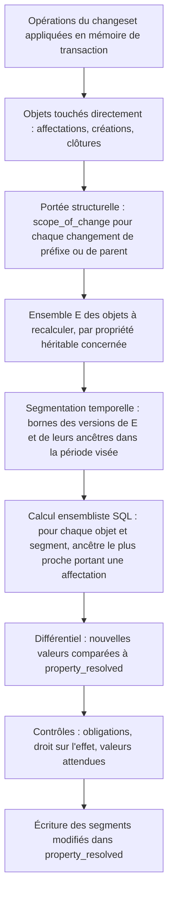

# 003 — Propriétés : conception

## Vue d'ensemble

Les propriétés sont un sous-système du noyau (`kartenn-core` pour les types, les arbres
et la résolution ; `kartenn-service` pour le pipeline ; `kartenn-store-pg` pour le
stockage). Le noyau lui-même déclare `core.owner` et `core.site` (002, ADR 0014) : la 003
est donc sur le chemin critique du RBAC.

Le point dur est la performance de la **résolution** sous trois contraintes à la fois :
héritage le long d'un arbre déduit (D34), bitemporel (D10), et différentiel avec contrôle
des droits à chaque changeset (REQ-003-18, 19). La décision centrale :

> Les **valeurs résolues sont matérialisées** dans une table versionnée comme les autres
> données (temps applicatif et temps système), maintenue **incrémentalement par la
> couche service dans la transaction du changeset**. Le différentiel est la différence
> entre les valeurs matérialisées avant et après, sur l'ensemble des objets touchés.
> (ADR 0016, proposé.)

## Changements

### Déclarations (REQ-003-1 à 6)

**Modules.** Un module expose ses déclarations dans le code (descripteurs statiques :
clé, type et paramètres, cardinalité, porteurs, héritage et arbre, obligations,
approbation, source de valeurs attendues). Une migration du module les enregistre en base ;
leur évolution passe par une migration de module (P8).

**Administrateurs.** Déclarations de l'espace `custom`, créées et modifiées par
changeset (opérations `declare_property`, `update_property`, `close_property`,
`add_enum_value`, `close_enum_value`). Seuls les types intégrés sont proposés (P1).

**Stockage** (temporel selon la 004) :

| Table | Contenu |
|---|---|
| `property_declaration` | `id`, `key`, `namespace`, `value_type`, `type_params` (JSON validé par le type), `cardinality` (`single`, `set`), `carriers` (types d'objets), `inherit_tree` (null, `addressing`, `entity`, `site`, ou arbre d'un module), `requires_approval`, `expected_source` (id, mode : `suggest`, `default`, `check`) |
| `property_obligation` | `property_id`, portée (`domain` + id, `entity` + id, ou `object_type`) |
| `property_enum_value` | `id`, `property_id`, `key` (`[a-z0-9-]`), période de validité |

La permission d'écriture d'une propriété est dérivée de sa clé : `prop.<key>.write`
(REQ-003-17) ; elle est enregistrée au catalogue de permissions du RBAC (005) à la
déclaration.

**Compatibilité** (REQ-003-6). Un vérificateur compare l'ancienne et la nouvelle
déclaration ; pour chaque changement non trivialement compatible, il cherche des
affectations ou des valeurs résolues qui deviendraient invalides :

| Changement | Contrôle |
|---|---|
| Paramètres de type plus stricts (bornes, longueur, regex) | Revalider toutes les affectations courantes |
| Changement de type ou de cardinalité | Refusé s'il existe une affectation courante |
| Retrait d'un porteur | Refusé s'il existe une affectation sur ce type d'objet |
| Héritable → non héritable, ou changement d'arbre | Refusé si des valeurs résolues changeraient (objets sans affectation propre qui héritent) |
| Clôture d'une valeur de liste fermée | Refusée si une affectation courante la contient |
| Ajout d'obligation | Refusé si des objets de la portée n'ont pas de valeur résolue |

### Types de valeurs (REQ-003-7 à 10)

Trait `ValueType` dans `kartenn-core` : `parse`, `normalize`, `validate(params)`,
`encode` (vers la colonne de stockage), `compare` ; un module peut en enregistrer d'autres
(compilés). Types intégrés :

| Type | Normalisation et validation | Colonne |
|---|---|---|
| `enum` | valeur de liste fermée valide à la date de l'affectation | `v_uuid` / `v_uuids` |
| `text` | NFC ; pas de caractère de contrôle (catégorie Cc) ; longueur en points de code ; regex optionnelle (crate `regex`, sans retour arrière, donc sans risque de ReDoS) | `v_text` / `v_texts` |
| `int` | `i64`, bornes | `v_int` / `v_ints` |
| `bool` | — | `v_bool` |
| `date` | RFC 3339 `full-date` stricte | `v_date` / `v_dates` |
| `fqdn` | UTS #46 non transitional, `UseSTD3ASCIIRules`, `CheckHyphens`, longueurs DNS ; A-label, minuscules, sans point final ; refus des Fake A-labels et des noms en forme d'adresse IPv4 ([note](../../docs/reference/noms-dates-texte.md)) | `v_text` / `v_texts` |
| `ref` | UUID d'un objet du type cible, valide sur toute la période de l'affectation | `v_uuid` / `v_uuids` |

Ensembles : tableaux PostgreSQL triés et dédoublonnés à l'écriture (REQ-003-9), ce qui
rend l'égalité d'ensemble triviale (égalité de tableaux).

**Références** (REQ-003-10) : la clôture d'un objet cible est refusée s'il reste des
affectations qui le référencent sur la période ; contrôle applicatif, appuyé par un
index GIN sur `v_uuids` et B-tree sur `v_uuid`.

### Affectations (REQ-003-12, 13)

| Table | Contenu |
|---|---|
| `property_assignment` | `object_id`, `object_type`, `property_id`, `kind` (`value`, `cleared`), colonnes de valeur, `provenance` (`input`, ou `source:<id>@<version>`), période de validité, changeset |

Contrainte : une seule affectation par (objet, propriété) et par période (exclusion GiST
sur `object_id` et `property_id` en `uuid` via btree_gist, et `valid_period`).

### Arbres d'héritage (REQ-003-11)

Trait `InheritanceTree` (`kartenn-core`) :

- `ancestors(object, at)` : chaîne ordonnée du parent à la racine ;
- `scope_of_change(change)` : ensemble des objets dont la chaîne d'ancêtres peut changer
  du fait d'un changement structurel, exprimé comme prédicat de requête.

| Arbre | Ancêtres | Portée d'un changement structurel |
|---|---|---|
| `addressing` | préfixes du domaine qui contiennent l'objet, triés par longueur décroissante, puis le domaine | tous les objets du domaine contenus dans l'ancienne **et** la nouvelle valeur du préfixe créé, clos, redimensionné ou dont la nature change |
| `entity` | parents stockés | descendants de l'entité déplacée |
| `site` | parents stockés | descendants du site déplacé |

Une adresse ou une plage a pour premier ancêtre son réseau, jamais une plage (P3).

### Résolution matérialisée (REQ-003-11 à 15, 25, 26) — ADR 0016

| Table | Contenu |
|---|---|
| `property_resolved` | `object_id`, `property_id`, valeur résolue (mêmes colonnes typées, ou absente), `origin_object_id` (objet qui porte l'affectation retenue, ou null), période de validité, période système |

- Une ligne par (objet porteur ou héritier, propriété héritable ou affectée) et par
  segment de temps applicatif où la valeur est constante. Pour une propriété non
  héritable, la table reflète simplement les affectations (uniformité du filtrage).
- **Versionnée en temps système** comme le reste (004) : `as_of` dans le passé se sert
  de l'historique de la table, sans recalcul (budget INV-33).
- **Explication** (REQ-003-14) : `origin_object_id` donne l'origine ; la chaîne est
  reconstituée par `ancestors(object, valid_at)` jusqu'à l'origine ; la provenance et la
  valeur remplacée viennent des affectations.

**Maintenance incrémentale** dans la transaction du changeset, après les écritures du
noyau :

- **Arrêt de propagation** : un descendant qui porte sa propre affectation borne la
  propagation (REQ-003-12) ; le calcul ensembliste le prend en compte naturellement
  (ancêtre le plus proche).
- **Calcul ensembliste** : une requête par propriété héritable, `LATERAL` sur les ancêtres
  (`prefix >>= objet` dans le domaine, trié par longueur décroissante) joints aux
  affectations courantes ; pas de boucle objet par objet.
- **Segmentation temporelle** : la période visée par le changeset est découpée aux bornes
  des versions des objets concernés (préfixes ancêtres et affectations) ; chaque segment
  est résolu, puis les segments adjacents de même valeur sont fusionnés.
- **Objets nouveaux** : résolus de la même façon, mais exclus du contrôle de droit sur
  l'effet (REQ-003-18).

### Obligations (REQ-003-16)

Après résolution, pour chaque propriété obligatoire dont la portée contient un objet
touché ou créé : toute valeur résolue absente (ou effacée) produit une erreur
`prop.required` listant les objets. Les valeurs par défaut (REQ-003-22) sont appliquées
**avant** ce contrôle.

### Droits (REQ-003-17, 18)

- **Affectation directe** : `prop.<key>.write` sur le périmètre de l'objet.
- **Effet indirect** : pour chaque (propriété, objet existant) du différentiel, même
  permission. L'appel au RBAC (005) est **groupé** : `authorize_many(subject,
  permission, objets)` renvoie les objets refusés. Le RBAC résout les périmètres par
  `core.owner` et l'arbre d'adressage, eux-mêmes matérialisés.
- Si `requires_approval` est vrai pour une propriété du différentiel, le changeset passe
  en attente au lieu d'être refusé quand l'auteur n'a pas le droit, si une politique
  d'approbation existe (004, 005) ; sinon refus `prop.forbidden_effect`.

### Différentiel (REQ-003-19, 20)

- Produit par l'étape G ci-dessus ; renvoyé avec le résultat du changeset : décompte par
  (propriété, ancienne valeur, nouvelle valeur), puis détail paginé (stocké avec le
  changeset pour consultation ultérieure).
- **Simulation** : même pipeline, transaction annulée (`ROLLBACK`) à la fin ; le résultat
  est renvoyé sans rien écrire.

### Valeurs attendues (REQ-003-21 à 24)

Trait `ExpectedValueSource` : `id`, `version`, `expected(object, at, view) ->
Option<(Value, Explanation)>` ; `view` ne donne accès qu'au noyau et aux propriétés
résolues (lecture seule). Modes configurés dans la déclaration :

| Mode | Effet |
|---|---|
| `suggest` | Endpoint de suggestion (REQ-003-23), rien d'écrit |
| `default` | À la création d'un objet sans affectation, affectation de la valeur attendue avec la provenance `source:<id>@<version>` (REQ-003-22), avant les obligations |
| `check` | Après résolution, sur les objets touchés : écart entre valeur résolue et attendue → anomalie `prop.expected_mismatch` (REQ-003-24) |

Quand la version d'une source change, un **job** de worker réévalue les écarts sur tous
les porteurs, par lots. La v0.1 ne fournit **aucune** source ; le moteur de règles arrive
en v0.2 (spec 010).

### Filtrage (REQ-003-25)

Sur `property_resolved` (versions courantes, segment contenant `valid_at`) :

| Filtre | Index |
|---|---|
| égalité, intervalle (int, date, text) | B-tree `(property_id, v_int)`, `(property_id, v_date)`, `(property_id, v_text)` |
| appartenance (enum, ref, ensembles) | B-tree `(property_id, v_uuid)` ; GIN sur `v_uuids`, `v_texts` |
| présence / absence | index partiel sur valeur absente |

Les filtres se combinent avec les filtres du noyau et le filtrage RBAC (prédicats SQL).

## Erreurs et cas limites

| Cas | Comportement | REQ |
|---|---|---|
| Affectation sur un type d'objet non porteur | `prop.not_carrier` | 4 |
| Valeur invalide pour le type | `prop.invalid_value`, contrainte citée | 8 |
| Valeur de liste fermée close à la date | `prop.invalid_value` | 5, 8 |
| `custom.x` créée par un module, ou `policy.y` par un administrateur | `prop.namespace_forbidden` | 2 |
| Insertion d'un conteneur sans affectation entre un parent `{prod}` et un enfant `{dev}` | Aucun changement de valeur résolue : pas de contrôle de droit | 18 |
| Clôture d'un préfixe qui porte `{dev}` sous un parent `{prod}` | Différentiel `{dev}` → `{prod}` sur ses descendants ; `prop.forbidden_effect` sans droit | 18, 19 |
| Changeset qui crée un réseau, ses adresses et affecte une propriété au réseau | Objets nouveaux : pas de contrôle d'effet ; droit direct exigé pour l'affectation | 17, 18 |
| Changeset qui reclasse 10⁶ objets | Différentiel : décompte immédiat, détail paginé ; budget < 10 s | 19, 26 |
| Effacement explicite sur une portée obligatoire | `prop.required` | 13, 16 |
| Référence vers un objet qui sera clos dans le même changeset | Évalué sur l'état final : refus `prop.dangling_reference` | 10 |
| Cycle d'entités ou de sites | Refusé par le noyau (`core.anchor.cycle`) avant la résolution | 11 |

## Alternatives considérées

- **Résolution à la lecture, sans matérialisation** : simple et toujours juste, mais
  filtrer 10⁶ objets par valeur héritée et calculer un différentiel de 10⁴ objets en
  moins d'1 s deviennent hors budget. Rejetée.
- **Maintenance par déclencheurs PostgreSQL** : cohérente par construction, mais la
  logique (arbres, segmentation, droits sur l'effet) serait dupliquée en PL/pgSQL et le
  différentiel ne remonterait pas naturellement à l'application. Rejetée.
- **Matérialisation sans temps système** (recalcul pour `as_of` passé) : économise de la
  place, mais `as_of` passé dépasserait le budget ×2. Rejetée.
- **Stockage EAV en JSONB** : souple, mais validation, typage et index plus faibles.
  Rejeté (P2).
- **Une table par type de valeur** : propre, mais multiplie les jointures pour un filtrage
  multi-propriétés. Rejetée au profit de colonnes typées dans une table.

## Risques et migration

- **Volume de `property_resolved`** : environ 3 propriétés héritables × 10⁶ objets ×
  segments × versions système. Estimation et mesure par le prototype ; partitionnement par
  `property_id` si nécessaire.
- **Coût des changements structurels hauts dans l'arbre** (conteneur `/8` clos) : borné
  par le budget de 10 s pour 10⁶ objets ; au-delà, refus avec demande de découpage (le
  différentiel complet doit rester calculable).
- **Segmentation temporelle** : source probable de bugs subtils ; couverte par des tests
  de propriétés comparant la table matérialisée à une résolution naïve.
- **Dépendance au RBAC (005)** pour `authorize_many` : interface fixée ici, implémentée là.
- **Crates `idna`, `unicode-normalization`, `regex`** : conformité à vérifier par des tests
  (cas de la note de référence) à leur introduction.

## Stratégie de test

| Exigences | Type de test |
|---|---|
| 1 à 6 | Intégration : déclarations de module et d'administrateur ; vérificateur de compatibilité, un cas par ligne du tableau |
| 7 à 9 | Unitaires par type ; tests de propriétés (normalisation idempotente, encodage ↔ décodage) ; FQDN : cas de la note de référence (`straße`, Fake A-label, `10.1.2.3`) |
| 10 | Intégration : clôture d'une cible référencée |
| 11 à 15 | **Oracle naïf** : un résolveur de référence non matérialisé, comparé à `property_resolved` après des suites aléatoires de changesets (tests de propriétés), y compris dans le temps |
| 16 | Intégration : obligation, effacement, valeur par défaut avant contrôle |
| 17, 18 | Intégration avec un RBAC de test : chaque ligne de la table des cas limites |
| 19, 20 | Intégration : décompte et détail ; simulation sans écriture (état inchangé) |
| 21 à 24 | Source de test dans les tests : suggestion, défaut avec provenance, anomalie d'écart, job de réévaluation |
| 25 | Intégration : chaque type de filtre ; plans d'exécution vérifiés (index utilisés) |
| 26 | Banc CI sur le jeu synthétique de la 002 + 10 propriétés ; seuils bloquants |

## ADR

- [`docs/adr/0016-resolution-materialisee-proprietes.md`](../../docs/adr/0016-resolution-materialisee-proprietes.md) (proposé)
