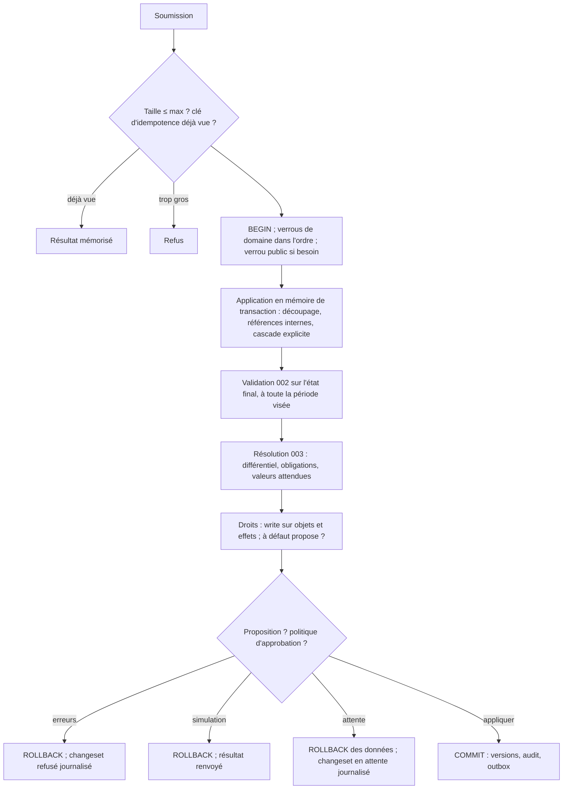

# 004 — Changesets et bitemporel : conception

## Vue d'ensemble

La 004 fournit le mécanisme d'écriture et de temps dont dépendent la 002 et la 003 :

1. **Stockage temporel : table courante + table d'historique** par type d'objet. La table
   courante contient toutes les versions applicatives actuellement affirmées ; la table
   d'historique reçoit, par **déclencheur**, chaque version dont l'affirmation se termine.
   Le temps système est posé par la base (`now()`), jamais par une instance. (ADR 0017.)
2. **Pipeline de changeset** dans `kartenn-service` : décodage, verrous de domaine (ADR
   0015), application en mémoire de transaction avec découpage des périodes (« FOR
   PORTION OF » émulé), validation 002, résolution et différentiel 003, droits,
   politiques d'approbation et propositions, écriture, audit, outbox.
3. **Outbox ordonnée par domaine**, au format CloudEvents 1.0, relayée par un worker qui
   enregistre ses livraisons (ADR 0018).

Ce que la 004 ne fait pas : le format HTTP (006), le modèle RBAC et l'évaluation des
permissions (005).

## Changements

### Stockage temporel (REQ-004-13 à 18) — ADR 0017

Pour chaque type d'objet versionné (objets du noyau, affectations et déclarations de
propriétés, origines résolues (003/P9), objets des modules) :

| Table | Contenu | Contraintes |
|---|---|---|
| `<objet>` (courante) | colonnes métier, `id`, `valid_period tstzrange`, `sys_start timestamptz`, `changeset_id` | `PRIMARY KEY (id, valid_period WITHOUT OVERLAPS)` ; contraintes métier (002, 003) sans clause partielle ; `CHECK (NOT isempty(valid_period))` |
| `<objet>_history` | mêmes colonnes + `sys_end timestamptz` (donc `system_period = [sys_start, sys_end)`) | aucune contrainte métier (validée quand la version était courante, SQL:2011) ; index `(id, sys_start)`, GiST `tstzrange(sys_start, sys_end)` |

**Déclencheur générique** (`BEFORE UPDATE OR DELETE` sur la table courante, fonction
PL/pgSQL commune) : copie l'ancienne ligne dans `<objet>_history` avec `sys_end = now()` ;
pour un `UPDATE`, pose `sys_start = now()` sur la nouvelle ligne. Un déclencheur
`BEFORE INSERT` pose `sys_start = now()`. Ainsi :
- toutes les versions d'un changeset ont le même temps système, celui de sa transaction
  (`now()` est fixe dans une transaction) — REQ-004-16, INV-12 ;
- aucune écriture ne peut contourner l'historique, même une correction manuelle en SQL.

**Immutabilité** (REQ-004-16, INV-11) : le rôle applicatif a `INSERT` sur les tables
d'historique (via la fonction du déclencheur, `SECURITY DEFINER`) mais ni `UPDATE` ni
`DELETE` ; seul un rôle d'administration hors application peut les modifier (et ne le
fait pas : contrôlé en test).

**Chaîne contiguë** : pour un même `(id, portion de valid_period)`, les versions
historiques successives se touchent (`sys_end` de l'une = `sys_start` de la suivante),
par construction du déclencheur.

**Lecture datée** (REQ-004-17) : fonctions du port de stockage, une par type :

| `as_of` | Requête |
|---|---|
| maintenant (défaut) | table courante, `valid_period @> valid_at` |
| passé | `UNION ALL` de la table courante filtrée `sys_start <= as_of` et de l'historique filtré `tstzrange(sys_start, sys_end) @> as_of`, puis `valid_period @> valid_at` |

La table courante reste petite (une ligne par segment applicatif affirmé) ; l'historique
est **partitionné par plage de `sys_end`** (mensuel) pour borner les parcours et faciliter
l'exploitation. Budget visé : `as_of` passé ≤ 2× la lecture courante (REQ-004-38), à
mesurer. Les partitions sont créées à l'avance (mois courant et deux suivants) par
`kartenn_history_maintenance`, au déploiement puis périodiquement ; un mois dont la
partition par défaut contient déjà des lignes y reste. L'index GiST de la période système
sert le prédicat `tstzrange(sys_start, sys_end) @> as_of`, que les lectures datées
ajoutent à `sys_end > as_of` (qui, lui, écarte les partitions) (tâche 25).

**Historique d'un objet** (REQ-004-18) : union des versions courantes et historiques de
l'`id`, triées par `valid_period` puis `sys_start`, avec `changeset_id`.

### Découpage des périodes (REQ-004-14, 15)

PostgreSQL 18 n'a pas `FOR PORTION OF` : kartenn l'émule (fonction en base, appelée par
la couche service). Pour une opération de modification sur la période P d'un objet, qui
doit exister sur toute P :

1. chaque version courante qui recoupe P et que la modification change est remplacée ;
2. ses morceaux hors de P (`version.valid_period − P` : 0, 1 ou 2) gardent l'ancien état ;
3. sa portion dans P prend le nouvel état.

La clôture à une date d (REQ-004-15) est une modification de la période :
`valid_period` devient `[début, d)` ; les versions entièrement postérieures à d sont
supprimées de la table courante (donc historisées).

Les morceaux adjacents de même état sont fusionnés (pas de fragmentation inutile).

**Mise en œuvre (004-8)** : une fonction SQL générique `kartenn_portion(table, id, début,
fin, modification, changeset)` supprime chaque version courante qui recoupe la portion
(le déclencheur l'historise) et réinsère jusqu'à trois morceaux : avant et après dans
l'ancien état, la portion avec la modification (un objet JSON des colonnes changées,
appliqué par `jsonb_populate_record`). Supprimer avant de réinsérer respecte les
exclusions de la table. Une version inchangée par la modification n'est pas touchée ;
les versions voisines de même état sont ensuite fusionnées. Une version écrite puis
remplacée dans la même transaction n'entre pas dans l'historique : elle n'a jamais été
visible (amendement de l'ADR 0017).

Opérations de modification, sur la période du changeset : `UpdatePrefix` (valeur, donc
redimensionnement ; nature ; point à point ; anycast ; avec la classe publique et la
version du registre recalculées depuis la valeur), `UpdateAddress` (usage),
`UpdateRange` (usage). La validation relit chaque version finale de l'objet sur la
période et lui applique les règles locales et globales d'une création (REQ-004-8) ; en
plus, pour un préfixe, le changement de nature vérifie `core.prefix.not_empty_for_nature`
(REQ-002-17) et le redimensionnement revalide les adresses et plages de l'ancienne et de
la nouvelle portée (REQ-002-18). Un redimensionnement déplace l'arbre : la maintenance
des origines recalcule la nouvelle portée et les héritiers du préfixe (003). La
concurrence optimiste (`expected`) s'applique comme pour la clôture.

### Pipeline d'un changeset (REQ-004-1 à 12, 19 à 27, 39 à 43)

- **Application en mémoire de transaction** : les opérations sont réellement exécutées
  (`INSERT`/`UPDATE`) dans la transaction, ce qui donne aux règles globales l'état final
  par de simples requêtes ; en cas de refus, d'attente ou de simulation, `ROLLBACK`, puis
  journalisation du changeset dans une **transaction séparée**.
- **Verrous** (REQ-004-12, ADR 0015) : `pg_advisory_xact_lock` par domaine touché (clé
  dérivée de l'UUID), dans l'ordre des UUID ; verrou « espace public » si un objet public
  est écrit. Les arbres d'entités et de sites ont chacun un verrou de même
  nature ; une modification de préfixe ou d'adresse prend le verrou « espace public »
  (ADR 0015). Les changesets en attente ne tiennent aucun verrou.
- **Période par opération** (REQ-004-2) : une opération s'enveloppe dans `Within {
  period, operation }` ; application et validation 002 prennent la période de chaque
  opération, l'étape des propriétés (origines, différentiel, obligations, droits) couvre
  depuis le plus ancien début, sans fin ; un changeset dont une opération commence dans
  le passé est rétroactif. (Écart trouvé et comblé le 2026-10-15 : la tâche 7 était
  cochée sans cette exigence.)
- **Références internes** (REQ-004-4) : une opération peut désigner un objet par une
  référence locale (`$1`, `$2`…) résolue en UUID v7 généré à l'application.
- **Concurrence optimiste** (REQ-004-11) : une opération peut porter
  `expected` (dernier changeset ayant modifié l'objet, exposé comme ETag par
  la 006) ; différence → conflit.
- **Idempotence** (REQ-004-10) : table `idempotency_key (identity_id, key, request_hash,
  changeset_id, expires_at)`, 24 h ; même clé + autre hash → refus.
- **Rétroactivité** (REQ-004-27) : `retroactive = (lower(période visée) < now())` pour au
  moins une opération ; stocké et indexé.

### Cascade explicite (REQ-004-25, 26)

Chaque type d'objet déclare, via le contrat de module, une fonction `dependents(objet,
période)` : pour un réseau, ses plages et adresses ; pour un objet référencé par une
propriété de type référence, ces affectations (003/REQ-003-10) ; pour une entité ou un
site, ses enfants et rattachements. Une clôture avec `cascade = true` ajoute au
changeset la clôture de ces dépendants, récursivement, avant validation ; toutes passent
par les mêmes contrôles de droits. Sans cascade, la validation 002/003 produit l'erreur
qui liste les dépendants.

**Mise en œuvre (004-15)** : `Close` porte `cascade` (faux par défaut). Avant les verrous,
le pipeline remplace chaque clôture en cascade par la clôture de ses dépendants,
récursivement, suivie de la sienne ; les dépendants du noyau sont, pour un réseau, ses
plages et adresses ; pour un domaine, tous ses préfixes, plages et adresses ; pour une
entité ou un site, ses enfants ; pour tout objet, les affectations de référence qui le
visent, retirées (`UnassignProperty`). Les objets déjà clos par le changeset ne sont
pas repris. Le résultat (appliqué ou simulé) liste les clôtures ajoutées. Le contrat de
module (`dependents()`) prolongera la liste avec les modules (008, 009). Les droits sur
les objets fermés en cascade viendront avec la 005 ; ceux des effets sur les propriétés
s'appliquent déjà.

### Approbation et propositions (REQ-004-19 à 24, 39 à 43)

**Politiques** (C6) : table `approval_policy` (`id`, `name`, déclencheurs :
`min_operations`, `min_diff_objects`, `property_keys[]`, `perimeters[]`,
`authors[]` (rôles, groupes, comptes), `enabled`). Évaluées après le différentiel ; aucune
par défaut. Gérées par changeset (permission d'administration, 005).

**Proposition** (C7) : si la vérification des droits échoue pour des opérations ou des
effets, la couche service vérifie, pour chacun, la permission `…propose` correspondante ;
si toutes sont couvertes, le changeset devient une proposition. La liste des droits
d'écriture requis (permission × ancre de périmètre) est stockée avec la proposition.

**Changeset en attente** : opérations, période visée, motif, auteur, nature
(`approval` ou `proposal`), droits requis, politique déclenchée, expiration (30 jours
configurable), résultat de la validation à la soumission.

**Validation** : l'approbateur ou le mainteneur déclenche l'application ; le pipeline est
rejoué intégralement dans une nouvelle transaction (revalidation, REQ-004-22), avec le
contrôle du valideur à la place de celui de l'auteur :
- politique : permission d'approbation sur tout le périmètre, valideur ≠ auteur ;
- proposition : droits d'écriture requis, valideur ≠ auteur (REQ-004-42).
L'auteur reste l'auteur du changeset appliqué ; le valideur est enregistré.

**File des propositions** (REQ-004-43) : requête sur les changesets en attente de nature
`proposal`, filtrée par les ancres de périmètre de leurs droits requis où le lecteur
détient ces droits (prédicat RBAC, 005). Volume attendu faible ; pagination standard.

**Expiration** : job de worker périodique.

**Mise en œuvre (004-11 à 14)**, choix délégués le 2026-10-15 :
- **Mise en attente** : après le différentiel et les droits, dans la transaction, un
  changeset dont un droit manque mais dont chaque manque est couvert par `…propose`
  devient une **proposition** ; sinon, si une politique active le vise, il devient une
  **demande d'approbation**. Dans les deux cas : `ROLLBACK`, puis journal `pending`
  (nature, politique, droits requis, périmètre, expiration à 30 jours) et événement
  `org.kartenn.changeset.pending` dans une transaction séparée. L'auteur système (P12)
  n'est jamais mis en attente.
- **Périmètre** d'un changeset : objets de ses opérations et objets de son différentiel,
  enregistré avec lui.
- **Validation** (`validate_pending`) : rejoue les opérations journalisées (références
  locales résolues à nouveau) dans une nouvelle transaction, sans politique. Proposition :
  le valideur doit détenir les droits d'écriture (objets et effets), sans repli sur
  `…propose`. Approbation : les droits de l'auteur sont revérifiés (plus strict que la
  conception, qui ne vérifiait que le valideur) et le valideur doit détenir
  `core.changeset.approve` (renommée par la 005) sur tout le périmètre recalculé. Valideur = auteur → refus
  `changeset.approval.self`. Revalidation en échec → `failed_revalidation` avec les violations
  (REQ-004-22) ; succès → `applied`, valideur enregistré, même identifiant.
- **Rejet** (motif obligatoire) par qui pourrait valider ; **retrait** par l'auteur seul
  (`changeset.state.not_author`) ; **expiration** par un job (`expire_pending`). Chacun émet un
  événement (`rejected`, `withdrawn`, `expired`, `failed_revalidation`, `applied`) qui
  nomme l'auteur : ce sont les notifications de REQ-004-43. Un changeset qui n'est plus
  `pending` ne peut plus changer d'état (REQ-004-24).
- **File des propositions** : propositions en attente dont le lecteur détient tous les
  droits requis (filtre par l'`Authorizer` ; prédicat SQL avec la 005).
- **Politiques** : opération `SetApprovalPolicy` (création ou remplacement par nom,
  désactivation). Une politique vise un changeset quand **tous** ses déclencheurs définis
  correspondent (au moins un) : nombre d'opérations, nombre d'objets du différentiel,
  propriétés changées (directement ou par effet), domaines du périmètre, auteurs
  (personnes). Périmètres par entité, site ou sous-arbre et auteurs par rôle ou groupe :
  avec la 005.

### Imports (REQ-004-28 à 30)

- `import` (`id`, auteur, source, état, progression, rapport) et `import_batch` (`index`,
  opérations, `changeset_id`, état).
- À la création : opérations validées syntaxiquement, **triées par dépendance** (entités,
  sites, domaines, conteneurs du plus court au plus long préfixe, réseaux, plages,
  adresses, affectations), découpées en lots ≤ taille maximale.
- Un worker applique les lots dans l'ordre, chacun comme un changeset ordinaire ; échec
  d'un lot → import en pause avec le rapport ; reprise au premier lot non appliqué.
- **Rejeu** : les opérations d'import sont des « upsert par identifiant externe »
  (002/REQ-002-41) : un objet déjà importé est mis à jour ou laissé tel quel, jamais
  dupliqué.

**Mise en œuvre (004-18, 19)**, choix délégués le 2026-10-15 :
- Un import a une **source** (le connecteur) et des éléments `{ external_id, operation }` ;
  un élément qui crée un objet (il définit une référence locale) porte un identifiant
  externe, sinon l'import est refusé à sa création. Les références locales valent pour
  tout l'import.
- À la création : tri topologique sur les références locales, à rang égal dans l'ordre de
  la conception (entités, sites, domaines, conteneurs du plus court au plus long, réseaux,
  plages, adresses, affectations, le reste), puis découpe en lots (deux opérations par
  création : la création et sa liaison). Rien n'est appliqué.
- Opération nouvelle `BindExternal { object, kind, source, external_id }` : la
  correspondance de REQ-002-41, écrite dans le changeset qui crée l'objet ; un doublon
  est refusé (`core.external_id.duplicate`).
- `run_import` applique les lots dans l'ordre, chacun comme un changeset de l'auteur de
  l'import. Avant chaque lot, une création dont l'identifiant externe est déjà lié est
  **omise** (rejeu sans doublon : l'objet est laissé tel quel), et les références à des
  objets d'autres lots ou déjà importés deviennent leurs identifiants. Un lot refusé
  (ou mis en attente par une politique) met l'import en pause avec ses violations ; une
  relance reprend au premier lot non appliqué. `import_status` donne lots appliqués,
  restants et l'échec éventuel. La planification du worker vient avec la 006.

### Annulation (REQ-004-34, 35)

Pour un changeset C appliqué au temps système t :
1. objets touchés = versions dont `changeset_id = C` (courantes et historiques) ;
2. état antérieur = lecture `as_of` juste avant t sur la même période applicative ;
3. génération d'opérations qui rétablissent cet état (créations closes, modifications
   inverses, clôtures annulées par recréation sur la période) ;
4. **conflit** : si une version postérieure à t, d'un autre changeset, recoupe le même
   objet et la même période, l'opération correspondante est marquée en conflit et exclue,
   avec l'explication ; l'utilisateur décide.
Le changeset généré n'est pas soumis automatiquement.

**Mise en œuvre (004-20)**, choix délégués le 2026-10-15 :
- `undo::inverse(changeset, auteur)` rend une requête **non soumise** et la liste des
  conflits. Objets touchés : versions (courantes ou historiques) écrites par C des
  domaines, préfixes, plages, adresses, entités, sites et affectations ; période : depuis
  le plus ancien début de C (sa période et celles de ses opérations), sans fin.
- Objet créé par C (aucune version affirmée avant t) : `Close` (ou `UnassignProperty`
  pour une affectation), avec les contrôles d'une clôture. Sinon, opération nouvelle
  `Restore { kind, id, property, before: C }` : sur la période du changeset, les versions
  courantes de l'objet sont remplacées par celles qui étaient affirmées juste avant C
  (fonction en base `kartenn_restore`), puis validées comme une modification (règles
  locales et globales, origines, différentiel, droits).
- Conflit : une version de l'objet écrite après t par un autre changeset et qui recoupe
  la période ; l'objet est exclu de la requête et le conflit nomme ce changeset.
- Déclarations, valeurs de listes fermées et politiques ne sont pas annulées : listées à
  part (« non annulable »).

### Audit et identités (REQ-004-31 à 33)

| Table | Contenu |
|---|---|
| `changeset` | `id`, `author_id`, `validator_id`, `motive`, `state`, `kind`, `default_period`, `retroactive`, `submitted_at`, `applied_at`, `expires_at`, `policy_id`, `violations`, `anomalies`, `diff_summary`, `request` (requête d'un changeset en attente, pour sa revalidation), `rejection`, `required_rights` (droits manquants d'une proposition) |
| `changeset_operation` | `changeset_id`, `ordinal`, `payload` (JSON validé à la soumission) |
| `changeset_diff` | `changeset_id`, `seq`, `property_key`, `object_id`, `before`, `after` (détail paginé, 003) |
| `person` | `id` (interne, stable), `display_name`, `email`, `issuer`, `subject`, `departed_at`, `pseudonymized_at` |

- L'audit ne référence que `person.id`. La **pseudonymisation** remplace les champs
  d'identité par `personne #<8 premiers caractères de l'id>` et vide `email`, `issuer`, `subject` ; job déclenché à
  `departed_at + délai` (1 an proposé, configurable).
- Index de recherche : `(author_id)`, `(state)`, `(submitted_at)`, `(retroactive)` ; par
  objet via `changeset_diff` et les `changeset_id` des tables versionnées.

### Événements sortants (REQ-004-36, 37) — ADR 0018

- Table `outbox` (`seq bigint identity`, `xid xid8 DEFAULT pg_current_xact_id()`,
  `changeset_id`, `domain_ids uuid[]`, `payload jsonb`), insertion dans la transaction du
  changeset.
- Format **CloudEvents 1.0** : `specversion = "1.0"`, `id` = UUID du changeset (unique
  pour la source), `source` = `urn:kartenn:instance` (une URI propre à chaque déploiement
  viendra avec sa configuration, 006), `type` = `org.kartenn.changeset.applied`, `time` =
  temps système (RFC 3339), `data` = changeset, domaines, objets touchés, auteur,
  valideur et différentiel résumé. Un changeset en attente émet aussi un événement à
  chaque changement d'état (`org.kartenn.changeset.<état>`, `id` = `<uuid>/<état>`,
  sans domaine). Les consommateurs dédoublonnent par
  `source` + `id`.
- **Relais** (un à la fois par consommateur, verrou consultatif) : lit les lignes validées,
  non encore livrées à ce consommateur, par `seq` croissant (la barrière
  `xid < pg_snapshot_xmin(…)` de la première version est retirée, second amendement de
  l'ADR 0018), et **enregistre
  chaque livraison** (`outbox_delivery`). Un curseur unique « dernier `seq` livré » est
  proscrit : il peut sauter l'événement d'une transaction encore en cours (amendement
  de l'ADR 0018).
- **Ordre garanti par domaine d'adressage** (réponse à la question ouverte) : les
  changesets d'un même domaine sont sérialisés par le verrou de domaine, donc leurs `seq`
  suivent l'ordre d'application. Entre domaines différents, l'ordre global n'est pas
  garanti (et n'est pas nécessaire).
- Livraison au moins une fois : une livraison n'est enregistrée qu'après accusé du
  consommateur.

## Erreurs et cas limites

| Cas | Comportement | REQ |
|---|---|---|
| Changeset vide | Requête refusée (erreur de requête `Empty`, hors catalogue des règles) | 1 |
| Motif vide | Requête refusée (`MotiveRequired`) | 1 |
| Période vide ou inversée | Requête refusée (`InvalidPeriod`) | 13 |
| Opération qui modifie un objet sur une période où il n'existe pas | Refus `changeset.operation.no_version` | 14 |
| Version attendue différente de la version courante | Refus `changeset.operation.conflict`, qui cite la version courante | 11 |
| Modification dont la période déborde la période d'existence de l'objet | Refus (pas de création implicite) ; créer explicitement | 14 |
| Changeset planifié qui heurte une version future d'un autre objet | Refus de la règle concernée, avec la date du conflit | 8 |
| Deux soumissions avec la même clé d'idempotence en parallèle | La seconde attend la première (verrou sur la clé) puis renvoie son résultat | 10 |
| Validation d'un changeset en attente devenu invalide | État `échoué à la revalidation`, violations jointes | 22 |
| Auteur qui valide sa propre proposition | Refus `changeset.approval.self` | 21, 42 |
| Retrait par un autre que l'auteur | Refus `changeset.state.not_author` | 23 |
| Import interrompu pendant un lot | Le lot est atomique : rejoué entièrement à la reprise | 29 |
| Annulation d'un changeset dont tous les objets ont été remodifiés | Changeset inverse vide avec la liste des conflits | 35 |
| Relais d'outbox arrêté | Les événements s'accumulent ; reprise au premier événement non livré | 37 |

## Alternatives considérées

- **Table unique avec `system_period` et contraintes partielles** (`WHERE
  upper_inf(system_period)`) : moins de tables, mais chaque index doit exister en double
  (partiel pour le courant, complet pour l'historique), la table courante grossit avec
  l'historique, et toute requête courante doit penser au prédicat. Rejetée.
- **Historisation par la couche service seule** (sans déclencheur) : plus visible dans le
  code, mais une écriture SQL directe (maintenance, migration) contournerait
  l'historique. Rejetée au profit du déclencheur, qui reste trivial et générique.
- **Extension `temporal_tables` ou équivalent** : dépendance externe pour une fonction
  de quelques lignes ; non retenue.
- **Changeset unique asynchrone pour les imports** : rejeté par C3.
- **Ordre global des événements** : exigerait de sérialiser toutes les écritures ;
  rejeté, l'ordre par domaine suffit.

## Risques et migration

- **Volume de l'historique** : ~10⁶ objets × versions × 3 ans, plus la table matérialisée
  de la 003 ; partitionnement mensuel de l'historique, à dimensionner par le banc.
- **Déclencheurs et imports massifs** : coût d'historisation sur les mises à jour en
  masse ; mesuré par le banc d'import (< 15 min pour 10⁶ objets) : 593 s pour 996 717
  adresses en 200 lots (002/A14), après le passage à une recherche groupée des
  identifiants externes de chaque lot (une requête par identifiant de tout l'import
  auparavant).
- **Découpage des périodes** : bugs subtils (bornes, fusion) ; tests de propriétés
  comparant à un modèle de référence en mémoire.
- **Dépendance 005** : contrôle des droits, permission d'approbation, prédicat de file des
  propositions ; interfaces fixées ici, implémentées là.
- **Préfixe du `type` CloudEvents** : dépend d'un nom de domaine du projet, à fixer.

## Stratégie de test

| Exigences | Type de test |
|---|---|
| 1 à 5 | Intégration : structure, périodes par opération, références internes, taille |
| 6, 7 | Intégration : changeset de 100 opérations avec une erreur → aucune trace ; toutes les violations renvoyées |
| 8 | Intégration : conflits avec des versions futures et passées |
| 9 | Intégration : simulation → base inchangée (comparaison d'empreintes) |
| 10, 11, 12 | Intégration et concurrence : clés d'idempotence parallèles ; ETag ; deux changesets concurrents |
| 13 à 15 | **Tests de propriétés** du découpage contre un modèle en mémoire (suites aléatoires d'opérations sur des périodes) |
| 16 | Intégration : temps système identique dans un changeset ; droits refusés sur l'historique ; historisation déclenchée par un `UPDATE` SQL direct |
| 17, 18 | Intégration : lectures `as_of` avant et après une correction rétroactive |
| 19 à 24, 39 à 43 | Intégration : machine d'états complète ; politiques (volume, propriété, périmètre, auteur) ; propositions, file des mainteneurs, notifications |
| 25, 26 | Intégration : refus sans cascade, cascade avec droits manquants |
| 27 | Intégration : marquage et filtre des changesets rétroactifs |
| 28 à 30 | Intégration : import de 10⁵ opérations avec un lot fautif, reprise, rejeu sans doublon |
| 31 à 33 | Intégration : recherche d'audit ; pseudonymisation sans altération de l'historique |
| 34, 35 | Intégration : annulation simple, annulation avec conflit |
| 36, 37 | Intégration : événement dans la transaction ; relais sans trou avec transactions concurrentes longues ; ordre par domaine |
| 38 | Banc CI : changeset unitaire, lecture `as_of`, import de 10⁶, 50 changesets/s |

## ADR

- [`docs/adr/0017-temps-systeme-tables-historique.md`](../../docs/adr/0017-temps-systeme-tables-historique.md)
- [`docs/adr/0018-outbox-ordonnee-par-domaine.md`](../../docs/adr/0018-outbox-ordonnee-par-domaine.md)
