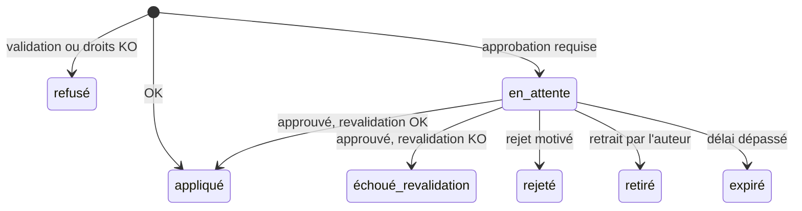

# 004 — Changesets et bitemporel : exigences

## Résumé

Toute écriture dans kartenn passe par un **changeset** : un ensemble d'opérations validé
puis appliqué atomiquement, éventuellement soumis à approbation, simulable, annulable par
un changeset inverse (ADR 0006). Toute donnée est **bitemporelle** : temps applicatif
fourni par l'utilisateur, temps système fixé par kartenn et immuable (ADR 0005). Cette
spec fixe le cycle de vie des changesets, la sémantique temporelle des écritures et des
lectures, l'audit, les imports massifs et les événements sortants. Les règles de validité
des objets sont dans les specs 002 et 003.

Décisions : [`decisions.md`](decisions.md) (C1–C5) ; D8, D10, D11, D33
([`../001-cadrage/decisions.md`](../001-cadrage/decisions.md)) ; ADR 0005, 0006, 0015.
Source : [`docs/reference/temporel-sql2011-postgresql.md`](../../docs/reference/temporel-sql2011-postgresql.md).

### Vocabulaire

- **Opération** : création, modification, clôture d'un objet, ou affectation d'une
  propriété, dans un changeset.
- **Période visée** : période de temps applicatif `[début, fin)` sur laquelle une
  opération s'applique.
- **Version** : état d'un objet sur une période applicative, tel qu'affirmé sur une
  période système.
- **Version courante** : version dont la période système est ouverte.
- Conventions EARS et sévérités : comme dans
  [`002/requirements.md`](../002-noyau-adressage/requirements.md#conventions).

## Exigences

### A. Structure d'un changeset

#### REQ-004-1 — Contenu
kartenn doit exiger qu'un changeset comporte une liste ordonnée d'opérations, un motif
non vide, une période visée par défaut, et doit l'attribuer à l'identité authentifiée qui
le soumet.

#### REQ-004-2 — Période par opération
kartenn doit appliquer à chaque opération la période visée par défaut du changeset, sauf
si l'opération précise sa propre période.

Acceptation :
- Un changeset de période `[2026-11-01, ∞)` contenant une opération de période
  `[2026-12-01, 2027-01-01)` applique cette dernière sur décembre seulement.

#### REQ-004-3 — Période par défaut
Si un changeset ne précise pas de période visée, alors kartenn doit utiliser
`[horodatage de la transaction, ∞)`.

#### REQ-004-4 — Références internes
kartenn doit permettre à une opération de référencer un objet créé par une opération
précédente du même changeset.

Acceptation :
- Un changeset crée un conteneur, un réseau dedans et trois adresses, en une soumission.

#### REQ-004-5 — Taille bornée
Si un changeset dépasse le nombre maximal d'opérations configuré (10 000 par défaut),
alors kartenn doit le refuser sans le traiter, en indiquant la limite (C3).

### B. Validation, application, atomicité

#### REQ-004-6 — Atomicité
kartenn doit appliquer toutes les opérations d'un changeset ou aucune.

Acceptation :
- Un changeset de 100 opérations dont la 73ᵉ viole une règle d'erreur ne laisse aucune
  trace dans les données (seulement le changeset refusé dans l'audit).

#### REQ-004-7 — Validation sur l'état final
kartenn doit valider les règles des specs 002 et 003 sur l'état qui résulterait de
l'application de toutes les opérations, et renvoyer **toutes** les violations, pas
seulement la première.

#### REQ-004-8 — Validation dans le temps
kartenn doit vérifier chaque invariant sur toute la période visée, en tenant compte des
versions passées et futures (planifiées) qui la recoupent.

Acceptation :
- Un réseau `10.1.2.0/24` est planifié à partir du 1er janvier : créer aujourd'hui sans fin
  de période un réseau `10.1.2.0/25` est refusé (il deviendrait un réseau contenu dans un
  réseau au 1er janvier).

#### REQ-004-9 — Simulation
kartenn doit permettre de soumettre un changeset en mode simulation : validation,
anomalies et différentiel sont renvoyés, rien n'est écrit (003/REQ-003-20).

#### REQ-004-10 — Idempotence de la soumission
Là où une soumission porte une clé d'idempotence, kartenn doit, pour toute soumission
ultérieure de même clé par la même identité pendant 24 h, renvoyer le résultat de la
première sans appliquer à nouveau ; une même clé avec un contenu différent doit être
refusée.

#### REQ-004-11 — Concurrence optimiste
Là où une opération de modification ou de clôture précise la version attendue de l'objet,
si la version courante diffère, alors kartenn doit refuser le changeset avec un conflit
qui indique la version courante.

#### REQ-004-12 — Concurrence entre changesets
kartenn doit garantir que deux changesets concurrents ne produisent jamais ensemble un
état qu'aucun des deux n'aurait accepté seul (ADR 0015).

Acceptation :
- Deux changesets simultanés créant le même préfixe dans un domaine : un seul réussit,
  l'autre échoue en `core.prefix.duplicate`.

### C. Sémantique temporelle

#### REQ-004-13 — Périodes
kartenn doit représenter toute période en `[début, fin)`, `fin` pouvant être infinie, et
refuser une période vide ou dont la fin précède le début.

#### REQ-004-14 — Modification sur une portion
Quand une opération modifie un objet sur une période visée qui ne couvre qu'une partie
d'une de ses versions, kartenn doit découper cette version : les portions hors de la
période gardent l'ancien état, la portion visée prend le nouvel état (sémantique
SQL:2011 `FOR PORTION OF`).

Acceptation :
- Adresse d'usage « hôte » sur `[janvier, ∞)` ; passer l'usage à « réservée » sur
  `[mars, juin)` donne trois versions : hôte `[janvier, mars)`, réservée `[mars, juin)`,
  hôte `[juin, ∞)`.

#### REQ-004-15 — Clôture
Quand une opération clôt un objet à une date, kartenn doit terminer sa période
applicative à cette date sans rien effacer ; l'objet reste lisible aux dates antérieures.

#### REQ-004-16 — Temps système
kartenn doit fixer le temps système de toutes les versions écrites par un changeset à
l'horodatage de sa transaction en base, identique pour toutes ses opérations, et ne doit
jamais modifier ni supprimer une version dont la période système est close.

Acceptation :
- Test : aucune requête de l'application ne met à jour ou ne supprime une version
  historique (droits PostgreSQL du rôle applicatif, INV-11).

#### REQ-004-17 — Lecture datée
kartenn doit permettre toute lecture à un couple (`valid_at`, `as_of`), chacun valant
« maintenant » par défaut.

Acceptation :
- `as_of` antérieur à une correction rétroactive renvoie l'état d'avant la correction ;
  `as_of` postérieur renvoie l'état corrigé.

#### REQ-004-18 — Historique d'un objet
kartenn doit restituer l'historique d'un objet : ses versions sur les deux axes, chacune
avec le changeset qui l'a produite.

### D. Cycle de vie et approbation

#### REQ-004-19 — États
kartenn doit gérer les états de changeset : `appliqué`, `refusé`, `en attente`,
`rejeté`, `retiré`, `expiré`, et `échoué à la revalidation` ; seuls les changesets
`appliqué` modifient les données.

#### REQ-004-20 — Approbation selon une politique
Là où un administrateur a configuré une politique d'approbation dont les déclencheurs
correspondent au changeset, kartenn doit mettre le changeset en attente au lieu de
l'appliquer (C6).

Acceptation :
- Politique « plus de 500 objets dans le différentiel » : un changeset qui reclasse 4 096
  adresses passe en attente ; un changeset de 3 adresses s'applique immédiatement.

#### REQ-004-39 — Aucune approbation par défaut
kartenn doit appliquer immédiatement tout changeset autorisé tant qu'aucune politique
d'approbation ne le vise ; aucune déclaration de module ne doit pouvoir imposer une
approbation (C6).

Acceptation :
- Instance neuve, modules v0.1 et v0.2 installés : aucun changeset ne passe en attente.

#### REQ-004-40 — Déclencheurs d'une politique
kartenn doit permettre de définir une politique d'approbation par une combinaison de
déclencheurs : volume (opérations ou objets du différentiel au-delà d'un seuil),
propriété (changement direct ou indirect), périmètre, auteur (rôle, groupe, compte de
service).

#### REQ-004-41 — Proposition
Si l'auteur n'a pas le droit d'écriture requis par une opération ou un effet
(003/REQ-003-17, 18) mais détient le droit de proposer correspondant (`…propose`), alors
kartenn doit enregistrer le changeset comme **proposition** en attente au lieu de le
refuser (C7). Sans l'un ni l'autre, le changeset est refusé.

Acceptation :
- Un utilisateur avec `core.address.propose` sur son réseau propose de passer l'usage de
  l'adresse de sa VM de « réservée » à « hôte » : la proposition est en attente ; sans
  `propose`, le changeset est refusé.

#### REQ-004-42 — Validation d'une proposition
kartenn doit n'accepter la validation d'une proposition que d'une identité qui détient le
droit d'écriture sur tout ce que la proposition modifie (objets et effets) et qui n'en est
pas l'auteur ; la proposition est revalidée à l'application (REQ-004-22).

#### REQ-004-43 — File des propositions et notifications
Quand une proposition est soumise, kartenn doit la rendre visible dans la file des
propositions de chaque mainteneur concerné (identités qui détiennent le droit d'écriture
requis sur son périmètre) et émettre un événement ; quand elle est appliquée, rejetée ou
expire, kartenn doit en notifier l'auteur.

Acceptation :
- Un mainteneur ne voit dans sa file que les propositions qu'il peut valider.
- Le rejet porte un motif, restitué à l'auteur.

#### REQ-004-21 — Approbateur
kartenn doit n'accepter l'approbation que d'une identité qui détient la permission
d'approbation sur tout le périmètre du changeset et qui n'en est pas l'auteur (C1).

Acceptation :
- L'auteur, même administrateur, ne peut pas approuver son propre changeset.

#### REQ-004-22 — Revalidation
Quand un changeset en attente est approuvé, kartenn doit le revalider sur l'état courant
et, en cas d'échec, le passer en `échoué à la revalidation` avec les violations.

#### REQ-004-23 — Rejet, retrait, expiration
kartenn doit permettre à l'approbateur de rejeter un changeset en attente avec un motif,
à l'auteur de le retirer, et doit expirer un changeset resté en attente au-delà du délai
configuré (30 jours par défaut).

#### REQ-004-24 — Pas de modification en attente
Si une soumission tente de modifier un changeset en attente, alors kartenn doit la
refuser.

### E. Clôture en cascade (D33)

#### REQ-004-25 — Refus par défaut
Si la clôture d'un objet laisserait des objets dépendants invalides, alors kartenn doit
refuser le changeset en listant ces dépendants.

#### REQ-004-26 — Cascade explicite
Là où une opération de clôture demande la cascade, kartenn doit ajouter au changeset la
clôture de tous les dépendants, les restituer dans le différentiel, et appliquer à chacun
les contrôles de droits.

Acceptation :
- Clore en cascade un réseau qui contient 3 plages et 40 adresses produit un changeset de
  44 clôtures ; sans droit sur une des adresses, le tout est refusé.

### F. Écritures rétroactives (C2)

#### REQ-004-27 — Rétroactivité permise et marquée
kartenn doit accepter une période visée qui commence dans le passé, avec les droits
ordinaires, et doit marquer le changeset comme rétroactif dans l'audit.

Acceptation :
- L'audit permet de filtrer les changesets rétroactifs par périmètre et par auteur.

### G. Imports massifs (C3)

#### REQ-004-28 — Import par lots
kartenn doit fournir un import qui accepte un volume d'opérations supérieur à la taille
maximale d'un changeset, les ordonne par dépendance, les applique en changesets
successifs atomiques, et produit un rapport (appliqués, refusés avec violations).

#### REQ-004-29 — Reprise et rejeu
Quand un import est interrompu ou relancé, kartenn doit reprendre au premier lot non
appliqué, et un rejeu complet ne doit pas créer de doublons (objets reconnus par leurs
identifiants externes, 002/REQ-002-41).

#### REQ-004-30 — Suivi d'import
kartenn doit exposer l'état d'avancement d'un import (lots traités, restants, erreurs).

### H. Audit et données personnelles (C4)

#### REQ-004-31 — Journal d'audit
kartenn doit conserver chaque changeset, quel que soit son état, avec : auteur,
horodatage, motif, opérations, résultat (violations, anomalies, différentiel), approbateur
et motif de rejet le cas échéant.

#### REQ-004-32 — Consultation de l'audit
kartenn doit permettre de rechercher les changesets par objet, auteur, état, période et
caractère rétroactif.

#### REQ-004-33 — Identités pseudonymisables
kartenn doit référencer les personnes dans l'audit par un identifiant interne stable, et
permettre de pseudonymiser leurs données d'identité (nom, courriel, sujet OIDC) sans
altérer l'historique.

Acceptation :
- Après pseudonymisation, l'audit montre « personne #1234 » pour tous ses changesets ;
  aucune autre donnée n'est modifiée.

### I. Annulation (C5)

#### REQ-004-34 — Changeset inverse
Quand on demande l'annulation d'un changeset appliqué, kartenn doit générer, sans le
soumettre, un changeset qui rétablit l'état antérieur des objets touchés sur la même
période applicative.

#### REQ-004-35 — Conflit d'annulation
Si un objet touché par le changeset à annuler a été modifié depuis par un autre
changeset, alors kartenn doit signaler le conflit dans le changeset inverse généré au lieu
d'écraser la modification ultérieure.

### J. Événements sortants

#### REQ-004-36 — Événement par changeset
Quand un changeset est appliqué, kartenn doit émettre un événement (identifiant du
changeset, objets touchés, différentiel résumé) écrit dans la même transaction que les
données.

#### REQ-004-37 — Livraison au moins une fois, dans l'ordre
kartenn doit livrer chaque événement au moins une fois aux consommateurs, dans l'ordre
d'application des changesets ; l'identifiant du changeset permet aux consommateurs de
dédoublonner.

### K. Performance (D14)

#### REQ-004-38 — Budgets
kartenn doit respecter, p95 serveur sur le jeu de référence (002/REQ-002-45) avec 3 ans
d'historique : changeset unitaire validé et appliqué < 200 ms ; lecture « à la date X »
≤ 2 × la lecture courante ; import de 10⁶ objets < 15 min ; 50 changesets unitaires par
seconde soutenus.

## Non-objectifs

- Branches ou espaces de travail à la Git (D11).
- Approbations multiples (C1 : évolution possible).
- Toute approbation imposée par défaut ou par un module (C6).
- L'envoi de notifications externes (courriel, messagerie) : un consommateur des
  événements, ultérieur ; ici, la file des propositions et l'événement (C7).
- Les discussions en fil sur une proposition (seulement motif de soumission et motif de
  rejet).
- Modification d'un changeset en attente (C1).
- Purge de l'historique (C4).
- Webhooks et leur configuration : un consommateur d'événements ultérieur ; ici seulement
  l'émission fiable.
- Le format des requêtes et réponses HTTP (spec 006) et le modèle des politiques
  d'approbation (spec 005).

## Questions ouvertes

- [ ] Durée de rétention des clés d'idempotence (24 h proposées). (Claude, conception)
- [ ] Ordre des événements : global, ou par domaine d'adressage (suffisant pour la plupart
  des consommateurs et moins contraignant) ? (conception)
- [ ] Délai de pseudonymisation après départ : 1 an proposé par défaut, configurable. (utilisateur)
