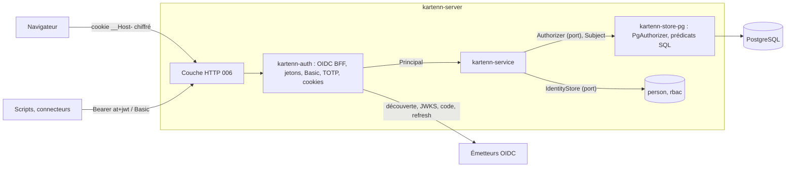

# 005 — Authentification et RBAC : conception

## Vue d'ensemble



1. **Authentification** (`kartenn-auth`, nouvel adaptateur) : transforme une preuve
   (cookie de session, jeton d'accès, Basic) en `Principal` : identité, nature, émetteur,
   groupes, méthode. Elle ne décide d'aucun droit.
2. **Autorisation** (`kartenn-service` + `kartenn-store-pg`) : le service demande au port
   `Authorizer` si un `Subject` (identité, émetteur, groupes) détient une permission sur
   des objets ; l'adaptateur PostgreSQL répond en une requête par lot et fournit le même
   prédicat pour filtrer les listes.
3. **Administration** : rôles, liaisons, rattachements d'émetteurs, comptes de service et
   état des identités sont des opérations de changeset (pipeline de la 004).

## Changements

### Crates et dépendances

| Crate | Rôle | Dépendances nouvelles |
|---|---|---|
| `kartenn-core` | catalogue des permissions (`authz::catalogue`), rôles livrés, types `Permission`, `ScopeKind` | — |
| `kartenn-service` | `Subject`, `Principal` ; port `Authorizer` étendu ; ports `IdentityStore`, `SecretHasher` ; contrôles d'écriture par type d'objet ; opérations d'administration ; `authn` (identité juste-à-temps, événements) | — |
| `kartenn-auth` (nouvelle) | client OIDC du BFF (découverte, PKCE, `state`, `nonce`, validation du jeton d'identité, rafraîchissement), validation des jetons d'accès RFC 9068, cookie de session chiffré, trousseau de clés, HMAC des secrets, Argon2id, TOTP | `openidconnect` (flux du BFF), `jsonwebtoken` (jetons d'accès, moteur RustCrypto), `aes-gcm`, `hkdf`, `hmac`, `sha2`, `argon2`, `subtle` ; client HTTP sur rustls avec `ring`, sans aws-lc (comme la 012) |
| `kartenn-store-pg` | migration `0028_rbac.sql` ; `PgAuthorizer`, `Visibility` ; identités ; comptes | — |
| `kartenn-server` | configuration `[auth]` ; sous-commande `breakglass` ; synchronisation des rôles livrés au job de migration | — |

Les crates `openidconnect` et `jsonwebtoken` sont confirmées en tâche 1 (versions,
moteur cryptographique sans aws-lc, couverture de RFC 9068 et de RFC 9207) ; à défaut,
la validation est écrite sur `jsonwebtoken` seul.

### Sujet et principal (REQ-005-18, 22)

- `Principal` (sortie de l'authentification) : `identity: Uuid`, `kind` (`person`,
  `service_account`, `breakglass`), `issuer: Option<String>`, `groups: Vec<String>`,
  `method` (`oidc_session`, `bearer`, `basic`, `breakglass`), `session_started`.
  Il alimente `RequestContext` (012).
- `Subject` (entrée de l'autorisation) : `id`, `issuer`, `groups`. Le port devient
  `authorize_many(&Subject, permission, objects)` ; `Grants` et `Unrestricted` suivent.
  Un changeset en attente garde un instantané des groupes de son auteur
  (`changeset.author_groups`) : la revalidation de ses droits à l'approbation (004) se
  fait avec eux, les groupes vivant dans le jeton.

### Modèle de données — migration `0028_rbac.sql`

- `person` (existante) devient la table des **identités** : colonnes `kind`
  (`person`, `service_account`, `breakglass`), `disabled_at`, `revoked_after` ;
  `issuer`, `subject` déjà présents (unicité (`issuer`, `subject`)) ; `email` cesse
  d'être écrit (K3).
- Tables versionnées comme les objets du noyau (`valid_period`, historique, ADR 0017) :
  - `role (id, key, label, builtin)` et `role_permission (role_id, permission)` ;
  - `binding (id, subject_kind, subject_id, issuer, group_name, role_id, scope_kind,
    scope_id)` : `subject_kind` ∈ (`identity`, `group`, `issuer`) avec les colonnes
    utiles seulement (`CHECK`) ; `scope_kind` ∈ (`global`, `entity`, `site`, `domain`,
    `prefix`), `scope_id` nul pour `global` ; la période applicative borne la liaison
    (liaison temporaire, K6) ;
  - `issuer_attachment (issuer, entity_id)` : `entity_id` nul = rattachement global (K13).
- Non versionnées (état de preuves) :
  - `service_secret (id, account_id, digest, key_id, created_at, expires_at,
    revoked_at)` : au plus deux secrets actifs par compte (`CHECK` par déclencheur) ;
  - `breakglass_account (account_id, password_hash, totp_secret, totp_key_id,
    last_totp_step, failures, valid_until)` : écrite par le propriétaire du schéma ; le
    rôle applicatif ne peut que lire et mettre à jour `last_totp_step` et `failures`.
- `changeset.author_groups text[]`.

### Catalogue des permissions et rôles livrés (REQ-005-16, 17)

- `kartenn_core::authz::catalogue` : macro comme celle des événements d'audit ; chaque
  entrée : nom, module, résumé, objet, action ; `EVENTS` → `PERMISSIONS`. Les permissions
  de propriété (`prop.<clé>.*`) sont dérivées des déclarations (003) ; `read` n'existe
  que pour les propriétés sensibles.
- Noyau : `core.<entity|site|domain|prefix|range|address>.<read|write|propose>`,
  `core.changeset.approve` (renomme `changeset.approve`), `core.rbac.admin`,
  `core.role.admin`, `core.issuer.admin`, `core.account.admin` (comptes de service et
  état des identités), `core.audit.read`, `core.observability.admin`,
  `core.approval_policy.admin`.
- Publication : `docs/spec/permissions.md`, généré et vérifié par un test
  (`KARTENN_BLESS`).
- Rôles livrés : constantes du noyau, synchronisées par le job de migration (comme les
  déclarations du noyau, 003/P12) dans un changeset système ; `builtin` interdit leur
  modification hors synchronisation.

### Décision (REQ-005-18 à 20, 23)

1. **Périmètres du sujet** : une requête lit, à la date de la requête, les liaisons
   valides dont le sujet est l'identité, l'un de ses groupes (`issuer`, `group_name`) ou
   son émetteur entier, jointes aux rôles qui contiennent la permission ; résultat :
   `Visibility { global, entities, sites, domains, prefixes, confinement }`, les ensembles
   d'entités et de sites étant étendus à leurs descendants (CTE récursive, à la date).
2. **Confinement** : pour une identité d'émetteur, `confinement` = descendants des entités
   rattachées (`None` si rattachement global ; ensemble vide si aucun rattachement :
   aucun droit) ; comptes de service et de secours : `None`.
3. **Appartenance d'un objet** : deux fonctions SQL `STABLE` :
   - `kartenn_owner(objet, à)` : l'entité elle-même pour une entité ; le `core.owner`
     résolu (`property_origin` → `property_assignment`) pour un objet d'adressage ;
     nul pour un site ;
   - `kartenn_site(objet, à)` : le site lui-même ; le `core.site` du réseau pour un réseau ;
     celui du réseau qui contient une plage ou une adresse ; nul sinon.
4. **Prédicat** : `(global OR owner = ANY(entities) OR site = ANY(sites) OR domain_id =
   ANY(domains) OR value <<= ANY(prefixes du même domaine)) AND (confinement IS NULL OR
   owner = ANY(confinement))`, paramètres en tableaux liés. `authorize_many` l'applique à
   `unnest(objets)` et renvoie les refusés ; les lectures de listes (filtre, arbre,
   occupation, prochain libre, propositions) le reçoivent en paramètre
   (`&Visibility`).
5. **Écritures** (REQ-005-22) : chaque opération planifiée donne (permission, objet de
   contrôle) : l'objet lui-même pour une modification ou une clôture ; pour une création,
   son parent dans l'arbre (préfixe ou domaine contenant, entité ou site parent ; création
   d'une racine : périmètre global). Contrôle groupé par permission ; une permission
   `write` manquante couverte par `propose` fait une proposition (004).
6. **Valeurs sensibles** (REQ-005-21) : `read_object` reçoit la `Visibility` de
   `prop.<clé>.read` pour chaque propriété sensible ; la valeur est remplacée par un
   marqueur `masked`, et seul un lecteur autorisé produit `data.sensitive.read`.

Pas de cache des liaisons en v0.1 (une requête par décision, cible < 1 ms au p95) ; cache
de l'état des identités de 5 s par instance (K10).

### Administration (REQ-005-25 à 27)

- Opérations : `CreateRole`, `SetRolePermissions`, `CloseRole` ; `Bind`, `Unbind`
  (clôture de la période) ; `AttachIssuer`, `DetachIssuer` ; `CreateServiceAccount`,
  `AddServiceSecret`, `RevokeServiceSecret` ; `DisableIdentity`, `EnableIdentity`,
  `RevokeSessions`.
- Contrôles (nouvelles règles du pipeline) : `core.role.admin`, `core.issuer.admin` et
  `core.account.admin` sur le périmètre global ; une liaison exige `core.rbac.admin` sur
  un périmètre qui contient le sien et toutes les permissions du rôle sur ce périmètre
  (K7) — vérifié par le prédicat sur l'objet du périmètre ; refus :
  `rbac.binding.escalation`.
- Politiques d'approbation (004) : périmètre (entité, site, sous-arbre) et auteurs par
  rôle ou groupe, évalués avec le même modèle.
- Le secret d'un compte de service est généré hors du pipeline (`SecretHasher`) :
  l'opération ne transporte que l'empreinte et l'identifiant de clé ; l'appelant (006)
  montre le secret une fois.

### Authentification (REQ-005-1 à 15)

- **Trousseau** (question ouverte 1) : `auth.key_file`, une ou plusieurs clés de 256 bits
  avec un identifiant, la première sert à chiffrer et signer, toutes servent à lire ;
  sous-clés dérivées par HKDF-SHA-256 par usage (`session`, `login`, `service-secret`,
  `totp`). Le même fichier sur toutes les instances ; rotation : ajouter la nouvelle clé
  en tête, retirer l'ancienne après la durée absolue des sessions.
- **Connexion** : `begin_login(émetteur)` renvoie l'URL d'autorisation et un cookie de
  transaction chiffré (`state`, `nonce`, vérificateur PKCE, émetteur, 10 min) ;
  `complete_login(paramètres, cookie)` vérifie `state` et `iss` (RFC 9207), échange le
  code, valide le jeton d'identité, crée ou met à jour l'identité (REQ-005-2), lit les
  groupes, renvoie le `Principal` et le cookie de session.
- **Cookie de session** : AES-256-GCM, données associées = nom du cookie et identifiant de
  clé ; contenu : identité, émetteur, `sub`, groupes, début, dernière activité, jeton de
  rafraîchissement, jeton d'identité (pour la déconnexion). Réémis au plus une fois par
  minute (inactivité glissante). Au-delà de 4 Kio, découpage en au plus trois cookies
  `__Host-kartenn-N`.
- **Rafraîchissement des groupes** : à l'expiration du jeton d'accès de l'IdP (au plus
  15 min), le jeton de rafraîchissement est échangé ; un échec ferme la session.
- **Jetons Bearer** : validation RFC 9068 par `jsonwebtoken`, clés JWKS en cache par
  émetteur, rechargement sur `kid` inconnu au plus une fois par minute ; identité
  juste-à-temps comme à la connexion.
- **Basic** : `user` = nom du compte de service ; empreinte HMAC comparée en temps
  constant aux secrets actifs ; état relu à chaque requête. Limitation de débit par source
  (seau à jetons par instance).
- **Secours** : sous-commande `kartenn-server breakglass create <url> <nom> <heures>`
  (propriétaire du schéma) : génère une phrase de passe de 20 caractères et un secret TOTP
  de 160 bits, affichés une fois (URI `otpauth://`). La connexion (route de la 006)
  vérifie la phrase (Argon2id, 64 Mio, t = 3, p = 4) puis le code TOTP (pas courant ou
  précédent, strictement après `last_totp_step`) et ouvre une session d'au plus 1 h ;
  100 échecs consécutifs désactivent le compte.

### Configuration

```toml
[auth]
key_file = "/run/secrets/kartenn-auth.keys"
session_idle_minutes = 30       # ≤ 60
session_absolute_hours = 8      # ≤ 24
redirect_uri = "https://kartenn.example.invalid/auth/callback"

[[auth.issuers]]
id = "interne"
issuer = "https://idp.example.invalid/realms/main"
client_id = "kartenn"
client_secret_file = "/run/secrets/oidc-interne"
audience = "kartenn"            # jetons d'accès des clients non navigateur
groups_claim = "groups"
algorithms = ["RS256", "ES256"]
```

### Audit (REQ-005-28)

- Connexion, échec (raison codée : `state`, `iss`, `nonce`, `signature`, `expired`,
  `audience`, `secret`, `totp`, `disabled`, `revoked`), fermeture de session : événements
  existants du catalogue (012), méthode et émetteur en détails ; l'identifiant revendiqué
  d'un échec en empreinte HMAC (REQ-012-9).
- Nouveaux événements : `authn.breakglass.used` (WARN, high).
- Les changesets d'administration sont audités par la 012 (`changeset.state.applied`) ;
  `rbac.role.changed` et `account.service.changed` (déjà au catalogue) en plus.

## Erreurs et cas limites

| Cas | Comportement | REQ |
|---|---|---|
| Émetteur injoignable à la connexion | connexion refusée, `authn.login.failed` (`issuer_unavailable`) ; les sessions ouvertes restent valides jusqu'au rafraîchissement suivant | 4, 7 |
| JWKS injoignable, `kid` inconnu | jeton refusé ; clés en cache conservées | 10 |
| Groupes absents du jeton | aucun groupe ; seules les liaisons d'identité et d'émetteur jouent | 18 |
| Entité rattachée close | elle cesse de confiner à la date de clôture : ses objets sortent de la portée | 20 |
| Liaison sur un périmètre clos | n'accorde plus rien à partir de la clôture | 18 |
| Cookie d'une clé retirée | session refusée (reconnexion) | 6 |
| Changeset en attente dont l'auteur a perdu ses droits | revalidation refusée (004) | 22 |

## Alternatives considérées

- **Cache des liaisons par instance avec invalidation par l'outbox** : plus rapide, mais
  une fenêtre d'incohérence entre instances après un retrait de droits ; à envisager si le
  banc le demande.
- **Table de visibilité matérialisée (objet × sujet)** : coût d'écriture en
  O(objets × sujets) à chaque changement de liaison ou d'arbre.
- **Port `Authorizer` inchangé (sujet = `Uuid`) avec un autorisateur par requête** :
  insuffisant pour la revalidation des droits de l'auteur d'un changeset en attente.

## Risques

- **Coût du prédicat sur les listes** : résolution du propriétaire par objet ; mesuré au
  banc (REQ-005-29) ; repli : colonne de propriétaire résolu maintenue avec l'origine.
- **Taille du cookie** : jetons de l'IdP volumineux ; découpage borné à trois cookies,
  au-delà la connexion échoue avec une erreur explicite.
- **Crates OIDC** : surface et dépendances (client HTTP) ; vérifiées en tâche 1.

## Stratégie de test

- IdP de test en processus (découverte, JWKS, points d'autorisation et de jeton, clés
  EC générées) pour les flux et chaque refus de REQ-005-4, 5, 9, 10.
- Tests de propriété : décision unitaire et filtrage des listes coïncident (REQ-005-24) ;
  aucune liaison d'un administrateur délégué n'élève un droit (REQ-005-26).
- Tests SQL du confinement et des périmètres sur un petit arbre (entités, sites, domaines,
  préfixes) ; rôle `kartenn_app` pour les droits d'écriture des comptes de secours.
- Banc `bench-core` avec 1 000 liaisons et 50 groupes par identité (REQ-005-29).

## ADR

- [`docs/adr/0020-session-bff-cookie-sans-etat.md`](../../docs/adr/0020-session-bff-cookie-sans-etat.md) (proposé)
- [`docs/adr/0021-rbac-predicats-sql-confinement.md`](../../docs/adr/0021-rbac-predicats-sql-confinement.md) (proposé)
