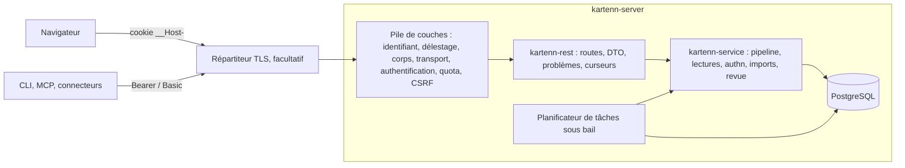

# 006 — API REST : conception

## Vue d'ensemble



1. **`kartenn-rest`** (nouvelle crate) : routeur axum, types de requête et de réponse
   (DTO, distincts des types du noyau), conversion des erreurs en problèmes, curseurs,
   filtres, cache, contrat OpenAPI (utoipa). Aucune logique métier : chaque route
   appelle le service ou, pour une lecture sans cas d'usage dans le service, le store
   après un contrôle de droit (fin de la 005).
2. **Pile de couches** (tower) : transverse, dans l'ordre de REQ-006-22.
3. **`kartenn-server`** : compose le routeur, le serveur HTTP (TLS facultatif) et le
   planificateur de tâches dans `app::run`, à côté des relais et du scellement de la 012.

## Changements

### Crates et dépendances

| Crate | Rôle | Dépendances nouvelles |
|---|---|---|
| `kartenn-rest` (nouvelle) | routeur, DTO, problèmes, curseurs, filtres, cache, CSRF, quotas, OpenAPI | `axum` 0.8.9, `tower` 0.5 (`limit`, `load-shed`), `tower-http` 0.7 (`compression-zstd`, `-br`, `-gzip`, `limit`, `timeout`), `utoipa` 6 et `utoipa-axum` 0.3, `governor` 0.10 (GCRA), `serde_json` |
| `kartenn-server` | boucle d'acceptation propre, HTTP/1.1 et HTTP/2 (`hyper-util` 0.1 `auto`), TLS par `tokio-rustls` 0.26 avec `ring` (sans aws-lc, comme la 012), configuration `[http]`, planificateur, câblage | `hyper-util`, `tokio-rustls`, `arc-swap` |
| `kartenn-service` | `authn::seen` (identité juste-à-temps sans événement), `RequestContext` rempli depuis HTTP, `Outcome::Replayed` complété (réponse reconstruite), port `Jobs` | — |
| `kartenn-store-pg` | migration `job` (tâches sous bail), verrou d'idempotence, `transaction_timeout`, lectures paginées par clé | — |
| `kartenn-auth` | usage de clé `Purpose::Cursor` (HKDF, `kartenn/cursor/v1`) | — |

Évaluées le 2026-10-18 (`crate-scout`) : licences MIT ou MIT/Apache-2.0, MSRV ≤ 1.98.
- `http` 1.5 a `Method::QUERY` ; hyper accepte tout jeton de méthode. axum 0.8 n'a pas
  de `MethodFilter` pour `QUERY` : la route `QUERY` passe par `any()` et un contrôle de
  la méthode, et l'en-tête `Allow` des 405 est écrit par kartenn (`any()` le supprime).
  Le passage de `QUERY` en HTTP/2 est vérifié par un test d'intégration.
- `governor` est appelé par une couche propre (`check_key_n` pour le poids, `NotUntil`
  pour `Retry-After`, `retain_recent` et un plafond du nombre de clés contre la
  croissance par clés variées) plutôt que par `tower_governor` (poids fixe, en-têtes
  non standard, pas de purge).
- TLS : boucle d'acceptation sur `tokio-rustls` plutôt que `axum-server` (maintenance
  plus lente) : maîtrise du délai de poignée de main, du nombre de connexions et de
  l'arrêt propre ; rechargement du certificat par un `ResolvesServerCert` sur
  `ArcSwap`.
- Aucun crate Rust mûr ne compare deux documents OpenAPI : comparateur interne.

### Pile de couches (REQ-006-20, 22, 27 à 31, 37)

De l'extérieur vers la route :

| # | Couche | Effet |
|---|---|---|
| 1 | Identifiant de requête et trace | UUID v7 toujours généré (un identifiant entrant n'est jamais repris), en-tête `Request-Id` en réponse ; `traceparent` selon REQ-012-7 ; `RequestContext` |
| 2 | Délestage | `LoadShed` à l'extérieur de `ConcurrencyLimit` (dans l'autre ordre, `poll_ready` attend au lieu de refuser) ; `Overloaded` → 503 `Retry-After` par `HandleErrorLayer` |
| 3 | Délai | `TimeoutLayer::with_status_code(503)`, 30 s par défaut jusqu'aux en-têtes de réponse ; `RequestBodyTimeoutLayer` pour la lecture du corps |
| 4 | Transport | adresse cliente et TLS : directs, ou `Forwarded` des proxys de confiance seulement |
| 5 | Limite de corps | `Content-Length` ou flux au-delà de la limite → 413 ; `Content-Encoding` → 415 |
| 6 | Authentification | cookie, Bearer ou Basic → `Principal` ; échec → 401 ; anonyme permis seulement sur les routes publiques |
| 7 | Quota | GCRA par identité (par adresse avant authentification) → 429 |
| 8 | CSRF | méthode non sûre par cookie : `Sec-Fetch-Site`, puis `Origin` → 403 |
| 9 | Route | extraction (syntaxe → 400, type de média → 415), préconditions (428, 412), service (403, 404, 409, 422) |
| 10 | Compression | au retour, sauf réponses marquées « secret » (extension de réponse) |

L'ordre réalise REQ-006-22 : une requête non authentifiée et malformée est arrêtée en 6
(401) avant que la route n'en lise le corps. Le quota vient après l'authentification
pour compter par identité ; avant elle, la couche 7 compte par adresse les requêtes
dont l'authentification échoue, avec le `FailureLimiter` (005) pour les échecs.

### Ressources et routes (REQ-006-1, 4, 11, 12, 16 à 19, 24, 33 à 36)

Toutes sous `/v1`, sauf les sondes. Collections à plat, objet par UUID.

| Domaine | Routes |
|---|---|
| Objets du noyau | `entities`, `sites`, `domains`, `prefixes`, `ranges`, `addresses` : `GET`/`QUERY` collection, `POST` collection, `GET`/`PATCH`/`DELETE` objet, `GET …/{id}/history` |
| Arbre | `GET /v1/prefixes/{id}/children`, `…/ancestors`, `…/occupancy`, `…/next-free?kind=prefix&length=26` ou `kind=address` |
| Anomalies | `GET /v1/anomalies` ; `POST /v1/anomalies/{id}/acknowledgement` |
| Propriétés | `property-declarations`, `property-declarations/{key}/values` ; `GET /v1/<collection>/{id}/properties` (valeurs résolues), `…/properties/{key}/explanation`, `…/properties/{key}/suggestion` ; `GET /v1/property-gaps` (écarts) |
| Changesets | `POST /v1/changesets` (`?simulate=true` → 200 sans écriture) ; `GET` collection et objet ; `GET …/{id}/diff` (décompte, détail paginé) ; `POST …/{id}/validation`, `…/rejection`, `…/withdrawal`, `…/undo` ; `GET /v1/proposals` |
| Imports | `POST /v1/imports` ; `PUT /v1/imports/{id}/chunks/{n}` ; `POST …/start`, `…/resume`, `…/cancel` ; `GET …/{id}` |
| Droits | `roles`, `bindings`, `issuer-attachments`, `service-accounts`, `service-accounts/{id}/secrets`, `identities` (état), `GET /v1/me` (session, droits effectifs résumés) |
| Audit | `GET`/`QUERY /v1/audit-events` ; `POST /v1/identities/{id}/pseudonymisation` |
| Authentification | `GET /v1/auth/login?issuer=…`, `GET /v1/auth/callback`, `POST /v1/auth/logout`, `POST /v1/auth/breakglass` ; publiques : `GET /v1/auth/issuers` (007) et `GET /v1/auth/native-clients` (amendement 023/A5 : `[{id, discovery_url, client_id, audience, scopes, device}]`, client public des applications natives des seuls émetteurs configurés avec `native_client_id`, sans secret) |
| Exploitation | `GET /v1/capabilities`, `GET /v1/openapi.json`, `PUT /v1/log-filters/{output}` ; `/health/live`, `/health/ready` |

- Les actions d'un changeset sont des sous-ressources en `POST` (RFC 9205 §4.5 : une
  action non idempotente est un `POST`) ; elles exigent `If-Match` (ETag du changeset =
  son état), comme `PATCH`.
- Les morceaux d'import sont des `PUT` à numéro explicite : un renvoi identique est
  idempotent par nature (H9) ; un contenu différent sous le même numéro → 409.
- Les routes de connexion sont publiques ; `logout` exige la session et le contrôle CSRF.
- **Anomalies (arbitrage du 2026-10-18)** : la liste ne montre que les anomalies dont
  l'objet est lisible par l'appelant ; l'acquittement exige la permission
  `core.anomaly.acknowledge` (nouvelle, catalogue 005) sur l'objet de l'anomalie, un
  `motive` (membre réservé, sinon 422 `motive-required`), et enregistre un événement
  d'audit ; il n'exige pas `If-Match`, l'acquittement étant lié à la version courante
  de l'objet (REQ-002-36). Une anomalie d'un objet invisible répond 404.
- **Propriétés (arbitrage du 2026-10-19)** :
  - déclarations et listes de valeurs : lisibles par tout appelant authentifié (un
    schéma, pas une donnée ; lecture non auditée), datées, paginées par clé ; une
    déclaration `{id, key, type, params, cardinality, carriers, inherit, sensitive,
    expected}` (`expected` `{source, mode}` ou `null`), `links.values` ; les valeurs
    d'une clé inconnue → 404, d'un type autre que `enum` → 409 ;
  - valeurs résolues (`…/{id}/properties`) : celles de la lecture de l'objet, datées
    (`valid_at`, `as_of`), `{properties: {clé: valeur | null}, masked: [clés]}` (`null` :
    « sans valeur » explicite ; une valeur sensible sans `prop.<clé>.read` est absente et
    sa clé dans `masked`, REQ-005-21) ; ETag faible du contenu ;
  - explication : objet gardé comme ses sous-ressources (404), propriété non déclarée à
    la date → 404 ; `{property, value, masked, origin, chain, provenance, replaces}`,
    nœuds `{kind, id, href}` ; un nœud de la chaîne que l'appelant ne lit pas vaut
    `null` (sa position reste, son existence n'est pas divulguée, REQ-005-19) ; valeur
    sensible sans droit : `value` et `replaces.value` `null`, `masked: true` ; lecture
    auditée (`data.objects.read`, plus `data.sensitive.read` si la valeur est rendue) ;
  - suggestion : le registre des sources (`Sources`) est passé à l'`Api`, vide tant
    qu'aucun module n'en fournit ; calculée sur l'état courant à `valid_at` (`as_of`
    donné → 400) ; `{property, suggestion: {values, explanation} | null}`, masquée et
    auditée comme l'explication ;
  - écarts : `GET /v1/property-gaps?property=…&domain=…&entity=…`, les anomalies
    ouvertes de la règle `prop.resolution.expected_mismatch` dont l'objet est lisible,
    `{id, property, object, message, opened_at}`. Leur message cite la valeur résolue :
    pour une propriété sensible sans `prop.<clé>.read`, il est remplacé par un texte
    générique, ici comme dans `/v1/anomalies`.
- **Cycle d'un changeset (arbitrage du 2026-10-19, 006-17)** :
  - lecture : `GET /v1/changesets/{id}`, `GET /v1/changesets` et `GET …/{id}/diff`
    exigent `core.changeset.read`, nouvelle permission du catalogue 005, globale
    uniquement (accordée sur l'objet sentinelle `CHANGESETS`) ; sans elle → 403
    `forbidden` et `authz.access.denied`, avant toute recherche (un changeset absent
    n'est pas un oracle) ; changeset absent → 404. Chaque lecture est auditée
    (`data.objects.read`, cible `changeset`) ;
  - masquage (REQ-005-21) : dans les opérations, les `values` d'une affectation d'une
    propriété sensible valent `null` et l'opération porte `masked: true`, sauf
    `prop.<clé>.read` sur l'objet (propriété ou objet en référence locale : toujours
    masqué) ; dans le différentiel, `before` et `after` d'une propriété sensible sans ce
    droit valent `null`, `masked: true`, dans le détail comme dans le décompte (qui
    porte aussi les valeurs) ; une entrée du décompte n'est rendue que si l'appelant a
    le droit sur chacun des objets qu'elle compte ; une valeur sensible rendue est auditée
    (`data.sensitive.read`). Le condensat d'un secret de compte de service
    (`secret.digest`) n'est jamais rendu ; les messages de violation sont masqués comme
    dans la réponse d'une soumission ;
  - représentation : `{id, state, kind, author, validator, motive, valid_from, valid_to,
    submitted_at, applied_at, expires_at, policy, rejection, operations, violations,
    diff, cascaded, links: {diff}}` (`diff` : le décompte journalisé ; `violations` :
    erreurs puis avertissements, avec `operation` et `pointer` comme en 006-14). ETag
    fort `"<état>"` (`"pending"`, `"applied"`…) ;
  - liste : `GET /v1/changesets?state=…&author=…` (chaque filtre au plus une fois, un
    état du schéma, un auteur UUID ; `valid_at` ou `as_of` → 400), tri par temps
    système (`submitted_at`) décroissant puis UUID décroissant, curseur lu à l'état
    courant à chaque page (comme 006-13b), migration 0038 d'index `(submitted_at, id)` ;
    élément `{id, href, state, kind, author, motive, submitted_at}` ;
  - différentiel : `GET …/{id}/diff?property=…` → `{counts, items, links: {next}}`,
    `counts` le décompte journalisé, `items` `{property, object: {id}, before, after,
    masked}` dans l'ordre `seq` du journal, curseur sur `seq` ;
  - propositions : `GET /v1/proposals`, celles que l'appelant peut valider (REQ-004-43,
    sans `core.changeset.read`), plus anciennes d'abord, curseur sur `(submitted_at,
    id)` ; élément comme dans la liste, plus `required` (`[{permission, objects}]`) ;
  - actions : `POST …/validation`, `…/rejection` (`{motive}` obligatoire, sinon 422
    `motive-required`), `…/withdrawal`, `…/undo` ; seule `undo` exige
    `core.changeset.read` (elle lit le changeset pour l'inverser). `If-Match`
    obligatoire : absent ou `*` → 428 ; une étiquette qui n'est pas l'état courant →
    412 ; l'état attendu est `"pending"` (validation, rejet, retrait) ou `"applied"`
    (annulation). Changeset absent → 404 ; décidé entre-temps → 409 `conflict`. Auteur
    qui valide ou rejette, validateur sans le droit, non-auteur qui retire → 403
    (`changeset.approval.self`, `changeset.approval.forbidden`,
    `changeset.state.not_author`, audités) ;
  - réponses : validation appliquée → 200, corps de soumission et `Link` vers le
    changeset ; revalidation échouée → 422 `changeset-refused` avec les violations ;
    rejet et retrait → 200 `{changeset, state}` ;
  - annulation : inverse généré (REQ-004-34) ; s'il a des conflits (objets ou droits
    écrits depuis, REQ-004-35) → 409 `undo-conflict`, extension `conflicts` :
    `[{kind, id, property, by}]` puis `[{row, by}]` pour les droits ; sinon soumis par
    le pipeline sous les droits de l'appelant : 201/202/422 comme `POST /v1/changesets`,
    `Location` et `Link` vers le nouveau changeset, plus `undoes` et `unsupported`
    (`[{kind, id}]`, ce qui n'est pas annulé) dans le corps ; `?simulate=true` → 200,
    la réponse de simulation plus les `operations` de l'inverse, rien d'écrit.
- **Droits (arbitrage du 2026-10-19, 006-18)** :
  - lecture : rôles, liaisons, rattachements, comptes de service et identités exigent
    `core.rbac.read`, nouvelle permission du catalogue 005, globale uniquement
    (accordée sur l'objet sentinelle `RBAC_OBJECT`) ; sans elle → 403 `forbidden` et
    `authz.access.denied`, avant toute recherche ; chaque lecture est auditée
    (`data.objects.read`, cible `rbac`). État courant seulement (`valid_at`, `as_of` →
    400), collections paginées par curseur sur leur clé ;
  - écritures comme les routes par ressource (006-16) : un changeset d'une opération
    d'administration (005), membres réservés `motive`, `valid_from`, `valid_to`,
    réponses 201/200, 202 sous une politique, 422 et `Link` vers le changeset ; les
    contrôles sans escalade sont ceux du pipeline (REQ-005-25, 26). Pas d'`If-Match` :
    la version d'objet (0037) ne couvre que les objets du noyau ;
  - rôles : `{key, href, label, builtin, entries}` ; `GET /v1/roles`, `GET`/`PUT`/
    `DELETE /v1/roles/{key}` ; `PUT {label, entries}` remplace le rôle (201 s'il est
    créé, 200 sinon), `DELETE` le clôt avec ses liaisons ;
  - liaisons : `{id, href, subject, role, scope, valid_from, valid_to}`, `subject` et
    `scope` dans la forme de l'opération `bind` ; `POST /v1/bindings` → 201 et
    `Location`, `GET`/`DELETE /v1/bindings/{id}` ;
  - rattachements : `{issuer, entity}` (`entity` `null` : partout) ; `POST
    /v1/issuer-attachments` → 201 ; `DELETE /v1/issuer-attachments?issuer=…[&entity=…]`
    (un émetteur est une URL : la requête l'identifie, sans encodage dans le chemin) ;
  - comptes de service : `{id, href, name, disabled, secrets: [{id, key_id,
    created_at, expires_at, revoked}]}`, jamais le condensat ; `POST
    /v1/service-accounts {name, expires_at}` → 201, `Location` ; `POST …/{id}/secrets
    {expires_at}` → 201 ; `DELETE …/{id}/secrets/{secret}` révoque. Le serveur génère le
    secret (`kartenn_auth::secrets::generate`), seul le condensat entre dans le
    changeset ; la réponse de création ou d'ajout, appliquée (201) ou en attente (202),
    porte `secret: {id, value, expires_at}` une seule fois, réponse `Secret` (`no-store`,
    jamais compressée) ; un rejeu par `Idempotency-Key` ne le rend plus (l'empreinte
    de la requête omet l'identifiant et le condensat du secret, tirés à chaque envoi) ;
  - identités : `{id, href, kind, name, issuer, disabled, revoked_after}` ; `GET
    /v1/identities`, `GET /v1/identities/{id}`, `PATCH` (Merge Patch) `{disabled,
    revoke_sessions}` ;
  - `GET /v1/me` (route de 005, sans permission ni audit) étendu par ajouts seulement
    (REQ-006-33) : `name`, `bindings` (`[{role, scope}]`, les liaisons effectives,
    directes, de groupe ou d'émetteur), `global_permissions` (celles des liaisons
    globales) et `session.expires_at` (fin de session, par inactivité ou durée absolue ;
    `session` reste `null` hors session cookie).
- **Audit et exploitation (arbitrage du 2026-10-19, 006-19)** :
  - journal : `GET /v1/audit-events?from=…&to=…&name=…&actor=…&object=…` et `QUERY
    /v1/audit-events` (corps JSON, mêmes critères, chacun facultatif ; `from`/`to` en
    RFC 3339 avec décalage, `actor`/`object` UUID) exigent `core.audit.read`
    (REQ-012-17) ; sans elle → 403 `forbidden` et `authz.access.denied`. État courant
    seulement (`valid_at`, `as_of` → 400). Un événement est la ligne exportée telle
    quelle (`audit.event`, avec `seq`) ; tri par `seq` décroissant, curseur opaque sur
    `seq` (`limit` jusqu'à 1000, 100 par défaut), `{items, links: {next}}`. Chaque page
    est auditée `audit.events.read` (critères, nombre) ;
  - export : la même route sous `Accept: application/x-ndjson` rend toute la sélection,
    un événement par ligne, en flux lu par pages internes (pas de curseur ni de
    `limit`) ; un seul `audit.events.read` avec les critères et le nombre total, écrit
    avant le flux (son nombre est celui de la sélection au moment de l'audit), même
    permission ;
  - pseudonymisation : `POST /v1/identities/{id}/pseudonymisation {motive}` exige
    `core.identity.pseudonymise`, nouvelle permission du catalogue 005, globale ; sans
    elle → 403 et `authz.access.denied`, avant toute recherche. Immédiate, sans
    condition de départ ni de délai (le traitement par lot de REQ-004-33 reste) ;
    `motive` obligatoire (422 `motive-required`). Personne inconnue → 404 ; compte de
    service → 409 `conflict` ; déjà pseudonymisée → 200 sans effet ni nouvel événement.
    L'événement `person.identity.pseudonymised` (acteur, motif) est écrit dans la transaction de
    la pseudonymisation ; réponse 200, l'identité (forme de `GET /v1/identities/{id}`) ;
  - recherche de changesets (REQ-004-32) : `GET /v1/changesets` gagne, par ajout
    (REQ-006-33), `object` (UUID : changesets qui ont écrit l'objet, version courante
    ou historique), `from` et `to` (temps de soumission, `from` inclus, `to` exclu,
    RFC 3339 avec décalage) et `retroactive` (`true`/`false`), chacun au plus une fois ;
  - filtres de log : `PUT /v1/log-filters/{output} {filter, ttl}` (`ttl` en secondes,
    3600 par défaut, 86 400 au plus) exige `core.observability.admin` ; sortie non
    configurée → 404 ; filtre qui ne s'analyse pas ou durée hors bornes → 422
    `invalid-override` ; 200 `{output, filter, expires_at}`. Chaque instance applique la
    surcharge à sa prochaine lecture et revient d'elle-même à la configuration à
    l'échéance (REQ-012-27).

### Représentations et DTO (REQ-006-2, 3, 13)

- Un DTO par type d'objet dans `kartenn-rest`, dérivé du type du noyau par `From` ; le
  schéma OpenAPI se dérive du DTO. Les types du noyau restent libres d'évoluer.
- Résumé d'un objet lié : `{ id, <clé naturelle>, href }`, lu par la même requête
  (jointure fixe). Liens : `links.self`, `links.history`, et les liens de navigation.
- Valeurs canoniques en sortie (préfixes et adresses, REQ-002-6), dates RFC 3339 en UTC.
- **Objets du noyau (arbitrage du 2026-10-18)** : `domains` `{id, slug}`, `entities`
  et `sites` `{id, slug, parent}`, `prefixes` `{id, domain, value, nature,
  point_to_point, anycast, public}`, `ranges` `{id, domain, first, last, usage,
  public}`, `addresses` `{id, domain, value, usage, public}` ; `domain` et `parent` sont
  des résumés `{id, slug, href}` (`parent` vaut `null` à la racine). Les propriétés ne
  sont pas dans l'objet : `links.properties` mène aux valeurs résolues (006-13). Filtres
  de clé naturelle : `slug` ; `parent` (slug) pour les entités et les sites ; `domain`
  (slug) et `value` (`first` pour une plage) pour les objets d'adressage ; une valeur
  répétée vaut « l'une de ». Les listes sont triées par clé naturelle puis UUID.
- **Historique** : `GET …/{id}/history` rend `{items: [{valid_from, valid_to,
  asserted_from, asserted_to, changeset: {id, href}, object}]}` (`valid_to` et
  `asserted_to` `null` quand ouverts), trié par début de validité puis d'assertion ;
  lisible si l'objet l'est aujourd'hui (sinon 404), audité comme une lecture.
  `valid_at` donné ne garde que les versions valides à cette date (toutes leurs
  assertions), sur toutes les pages : la clé du curseur le porte. À un `as_of` passé,
  l'historique est celui connu alors : versions assertées à `as_of`, et une version
  retirée après `as_of` rendue avec `asserted_to` `null` — rien de postérieur ne
  transparaît, la réponse au passé figé reste immuable (REQ-006-6) (006-12e).
- Membres réservés des corps d'écriture : `motive` (obligatoire), `valid_from`,
  `valid_to` ; jamais confondus avec des champs de l'objet (le noyau n'a aucun champ de
  ce nom ; un test du contrat le garantit).
- **`null` et absent (question ouverte H13a, tranchée)** : dans les objets du noyau,
  aucun champ ne distingue `null` d'absent. Dans les propriétés, deux gestes diffèrent :
  retirer l'affectation (l'héritage reprend) et l'effacement explicite (REQ-003-13, qui
  bloque l'héritage). `null` vaut retrait ; l'effacement s'écrit
  `{"properties": {"k": {"clear": true}}}`. Aucun type de propriété n'a de valeur objet,
  la forme est donc sans ambiguïté.

### Lectures datées et cache (REQ-006-5, 6)

- `valid_at`, `as_of` : RFC 3339 avec décalage, analysés strictement ; absents → `now()`
  de la base, renvoyé dans la réponse (`as_of` effectif) pour que le client puisse figer
  ses lectures suivantes.
- **Passé figé (question ouverte H4, tranchée)** : PostgreSQL 18 borne la durée d'une
  transaction (`transaction_timeout`). Le pool de l'instance (`run`), unique et partagé
  par l'API, le service et les tâches de fond, la fixe à `T` pour tout écrivain
  (configuration `[http] write_transaction_timeout_s`, 60 s par défaut ; la plus longue
  écriture mesurée, un changeset de 10⁴ objets, prend 2,5 s, INV-35) ; lectures et
  tâches de fond sont donc bornées aussi. Les commandes ponctuelles (`migrate`,
  `audit purge`) ont leur propre connexion, non bornée. Une transaction commencée à `s`
  est close avant `s + T` ; si `as_of ≤ now() − T − 1 s` (marge d'horloge), aucune
  écriture ne peut plus apparaître à `as_of`. La comparaison se fait avec `now()` de la
  base, lu avant les données (qui sont alors au moins aussi récentes). Alors :
  `Cache-Control: private, max-age=31536000, immutable`.
- Sinon : `private, no-cache`, ETag ; objet : ETag fort `"<version>.<empreinte>"`, la
  version étant l'identifiant du dernier changeset qui l'a modifié (le même que
  `expected`, REQ-004-11) et l'empreinte les 64 premiers bits (16 chiffres hexadécimaux)
  du SHA-256 des octets du corps (H19) ; liste : ETag faible = empreinte du contenu de la
  page. `If-None-Match` (étiquette entière) → 304 sans corps. Le kit des modules
  (`kit::answer`) calcule l'étiquette composite pour toute lecture d'un objet.
- Même au passé figé, la réponse reste `private` : elle dépend des droits de l'appelant,
  un cache partagé ne doit jamais la servir à un autre.

### Curseurs (REQ-006-7, 8)

- Contenu : version, identifiant de la clé du trousseau, `as_of` figé, `valid_at`,
  filtres normalisés, taille de page, dernière clé de tri vue, sens. Sérialisé en JSON
  compact, HMAC-SHA-256 par la sous-clé `Purpose::Cursor`, encodé base64url. Non chiffré :
  il ne contient que ce que le client a envoyé et des clés visibles de lui.
- `as_of` figé = `now()` de la base à la première page. Une transaction commencée avant
  et validée après peut faire apparaître un élément derrière le curseur : c'est le cas
  d'une insertion concurrente ordinaire, sans répétition ni saut d'un élément déjà vu
  (tri par clé). Le gel n'est donc pas borné par `T`, contrairement à `immutable`.
- Une requête avec `cursor` n'accepte que `page_size` ; tout autre paramètre → 400
  (les filtres sont dans le curseur, le lien `next` les contient déjà).
- Signature fausse, clé inconnue ou version inconnue → 400 `invalid-cursor`. Le RBAC est
  le prédicat SQL habituel (ADR 0021), réappliqué à chaque page.
- Tri : clé naturelle puis UUID (préfixes : domaine, valeur ; adresses : domaine,
  valeur ; changesets : temps système décroissant, UUID). Lecture par index (keyset),
  `LIMIT page_size + 1` pour savoir s'il existe une suite.

### Filtres (REQ-006-9, 10)

- **Séparateur des opérateurs (question ouverte H6, tranchée)** : une clé de propriété
  suit `[a-z][a-z0-9_]*.[a-z][a-z0-9_]*` (REQ-003-2) et ne contient jamais `:`. L'opérateur
  suit donc la clé après `:` :
  - `prop.policy.environment=prod` : égal ; répété → un parmi ;
  - `prop.dns.ttl:between=60..3600`, bornes ouvertes `..3600` ou `60..` ;
  - `prop.dns.fqdn:exists=true` ou `false` : présent ou absent.
  Mêmes opérateurs pour les champs du noyau (`usage`, `nature`…) ; `within=<CIDR>`
  désigne l'inclusion. `:` est permis dans une requête (RFC 3986 §3.4, `pchar`).
- **Champs du noyau servis** (021-28) : entités et sites `slug`, `parent` ; domaines
  `slug` ; préfixes `domain`, `value`, `within`, `nature` ; plages `domain`, `first`,
  `within`, `usage` ; adresses `domain`, `value`, `within`, `usage`. Égalité seule
  (répétée : un parmi). `within=<CIDR>` : un préfixe inclus ou égal (`<<=`), une adresse
  dedans, une plage dont les deux bornes y sont ; valeur canonique exigée (bits d'hôte →
  400). `nature`, `usage` : valeurs de leur énumération, sinon 400. Prédicats SQL de la
  liste (`list::objects`, `$12` CIDR, `$13` valeurs), sous le même tri par clé.
- **Déclaration au contrat** (H20, 021/X41) : chaque filtre servi est un `parameter` de
  la liste, typé (`$ref` de l'énumération, `x-kartenn.collection` de la liste d'origine
  des valeurs) ; les filtres de propriétés, en trois gabarits `prop.{key}`,
  `prop.{key}:between`, `prop.{key}:exists` marqués `x-kartenn.template`, sur les seules
  listes qui filtrent par propriété. Test de contrat : chaque liste sondée avec tous les
  noms de filtre du contrat ; un nom accepté (refus autre que « unknown parameter ») doit
  être déclaré.
- Traduction vers le moteur de filtres de la 003 (`kartenn_store_pg::filter`), qui
  garde ses plans et ses budgets ; un paramètre inconnu, une clé non déclarée ou une
  valeur mal typée → 400 avec le nom du paramètre.
- **Filtres de propriétés (arbitrage du 2026-10-19)** : le moteur de la 003 filtre une
  condition dans un domaine, au temps système courant, et pagine par UUID. Un filtre
  `prop.<clé>` exige donc un seul `domain=` ; plusieurs conditions sont intersectées ;
  la liste filtrée est triée par UUID (le curseur porte l'UUID) ; sans domaine, sur les
  entités et les sites, ou à un `as_of` passé → 400 qui le nomme. Les champs du noyau
  (`value`, `first`) restreignent le moteur (`$12`, valeurs de `addressing_object`). Le
  curseur ne fige pas `as_of` : chaque page relit l'état courant (exception de
  REQ-006-7). `within`, `nature`, `usage` s'appliquent ensuite aux objets de la page du
  moteur : une page peut compter moins de `page_size` éléments sans être la dernière
  (021-28). Des sous-requêtes dans
  la liste triée par clé naturelle ne seraient envisagées que si le banc le demande.
- `QUERY` : corps `application/json`
  `{ "valid_at", "as_of", "filters": [{ "field", "op", "value" }], "page_size" }` ; mêmes
  conditions, même traduction. `Accept-Query: "application/json"` sur les collections ;
  réponse avec `Content-Location` absent (pas de ressource de résultat stockée, D9).
  Cache : `private` comme `GET` ; ETag faible de la page ; conditionnelles comme `GET`.
- Une URL de plus de 8 Kio → 414 avant le routage.

### Écritures (REQ-006-11 à 15)

- **Routes par ressource** : `POST /v1/prefixes` → `Operation::CreatePrefix` ;
  `PATCH /v1/prefixes/{id}` → `Operation::Modify…` avec les champs du Merge Patch et
  `expected` = ETag ; `DELETE` → `Operation::Close…` (corps facultatif : `motive`,
  `valid_from`). Le motif d'un `DELETE` sans corps manque → 422 `motive-required`.
- **Routes par ressource (arbitrage du 2026-10-19, 006-16)** :
  - corps de `POST` : les membres du DTO, plus les membres réservés ; `domain` et
    `parent` sont des références `{"id": …}` (la forme du résumé, sans `href`).
    `domains` `{slug}`, `entities` et `sites` `{slug, parent}`, `prefixes` `{domain,
    value, nature, point_to_point, anycast}`, `ranges` `{domain, first, last, usage}`,
    `addresses` `{domain, value, usage}`. Un membre inconnu → 400. 201 et `Location`
    vers l'objet créé, retrouvé par son changeset (la ligne, courante ou historique,
    écrite par lui). `Idempotency-Key` y est accepté comme sur `POST /v1/changesets`
    (REQ-006-15) ; le rejeu rend la même réponse, `Location` compris ;
  - `PATCH` : un seul changeset de N opérations, dans l'ordre : une garde
    `Operation::Expect {kind, id, expected}` (valeur de `If-Match`), puis les champs
    (`slug` → `Rename` ; `parent` → `MoveEntity`/`MoveSite`, `null` = racine ; `domain`,
    `value`, `nature`, `point_to_point`, `anycast`, `usage` → `Update…`, l'`usage`
    courant complété par la route quand il manque), puis les propriétés dans l'ordre des
    clés : valeur (scalaire ou tableau) → `AssignProperty`, `null` → `UnassignProperty`,
    `{"clear": true}` → `ClearProperty`. Seule la garde porte `expected`. Un membre que
    le service ne modifie pas (`id`, `public`, `value` d'une adresse, `first`/`last`
    d'une plage) ou une propriété non déclarée → 422 `invalid-member` et `pointer` vers
    le membre ;
  - `DELETE` : `Close {expected, cascade: false}` ; corps facultatif `{motive,
    valid_from}` ;
  - réponses : 201 (création), 200 (modification, clôture) avec le corps de
    `POST /v1/changesets` (`{changeset, state, warnings, diff, cascaded}`), 202 en
    attente ; `Link` vers le changeset. Un refus dont une violation est
    `changeset.operation.conflict` → 412 (`violations` et `changeset` en extensions),
    sinon 422 ; `operation` est omis, `pointer` désigne le membre source (`/slug`,
    `/parent`, `/properties/<clé>`), `""` (le corps entier) pour la garde, une
    création, une clôture ou un `Update…`, `null` pour une règle de l'état final ;
  - `If-Match` : une seule étiquette forte dont l'opaque est `<UUID>.<16 hex>` ou un
    UUID nu ; seule la version (l'UUID) est comparée (H19) ; absent ou `*` → 428,
    plusieurs valeurs ou syntaxe invalide → 400, étiquette faible ou opaque d'une autre
    forme → 412 (ne peut égaler aucune version).
- **Version d'un objet (arbitrage du 2026-10-19, 006-16)** : la version est le dernier
  changeset qui a écrit l'objet **ou ses propriétés**. Migration 0037 `object_version
  (object_id PK, changeset_id)`, mise à jour dans la transaction du changeset par toute
  écriture de l'objet (création, modification, déplacement, renommage, clôture,
  restauration, cascade) ou de ses affectations (affectation, effacement, retrait),
  initialisée depuis les lignes courantes. Elle donne l'ETag de toute lecture sans
  `as_of` (une lecture à un `as_of` passé garde le changeset de la ligne, pour le 304),
  et `conflict()` (REQ-004-11) lui compare `expected` pour toutes les opérations,
  `POST /v1/changesets` compris. Elle ignore la période visée : une écriture d'une autre
  période la relève aussi (412 superflu possible, perte jamais). La garde `Expect` exige
  `core.<kind>.read` sur l'objet et n'écrit rien.
- **Réponses** : 201 et `Location` vers l'objet (création), 200 (modification ou
  clôture), 202 (en attente) ; toujours
  `Link: </v1/changesets/{id}>; rel="urn:kartenn:rel:changeset"` (type de relation
  d'extension : URI propre à kartenn, RFC 8288 §2.1.2) et `changeset` dans le corps.
- **`If-Match`** : absent sur `PATCH`, `DELETE` ou une action de changeset → 428 ; la
  version qu'elle porte (H19) devient `expected` ; un conflit du pipeline (`expected`
  périmé) → 412.
  `If-Match: *` est refusé (428) : il ne protège de rien.
- **Idempotence** : en-tête `Idempotency-Key` (1 à 255 caractères imprimables) →
  `ChangesetRequest.idempotency_key`.
  - En cours (H8, 409) : `pg_try_advisory_xact_lock` sur l'empreinte (identité, clé) au
    début de la transaction de soumission ; verrou pris par une autre → 409
    `idempotency-in-progress`. Sans lui, la seconde soumission attendrait l'index
    unique puis rejouerait : correct, mais contraire à REQ-006-15.
  - Rejeu : `Outcome::Replayed` donne le changeset ; la route reconstruit la réponse du
    journal du changeset (même statut, même corps). La réponse est fonction du journal,
    lui-même immuable : « inchangée » sans stocker de réponse. Arbitrage du 2026-10-19
    (006-15) : le journal garde aussi les fermetures ajoutées par cascade
    (`changeset.cascaded`, `[{kind, id}]` dans l'ordre de l'expansion), et le 422 sert
    les erreurs puis les avertissements, dans l'ordre des colonnes `violations` et
    `anomalies` du journal. Statut rejoué : 202 pour un changeset d'approbation ou de
    proposition (même décidé depuis), sinon 201 (`applied`) ou 422 (`refused`) ; seul
    l'`instance` d'un problème, propre à chaque requête, diffère.
  - Contenu différent : `RequestError::IdempotencyConflict` → 422.
  - Purge des clés expirées : tâche de fond (REQ-006-38).
- **`POST /v1/changesets` (arbitrage du 2026-10-19, 006-14)** :
  - corps `application/json` (autre type → 415), ni JSON Patch ni Merge Patch :
    `{motive, valid_from, valid_to, operations}`. `valid_from` et `valid_to` sont des
    dates RFC 3339 avec décalage ; `valid_to` absent ou `null` vaut l'infini (pas de
    valeur spéciale), `valid_from` absent vaut l'heure de la base (REQ-004-3) ; les
    deux absents : `[instant de la transaction, ∞)`. Les opérations gardent la forme du
    service (discriminant `op`, `Ref` `{"id": …}` ou `{"local": n}`, période de
    `within` en microsecondes) jusqu'au DTO du contrat (006-22) ;
  - `?simulate=true` → 200 `{valid, violations, diff, sample, cascaded}`, rien de
    journalisé, donc sans lien ; appliqué → 201, `Location` et `Link` vers le
    changeset ; en attente → 202 et `Link` ; corps `{changeset: {id, href}, state, …}` ;
  - indice d'opération : la violation du noyau porte `operation: Option<usize>`,
    renseigné par le pipeline là où une opération en est la source (planification,
    écriture, cascade : l'opération de la clôture) et journalisé avec elle ; une
    violation de l'état final (REQ-004-7) n'en a pas : `operation` et `pointer` valent
    `null`. Le pointeur désigne l'opération entière (`/operations/2`), pas un membre.

### Erreurs (REQ-006-20 à 23)

- `type` : URN stable `urn:kartenn:problem:<slug>` (RFC 9457 §3.1.1 demande une
  référence d'URI, pas une URL résoluble) ; une URL demanderait un nom de domaine réel
  et stable. Chaque slug est documenté dans le contrat OpenAPI.
- Correspondance des erreurs du service :

| Erreur | Statut | `type` |
|---|---|---|
| JSON invalide, paramètre inconnu, date sans décalage, curseur invalide | 400 | `bad-request`, `invalid-cursor` |
| Sans authentification, jeton invalide | 401 | `unauthenticated` |
| Droit manquant pour une action hors changeset sur un objet visible (lecture d'administration, action sur un changeset, filtre de sortie), CSRF | 403 | `forbidden`, `cross-site-request` |
| Objet absent ou invisible | 404 | `not-found` |
| Annulation en conflit, état d'un changeset incompatible, idempotence en cours, morceau différent | 409 | `conflict`, `undo-conflict`, `idempotency-in-progress` |
| ETag périmé | 412 | `precondition-failed` |
| Corps trop gros | 413 | `payload-too-large` |
| URL trop longue | 414 | — (avant le routage, corps minimal) |
| Type de média | 415 | `unsupported-media-type` |
| Changeset refusé (`Outcome::Refused`), droit d'écriture manquant (règle `core.object.forbidden`, REQ-005-22), motif manquant, trop d'opérations, clé d'idempotence réutilisée, membre non modifiable ou propriété non déclarée, filtre de sortie ou durée invalide | 422 | `changeset-refused`, `motive-required`, `too-many-operations`, `idempotency-key-reused`, `invalid-member`, `invalid-override` ; `invalid-import` ne sort plus en réponse, il décrit l'`error` d'un import (H18) |
| `If-Match` absent | 428 | `precondition-required` |
| Quota | 429 | `rate-limited` |
| Délestage, délai, journal d'audit indisponible (`RequestError::Audit`), base indisponible | 503 | `unavailable` |
| Panique, erreur inattendue | 500 | `internal` |

- `violations[]` : `{ rule, severity, detail, subjects[], operation, pointer }`, où
  `pointer` est un JSON Pointer (RFC 6901) dans le corps de la requête
  (`/operations/2/value`) ; pour une route par ressource, l'indice est omis.
- Le droit d'écriture d'un objet est une règle du catalogue (REQ-005-22) : son absence
  est une violation du changeset, listée avec les autres dans la même réponse 422
  (REQ-006-21), et peut faire du changeset une proposition ; 403 reste aux actions que
  ne porte pas un changeset (arbitrage de la tâche 006-23).
- Un 404 pour un objet invisible est produit par le prédicat de lecture (ADR 0021) : la
  requête ne distingue pas « absent » d'« invisible », il n'y a rien à masquer après coup.
- Les détails ne contiennent que des identifiants et des messages de règles ; une
  valeur de propriété sensible (REQ-005-21) n'y figure jamais.

### Authentification et sessions (REQ-006-24 à 28)

- **Couche d'authentification** : `Authorization: Bearer` → `kartenn_auth::tokens` ;
  `Basic` → `authn::authenticate_service` ; sinon cookie `__Host-kartenn-N` →
  `Session::open`, `StateCache::check`. Deux preuves à la fois (cookie et
  `Authorization`) → 400 : pas de priorité implicite.
- **Identité juste-à-temps des jetons** : `authn::seen`, variante de `logged_in` sans
  événement ; `logged_in` reste pour la connexion OIDC.
- **Cookies** : un module `cookies` construit les `Set-Cookie` (`__Host-`, `Secure`,
  `HttpOnly`, `SameSite=Strict`, `Path=/`, pas de `Domain`) ; la session est réémise si
  sa dernière activité date de plus d'une minute ; suppression par `Max-Age=0`.
- **Secours** : `POST /v1/auth/breakglass` (`name`, `passphrase`, `code`) →
  `authn::authenticate_breakglass` ; session marquée « secours », absolue 1 h.
- **TLS** : `Transport { client, tls }` calculé en couche 4 ; sans TLS, Basic → 401 et
  aucun `Set-Cookie` (la couche des cookies vérifie `tls` avant d'émettre).
- **CSRF** : couche 8, sur `POST`, `PUT`, `PATCH`, `DELETE` authentifiés par cookie.
  `QUERY`, `GET`, `HEAD`, `OPTIONS` exemptés. Pas de CORS : l'API ne répond à aucun
  pré-vol (`OPTIONS` → 405 hors routes), le BFF est de même origine.

### Débit et délestage (REQ-006-29, 30)

- `governor` : un limiteur à clé par compartiment (lecture, écriture, anonyme), clé =
  UUID d'identité ou adresse IP (IPv6 regroupée par /64). Poids : 1 par requête ; un
  morceau d'import pèse `⌈éléments / 1 000⌉`. Mémoire : purge des clés inactives par
  minuterie locale (`retain_recent`).
- 429 : `Retry-After` = attente avant le prochain jeton, arrondie à la seconde
  supérieure ; `RateLimit-Policy: "w";q=20;w=1` et `RateLimit: "w";r=0;t=<s>` (draft-11,
  noms de politique `r`, `w`, `a`). Événement d'audit d'abus agrégé (REQ-012-19).
- Délestage : `LoadShedLayer` puis `ConcurrencyLimitLayer` → 503 `Retry-After: 1`.
  Plafond par défaut : 2 × la taille du pool. Pas de file d'attente dans kartenn : la
  file est celle du noyau (connexions acceptées non encore lues) ; une requête qui
  attendrait serait de toute façon hors budget.

### Transport (REQ-006-31, 32)

- Écoute : `hyper-util` (HTTP/1.1 et HTTP/2) ; en TLS, `tokio-rustls` avec ALPN `h2`,
  `http/1.1` ; sans TLS, `h2c` par connaissance préalable (derrière un proxy).
- Certificats : `[http.tls] cert_file`, `key_file`, relus sur `SIGHUP` (rotation sans
  arrêt) ; TLS 1.2 et 1.3 seulement (défauts de rustls).
- Compression : `CompressionLayer` (`zstd`, `br`, `gzip`), prédicat
  `SizeAbove::new(1024)` et un prédicat propre : absence de l'extension de réponse
  `Secret` posée par les routes qui montrent un secret (création de compte de service,
  ajout de secret). Une réponse de taille inconnue est compressée (comportement de
  `SizeAbove`), sans effet : nos réponses ont une taille connue.
- Limite de corps : `RequestBodyLimitLayer` (16 Mio par défaut ; 413 sur
  `Content-Length` annoncé ou en cours de lecture) ; morceaux d'import : 10 000 éléments
  vérifiés après lecture (413).

### Versions et contrat (REQ-006-33 à 35)

- Routeur `/v1` construit par features : chaque module ajoute ses routes et ses schémas
  (`OpenApiRouter` d'utoipa-axum). `GET /v1/openapi.json` sert le document de la build.
- **Cache du contrat (amendement 023/A5, tâche 023-4)** : `openapi::Served` sérialise le
  document une fois au démarrage, en JSON compact aux membres triés (passage par
  `serde_json::Value` : les extensions d'utoipa sont des tables de hachage, dont l'ordre
  varie d'un processus à l'autre), et calcule son ETag fort, le SHA-256 complet des
  octets en hexadécimal. Réponse `Cache-Control: no-cache` ; `If-None-Match` (comparaison
  faible, RFC 9110 §13.1.2) qui le nomme → 304 sans corps. Deux instances de la même
  build servent donc le même ETag ; la bibliothèque cliente en fait une part de la
  révision de son catalogue (023/REQ-023-2).
- **Extension `x-kartenn` (amendement 023/A5, tâche 023-5)** : ce que les clients
  découverts (ADR 0035) ne tirent pas des conventions. Le kit la produit, donc tout module
  la reçoit :
  - `kit::presented(router, "/<coll>", key, columns)` sur le `PathItem` de collection :
    `{"key": [...], "columns": [...]}`. `key` liste les **filtres** de la liste dont
    l'égalité désigne un seul objet à une date (la clé naturelle), dans l'ordre d'une
    référence `<domaine>/<valeur>` ; vide quand l'objet n'en a pas (machine, flux, valeur
    d'axe). Le kit refuse au démarrage une clé qui n'est pas un filtre. `columns` : les
    membres d'une table par défaut ;
  - `kit::commanded(router, path, méthode, nom)` sur une opération : `{"command": nom}`,
    le verbe des clients (`GET /v1/verdicts` → `check`, `POST /v1/policy-reports` →
    `report`).
  Portent la clé et les colonnes les collections paginées du noyau (dont `anomalies`), de
  `vlan`, `machines`, `policy` et `flow`. Le comparateur ne lit que les opérations :
  l'extension est un ajout, et son retrait ne casse rien non plus (elle est facultative
  pour les clients).
- Contrat de référence : `specs/006-api-rest/openapi-v1.json`, régénéré par
  `cargo run -p kartenn-server --all-features -- openapi` (depuis la 008). Test : le document produit
  est comparé au fichier par un comparateur interne (chemins, opérations, paramètres
  requis, schémas : un retrait, un champ requis ajouté en entrée, un type changé →
  échec) ; un ajout demande de régénérer le fichier.
- `QUERY` dans OpenAPI : OpenAPI 3.2 a un champ `query` dans `PathItem`, que utoipa 6
  sait produire, mais la macro `#[utoipa::path]` ne connaît pas `QUERY` et le champ est
  invalide dans un document 3.1. Le contrat reste en 3.1 (H12, générateurs de SDK) ;
  l'opération `QUERY` est construite à la main et placée dans l'extension `x-query` du
  `PathItem`. Passer en 3.2 quand les générateurs suivront : changement additif.
- Capacités : modules, versions, déclarations de propriétés, plugins UI, et les limites
  (page, changeset, morceau, corps, rétention d'idempotence).
- **Schémas du contrat (arbitrage du 2026-10-19, 006-22)** :
  - les opérations d'un changeset (corps de `POST /v1/changesets` et des morceaux
    d'import) sont lues par un DTO miroir de `kartenn-rest` (`OperationDto`, 35
    variantes, `From` exhaustif vers le service) : le DTO est le contrat, le service
    reste libre d'évoluer ; un test lit un exemple de chaque variante par les deux types ;
  - toute réponse est une structure typée `Serialize` + `ToSchema` servie telle quelle
    (plus de `json!`) : le schéma est celui qui sert ;
  - les énumérations du noyau (nature, usages, genre d'objet) ont un miroir de schéma
    dans `kartenn-rest`, lié par un `match` exhaustif et un test de sérialisation ;
  - les routes servies par un même handler pour les six collections (objets, valeurs de
    propriétés) sont documentées à la main, opération par opération ; `QUERY` reprend
    les réponses du `GET` voisin.

### Imports et tâches de fond (REQ-006-17 à 19, 38)

- Migration : `import_chunk (import_id, n, digest, elements jsonb)` ; `import.state`
  gagne `uploading`. `start` lit les morceaux dans l'ordre, appelle `create_import` (tri,
  lots) dans une transaction, passe l'import à `ready`. **Amendé par H18** : ce travail
  passe dans la tâche `import:<id>` (état `sorting`), voir plus bas.
- Table `job (name, due_at, period, lease_until, holder, heartbeat_at)` ; une ligne par
  tâche périodique, plus une par import prêt (`import:<id>`). Boucle de chaque instance
  (toutes les 5 s) : `SELECT … WHERE due_at <= now() AND (lease_until IS NULL OR
  lease_until < now()) FOR UPDATE SKIP LOCKED LIMIT 1`, prise du bail (30 s), battement
  toutes les 10 s pendant l'exécution, puis `due_at = now() + period` et bail libéré.
- Tâches : `import` (`run_import`, un lot par battement au plus), `expire-pending`
  (`review::expire_pending`, 1 min), `reevaluate-expected` (`expected::reevaluate_outdated`,
  5 min), `public-drift` (`registry::public_drift` puis changeset système, au démarrage
  de la version et chaque jour), `idempotency-purge` (1 h).
- Minuteries locales : purge de `StateCache`, du `FailureLimiter` et des limiteurs,
  rechargement des JWKS et de la découverte (5 min).
- **Imports (arbitrage du 2026-10-19, 006-21)** :
  - états : `uploading`, `sorting` (H18), `ready` (renomme `queued` de la 004),
    `running`, `paused`, `done`, `cancelled` ; les lots gardent `queued`, `applied`, `failed` ;
  - droits : créer est ouvert à tout appelant authentifié ; déposer, démarrer,
    reprendre, annuler et lire sont réservés à l'auteur (un autre appelant → 404, comme
    un objet invisible). Aucune permission nouvelle : chaque lot est un changeset de
    l'auteur, soumis à ses droits lot par lot. Ses droits comptent ses groupes : la
    tâche de fond n'a pas son jeton, donc `start` et `resume` gardent dans l'import un
    instantané de son émetteur et de ses groupes (colonne `import.author_subject`,
    migration 0059), comme un changeset en attente garde celui de son auteur (005,
    REQ-005-22) ; chaque lot est soumis avec lui (correctif du 2026-10-23 : sans lui,
    une personne dont les droits viennent d'un groupe voyait ses lots refusés par
    `core.object.forbidden`) ;
  - `POST /v1/imports {source}` → 201, `Location`, corps = représentation ;
  - `PUT /v1/imports/{id}/chunks/{n} {elements: [{external_id, operation}]}` (`n ≥ 0`,
    trous admis, morceaux lus par `n` croissant au démarrage ; opérations sous la forme
    du service, comme `POST /v1/changesets`) : nouveau → 201, renvoi identique (même
    empreinte SHA-256 du tableau `elements` sérialisé) → 200 sans effet, contenu
    différent → 409 `conflict`, plus de 10 000 éléments → 413 `payload-too-large`,
    import hors `uploading` → 409 ; le morceau pèse `⌈éléments / 1 000⌉` au quota ;
  - `POST …/start` → 202 et `Location` vers l'import (`uploading` → `sorting`, sinon
    409), efface l'`error` précédente et pose la tâche `import:<id>` (H18) ; la tâche
    lit les morceaux par `n` croissant, appelle `create_import` (tri, lots) dans une
    transaction et passe à `ready`. Une erreur de tri (`ImportError` : identifiant
    externe manquant, référence locale inconnue, cycle) ramène l'import à `uploading`
    et enregistre `error` (colonne `jsonb`, problème `invalid-import` et ses
    violations) ; aucun lot n'est créé. Le tri tient sous le bail grâce au battement ;
    une instance arrêtée pendant le tri laisse l'import en `sorting`, repris par la
    suivante ;
  - `POST …/resume` → 202 (`paused` → `ready`, sinon 409) ; `POST …/cancel` → 200
    (`uploading`, `sorting`, `ready`, `running`, `paused` → `cancelled`, sinon 409) : le lot en
    cours se termine, les lots appliqués restent. Aucune action n'exige `If-Match` :
    l'état fait garde ;
  - `GET /v1/imports/{id}` → `{id, source, state, chunks, elements, batches: {applied,
    remaining}, report, error, links: {self}}` (`error` absent sauf après un tri
    échoué, H18) ; `Retry-After: 5` en `sorting`, `ready` et `running` ;
  - exécution : `start` et `resume` posent la tâche `import:<id>` (due aussitôt) ; une
    exécution applique les lots restants l'un après l'autre sous le bail, relit l'état
    avant chaque lot (arrêt sur `cancelled`), et retire la tâche quand l'import est
    `done`, `paused` ou `cancelled`. Une instance arrêtée laisse le lot en cours annulé
    (transaction) ; la suivante reprend au premier lot non appliqué.

### Sondes et corrélation (REQ-006-36, 37)

- `live` : 200 si la boucle tourne. `ready` : `SELECT` de la version des migrations,
  état des sorties d'audit (`SinkHealth`) ; 503 sinon, corps sans détail.
- `Request-Id` en réponse et `instance` dans le problème ; `RequestContext { actor,
  source, request_id, trace }` rempli par les couches 1, 4 et 6.

### Configuration

```toml
[http]
listen = "0.0.0.0:8443"
public_origin = "https://kartenn.example"   # CSRF, liens absolus, redirect_uri par défaut
trusted_proxies = ["10.0.0.0/8"]
max_body_bytes = 16777216
request_timeout_ms = 30000
write_transaction_timeout_s = 60
max_in_flight = 0            # 0 = 2 × la taille du pool

[http.tls]                  # absent = HTTP clair derrière un proxy
cert_file = "/etc/kartenn/tls.crt"
key_file = "/etc/kartenn/tls.key"

[http.rate]
read = { per_second = 50, burst = 200 }
write = { per_second = 10, burst = 20 }
anonymous = { per_second = 20, burst = 20 }
```

`kartenn.example` est un domaine réservé (RFC 2606). Sans `[http]`, l'instance ne sert
pas l'API (tâches de fond seules), utile à un job dédié.

## Erreurs et cas limites

| Cas | Comportement | REQ |
|---|---|---|
| Deux preuves d'authentification | 400 | 26 |
| `If-Match: *` | 428 | 14 |
| Curseur d'une clé retirée du trousseau | 400 ; le client recommence | 8 |
| `as_of` dans le futur | 400 (le temps système n'a pas d'avenir) | 5 |
| Import `start` deux fois | 409 (état `ready` ou au-delà) | 17 |
| Tri d'un import impossible | `start` → 202 ; la tâche ramène l'import à `uploading` avec `error` (`invalid-import`) (H18) | 17 |
| Instance arrêtée pendant un lot | lot atomique, rejoué par une autre instance | 18 |
| `QUERY` vers une route sans `QUERY` | 405 et `Allow` | 10 |
| Journal d'audit indisponible pendant une lecture | 503 (échec fermé, REQ-012-11) | 20 |
| Horloge de l'instance décalée | sans effet : `now()` de la base fait foi | 6 |

## Alternatives considérées

- Réponse rejouée stockée en base (`idempotency_key.response`) : reconstruction depuis
  le journal suffisante et sans stockage.
- Attendre l'index unique pour une clé d'idempotence en cours : rejet, contredit le 409
  de REQ-006-15.
- Curseur chiffré : rien de secret dedans ; la signature suffit.
- `type` des problèmes en URL HTTP : demande un nom de domaine réel ; l'URN est stable.
- CORS ouvert : aucun client navigateur hors BFF prévu.

## Risques

- **`QUERY` mal relayé** par un proxy ancien (méthode inconnue → 405 ou 501 du proxy) :
  `GET` reste disponible pour tout filtre sous 8 Kio ; documenté dans le guide
  d'exploitation.
- **Limites par instance** : plafond réel N × la limite ; documenté (H11).
- **`transaction_timeout`** coupe une écriture anormalement longue : c'est voulu, mais
  un import mal dimensionné échouera ; lots ≤ 10 000 opérations (2,5 s mesurées).
- **Contrat** : un comparateur interne peut laisser passer un cas cassant rare ; il
  couvre les cas listés, complété par la revue.

## Stratégie de test

| REQ | Tests |
|---|---|
| 1 à 4, 33 à 35 | Contrat : opérations présentes, comparateur sur le fichier de référence |
| 5 à 10 | Intégration `tower` : formats de date, cache (`immutable`, 304), pagination sous écritures concurrentes, curseur altéré, filtres et `QUERY` équivalents, 414 |
| 11 à 16 | Intégration : réponses 201, 200, 202, 422 et `violations`, 428, 412, idempotence (rejeu, contenu différent, en cours par deux requêtes simultanées), actions sur changeset |
| 17 à 19, 38 | Intégration à plusieurs planificateurs sur la même base : un seul exécutant, reprise après arrêt simulé |
| 20 à 23 | Un test par ligne du tableau des erreurs ; 404 identique pour invisible et absent |
| 24 à 28 | Matrices : CSRF, TLS et `Forwarded`, cookies (attributs, réémission), Bearer et Basic ; flux OIDC contre un émetteur de test |
| 29 à 32 | Quotas et délestage sous charge ; compression et exception « secret » ; HTTP/2 et ALPN sur vrai TCP + TLS |
| 36, 37 | Sondes base arrêtée ; `Request-Id` identique dans réponse, log et audit |
| 39 | Banc `bench-http` : scénarios de `bench-core` à travers HTTP, et charge (200 utilisateurs, 50 écritures/s) |

## ADR

- ADR 0022 (accepté le 2026-10-19) : contrat HTTP de l'API : `/v1`, curseurs signés, `QUERY`, Merge
  Patch, `If-Match` obligatoire, URN de problèmes.
- ADR 0023 (accepté le 2026-10-19) : tâches de fond sous bail dans PostgreSQL (H9, H16).
