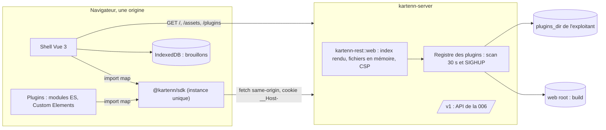

# 007 — Shell Web et plugins : conception

Approuvée par délégation de l'utilisateur le 2026-10-19 (W18 à W28) ; l'amendement de
D35 (W25) reste à confirmer à la relecture.

## Vue d'ensemble



1. **`kartenn-rest::web`** (nouveau module de la crate HTTP) : charge le build du web en
   mémoire, rend `index.html` (import map, plugins du document, CSP), sert les fichiers
   du shell et des plugins, tient le registre des plugins et le publie dans les
   capacités.
2. **`web/`** (pnpm, ADR 0024) : `sdk/` (`@kartenn/sdk`, MPL-2.0), `shell/` (AGPL-3.0),
   `plugins/<nom>/` (MPL-2.0 ; `exemple` pour la 007).
3. **`kartenn-dev-idp`** (nouvelle crate, jamais livrée) : émetteur OIDC de
   développement et de test.
4. **`kartenn-server`** : configuration `[web]`, câblage du module web, minuterie de
   relecture et `SIGHUP`.

Le shell ne connaît que l'API (D7) : chaque écran est une suite d'appels `/v1`, avec la
session cookie de la 005. Un plugin est du code de confiance (W4) : il partage le
document, la CSP et la session.

## Changements

### Crates, paquets et dépendances

| Crate ou paquet | Rôle | Dépendances nouvelles |
|---|---|---|
| `kartenn-rest` | module `web` (build en mémoire, rendu d'`index.html`, CSP, registre et scan des plugins, plages SemVer), ajouts de l'API (W18, W22, W28) | `base64` 0.22 (déjà dans l'espace de travail, en développement) passe en dépendance normale ; `sha2` déjà présent |
| `kartenn-server` | `[web]`, `[[auth.issuers]] label`, minuterie de relecture des plugins, `SIGHUP` installé avec `[web] plugins_dir` | — |
| `kartenn-service`, `kartenn-store-pg` | `Rights::permissions` (entrées des rôles tenus sur tout périmètre) | — |
| `kartenn-dev-idp` (nouvelle, `publish = false`) | émetteur OIDC de développement | aucune hors espace de travail : `axum`, `tokio`, `serde`, `serde_json`, `figment` (TOML), `jsonwebtoken`, `p256`, `rand_core`, `rcgen` (certificat de développement) |
| `kartenn-bench` | sous-commande `web` : charge le jeu de `bench-core` et la personne des budgets du navigateur | — |
| `web/sdk` (`@kartenn/sdk`) | surface publique, client HTTP, contexte, extensions, i18n, brouillon, bac à sable | exécution : aucune ; développement : `openapi-typescript`, `@microsoft/api-extractor` |
| `web/shell` | application | `vue`, `vue-router`, `vue-i18n`, `reka-ui`, `@tanstack/vue-virtual` |
| `web/plugins/exemple` | plugin d'exemple, sans framework | — |
| `web/` (racine) | outillage commun | `vite`, `@vitejs/plugin-vue`, `vue-tsc`, `typescript`, `vitest`, `@vue/test-utils`, `happy-dom`, `@playwright/test` (version de `playwright-driver`), `@axe-core/playwright`, `eslint`, `eslint-plugin-vue`, `typescript-eslint`, `@intlify/eslint-plugin-vue-i18n`, `prettier` |

- Les versions du web sont fixées à la tâche 1 (dernière version stable de chacune,
  licences vérifiées par REQ-007-65) et consignées dans sa note.
- Le SDK n'a **aucune dépendance d'exécution**, Vue comprise : un plugin peut être écrit
  sans framework (D17). Le contexte réactif repose sur `EventTarget` ; le shell
  l'enveloppe dans des composables Vue.
- vue-i18n : compilation des messages à la volée sans `eval` (mode JIT), compatible avec
  `script-src` sans `unsafe-eval` ; une violation relevée en E2E le prouverait faux
  (risque).
- Aucun crate Rust n'est ajouté : fichiers servis depuis la mémoire (pas de `tower-http`
  `fs`), types de média par une liste fermée, plages SemVer par un analyseur de
  quelques dizaines de lignes (sous-ensemble de REQ-007-12).

### Arborescence de `web/`

```
web/
  package.json, pnpm-workspace.yaml, eslint.config.js, .prettierrc.json, tsconfig.base.json
  vitest.workspace.ts, playwright.config.ts, scripts/ (build, contrôles)
  sdk/       src/{index.ts, context.ts, client/, extensions.ts, i18n.ts, draft.ts,
             notify.ts, navigation.ts, range.ts, tokens.ts, host.ts, api/v1.d.ts}
             src/testing/ (bac à sable, entrée @kartenn/sdk/testing)
             manifest.schema.json, etc/sdk.api.md, test/{manifests/, ranges.json}
  shell/     index.html (gabarit), src/{main.ts, router.ts, app/, host/, views/, draft/,
             i18n/{fr,en}.json, styles/{tokens.css, base.css}}, e2e/
  plugins/exemple/  manifest.json, src/, i18n/{fr,en}.json, test/
  dist/      sortie du build (REQ-007-63)
```

### Build et répertoire servi (REQ-007-63, W25)

`pnpm -C web build` produit `web/dist/` :

- `index.html` : gabarit du shell, avec le marqueur `<!--kartenn:head-->` dans `<head>`
  et un message « navigateur non pris en charge » visible par défaut, masqué par le
  module d'entrée quand il démarre (REQ-007-5) ;
- `assets/` : modules et CSS à empreinte dans le nom (Vite), dont le SDK compilé à part
  (`sdk-<empreinte>.js`) ; le shell marque `@kartenn/sdk` `external`, comme les plugins
  (W7), pour qu'une seule URL le désigne ;
- `kartenn-build.json` : `{ "entry": "/assets/index-….js", "sdk": "/assets/sdk-….js",
  "sdk_version": "1.0.0" }`, lu par kartenn au démarrage ;
- `plugins/<module>/` : plugins de première partie (aucun en 007).

Le plugin d'exemple, non livré, est construit à part dans `web/dist-plugins/exemple/`,
que désignent les configurations de développement et des parcours.

Aucun style en ligne : Vite extrait le CSS des composants (W19) ; aucun mode « SFC as
Custom Element ».

### Service du web par kartenn-server (REQ-007-1 à 4, 66)

**Chargement.** Au démarrage, `web::Build::load(root)` lit tout `root` en mémoire
(fichiers ≤ 8 Mio, ensemble ≤ 64 Mio), vérifie `index.html` (marqueur unique) et
`kartenn-build.json`, calcule l'empreinte SHA-384 de chaque module. Un défaut refuse le
démarrage (REQ-007-1, 66). Le build ne change qu'avec le déploiement : pas de relecture.

**Routes**, hors `/v1` et `/health`, dans `web::routes()` :

| Requête | Réponse |
|---|---|
| `GET /assets/<f>` présent | 200, `Cache-Control: public, max-age=31536000, immutable` |
| `GET /plugins/<nom>/<version>/<f>` présent, session valide | 200, `no-cache`, `ETag` = empreinte |
| `GET /plugins/…` sans session, absent, ou type hors liste | 404 (problème de l'API) |
| Navigation (`Sec-Fetch-Dest: document`, ou à défaut `Accept` contenant `text/html`) vers un autre chemin, `GET` ou `HEAD` | `index.html` rendu, 200, `no-cache`, `ETag` |
| Autre `GET` hors navigation | 404 |

- Les chemins sont résolus dans la table en mémoire, jamais sur le disque : `..` et
  `%2f` ne peuvent rien atteindre d'autre. Au chargement et au scan, un lien symbolique
  dont la cible sort de `root` ou du dossier du plugin est refusé ; un dossier de plugin
  peut lui-même être un lien.
- Types servis : `.js`, `.mjs` → `text/javascript` ; `.css` → `text/css` ; `.json` →
  `application/json` ; `.svg` → `image/svg+xml` ; `.png`, `.webp`, `.woff2`, `.ico`.
- Toute réponse du module : `X-Content-Type-Options: nosniff`, `Referrer-Policy:
  same-origin` ; 304 sur `If-None-Match` égal.

**Place dans la pile** (006, « Pile de couches ») : `kartenn_rest::router` reçoit le web
en option. Les routes web forment un routeur à part, fusionné à la racine, avec les
couches 1 à 5 et la compression (identifiant de requête, panique, délestage, délai,
transport, corps) mais **sans** les couches 6 à 8 (authentification, quota, CSRF) : les
fichiers du shell sont publics et nombreux au premier chargement, le quota anonyme les
étranglerait ; aucune route web n'accepte de méthode non sûre (405). Le repli de
navigation est la `fallback` de ce routeur ; `/v1` garde la sienne (problème 404).
`/plugins/…` et `index.html` lisent la session de façon **facultative** :
`web::session` appelle `Authenticator::authenticate` si le cookie de session est
présent, sans 401 en cas d'échec (W21), et réémet le cookie prolongé comme la couche 6 ;
une session expirée reçoit la suppression du cookie.

**CSP** (REQ-007-3, W19, W27), posée en en-tête sur `index.html` :

```
default-src 'none'; script-src 'self' 'sha256-<import map>'; style-src 'self';
img-src 'self'; font-src 'self'; connect-src 'self'; worker-src 'self';
manifest-src 'self'; base-uri 'none'; form-action 'self'; frame-ancestors 'none'
```

Pas de `'strict-dynamic'` (il ignorerait `'self'`), ni `unsafe-eval`, ni
`'unsafe-inline'`. Pas de `report-to` (non-objectif) : les parcours E2E relèvent les
`securitypolicyviolation`.

### Rendu d'`index.html` (REQ-007-7, 10, 11, 15 ; W20, W21)

`web::render(build, plugins, authenticated)` remplace le marqueur par deux éléments :

1. `<script type="importmap">` :
   ```json
   { "imports": { "@kartenn/sdk": "/assets/sdk-….js" },
     "integrity": { "/assets/index-….js": "sha384-…", "/assets/sdk-….js": "sha384-…",
                    "/plugins/exemple/1.2.0/index.js": "sha384-…", "…": "…" } }
   ```
   avec une entrée `integrity` pour **chaque** module du build et, si la requête est
   authentifiée, de chaque plugin retenu (entrée et fragments) ;
2. `<script type="application/json" id="kartenn-plugins">` : les plugins retenus du
   document (nom, version, entrée, manifeste normalisé, catalogues) ; vide sans
   session. C'est un bloc de données, que le navigateur n'exécute pas : il n'entre pas
   dans `script-src` (à confirmer par l'absence de violation en E2E).

Le JSON est sérialisé sans espace, et `<`, `>`, `&`, U+2028 et U+2029 y sont échappés en
`\u00XX` (pas de `</script>` possible depuis un manifeste). L'empreinte SHA-256 de la CSP
est calculée sur les octets exacts du contenu de l'import map. Le rendu est mis en cache
par ensemble de plugins (deux variantes : anonyme et authentifiée), invalidé à chaque
changement du registre ; l'`ETag` est l'empreinte du document.

Un document porte ainsi un ensemble figé : le shell ne charge que les plugins de son
bloc de données (REQ-007-10), et l'import map couvre chacun de leurs modules
(REQ-007-11). Le module d'entrée lui-même est contrôlé par la clé `integrity` (HTML :
un script module sans attribut `integrity` prend celle de l'import map).

### Registre des plugins (REQ-007-7 à 10, 12, 13 ; W3, W27)

**Sources.** Plugins de première partie : `<root>/plugins/<dossier>/` ; plugins de
l'exploitant : `<plugins_dir>/<dossier>/`. Un dossier = un plugin, nom et version lus
dans son `manifest.json` ; le nom du dossier est libre.

**Manifeste** (`manifest.json`, schéma `web/sdk/manifest.schema.json`, `$id` versionné
avec le SDK) :

```json
{
  "manifest": 1,
  "name": "exemple",
  "version": "1.2.0",
  "sdk": "^1.0",
  "entry": "index.js",
  "requires_module": null,
  "elements": ["exemple-vue", "exemple-onglet", "exemple-colonne", "exemple-action"],
  "extensions": [
    { "point": "route", "path": "/exemple", "element": "exemple-vue",
      "label": "exemple.nav", "permission": null },
    { "point": "tab", "object": "prefix", "element": "exemple-onglet",
      "label": "exemple.onglet", "permission": "core.prefix.read" },
    { "point": "column", "object": "address", "element": "exemple-colonne",
      "label": "exemple.colonne", "permission": null },
    { "point": "action", "object": "prefix", "element": "exemple-action",
      "label": "exemple.action", "permission": "core.prefix.write" }
  ],
  "catalogs": { "fr": "i18n/fr.json", "en": "i18n/en.json" }
}
```

- `point` : `route`, `tab`, `panel`, `column`, `action` (`panel` et `column` sont les
  deux formes du point 3 de W5) ; `object` : type d'objet de l'API (`entity`, `site`,
  `domain`, `prefix`, `range`, `address`, ou un type d'un module) ; `path` d'une route
  sous `/x/<nom>/…`.
- Validation en Rust (`web::manifest`, serde `deny_unknown_fields` puis contrôles) :
  nom `[a-z][a-z0-9-]*` hors `k` et `kartenn` ; version SemVer 2.0.0 sans préversion ;
  plage du sous-ensemble ; entrée, catalogues et chemins relatifs présents dans le
  dossier ; éléments déclarés, chacun préfixé de `<nom>-` et valide pour HTML ; chaque
  extension désigne un élément déclaré ; clé `label` sous `<nom>.`.
- Les manifestes de `web/sdk/test/manifests/{valid,invalid}/` sont validés par le test
  Rust et par le test du schéma JSON du SDK : les deux validations ne divergent pas.

**Scan.** `web::Registry::scan()` parcourt les deux sources ; pour chaque dossier, il
compare l'empreinte de la liste (chemin, taille, date de modification) au scan
précédent et ne relit que les dossiers changés. Un plugin relu est chargé en mémoire
(fichier ≤ 8 Mio, plugin ≤ 32 Mio, ensemble ≤ 128 Mio), validé, haché (SHA-384 par
fichier). Puis :

1. les noms en conflit (deux plugins, ou un même élément déclaré par deux plugins)
   écartent tous les plugins en cause, sauf un plugin de première partie, qui garde ses
   noms ;
2. un plugin dont `requires_module` n'est pas dans `modules` de la build est écarté
   (raison « module absent ») ;
3. un plugin dont la plage n'inclut pas `sdk_version` reste publié (le shell le refuse,
   REQ-007-12) et un log `warn` le signale.

Le nouvel ensemble remplace l'ancien d'un coup (`ArcSwap<Plugins>`) ; le rendu
d'`index.html` est invalidé. Logs : `web.plugin.accepted`, `web.plugin.rejected` (nom ou
dossier, raison, fichier et champ), `web.plugin.removed`, `web.plugins.scanned` (durée).
Un dossier illisible au scan écarte ses plugins ; `plugins_dir` disparu donne un
ensemble vide et un log `error`, sans arrêt.

**Minuterie.** `app::run` scanne toutes les 30 s et à chaque `SIGHUP` (le même signal
relit le certificat TLS), dans une tâche à part (`spawn_blocking` pour les lectures),
une à la fois. Chaque instance lit son propre répertoire (W3).

**Plages SemVer** (`web::range`, `sdk/src/range.ts`) : version exacte `1.2.3`, `^1.2`,
`^1.2.3`, `~1.2`, `~1.2.3`, et une conjonction de comparateurs `>=` et `<` séparés par
des espaces. Sémantique de node-semver (`^0.y` borne à la mineure) ; `||`, tirets,
jokers `x` et préversions refusés. Vecteurs communs : `web/sdk/test/ranges.json`, lus
par les tests des deux langages.

### Ajouts à l'API (REQ-007-9, 67 ; W18, W22, W28)

| Ajout | Forme |
|---|---|
| `ui_plugins` (capacités) | `name`, `version`, `entry` (URL), `integrity` (URL → `sha384-…`, tous les modules), `sdk`, `requires_module`, `first_party`, `elements`, `extensions`, `catalogs` (langue → URL) ; rien d'autre ne change dans les capacités |
| `GET /v1/me` | `permissions` : entrées (motifs compris) des rôles tenus sur au moins un périmètre ; `Rights::permissions` par la requête de `global_entries` sans le filtre `scope_kind = 'global'` |
| `GET /v1/auth/issuers` | sans authentification (ajoutée à `authn::PUBLIC`), compartiment anonyme du quota : `[{ "id": "corp", "label": "…" }]`, dans l'ordre de la configuration |
| `[[auth.issuers]] label` | facultatif, 1 à 64 caractères, défaut `id` |
| `POST /v1/auth/logout` | `Clear-Site-Data: "storage"` ; avec `Accept: application/json` : 200 `{ "end_session_url": "https://…" \| null }`, sinon 303 inchangé |

Le contrat de référence `specs/006-api-rest/openapi-v1.json` est régénéré ; le
comparateur de la 006 n'y voit que des ajouts. Les types du SDK en sont tirés.

### Chargeur de plugins du shell (REQ-007-11 à 14, 18, 19)

Au démarrage, après le premier écran (il ne l'attend pas, REQ-007-57), `host/plugins.ts` :

1. lit le bloc `#kartenn-plugins` et l'import map du document ;
2. pour chaque plugin : plage contre `SDK_VERSION` (sinon « incompatible ») ; chaque
   module du plugin a une entrée `integrity` dans l'import map (sinon « en échec ») ;
3. enregistre ses éléments déclarés ; `customElements.define` est enveloppé une fois
   par le shell avant tout plugin : l'appel est attribué au plugin par l'URL du module
   appelant, lue dans la pile (`new Error().stack`, `/plugins/<nom>/…`), à défaut au
   plugin qui a déclaré le nom ; un nom non déclaré par ce plugin, ou déjà défini, est
   refusé (`NotSupportedError`) et le plugin marqué « en échec » ;
4. `import(entry)` en concurrence avec un délai de 5 s : au-delà, le plugin est
   « expiré » et ses extensions ne sont jamais montées, même si l'import finit plus tard ;
5. charge ses catalogues (REQ-007-49) ;
6. publie ses extensions dans le registre réactif des points d'extension, filtrées par
   type d'objet et par permission (`sdk.can(permission)` sur `/v1/me` `permissions`,
   motifs `*` et `prop.*.<action>` comme la 005).

**Montage.** Un emplacement d'extension (`<k-extension-slot>`) crée l'élément du
plugin, lui affecte les propriétés `object` (représentation de l'API) et `context` (vue
du contexte du SDK), et l'entoure d'un cadre d'erreur. Une exception d'un Custom Element
(rappel de cycle de vie, rendu) ne remonte pas à l'appelant : le shell écoute
`window.onerror` et `unhandledrejection`, attribue l'erreur au plugin par l'URL du
fichier (`/plugins/<nom>/…`) et remplace ses emplacements ouverts par un message
(REQ-007-13). Les actions du point 4 reçoivent l'objet et ouvrent l'élément dans un
dialogue du shell.

**État des plugins.** La vue `/plugins` liste chaque plugin du document avec son état
(chargé, incompatible, en échec, expiré) et la raison.

### SDK (REQ-007-15 à 22, 26, 34)

Point d'entrée `@kartenn/sdk` (instance unique par l'import map), sans dépendance :

| Module | Contenu public |
|---|---|
| `context` | `user` (identité, nom, permissions, rôles), `time` (`valid_at`, `as_of`, `readOnly`), `object` courant, `locale` ; chacun lisible et observable (`subscribe`, `EventTarget`) |
| `client` | `api.get/query/list/post/patch/delete/submit`, itérateur de pages, `ApiError` |
| `extensions` | types des points d'extension et des propriétés reçues par un élément |
| `i18n` | `t(clé, paramètres)`, `formatDate`, `formatNumber`, `timeZone` |
| `draft` | `draft.add(opérations)`, `draft.size`, observable |
| `notify` | `notify.info/success/error` (région de statut du shell) |
| `navigation` | `navigate(chemin, requête)`, `href(…)` |
| `tokens` | liste des jetons de design (noms `--k-*`) |
| `can` | `can(permission, objet?)` |
| `SDK_VERSION` | version du SDK servie |

- **Branchement de l'hôte** : `attachHost(host)` (`@internal`, hors surface publique)
  est appelé une fois par le shell ; avant lui, les appels du SDK échouent avec
  `HostMissing`. Un second appel est refusé : un plugin ne peut pas se faire hôte.
- **Bac à sable** (`@kartenn/sdk/testing`, pour Vitest, jamais dans l'import map) :
  `mountExtension(tag, { object, context, responses })` branche un hôte de test, un
  `fetch` simulé dont les réponses sont typées par le contrat (`paths` d'openapi-typescript),
  et rend l'élément dans un document `happy-dom`.
- **Version** : `1.0.0` à la première publication (W27) ; rapport api-extractor
  `web/sdk/etc/sdk.api.md` comparé en CI : une ligne retirée ou modifiée sans montée de
  la version majeure fait échouer `k-web-check` (W24).

### Client HTTP (REQ-007-20, 21)

- Types : `openapi-typescript specs/006-api-rest/openapi-v1.json -o
  web/sdk/src/api/v1.d.ts` ; `k-web-check` régénère dans un dossier temporaire et compare.
- `request(method, path, { query, body, ifMatch, idempotencyKey, signal })` sur `fetch`,
  `credentials: 'same-origin'`, `Accept: application/json`, jamais `Authorization`.
- `QUERY` : `fetch` accepte la méthode, corps JSON et `Content-Type`.
- ETag : chaque lecture d'objet rend `{ value, etag }` ; `patch` et `delete` exigent un
  `etag` (type), envoyé en `If-Match`.
- Idempotence : `submit()` crée une clé (`crypto.randomUUID()`) par soumission et la
  réutilise pour chaque nouvel essai (coupure réseau, 503 avec `Retry-After`), au plus
  3 essais ; jamais de nouvel essai automatique d'un `PATCH` ou `DELETE` sans clé.
- Pages : `list()` suit `Link: rel="next"` et rend un itérateur asynchrone.
- Erreurs : un corps `application/problem+json` devient `ApiError { type, status, title,
  detail, requestId, violations? }` ; `type` est l'URN de la 006, dont le suffixe sert de
  clé de traduction (REQ-007-51).
- 401 : l'hôte reçoit `onUnauthenticated` (REQ-007-44) ; la promesse échoue avec
  `ApiError` de type `unauthenticated`.

### Contexte temporel et URL (REQ-007-23 à 26)

- vue-router en mode historique ; routes :

| Chemin | Vue |
|---|---|
| `/` | accueil : domaines et file des propositions et approbations de l'utilisateur |
| `/login` | connexion (émetteurs, secours) |
| `/entities`, `/sites`, `/domains`, `/prefixes`, `/ranges`, `/addresses` et `/<collection>/:id` | listes et fiches |
| `/domains/:id/tree` | arbre des préfixes |
| `/properties`, `/properties/:key` | déclarations, listes de valeurs |
| `/anomalies`, `/changesets`, `/changesets/:id`, `/review`, `/draft` | |
| `/admin/{roles,bindings,attachments,service-accounts,identities}` | |
| `/audit`, `/imports`, `/imports/:id`, `/plugins` | |
| `/x/<plugin>/…` | routes des plugins |

- Paramètres de requête : ceux de l'API pour les filtres (`domain`, `within`,
  `prop.<clé>`… de REQ-006-9), `valid_at`, `as_of` (RFC 3339 avec décalage, en UTC dans
  l'URL), `tab`, `cursor` absent (une URL partagée repart de la première page).
- `useTime()` lit `valid_at`/`as_of` dans la route et les pousse dans `context.time` ;
  tout appel de lecture du SDK les ajoute. `readOnly` = `as_of` présent et passé.
- Bandeau (`AppTimeBanner`) : présent dès que l'un est posé ; dates dans le fuseau
  affiché ; bouton « Revenir au présent » qui retire les deux paramètres.
- `readOnly` désactive formulaires, actions qui écrivent et soumission du brouillon ;
  `draft.add` et les écritures du client du SDK échouent avec `ReadOnlyContext` sans
  requête.

### Écritures et brouillon (REQ-007-27 à 34)

**Modification rapide.** Le formulaire d'une fiche construit un Merge Patch des champs
changés, avec `motive` (obligatoire) et `valid_from`/`valid_to` (membres réservés de la
006), `If-Match` de l'ETag affiché. Issues (REQ-007-28) : 200/201 → relecture ; 202 →
bannière et lien vers `/changesets/:id` ; 422 → `violations[].pointer` relié au champ
par le pointeur JSON, sinon en tête ; 412 → relecture de l'objet, panneau « version
courante » à côté de la saisie conservée, resoumission sur le nouvel ETag ; 403 → droit
manquant tiré du problème. La saisie reste dans le formulaire dans tous les cas.

**Brouillon** (`shell/src/draft/`) :

- IndexedDB `kartenn`, magasin `drafts` : `{ id, identity, created, updated, motive,
  valid_from?, valid_to?, operations: [{ op, origin: 'shell' | 'plugin:<nom>', added }],
  revision }`, index sur `identity` et `updated`.
- À l'ouverture du shell (identité lue par `/v1/me`) : suppression des brouillons d'une
  autre identité et de ceux non modifiés depuis 7 jours (REQ-007-32).
- Un onglet ouvre un brouillon sous le verrou Web Locks `kartenn-draft:<id>`
  (`ifAvailable`) : un brouillon tenu ailleurs s'affiche en lecture seule avec « ouvert
  dans un autre onglet ».
- Plafond : `limits.changeset_operations` des capacités.
- Simulation : 400 ms après la dernière modification, `POST /v1/changesets` en mode
  simulation avec les opérations ; la requête en vol est abandonnée (`AbortController`)
  à toute modification ; un résultat n'est affiché que si sa `revision` est celle du
  brouillon. Affichage : validation, anomalies, différentiel ; chaque violation renvoie à
  son opération (`index`).
- Soumission : `submit()` du SDK (clé d'idempotence gardée dans le brouillon jusqu'à la
  réponse) ; 201/202 → brouillon effacé, lien vers le changeset ; 422 → brouillon gardé,
  violations affichées ; coupure → nouvel essai avec la même clé.
- Opérations des plugins : `draft.add` valide la forme (`OperationDto` du contrat), ajoute
  avec `origin: 'plugin:<nom>'` (nom tiré de l'URL du module appelant, comme pour les
  éléments) ; l'écran du brouillon montre l'origine.

### Vues (REQ-007-35 à 43)

| Vue | Appels de l'API (006) |
|---|---|
| Listes et fiches des objets du noyau | `GET`/`QUERY /v1/<collection>`, `GET /v1/<collection>/{id}` ; écritures par ressource |
| Arbre | `GET /v1/prefixes/{id}/children` (page de 100, à la demande), `…/occupancy`, `…/next-free` |
| Propriétés | déclarations, listes de valeurs, valeurs résolues et `explain`, suggestion, écarts |
| Historique | `GET /v1/<collection>/{id}/history` ; « ouvrir à cette version » pose `valid_at` et `as_of` |
| Anomalies | `GET /v1/anomalies`, acquittement |
| Changesets et revue | liste, lecture, différentiel, propositions, `approve`, `reject`, `withdraw`, `revert` avec `If-Match` |
| Administration | rôles, liaisons, rattachements, comptes de service et secrets, état des identités, par changesets |
| Audit | `GET`/`QUERY /v1/audit`, export NDJSON (`fetch` puis `Blob` téléchargé), pseudonymisation après confirmation |
| Imports | liste, lecture, `resume`, `cancel` ; relecture au rythme de `Retry-After` |

Les noms exacts des routes sont ceux du contrat de référence ; le design de la 006
(« Ressources et routes ») en est la table. Un secret de compte de service créé
s'affiche dans un dialogue, avec copie, et n'est gardé que dans la mémoire du composant.

Listes et arbre : `@tanstack/vue-virtual` ; pages de 100 chargées en continu au
défilement. Arbre en motif Tree View (APG) : `aria-level`, `aria-setsize`,
`aria-posinset`, chargement d'un niveau à l'ouverture ; tables en motif Grid :
`aria-rowcount` (inconnu : `-1`, la 006 ne donne pas de total), `aria-rowindex` ; la
ligne qui a le focus reste rendue hors de la fenêtre virtualisée.

### Session (REQ-007-44 à 46 ; W22, W28)

- `/login` : `GET /v1/auth/issuers` ; un lien par émetteur vers
  `/v1/auth/login?issuer=<id>` (navigation) ; formulaire de secours envoyé par `fetch`
  à `POST /v1/auth/breakglass` (204), puis navigation vers `/`.
- 401 : le shell range l'URL courante dans `sessionStorage` (`kartenn.return`, un chemin
  commençant par `/` et pas `//`), puis navigue vers `/login`. Après le retour OIDC
  (`/`) ou le secours, le shell lit `kartenn.return`, l'efface et y navigue ; une valeur
  invalide mène à l'accueil. Le brouillon, en IndexedDB, est intact (même identité).
- Déconnexion : effacement dans chaque onglet (`BroadcastChannel('kartenn')` :
  fermeture des connexions IndexedDB, puis `indexedDB.databases()` et `deleteDatabase`
  de chacune, `caches.keys()` et `caches.delete`, `localStorage.clear()`), puis
  `POST /v1/auth/logout` avec `Accept: application/json` ; réécriture de la langue et du
  thème ; navigation vers `end_session_url`, sinon `/login`.
- Rien de secret n'est rangé : `sessionStorage` ne contient que l'URL de retour,
  `localStorage` la langue et le thème.

### Internationalisation (REQ-007-47 à 51)

- vue-i18n, mode composition, catalogues `shell/src/i18n/{fr,en}.json`, clés sous
  `shell.`; ceux des plugins ajoutés par `mergeLocaleMessage` sous `<nom>.` seulement
  (une clé hors de l'espace de noms est ignorée et signalée).
- Langue : `localStorage['kartenn.locale']`, sinon première de `navigator.languages`
  prise en charge (`fr`, `en`, préfixe de langue), sinon `en` ; `document.documentElement.lang`
  suit ; repli d'une clé absente sur `en` (`fallbackLocale`).
- Contrôles : `@intlify/eslint-plugin-vue-i18n` (`no-raw-text`, `no-missing-keys`) dans
  le shell et les plugins de première partie ; un test Vitest compare les clés de chaque
  paire de catalogues FR/EN.
- Erreurs : clé `shell.error.<suffixe de l'URN>` et `shell.rule.<règle>` pour une
  violation (paramètres : sujets, valeurs) ; sans clé, `title` et `detail` ;
  identifiant de requête affiché et copiable.
- Dates : `Intl.DateTimeFormat` avec `timeZoneName: 'shortOffset'` et le fuseau
  affiché en clair ; fuseau de l'utilisateur (`Intl…resolvedOptions().timeZone`), réglable ;
  une saisie est convertie en RFC 3339 avec le décalage du fuseau à cette date.
  Adresses, préfixes, UUID et clés ne passent jamais par `Intl` (forme canonique de
  l'API, 002/REQ-002-6).

### Composants, jetons et accessibilité (REQ-007-52 à 55)

- Primitives Reka UI (dialogue, menu, onglets, liste déroulante, infobulle) ; composants
  du shell dans `shell/src/app/ui/`.
- Jetons : `shell/src/styles/tokens.css` sur `:root` (`--k-color-*`, `--k-space-*`,
  `--k-font-*`, `--k-radius-*`), redéfinis sous `[data-theme="dark"]` et sous
  `prefers-color-scheme: dark` sans choix explicite ; la liste des noms est générée dans
  `sdk/src/tokens.ts` (surface du SDK). Héritage dans les racines d'ombre par l'arbre
  aplati (CSS Cascade 5), sans code.
- Contrastes : un test lit `tokens.css` et vérifie chaque paire déclarée (texte/fond
  ≥ 4,5:1, grand texte et non textuel ≥ 3:1) dans les deux thèmes.
- axe-core : fixture Playwright `a11y` (`@axe-core/playwright`), après chaque étape d'un
  parcours, tags `wcag2a`, `wcag2aa`, `wcag21a`, `wcag21aa`, `wcag22aa`, règle
  `target-size` activée ; violation → échec ; `incomplete` → annexe du rapport.
- Critères sans règle axe-core : 2.4.11 (le focus n'est jamais sous le bandeau ni un
  panneau : assertion de géométrie dans les parcours clavier), 2.5.7 (aucun glisser
  dans la v0.1, vérifié par la grille), 3.2.6 (aide à la même place : grille), 3.3.7
  (brouillon et formulaires ne redemandent pas une saisie : grille), 3.3.8 (connexion
  déléguée à l'émetteur ; secours : coller autorisé, test) ; grille de revue manuelle
  `docs/practices/accessibilite.md`.
- Région de statut unique (`role="status"`, `aria-live="polite"`) pour simulations,
  soumissions et notifications ; erreurs bloquantes en `role="alert"`.

### Budgets (REQ-007-56 à 59 ; W13, W23)

- Poids : `web/scripts/size.mjs` lit le manifeste de Vite, suit les imports statiques
  du module d'entrée et du SDK, somme les tailles gzip (zlib de Node, niveau 9) du JS et
  du CSS ; > 300 Ko → échec de `k-web-check`.
- Parcours de mesure (projet Playwright `budgets`, Chromium seul) : CDP
  `Emulation.setCPUThrottlingRate` à 4 ; jeu chargé par `kartenn-bench web <url> 42`
  (jeu de `bench-core`, personne des budgets liée par l'émetteur de développement).
  - premier écran : `performance.mark('kartenn:first-screen')` posé quand l'accueil a
    rendu ses données ; mesuré depuis la navigation de retour de connexion ≤ 2 s, avec
    deux plugins de test, l'un en échec, l'autre lent ;
  - page de 100 : marque à la fin de la réponse et après le rendu (`requestAnimationFrame`
    double) ≤ 100 ms ;
  - arbre : niveau de 10⁵ enfants, défilement programmé de bout en bout,
    `PerformanceObserver('longtask')` vide.
- Ces mesures font partie de `k-web-e2e` sous le projet `budgets`, lancé par le script
  `bench-web` (jeu à 10⁶ objets) ; en CI, bloquantes.

### Tests de bout en bout et émetteur de développement (REQ-007-60, 61 ; W15, W16, W26)

**Émetteur** `kartenn-dev-idp` (binaire) : `kartenn-dev-idp <config.toml>` ;
`listen` (boucle locale seulement, refus sinon), `issuer`, `clients` (`id`, `secret`,
`redirect_uris`), `users` (`sub`, `name`, `groups`) ; routes
`/.well-known/openid-configuration`, `/jwks` (ES256, clé tirée au démarrage),
`/authorize` (page de choix de l'utilisateur, ou `login_hint=<sub>` pour les tests),
`/token` (code d'usage unique, PKCE S256 vérifié, `nonce` rendu), `/end_session`. Code
de départ : l'émetteur de `crates/kartenn-rest/tests/sessions.rs`. Configuration de
développement `dev/dev-idp.toml` ; processus devenv `dev-idp`.

**Serveur des parcours** : `dev/e2e.toml` : `[http]` en TLS (certificat de
développement tiré par `kartenn-dev-idp cert <dossier>` au premier lancement),
`public_origin = "https://127.0.0.1:8443"`, `[auth]` avec l'émetteur de développement,
`[web] root = "web/dist"`, `plugins_dir = "target/e2e-plugins"` (plugin d'exemple
construit, plugins d'essai : incompatible, en échec, lent, altéré, en conflit de noms,
qui tente `fetch` ailleurs, `eval` et un `<script>` en ligne) ; ce dossier est assemblé
par la mise en place à partir de `web/dist-plugins/` et des plugins d'essai écrits à la
main sous `web/shell/e2e/plugins/`.

**Mise en place** (`globalSetup` Playwright) : base de test migrée, `kartenn-dev-idp`
et `kartenn-server run` lancés, compte de secours créé (`breakglass create`), liaisons
des groupes de l'émetteur posées par l'API avec la session de secours, jeu fonctionnel
chargé par l'API (quelques domaines, préfixes, adresses, propriétés). Projets :
`chromium`, `firefox` (tous les parcours), `webkit` (intégrité et CSP, W23),
`budgets` (Chromium).

**Parcours** : connexion OIDC et secours, retour à l'URL après 401 ; lecture datée et
bandeau ; modification rapide (succès, 412, 422, 202) ; brouillon (simulation, soumission,
rechargement, deux onglets) ; revue (validation par un autre utilisateur, refus à
l'auteur) ; administration (liaison par changeset, secret montré une fois) ; audit
(recherche, export) ; imports (état) ; plugins (exemple aux quatre points ; incompatible,
en échec, lent, altéré, conflit) ; CSP (aucune violation, plugins d'essai bloqués,
aucune requête vers une autre origine) ; clavier seul ; déconnexion (stockage vide).

**Vitest** : projets `sdk` (client, plages, contexte, schéma du manifeste), `shell`
(composants avec `@vue/test-utils`, brouillon avec un IndexedDB simulé par `happy-dom`
ou `fake-indexeddb` si `happy-dom` ne le fournit pas), `plugins/exemple` (bac à sable).

### Licences (REQ-007-65)

- En-tête SPDX en tête de chaque fichier source (`.ts`, `.vue`, `.css`, `.mjs`) :
  `MPL-2.0` sous `web/sdk/` et `web/plugins/`, `AGPL-3.0-only` sous `web/shell/` ;
  `package.json` de chaque paquet avec le même `license`.
- `web/scripts/licenses.mjs` : vérifie les en-têtes par répertoire, puis `pnpm licenses
  list --prod --json` du shell et du SDK contre la liste admise (MIT, ISC, BSD-2-Clause,
  BSD-3-Clause, Apache-2.0, MPL-2.0, 0BSD) ; tout autre → échec de `k-web-check`.

### Configuration

```toml
[web]
root = "/usr/share/kartenn/web"     # requis avec [web] ; build du web (REQ-007-63)
plugins_dir = "/etc/kartenn/plugins" # facultatif

[[auth.issuers]]
id = "corp"
label = "Annuaire de l'entreprise"  # facultatif, défaut : id
```

- `[web]` sans `[http]` refuse le démarrage (rien ne servirait le shell).
- `root` illisible, sans `index.html`, sans marqueur ou sans `kartenn-build.json`, et
  `plugins_dir` illisible au démarrage, refusent le démarrage.
- `KARTENN_WEB__ROOT`, `KARTENN_WEB__PLUGINS_DIR` par les variables, comme le reste.

### Développement (W26)

- `web/shell/vite.config.ts` : `server.proxy` de `/v1` et `/plugins` vers
  kartenn-server (`http://127.0.0.1:8080`), en-tête `Forwarded: for=127.0.0.1;proto=https`
  ajouté ; `index.html` de développement avec une import map qui fait de
  `@kartenn/sdk` l'URL du SDK servie par Vite, la même pour le shell (alias résolu vers
  cette URL) et pour les plugins ; plugins lus depuis `/v1/capabilities` faute de bloc
  de données ; pas d'intégrité.
- `dev/dev.toml` : `[http]` en clair sur `127.0.0.1:8080`, `trusted_proxies =
  ["127.0.0.1/32"]`, `public_origin = "http://127.0.0.1:5173"`, `[auth]` avec
  l'émetteur de développement (`redirect_uri` via Vite), `[web] root = "web/dist"`,
  `plugins_dir = "web/dist-plugins"` (le plugin d'exemple construit).
- Processus devenv : `kartenn` (`cargo run -p kartenn-server -- run … dev/dev.toml`),
  `dev-idp`, `web` (existant) ; le MCP `playwright` reste limité à
  `127.0.0.1:5173`.

## Erreurs et cas limites

| Cas | Comportement | REQ |
|---|---|---|
| Plugin copié à moitié pendant un scan | validé tel quel : manifeste invalide → écarté ; fichiers incomplets → empreinte publiée, le plugin marche ou échoue ; le scan suivant le relit (guide : copier puis renommer) | 7, 10 |
| Fichier d'un plugin modifié entre deux scans | servi depuis la mémoire : octets et empreinte restent cohérents jusqu'au scan suivant | 7, 11 |
| `index.html` d'une instance, modules d'une autre (mise à jour) | 404 ou empreinte fausse → plugin « en échec » ; rechargement une fois les instances alignées | 10, 13 |
| Deux onglets, déconnexion dans l'un | l'autre reçoit le message, ferme ses connexions IndexedDB, passe à `/login` | 45 |
| Brouillon tenu par un onglet fermé brutalement | Web Locks libéré par le navigateur | 29 |
| `as_of` posé pendant une saisie rapide | formulaire passé en lecture seule, saisie gardée | 25, 28 |
| Plugin qui appelle `attachHost` | refusé (`HostAlreadyAttached`), plugin « en échec » | 14, 16 |
| Catalogue d'un plugin hors de son espace de noms | clés ignorées, log console, plugin chargé | 49 |
| Navigateur sans import maps | module d'entrée non chargé, message par défaut visible | 5 |
| Navigateur avec import maps sans `integrity` (antérieur à la cible) | modules exécutés sans contrôle : hors cible (REQ-007-5) ; risque noté | 5, 11 |
| Session expirée pendant le chargement des plugins | `/plugins/…` → 404 → plugins « en échec » ; le premier appel `/v1` → 401 → reconnexion | 13, 44 |

## Alternatives considérées

- Fichiers servis depuis le disque à chaque requête (`tower-http` `ServeDir`) :
  incohérence possible entre octets servis et empreinte publiée ; la mémoire est bornée
  et petite.
- Surveillance du répertoire par inotify (`notify`) : une dépendance pour gagner au plus
  30 s ; `SIGHUP` donne l'immédiat.
- Contexte du SDK sur Vue (`reactive`) : impose Vue aux plugins (contraire à D17).
- Magasin global (Pinia) : W17, pas de besoin.
- Jeu de mesure chargé par l'API : 10⁶ objets par import prennent jusqu'à 15 min ; le
  générateur de `bench-core` les écrit en quelques dizaines de secondes.

## Risques

- **Cookie `Secure` sur `http://127.0.0.1` en développement** (W26) : repli Vite en
  https, constaté à la tâche du développement.
- **CSS des bibliothèques** : un composant Reka UI ou TanStack qui poserait un attribut
  `style` par `setAttribute` violerait `style-src 'self'` ; relevé par les parcours
  (`securitypolicyviolation`) ; repli W19.
- **Bloc de données et CSP** : la non-application de `script-src` à un
  `<script type="application/json">` est déduite du standard HTML, non relue
  (note) ; prouvée par l'absence de violation en E2E, sinon le bloc passe en attribut
  `data-` d'un élément.
- **Intégrité sous WebKit** : écart connu de Safari avec `Integrity-Policy` (non posé) ;
  WebKit de Nix non vérifié (W23).
- **Navigateurs antérieurs à la clé `integrity`** : contrôle muet ; la cible de
  REQ-007-5 l'exclut, rien ne le détecte à l'exécution.
- **vue-i18n sans `eval`** : à prouver par les parcours ; sinon catalogues précompilés au
  build pour le shell, et JSON brut interprété sans compilation pour les plugins.
- **Cycle de Firefox à 2 semaines** (non vérifié) : « deux dernières versions »
  rétrécit ; la base minimale de REQ-007-5 reste la référence.

## Stratégie de test

| REQ | Tests |
|---|---|
| 1 à 4, 66 | Intégration `tower` sur le routeur complet : routes web, repli de navigation, 404, chemins hostiles, en-têtes et CSP exacte, cache et 304 ; configuration refusée |
| 5, 6 | E2E : message sans import maps (page servie sans import map), invitation à recharger après remplacement du build |
| 7 à 10, 12 | Rust : manifestes valides et invalides partagés, conflits de noms, bornes, scan à chaud (ajout, remplacement, retrait), `SIGHUP` ; session facultative (W21) ; TS : plages (vecteurs communs) |
| 11, 13, 14 | E2E : plugins d'essai altéré, lent, en échec, en conflit, `fetch` ailleurs, `eval`, script en ligne ; Chromium, Firefox, WebKit |
| 15 à 22 | Vitest SDK : client (412, 422, coupure et clé), pages, erreurs ; surface api-extractor ; types régénérés ; bac à sable |
| 23 à 26 | E2E : URL rejouée par un second utilisateur, bandeau, lecture seule au passé ; Vitest : contexte observable |
| 27 à 34 | Vitest : brouillon (identité, verrou, purge, révision) ; E2E : issues des écritures, simulation, soumission rejouée |
| 35 à 43 | E2E : un parcours par vue |
| 44 à 46 | E2E : 401 et retour, déconnexion à deux onglets et stockage vide, rien de secret rangé |
| 47 à 51 | Vitest : clés FR/EN, repli, espaces de noms, erreurs par `type` ; lint `no-raw-text` ; E2E : changement de langue et `lang` |
| 52 à 55 | Vitest : contrastes des jetons ; E2E : axe à chaque étape, clavier seul, géométrie du focus, élément de plugin sans Vue qui hérite des jetons |
| 56 à 59 | `size.mjs` ; projet `budgets` sur le jeu à 10⁶ |
| 60 à 62 | Projets Playwright ; test de l'arbre des dépendances de `kartenn-dev-idp` ; lint des importations `web/plugins` → `web/shell` |
| 63 à 65 | Build : contenu de `web/dist` ; `licenses.mjs` |
| 67 | Contrat : comparateur de la 006 (ajouts seuls), tests d'intégration des quatre ajouts |

## ADR

- ADR 0025 (proposé) : shell servi par kartenn-server, plugins de confiance sous une
  import map rendue par le serveur avec l'intégrité de chaque module (W2, W3, W4, W7,
  W20, W21).
- ADR 0011 : sa conséquence « licence à décider (Q-ouv-1) » est close (MPL-2.0), notée à
  la synchronisation.
