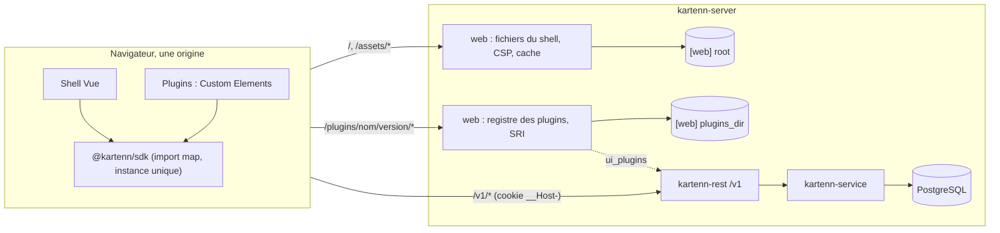

# 007 — Shell Web et plugins : conception

## Vue d'ensemble



1. **`web/`** (pnpm, ADR 0024) : `shell` (AGPL-3.0), `sdk` (`@kartenn/sdk`, MPL-2.0),
   `plugins/example` (MPL-2.0), `e2e` (Playwright). Le build produit `web/dist/shell/` et
   `web/dist/plugins/<nom>/<version>/`, que les paquets embarqueront (W2).
2. **`kartenn-rest::web`** (nouveau module) : fichiers du shell et des plugins, en-têtes,
   registre des plugins et empreintes ; `capabilities` publie le registre.
3. **`kartenn-server`** : section `[web]`, relecture du répertoire des plugins (10 s et
   `SIGHUP`), câblage dans `app::run`.
4. **`kartenn-dev-idp`** (nouvelle crate, jamais livrée) : émetteur OIDC de développement
   et de bout en bout (W16).

## Changements

### Arborescence de `web/` (REQ-007-12, 21, 34, 38)

```
web/
  package.json, pnpm-workspace.yaml, pnpm-lock.yaml
  eslint.config.js, prettier.config.js, vitest.workspace.ts
  sdk/                 @kartenn/sdk, MPL-2.0
    src/index.ts         API publique (contrat semver)
    src/host.ts          @kartenn/sdk/host : branchements du shell, hors contrat
    src/api/             schema.d.ts et dated.ts (tirés du contrat), client.ts, problem.ts
    src/context.ts, extensions.ts, draft.ts, i18n.ts, semver.ts, tokens.ts
    src/testing/         @kartenn/sdk/testing : bac à sable
    scripts/gen.mjs      openapi-typescript → src/api/
  shell/               AGPL-3.0
    index.html           import map de @kartenn/sdk et @kartenn/sdk/host
    vite.config.ts       SDK externe, import map réécrite, relais de développement
    src/main.ts, router.ts, app/, views/, components/
    src/plugins/         chargeur, registre des extensions, hôtes d'extension
    src/time/, session/, draft/, rights/, i18n/{fr,en}.json, styles/tokens.css
    scripts/size.mjs     budget de taille (REQ-007-32)
  plugins/example/     MPL-2.0, Custom Elements sans framework
    manifest.json, src/, i18n/{fr,en}.json, styles.css
  e2e/                 AGPL-3.0
    playwright.config.ts, global-setup.ts, kartenn.toml, users.toml
    fixtures/            connexion, accessibilité, CSP, jeu de données
    journeys/*.spec.ts, budgets/*.spec.ts
    plugins/             plugins de test (incompatible, empreinte fausse, lent…)
  dist/                build, non versionné
```

### Dépendances du frontend

Versions stables courantes, figées par `pnpm-lock.yaml` à la tâche 2 ; `@playwright/test`
épinglé sur `playwright-driver` (ADR 0024).

| Paquet | Où | Rôle | Décision |
|---|---|---|---|
| `vue`, `vue-router` | shell | interface, routage | D17, W17 |
| `vue-i18n` (≥ 10) | shell | i18n ; compilation JIT des messages, sans `eval` (CSP) | W11 |
| `reka-ui` | shell | primitives accessibles | W12 |
| `@tanstack/vue-virtual` | shell | listes et arbre virtualisés | W12 |
| aucune | sdk | le SDK n'a aucune dépendance à l'exécution | W7, W8 |
| `openapi-typescript` | sdk (dev) | types du contrat | W8 |
| `vite`, `@vitejs/plugin-vue`, `typescript`, `vue-tsc`, `eslint`, `eslint-plugin-vue`, `prettier`, `vitest` | dev | outillage | ADR 0024 |
| `@vue/test-utils`, `happy-dom` | dev | composants sous Vitest | nouveau, à valider |
| `fake-indexeddb` | dev | brouillon sous Vitest | nouveau, à valider |
| `@playwright/test`, `@axe-core/playwright` | e2e | parcours, accessibilité | ADR 0024, W14 |

### Crates

| Crate | Changement | Dépendances nouvelles |
|---|---|---|
| `kartenn-rest` | module `web` ; `UiPlugin` enrichi ; routes `roots`, liste des imports, `auth/issuers` ; quotas limités à `/v1` | aucune (`sha2`, `base64`, `arc-swap` déjà dans l'espace de travail) |
| `kartenn-store-pg` | `tree::roots_of`, `imports::list` | aucune |
| `kartenn-server` | `[web]`, relecture des plugins, câblage | aucune |
| `kartenn-dev-idp` (nouvelle, `publish = false`) | émetteur de développement | aucune hors de l'espace de travail (`axum`, `jsonwebtoken`, `p256`, `rcgen`, `tokio-rustls`, `toml`) |
| `kartenn-bench` | sous-commande `seed` (chargement seul) et domaine à 10⁵ enfants | aucune |

### Service du shell (REQ-007-1 à 3)

`kartenn_rest::router` reçoit un `Option<Arc<Web>>` ; quand il est présent, son
`fallback(not_found)` devient `web::serve`. Ordre de résolution :

1. `/v1/…` et `/health/…` : inchangés (404 problème hors des routes connues).
2. `/plugins/<nom>/<version>/<chemin>` : recherche dans l'instantané du registre ; seuls
   les fichiers relevés à la lecture sont servis, donc aucun chemin ne sort du répertoire.
3. Sinon, fichier du shell sous `root` : chemin décodé, refus de `..`, d'un segment vide
   ou commençant par `.`, de `\` et de NUL ; chemin canonique sous `root` (lien
   symbolique sortant refusé) ; fichier régulier servi.
4. Sinon, chemin sans extension → `index.html` ; avec extension → 404.

Seuls `GET` et `HEAD` sont servis (`405` et `Allow: GET, HEAD` sinon). Types de média par
extension, table fermée : `html`, `js`/`mjs` (`text/javascript; charset=utf-8`), `css`,
`json`, `svg`, `png`, `ico`, `woff2`, `txt` ; `application/octet-stream` sinon.

| Fichiers | `Cache-Control` | Validation |
|---|---|---|
| `/assets/*` (noms à empreinte de Vite) | `public, max-age=31536000, immutable` | — |
| `index.html` et autres fichiers du shell | `no-cache` | `ETag` (SHA-256 du contenu), 304 |
| `/plugins/…` | `no-cache` | `ETag` = empreinte SRI relevée, 304 |

En-têtes posés sur toute réponse hors `/v1` et `/health` :

```
Content-Security-Policy: default-src 'none'; script-src 'self' 'sha256-<import map>';
  style-src 'self'; img-src 'self' data:; font-src 'self'; connect-src 'self';
  manifest-src 'self'; base-uri 'none'; frame-src 'none'; frame-ancestors 'none'
X-Content-Type-Options: nosniff
Referrer-Policy: same-origin
```

- **Import map** : seul script en ligne permis. `index.html` est relu quand sa taille ou
  sa date changent ; le contenu entre `<script type="importmap">` et `</script>` est haché
  (SHA-256, base64) dans la CSP. Absente au démarrage → refus (REQ-007-3).
- **Pas de `form-action`** : la déconnexion est un formulaire `POST` suivi d'une
  redirection vers l'émetteur, que Chromium soumet à `form-action` ; la directive ne se
  replie pas sur `default-src`.
- **Styles** : `style-src 'self'` interdit les `<style>` et les attributs `style` analysés
  depuis du HTML, pas le CSSOM (liaisons `:style` de Vue, positionnement de Reka UI).
  Règle ESLint `vue/no-static-inline-styles` (Vue sérialise en `innerHTML` les longs
  blocs statiques) ; les plugins chargent leurs feuilles par `<link>` (SDK `styles()`).
- **Quotas** (Q-007-4) : `quota::layer` ne compte que `/v1` ; un shell charge plusieurs
  dizaines de fichiers sans authentification, au-delà du quota anonyme par adresse
  (20/s). Délestage, délai, corps borné et identifiant de requête restent sur tout.
  L'authentification ignore déjà ce qui est hors `/v1` (`authn::public`).
- La compression (couche 10) s'applique aux fichiers servis.
- Sans `root`, un serveur statique derrière le même répartiteur peut servir le shell
  (W2) ; il pose alors lui-même ces en-têtes, l'empreinte de l'import map comprise.

### Plugins côté serveur (REQ-007-4 à 8, 11)

```
<plugins_dir>/example/1.1.0/
  manifest.json  index.js  chunk-3f2a.js  styles.css  i18n/fr.json  i18n/en.json
```

```json
{
  "name": "example",
  "version": "1.1.0",
  "sdk": "^1.0",
  "entry": "index.js",
  "module": null,
  "catalogs": { "fr": "i18n/fr.json", "en": "i18n/en.json" },
  "extensions": [
    { "point": "view", "id": "overview", "element": "example-overview", "nav": "nav.overview" },
    { "point": "tab", "id": "notes", "element": "example-notes",
      "object_types": ["prefix"], "label": "tab.notes", "permission": "core.prefix.read" },
    { "point": "panel", "id": "summary", "element": "example-summary",
      "object_types": ["prefix", "address"] },
    { "point": "column", "id": "flag", "element": "example-flag",
      "object_types": ["address"], "label": "column.flag" },
    { "point": "action", "id": "reserve", "element": "example-reserve",
      "object_types": ["prefix"], "label": "action.reserve", "permission": "core.address.write" }
  ]
}
```

Règles de validation (REQ-007-5) :
- `name` : `[a-z][a-z0-9-]{0,39}`, égal au répertoire ; `version` : semver 2.0.0 sans
  métadonnée de build, égale au répertoire ; `sdk` : `^x[.y[.z]]`, `~x.y[.z]` ou `x.y.z`.
- `entry` : fichier `.js` présent ; `catalogs` : au moins `en`, fichiers JSON présents.
- `extensions[]` : `point` ∈ {`view`, `tab`, `panel`, `column`, `action`} ; `id` unique
  dans le plugin ; `element` nom de Custom Element valide préfixé par `<name>-` ;
  `object_types` non vide sauf pour `view` (types inconnus du shell ignorés par lui) ;
  `label` et `nav` présents dans chaque catalogue déclaré ; `permission` facultative.
- Fichiers : réguliers, sans lien symbolique, au plus 1 000 et 20 Mio par version.
- `module` : `null` ou le nom d'un module ; un plugin dont le module manque aux capacités
  n'est pas publié (REQ-007-11).

Registre : `Plugins` (dans `kartenn-rest::web`) garde un `ArcSwap<Snapshot>` : versions
valides par nom, fichiers `(nom, version, chemin) → (chemin disque, SRI, type)`. La
relecture parcourt `plugins_dir`, ne recalcule l'empreinte (`sha384`, base64) que des
fichiers dont `(taille, date)` a changé, puis publie un nouvel instantané d'un coup. Elle
tourne au démarrage, toutes les 10 s et sur `SIGHUP` (même signal que le certificat,
`kartenn-server/src/http.rs`). Version publiée : la plus haute au sens semver parmi les
valides. Journal technique : `web.plugin.loaded` (nom, version) quand une version
apparaît, `web.plugin.rejected` (nom, version, motif) une fois par état du manifeste ;
un répertoire illisible garde l'instantané précédent et journalise `web.plugins.unreadable`.

`ui_plugins` (REQ-007-7), membres ajoutés à `UiPlugin` :

```json
{
  "name": "example", "version": "1.1.0", "sdk": "^1.0",
  "base": "/plugins/example/1.1.0/", "entry": "/plugins/example/1.1.0/index.js",
  "integrity": { "index.js": "sha384-…", "chunk-3f2a.js": "sha384-…",
                 "styles.css": "sha384-…", "i18n/fr.json": "sha384-…", "i18n/en.json": "sha384-…" },
  "catalogs": { "fr": "i18n/fr.json", "en": "i18n/en.json" },
  "extensions": [ { "point": "tab", "id": "notes", "element": "example-notes",
                    "object_types": ["prefix"], "label": "tab.notes", "permission": "core.prefix.read" } ]
}
```

`integrity` couvre les `.js`, `.css` et `.json` ; images et polices sont servies sans
empreinte (chargées par CSS, sans mécanisme d'intégrité).

### Chargement des plugins par le shell (REQ-007-9, 10, 13)

Le shell n'attend pas les plugins pour son premier écran ; les points d'extension se
remplissent à mesure. Pour chaque élément de `ui_plugins`, en parallèle :

1. `satisfies(SDK_VERSION, sdk)` (`sdk/src/semver.ts`, `^`, `~` et exact) ; sinon écarté
   `incompatible`.
2. Catalogues de la langue courante et de `en` : `fetch(url, { integrity })`, fusionnés
   sous l'espace de noms `<name>`.
3. Un `<link rel="modulepreload" integrity>` par module de `integrity` : le navigateur
   vérifie chaque module avant qu'un `import` ne le résolve depuis la carte des modules.
4. `<script type="module" src=entry integrity>` ; le module appelle
   `definePlugin({ name, elements })`, qui définit chaque élément déclaré
   (`customElements.define`) et refuse un élément non déclaré ou déjà défini.
5. Écarté si `error` sur un `<link>` ou le `<script>` (`load-failed` : réseau ou
   empreinte), si une erreur non rattrapée provient de `base` pendant le chargement
   (`exception`), ou si `definePlugin` n'est pas appelé dans les 5 s (`timeout`) ; un
   `definePlugin` tardif est ignoré.

Hôtes d'extension (`shell/src/plugins/`) : un composant Vue crée l'élément, lui donne ses
propriétés (`object` : `{type, id, href}` ; `row` : représentation, pour une colonne), et
affiche un encart d'erreur si la création lève. Placement :

| Point | Où | Propriétés |
|---|---|---|
| `view` | route `/x/<plugin>/<id>/*`, entrée « Extensions » de la navigation | — |
| `tab` | onglets de la fiche d'un type | `object` |
| `panel` | colonne latérale de la fiche | `object` |
| `column` | colonne des listes d'un type (cellule par ligne, éléments recréés au défilement) | `object`, `row` |
| `action` | menu d'actions de l'objet ; l'élément s'ouvre dans un dialogue, l'événement `kartenn-close` le ferme | `object` |

Filtre : le type d'objet figure dans `object_types`, et la `permission`, s'il y en a une,
est détenue (« Droits dans l'interface »). Page `/about` : version, plugins chargés et
écartés avec leur motif.

### SDK (REQ-007-12 à 16, 24)

Deux points d'entrée, construits avec un morceau commun pour partager l'état, chacun
désigné par l'import map du shell : `@kartenn/sdk` (contrat public semver) et
`@kartenn/sdk/host` (branchements du shell : contexte, brouillon, 401, registre ; hors
contrat). Le build du shell et celui des plugins les marquent `external`. Un plugin
embarque son propre framework s'il en emploie un (W7).

```ts
export const SDK_VERSION: string;

export type ObjectType = 'entity' | 'site' | 'domain' | 'prefix' | 'range' | 'address' | (string & {});
export interface ObjectRef { type: ObjectType; id: string; href: string }
export interface TimeContext { validAt: string | null; asOf: string | null; present: boolean }
export interface User { identity: string; name: string | null; kind: string; has(permission: string): boolean }
export interface Context { user: User; time: TimeContext; locale: 'fr' | 'en' }
export const context: { get(): Readonly<Context>; subscribe(listener: (c: Readonly<Context>) => void): () => void };

export interface PluginHandle {
  t(key: string, params?: Record<string, unknown>): string;  // sous l'espace de noms du plugin
  format: { dateTime(iso: string): string; number(n: number): string; timeZone: string };
  styles(root: ShadowRoot, path: string): Promise<void>;     // <link> avec empreinte
}
export function definePlugin(def: { name: string; elements: Record<string, CustomElementConstructor> }): PluginHandle;

export const api: Client;
export const draft: {
  operations(): readonly Operation[]; add(op: Operation): void; remove(index: number): void;
  subscribe(listener: (ops: readonly Operation[]) => void): () => void;
};
export const tokens: readonly `--k-${string}`[];
```

Client (REQ-007-15) :
- `schema.d.ts` : `openapi-typescript` sur `specs/006-api-rest/openapi-v1.json` ;
  `dated.ts` : constante des chemins dont la lecture accepte `valid_at`, tirée du même
  contrat par `scripts/gen.mjs`. Un test régénère les deux en mémoire et les compare aux
  fichiers versionnés.
- `api.get(path, { path, query })` → `{ data, etag }` ; sur un chemin daté, `valid_at`
  et `as_of` du contexte sont ajoutés s'ils manquent (REQ-007-24).
- `api.query(path, body)` : méthode `QUERY`, corps JSON (REQ-006-10).
- `api.pages(path, opts)` : itérateur asynchrone qui suit le lien `next` (REQ-006-7).
- `api.post(path, { body, idempotencyKey? })` : clé `crypto.randomUUID()` si absente ;
  `api.patch` et `api.delete` exigent `ifMatch` par leur type (REQ-006-14).
- Erreur : `ApiProblem` (`status`, `type`, `title`, `detail`, `violations`, `requestId`).
  Un 401 appelle d'abord le branchement du shell (reconnexion), puis lève.
- `fetch` en `credentials: 'same-origin'`, `Accept: application/json`.

Bac à sable (`@kartenn/sdk/testing`, REQ-007-16) : `mount(tag, { context, object,
fetch })` monte l'élément dans un document de test ; `fakeFetch(routes)` répond selon
des gestionnaires typés par `paths` de `schema.d.ts`.

### Écrans et routes du client (REQ-007-17 à 21)

| Route | Écran | API |
|---|---|---|
| `/` | arbre du domaine choisi (premier domaine par défaut) : écran d'arrivée | `domains`, `domains/{id}/roots`, `prefixes/{id}/children` |
| `/:collection` | liste filtrée (`entities`, `sites`, `domains`, `prefixes`, `ranges`, `addresses`) | `GET`/`QUERY` de la collection |
| `/:collection/:id` | fiche : attributs, propriétés, historique, anomalies, onglets et panneaux de plugins, menu d'actions | objet, `properties`, `explanation`, `suggestion`, `history`, `anomalies?object=` |
| `/prefixes/:id` (en plus) | occupation, prochain libre | `occupancy`, `next-free` |
| `/anomalies` | anomalies, acquittement | `anomalies` |
| `/properties` | déclarations, valeurs, écarts | `property-declarations`, `property-gaps` |
| `/changesets`, `/changesets/:id`, `/proposals` | changesets, différentiel, actions, propositions | `changesets`, `diff`, actions, `proposals` |
| `/draft` | brouillon (aussi en tiroir sur toute page) | `changesets?simulate=true` |
| `/imports`, `/imports/:id` | suivi, reprise, annulation | `imports` |
| `/admin/roles`, `/admin/bindings`, `/admin/issuers`, `/admin/service-accounts[/:id]`, `/admin/identities[/:id]`, `/admin/audit` | administration | routes de la 005 et de la 012 |
| `/login`, `/about`, `/x/<plugin>/<id>/*` | connexion, à propos, vues de plugins | `auth/issuers`, `capabilities` |

- État : l'URL et des composables Vue, sans magasin global (W17).
- Recherche globale par valeur (adresse ou préfixe) : `GET /v1/addresses?value=…` et
  `/v1/prefixes?value=…`.
- Listes : défilement continu par pages de 100, filtres dans l'URL, pas de curseur dans
  l'URL (signé, il peut expirer) ; un curseur refusé (400) recommence à la première page.
- Secret d'un compte de service : affiché une fois dans un dialogue, jamais gardé.
- Export d'audit : `Accept: application/x-ndjson`, enregistré comme fichier.
- Droits dans l'interface (REQ-007-20) : `rights/` tient `/v1/me` ; une permission est
  détenue si une entrée de `global_permissions` ou d'un rôle d'une liaison la couvre
  (motifs `*`, `prop.*.<action>`), quelle que soit la portée ; la portée exacte reste au
  serveur, dont le 403 ou `core.object.forbidden` s'affiche sans perte de saisie.

### Contexte temporel (REQ-007-22 à 24)

- `valid_at` et `as_of` en RFC 3339 UTC dans la requête de l'URL ; `useTime()` les lit
  et les écrit ; une garde de `vue-router` les recopie sur chaque navigation interne,
  sauf retour explicite au présent.
- Bandeau `TimeBanner` (`role="status"`) : date et fuseau affichés, état connu à `as_of`,
  bouton « Revenir au présent ».
- Écritures : `as_of` → toutes désactivées, soumission du brouillon comprise ; `valid_at`
  hors présent → modification rapide désactivée, brouillon permis avec `valid_from`
  prérempli à `valid_at`.
- Le shell pousse le contexte au SDK (`host.setContext`) à chaque changement de route.

### Écriture (REQ-007-25 à 27)

Modification rapide : formulaire de l'onglet « Attributs » ; `PATCH` (Merge Patch) avec
`motive` et l'`If-Match` de la lecture, `POST` sur la collection pour créer, `DELETE`
avec `{motive}` pour clore.

| Réponse | Effet |
|---|---|
| 200, 201 | objet relu (nouvel `ETag`), avis avec lien vers le changeset |
| 202 | avis « en attente d'approbation », lien vers le changeset |
| 412 | dialogue : valeurs actuelles et saisie côte à côte ; « reprendre sur la nouvelle version » relit et garde la saisie |
| 422 | violations placées sur les champs qu'elles désignent, sinon en tête du formulaire |
| 403 | refus affiché, saisie gardée |

Brouillon (`shell/src/draft/`) :
- IndexedDB `kartenn-drafts`, magasin `drafts`, clé `<identité>:<onglet>`, index
  `identity` ; valeur `{identity, tab, motive, valid_from, valid_to, operations,
  idempotency_key, content_hash, updated_at}` ; `operations` au format `Operation` du
  contrat.
- Onglet : identifiant aléatoire en `sessionStorage` ; un onglet dupliqué hérite de
  l'identifiant, détecté par `BroadcastChannel` (`kartenn-tabs`) : le second prend un
  nouvel identifiant et une copie du brouillon. Au démarrage, les brouillons de la même
  identité sans onglet vivant sont proposés à la reprise ; ceux de plus de 30 jours sont
  effacés.
- Simulation : à chaque changement, après 500 ms sans autre changement, la précédente
  annulée (`AbortController`), `POST /v1/changesets?simulate=true` ; affichage de
  `valid`, des violations (erreurs, avertissements) par opération, du différentiel compté
  et de son échantillon, des cascades.
- Soumission : seulement si la dernière simulation porte sur le contenu courant
  (`content_hash`), est `valid`, avec un motif, hors `as_of`. La clé d'idempotence est
  écrite dans le brouillon avant l'envoi et rejouée tant que le contenu ne change pas ;
  201 ou 202 → brouillon effacé ; 422 → brouillon gardé ; 409 (clé en cours) → nouvel
  essai ; erreur réseau → « Réessayer » avec la même clé.
- Identité : à la connexion, les brouillons d'une autre identité sont effacés sans être
  lus ; à la déconnexion, ceux de l'identité courante.
- Plugins : `draft.add` passe par `host` et ouvre le tiroir du brouillon.

### Session (REQ-007-28)

- `/login` : boutons des émetteurs (`GET /v1/auth/issuers`, Q-007-3), formulaire de
  secours (`POST /v1/auth/breakglass`). Avant de partir vers l'émetteur, l'URL courante
  va en `sessionStorage` (`kartenn.return`, chemin interne seulement) et l'émetteur en
  `localStorage` (`kartenn.issuer`).
- Retour sur `/` après le rappel : le shell lit `kartenn.return` et y navigue.
- 401 en cours d'usage : dialogue « Session expirée » ; « Se reconnecter » reprend
  l'émetteur gardé ; le brouillon est dans IndexedDB, rien n'est perdu.
- Déconnexion : brouillons de l'identité et préférences sensibles (recherches et vues
  récentes) effacés ; langue, thème et dernier émetteur gardés ; puis formulaire `POST
  /v1/auth/logout` en navigation de premier niveau, qui suit la redirection vers
  l'émetteur.

### i18n (REQ-007-29)

- vue-i18n en API de composition ; `shell/src/i18n/{fr,en}.json` ; catalogues de plugins
  fusionnés sous `<name>.` (`mergeLocaleMessage`) ; `PluginHandle.t` préfixe la clé.
- Langue : `localStorage` `kartenn.locale`, sinon le premier de `navigator.languages`
  dont le préfixe est `fr` ou `en`, sinon `en`.
- Dates : `Intl.DateTimeFormat`, fuseau du navigateur, nom IANA affiché à côté.
- Problèmes : `urn:kartenn:problem:<slug>` → clé `problem.<slug>`, sinon `detail`, sinon
  `title`.
- Test de parité : clés aplaties de chaque paire `fr`/`en` du shell et de
  `web/plugins/*/i18n`.

### Thème, composants, arbre (REQ-007-30, 31, 33)

- `styles/tokens.css` : `--k-color-*` (fond, texte, atténué, accent, danger,
  avertissement, bordure, anneau de focus), `--k-space-*`, `--k-radius`, `--k-font-*`,
  `--k-row-height` ; mode sombre par `prefers-color-scheme` et par `[data-theme]` (choix
  gardé en `localStorage`). Les propriétés personnalisées s'héritent à travers les
  racines d'ombre : un plugin écrit `var(--k-color-bg)`.
- Reka UI : dialogues, menus, onglets, listes déroulantes, combobox, avis, infobulles.
- Contrastes : un test Vitest lit `tokens.css` et calcule le rapport WCAG de chaque paire
  déclarée, dans les deux modes (≥ 4,5:1 texte, ≥ 3:1 bordures et focus).
- Arbre : modèle aplati des lignes visibles ; `useVirtualizer` à hauteur fixe ; un nœud
  ouvert charge sa première page d'enfants, une ligne « suite » charge la page suivante
  quand elle approche de la fenêtre. ARIA : motif `treeview` de l'APG, `aria-level`,
  `aria-expanded`, `aria-setsize="-1"` tant que la dernière page n'est pas lue ; focus
  sur l'arbre et `aria-activedescendant` ; flèches, Origine, Fin, Entrée.
- Tables : `<table>` natif, `aria-rowcount` et `aria-rowindex` sous virtualisation, ligne
  focalisable, flèches haut et bas, Entrée ouvre la fiche.
- Accessibilité de bout en bout : fixture `expectAccessible(page)` (`@axe-core/playwright`,
  étiquettes `wcag2a`, `wcag2aa`, `wcag21a`, `wcag21aa`, `wcag22aa`) après chaque étape
  d'un parcours ; un test vérifie que chaque fichier de `journeys/` l'emploie.

### Budgets (REQ-007-32)

Script devenv `bench-web [graine]`, bloquant, Chromium seul (ralenti du CPU par CDP
`Emulation.setCPUThrottlingRate`, tâches longues par `PerformanceObserver`) :

1. `pnpm -C web build`, puis `shell/scripts/size.mjs` : point d'entrée du shell, ses
   imports statiques, sa CSS et le SDK, d'après le manifeste de Vite, en gzip niveau 9 :
   ≤ 300 000 octets.
2. Base `kartenn_bench` neuve, `kartenn-bench seed` (jeu de `bench-core`, graine 42) plus
   un domaine dont un conteneur a 10⁵ enfants directs.
3. kartenn-server (release) et l'émetteur de développement, plugins d'exemple et de test
   lent.
4. Projet Playwright `budgets` :

| Budget | Mesure |
|---|---|
| Premier écran utile ≤ 2 s | du début de la navigation qui suit le rappel OIDC à la marque `k:ready` (racines de l'arbre rendues) |
| Page de 100 lignes ≤ 100 ms | de `responseEnd` de la requête de la page à la marque `k:rows` (après rendu), p95 de 20 pages |
| Arbre à 10⁵ | défilement de 10⁴ lignes du conteneur en 10 s : aucune tâche longue > 50 ms |
| Plugin lent | plugin qui appelle `definePlugin` après 6 s : écarté à 5 s, premier écran dans son budget |

Le jeu de 10⁶ objets est chargé par `COPY` comme les autres bancs : par l'API, il
prendrait l'essentiel des 15 min du budget d'import ; les parcours fonctionnels, eux,
chargent leur jeu par l'API (W15).

### Bout en bout et développement (REQ-007-34 à 37)

Émetteur `kartenn-dev-idp` :
- `kartenn-dev-idp certs <rép>` : autorité de développement et certificats `127.0.0.1`
  pour l'émetteur et kartenn-server (`rcgen`) ; `kartenn-dev-idp serve <users.toml>`.
- Routes : `/.well-known/openid-configuration`, `/jwks`, `/authorize` (page de choix de
  l'utilisateur, PKCE S256 vérifié, `state`, `nonce`, `iss` de RFC 9207), `/token`
  (code et rafraîchissement, `client_secret_basic`), `/end-session` ; clés ES256 tirées
  au démarrage. Reprend l'émetteur de `crates/kartenn-rest/tests/sessions.rs` (`Idp`).
- Écoute refusée hors bouclage ; TLS par `tokio-rustls` (l'identifiant d'émetteur doit
  être `https`, `kartenn-server/src/config.rs`). kartenn-server lui fait confiance par
  `SSL_CERT_FILE` (racines natives de `kartenn-auth::http`), en développement seulement.

```toml
issuer = "https://127.0.0.1:8444"
listen = "127.0.0.1:8444"
client_id = "kartenn"
client_secret_file = "dev/idp-secret"
redirect_uris = ["http://127.0.0.1:5173/v1/auth/callback", "https://127.0.0.1:9443/v1/auth/callback"]

[[users]]
sub = "alice"
name = "Alice Exemple"
groups = ["kartenn-admins"]

[[users]]
sub = "bob"
name = "Bob Exemple"
groups = ["lecteurs"]

[[users]]
sub = "refuse"
name = "Refus d'accès"
error = "access_denied"     # cas d'erreur maîtrisé
```

Développement (`devenv up`) : processus `dev-idp`, `kartenn` (`kartenn-server run`,
`dev/kartenn.toml` : TLS sur `127.0.0.1:8443`, `public_origin = "http://127.0.0.1:5173"`,
`[web] plugins_dir = "web/dist/plugins"` sans `root`) et `web` (existant). Vite relaie
`/v1` et `/plugins` vers `https://127.0.0.1:8443` (`secure: false`, développement
seulement) ; le navigateur ne voit que `http://127.0.0.1:5173`, origine sûre du bouclage.
Le commentaire de `devenv.nix` qui parle d'un relais `/api` est corrigé.

Bout en bout (`k-web-e2e`) :
- `web/e2e/playwright.config.ts` : projets `chromium` et `firefox` (parcours) et
  `budgets` (lancé par `bench-web` seulement) ; `webServer` : l'émetteur
  (`web/e2e/users.toml`, port 9444) et kartenn-server (`web/e2e/kartenn.toml`, TLS sur
  9443, `root = web/dist/shell`, `plugins_dir` = plugins d'exemple et de test) ;
  `baseURL: https://127.0.0.1:9443`, `ignoreHTTPSErrors`.
- `global-setup.ts` : base `kartenn_e2e` neuve, `kartenn-server migrate`, compte de
  secours (`breakglass create`), et par l'API sous cette session : liaisons des groupes
  de `users.toml`, puis jeu de données (domaines, préfixes, adresses, propriétés) par
  changesets.
- Fixtures : connexion par la page de l'émetteur ; `expectAccessible` ; échec du test
  sur toute violation CSP (`securitypolicyviolation` relevé par la page) ou erreur de
  console non attendue.
- Navigateurs (REQ-007-37) : cible du build `es2022` ; import maps, `modulepreload`,
  Custom Elements et Shadow DOM natifs dans les versions visées.

### Licences (REQ-007-38)

- `web/sdk`, `web/plugins/*` : `"license": "MPL-2.0"` et, en tête de chaque fichier source
  (`.ts`, `.js`, `.vue`, `.css`), l'avis de l'annexe A de la MPL comme dans
  `crates/syslog-sender/src/lib.rs`.
- `web/shell`, `web/e2e` : `"license": "AGPL-3.0-only"` comme l'espace de travail Cargo.
- Test Vitest qui parcourt les sources de `web/sdk` et `web/plugins` et exige l'avis.

### Ajouts à l'API (REQ-007-39 à 41)

Sous réserve de Q-007-1 à 3 ; additifs (006/H12), au contrat de référence et au
comparateur.

| Route | Réponse | Store |
|---|---|---|
| `GET /v1/domains/{id}/roots?valid_at&as_of&cursor&page_size` | `Listing<TreeNode>` comme `prefixes/{id}/children`, mêmes clés de curseur | `tree::roots_of` : nœuds du domaine sans parent déduit, ordre des adresses, `ReadScope` |
| `GET /v1/imports?cursor&page_size` | `Listing<ImportDto>` de l'appelant, du plus récent | `imports::list(author, …)` |
| `GET /v1/auth/issuers` (publique) | `[{id}]`, ordre de la configuration | — (`Authenticator` expose les noms locaux) |

`/v1/auth/issuers` rejoint `PUBLIC` (`openapi.rs`) et la liste publique de `authn.rs`.

### Configuration

```toml
[web]
root = "/usr/share/kartenn/web/shell"       # facultatif : sans lui, pas de shell
plugins_dir = "/var/lib/kartenn/plugins"    # facultatif : sans lui, ui_plugins est vide
```

Refus des champs inconnus ; `root` sans `index.html` ou sans import map → refus au
démarrage ; répertoire `plugins_dir` inexistant ou illisible au démarrage → refus ;
illisible ensuite → instantané précédent gardé.

## Erreurs et cas limites

| Cas | Comportement | REQ |
|---|---|---|
| Build du shell remplacé pendant le service | `index.html` relu à sa prochaine requête, CSP recalculée ; un onglet ouvert garde ses fichiers `immutable` | 2 |
| Même version d'un plugin réécrite sur place | nouvelle empreinte à la relecture ; un onglet ouvert entre les deux voit le fichier refusé (SRI), plugin écarté | 6, 8 |
| Deux plugins définissent le même élément | le second à se charger est écarté (`definePlugin` refuse) ; les préfixes par nom l'empêchent entre plugins valides | 5, 13 |
| N instances, répertoires différents | `ui_plugins` diffère d'une instance à l'autre : prérequis d'exploitation (même paquet ou volume partagé), documenté | 8 |
| Curseur de liste expiré | 400 ; la liste recommence à la première page | 17 |
| Simulation plus lente que la saisie | simulation précédente annulée ; seule la dernière s'affiche | 26 |
| Brouillon soumis, réponse perdue | même clé d'idempotence au nouvel essai : réponse rejouée, un seul changeset | 26 |
| `as_of` futur dans un lien | 400 de l'API, affiché ; bouton « Revenir au présent » | 22, 23 |
| IndexedDB indisponible (navigation privée stricte) | brouillon désactivé, modification rapide disponible, avis affiché | 26 |

## Alternatives considérées

- `tower-http` `ServeDir` : ajoute `mime_guess` et la gestion des plages, inutiles pour
  un build ; un service propre de quelques types suffit.
- Hachage de tous les plugins à chaque relecture : coûteux toutes les 10 s ; on ne
  rehache que ce qui a changé de taille ou de date.
- Surveillance du répertoire par `inotify` (`notify`) : nouvelle dépendance pour un délai
  de 10 s acceptable.
- Section `integrity` de l'import map : ne couvre que les modules nommés par l'import map
  du document, figée avant le premier module ; `modulepreload` avec empreinte couvre les
  modules chargés à chaud.
- Plugin en un seul fichier : limite les plugins (pas de découpage) sans gain de sécurité.
- `form-action 'self'` : casse la déconnexion par l'émetteur (voir « Service du shell »).
- Émetteur en HTTP sur le bouclage : demanderait d'assouplir la règle `https` de la
  configuration des émetteurs, code livré ; une autorité de développement suffit.

## Risques

- **Cookie `Secure` sur `http://127.0.0.1`** en développement : Chromium et Firefox
  traitent le bouclage comme origine sûre ; à confirmer par la note de référence
  (tâche 1). Repli : Vite en HTTPS avec le certificat de développement et le MCP
  `playwright` avec `--ignore-https-errors`.
- **vue-i18n et CSP** : seule la compilation JIT évite `new Function` ; vérifié par les
  parcours (violation CSP = échec).
- **`modulepreload` avec empreinte** : sur un navigateur qui l'ignorerait, un module
  secondaire se chargerait sans contrôle d'intégrité ; vérifié sur Chromium et Firefox,
  Safari supposé (non éprouvé en CI).
- **Colonnes de plugins dans les listes virtualisées** : un élément coûteux ralentit le
  défilement ; le budget de la page de 100 lignes est mesuré avec la colonne du plugin
  d'exemple active.
- **Charge des simulations** : une simulation par pause de saisie de 500 ms compte dans
  le quota d'écriture ; un brouillon long saisi vite peut recevoir 429, affiché comme
  « simulation différée ».

## Stratégie de test

| REQ | Tests |
|---|---|
| 1 à 3 | Intégration `rest/tests/web.rs` : repli sur `index.html`, 404 sous `/v1`, chemins refusés, types, cache et 304, CSP et empreinte, `HEAD`, 405 ; configuration refusée |
| 4 à 8, 11 | Unitaires du manifeste (un par motif) ; intégration sur un répertoire temporaire : version publiée, relecture en ≤ 10 s et sur `SIGHUP`, retrait, empreintes comparées à `sha384`, module absent ; comparateur du contrat |
| 9, 10, 13 | E2E avec les plugins de test : compatible, incompatible, empreinte fausse, exception, enregistrement absent, `fetch` tiers bloqué ; filtres par type et permission |
| 12, 14 à 16, 24 | Vitest du SDK : contexte, `definePlugin`, semver, client (QUERY, If-Match, idempotence, problèmes, curseurs, paramètres datés), fraîcheur des types, bac à sable |
| 17 à 21 | E2E sur le jeu de données : un parcours par écran, plugin d'exemple |
| 22 à 27 | Vitest : `useTime`, magasin du brouillon (clés, onglet dupliqué, identité) ; E2E : lien partagé, bandeau, écritures désactivées, 412, 202, 422, brouillon simulé et soumis, coupure réseau |
| 28 | E2E : reconnexion après session expirée vers la même URL, déconnexion qui efface |
| 29, 30 | Vitest : parité des clés, choix de la langue, traduction des problèmes, contrastes des jetons ; E2E : élément de plugin en mode sombre |
| 31 à 33 | Banc `bench-web` ; parcours au clavier ; axe-core dans chaque parcours |
| 34 à 37 | `k-web-e2e` sur Chromium et Firefox ; intégration de l'émetteur (refus hors bouclage, flux complet contre kartenn-server) |
| 38 | Vitest : avis de licence |
| 39 à 41 | Intégration `rest/tests/` à la manière de `tree` (`objects.rs`), `imports.rs`, `sessions.rs` ; contrat |

## ADR

- ADR 0025 (proposé) : plugins Web servis depuis un répertoire de l'exploitant, code de
  confiance dans le document, SDK partagé par import map, empreintes SRI par
  `modulepreload` (W3, W4, W7).
