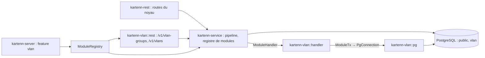

# 008 — VLAN : conception

## Vue d'ensemble



Deux parties. **A** (contrat de module, ADR 0026) touche le noyau de façon additive :
registre, enveloppe d'opération, `module_object`, porteurs et cibles étendus, catalogues
fusionnés, routes transverses, migrations par module, références. **B à E** sont le
module `kartenn-vlan`, premier consommateur, qui ne touche pas au code du noyau.

## Changements

### Crates (REQ-008-1, 9)

| Crate | Changement |
|---|---|
| `kartenn-core` | `authz` : `Permission` reste statique ; nouvelle fonction de catalogue paramétrée par les permissions des modules (`Catalogue`). `properties` : `REF_TARGETS`/`CORE_CARRIERS` deviennent les cibles et porteurs du noyau, complétés à l'exécution par le registre (`Carriers`). `rules` : `Rule` inchangé. |
| `kartenn-service` | nouveau `module.rs` : traits `Module`, `ModuleHandler`, `ModuleTx`, `ModuleRegistry` (tri topologique, refus au démarrage) ; `operations.rs` : `Operation::Module(ModuleOperation)`, `ObjectKind::Module(ModuleKind)` ; `pipeline.rs` : branchement de l'enveloppe à chaque étape ; `cascade.rs` : dépendants déclarés par les modules. |
| `kartenn-store-pg` | migration du noyau `module_object` et `module_migration` ; `ModuleTx` pour sa transaction ; migrateur de modules ; `carrier_object`, `kartenn_site`, `kartenn_visible` étendus. |
| `kartenn-rest` | montage des routeurs de modules ; routes transverses par type de module ; `modules` des capacités tiré du registre ; DTO de l'enveloppe dans le contrat. |
| `kartenn-server` | features `vlan` (par défaut) ; construction du registre ; migrations de modules dans le job de migration. |
| `kartenn-vlan` (nouvelle) | domaine (`group.rs`, `vlan.rs`, règles), gestionnaire (`handler.rs`), adaptateur (`pg.rs`, feature `pg`), routes (`rest.rs`, feature `rest`), migrations `migrations/`. Dépend de `kartenn-core`, `kartenn-service` ; `pg` → `kartenn-store-pg`, `sqlx` ; `rest` → `kartenn-rest`, `axum`, `utoipa`. Licence AGPL-3.0. |
| `kartenn-bench` | jeu de référence augmenté (groupes, VLAN, `vlan.vlan`), mesures du module dans `bench-core`. |

Règle de dépendance (`docs/spec/architecture.md`) : `kartenn-core` et `kartenn-service`
ne dépendent d'aucun module ; un module ne dépend d'aucun autre module qu'il ne déclare.

### Registre de modules (REQ-008-1, 8)

`kartenn_service::module::Module` (objet dynamique, `Send + Sync + 'static`) :

| Méthode | Rend |
|---|---|
| `name()`, `version()` | identité (clause 1) |
| `depends_on()` | noms des modules requis (clause 2) |
| `object_types()` | `&[ObjectType]` : nom qualifié, collection REST, parent (type), porte `core.owner` (obligatoire ou non), `core.site`, ancrage de domaine, arbre d'héritage |
| `declarations()` | `ModuleDeclarations` (inchangé, 003/P12) |
| `permissions()` | `&'static [Permission]` |
| `rules()` | `&'static [&'static Rule]` |
| `references()` | `&[Reference]` : type source, type cible, politique (`Refuse`, `Cascade`, `Nullify`), lecture des dépendants |
| `edges()` | `&[EdgeType]` (clause 11) |
| `handler()` | `Arc<dyn ModuleHandler>` |
| `migrations()` | `&'static [ModuleMigration]` (version, nom, SQL, somme SHA-256), inclus par `include_str!` |

`ModuleRegistry::new(Vec<Arc<dyn Module>>)` vérifie noms (`[a-z][a-z0-9_]*`, pas
`core`, pas de doublon), dépendances et absence de cycle (Kahn), puis garde l'ordre
topologique. Erreur de construction → le serveur s'arrête (`kartenn-server::app`).

Le catalogue des permissions est la concaténation noyau + modules dans l'ordre du
registre ; `valid_role_entry`, `grants` et la génération de `docs/spec/permissions.md`
le prennent en paramètre. Le registre des règles sert la lecture des anomalies et des violations (identifiant,
sévérité, message) comme pour celles du noyau.

### Enveloppe d'opération (REQ-008-4, 5)

JSON d'une opération de module : `{"op": "<module>.<nom>", …champs…}`. Désérialisation :
`Operation` garde ses variantes ; un `Deserialize` manuel regarde l'étiquette : sans
point, variante du noyau ; avec point, `Operation::Module(ModuleOperation { module, name,
body: serde_json::Value })` (le reste de l'objet). L'existence du module et de
l'opération se vérifie à la planification (problème `changeset-structure`, 400), pas à
la désérialisation (le service n'a pas le registre à cet instant).

`ModuleHandler` (méthodes `async` en `Pin<Box<dyn Future + Send>>`) :

| Étape du pipeline (`pipeline.rs`) | Appel |
|---|---|
| `plan` (local) | `plan(&ModuleOperation) -> Result<ModulePlan, Violation>` : décode `body` en type du module, valide localement (VID, nom), rend le `local` défini, les `Ref` utilisées, le type et l'objet cible, et les **opérations du noyau** qu'il ajoute au changeset (`ModulePlan::core`, planifiées à leur tour comme des opérations ordinaires, ADR 0026 clause 6) |
| `lock_targets` | `locks(&mut dyn ModuleTx, &ModulePlan) -> Locks` : domaines (ancrage de domaine) et **clés nommées** (`vlan.group:<uuid>`) ; le pipeline prend les domaines puis les clés triées, en verrous consultatifs de transaction sur un hachage de la clé (REQ-008-27) |
| `apply` | `apply(&mut dyn ModuleTx, &ModulePlan, ids résolus, période, changeset) -> Touched` |
| différentiel | `Module::diff(&mut dyn ModuleTx, &DiffContext) -> Option<DiffSection>` après le différentiel des propriétés, dans l'ordre du registre ; `DiffContext` porte le différentiel des propriétés, les objets touchés (noyau et modules, typés) et les sections déjà produites (REQ-008-26) |
| validation globale | `check(&mut dyn ModuleTx, &CheckContext) -> Vec<Violation>` : objets touchés de tous types et sections, pour des règles sur l'état final |
| droits | permission de chaque objet touché : `<type>.write` (ou `propose`) par `WriteTx::rbac_outside`, comme le noyau |
| journal, outbox | inchangés : objets touchés ; sections stockées dans `changeset_diff_section` |
| annulation | `Restore` générique sur `module_object` + `restore(&mut dyn ModuleTx, kind, id, before)` du module |

Sections de différentiel : table du noyau `changeset_diff_section (changeset_id,
section, seq, object_id, kind, before jsonb, after jsonb, period tstzrange)`, écrite
avec le différentiel des propriétés (`changeset_diff`, migration 0003) ; la simulation
les rend dans sa réponse ; `GET /v1/changesets/{id}/diff?section=<nom>` les pagine
(curseur sur `seq`), sous `core.changeset.read` comme le différentiel actuel. Un module
sans contribution n'a rien à implémenter (méthode par défaut).

`ModuleTx` (objet dynamique) : `fn connection(&mut self) -> &mut dyn Any` (l'adaptateur
du module le convertit en `sqlx::PgConnection`), `fn register(&mut self, row:
ModuleObjectRow, period, changeset)` (écrit `module_object`), `fn now()`. `kartenn-store-pg`
l'implémente pour sa transaction d'écriture.

`ObjectKind::Module(ModuleKind)` : `ModuleKind` est un `Arc<str>` qualifié
(`vlan.vlan`), sérialisé tel quel ; `Close`, `Expect`, `AssignProperty`…, `BindExternal`,
`Restore` l'acceptent. Pour `Close`, le pipeline appelle `handler.close(...)` après les
contrôles de références (REQ-008-10).

### Données du noyau (REQ-008-2, 3, 6, 7)

Migration du noyau `0041_module_object.sql` :

```sql
CREATE TABLE module_object (
    id           uuid NOT NULL,
    module       text NOT NULL,
    kind         text NOT NULL,          -- qualifié : vlan.vlan
    parent_id    uuid,                   -- objet de module parent (arbre du module)
    domain_id    uuid,                   -- ancrage de domaine (ADR 0026, clause 4)
    valid_period tstzrange NOT NULL CHECK (NOT isempty(valid_period)),
    sys_start    timestamptz NOT NULL DEFAULT now(),
    changeset_id uuid NOT NULL,
    PRIMARY KEY (id, valid_period WITHOUT OVERLAPS)
);
CALL kartenn_make_versioned('module_object');
CREATE TABLE module_migration (module text, version bigint, name text, checksum bytea,
    applied_at timestamptz NOT NULL DEFAULT now(), PRIMARY KEY (module, version));
```

- `carrier_object` gagne `SELECT id, domain_id, NULL::inet, kind, valid_period FROM
  module_object` ; `object_version` est écrit pour les objets de module par le chemin
  commun ; `external_id.object_type` accepte les types qualifiés.
- `kartenn_site` : pour un objet de module, la valeur résolue de `core.site`.
  `kartenn_owner` : inchangé (lit `core.owner` résolu de tout objet).
- `kartenn_visible`/`kartenn_readable` : un type de module est lisible sous la
  permission `<type>.read` ; les périmètres `entities` et `sites` passent par
  `kartenn_owner`/`kartenn_site` ; `domains` par `module_object.domain_id` ; `prefixes`
  et `prefix_domains` ne couvrent jamais un objet de module.
- Héritage : un arbre `InheritTree::Module("vlan")` suit `module_object.parent_id` ;
  `core.owner` et `core.site` déclarent les porteurs de module et l'arbre de chaque
  type (le registre complète leurs déclarations avant `sync_modules`). Résolution
  matérialisée comme pour le noyau (ADR 0016) : `property_origin` reçoit les objets de
  module ; le recalcul d'un sous-arbre suit `parent_id` (index `module_object_by_parent`).

Migrations de module : le job de migration applique, après `sqlx::migrate!` du noyau,
celles de chaque module dans l'ordre du registre : `CREATE SCHEMA IF NOT EXISTS
<module>`, puis chaque `ModuleMigration` absente de `module_migration`, dans une
transaction, avec `SET LOCAL search_path = <module>, public`. Une somme différente d'une
version appliquée arrête le job (REQ-008-2). Droits : `GRANT USAGE ON SCHEMA` et tables
à `kartenn_app` par la migration du module.

### Données du module (REQ-008-12 à 17)

Schéma `vlan`, migration `0001_vlan.sql` :

```sql
CREATE TABLE vlan."group" (
    id           uuid NOT NULL,
    slug         text NOT NULL,
    anchor_kind  text NOT NULL CHECK (anchor_kind IN ('entity', 'site', 'domain')),
    anchor_id    uuid NOT NULL,
    vid_min      smallint NOT NULL DEFAULT 1,
    vid_max      smallint NOT NULL DEFAULT 4094,
    valid_period, sys_start, changeset_id …,
    PRIMARY KEY (id, valid_period WITHOUT OVERLAPS),
    CHECK (1 <= vid_min AND vid_min <= vid_max AND vid_max <= 4094),
    EXCLUDE USING GIST (slug WITH =, valid_period WITH &&)
);
CREATE TABLE vlan.vlan (
    id           uuid NOT NULL,
    group_id     uuid NOT NULL,
    vid          smallint NOT NULL CHECK (vid BETWEEN 1 AND 4094),
    name         text NOT NULL CHECK (char_length(name) BETWEEN 1 AND 64),
    status       text NOT NULL CHECK (status IN ('active', 'reserved', 'deprecated')),
    valid_period, sys_start, changeset_id …,
    PRIMARY KEY (id, valid_period WITHOUT OVERLAPS),
    EXCLUDE USING GIST (group_id WITH =, vid WITH =, valid_period WITH &&),
    EXCLUDE USING GIST (group_id WITH =, name WITH =, valid_period WITH &&)
);
CALL public.kartenn_make_versioned('vlan."group"', ARRAY['id']);
CALL public.kartenn_make_versioned('vlan.vlan', ARRAY['id']);
CREATE INDEX vlan_by_group_vid ON vlan.vlan (group_id, vid);
```

`kartenn_make_versioned` prend une `regclass` et crée l'historique dans le schéma de la
table (copie par nom, ADR 0017 amendée) : rien à changer pour un schéma de module. Les contraintes d'exclusion sont la dernière ligne de défense ; les règles
applicatives donnent les messages (`vlan.vid.duplicate`, `vlan.name.duplicate`).

`module_object` : groupe (`kind = vlan.group`, `parent_id` nul, `domain_id` = ancre si
domaine) ; VLAN (`kind = vlan.vlan`, `parent_id` = groupe, `domain_id` = celui du
groupe). Déplacer un VLAN ou changer l'ancre d'un groupe réécrit ces lignes sur la
période (le différentiel de reclassification vient du recalcul des origines, 003).

Ancres (V3) : à la création d'un groupe, le gestionnaire ajoute au plan l'affectation de
`core.owner` (fournie, ou résolue sur le domaine d'ancrage) et, pour une ancre site, de
`core.site` ; ces affectations sont des opérations ordinaires du changeset (droits
`prop.core.owner.write` compris). Changer l'ancre réécrit ces affectations. Un VLAN
hérite de `core.owner` et `core.site` de son groupe (arbre `vlan`).

Propriété `vlan.vlan` (V4), dans `declarations()` :

| Champ | Valeur |
|---|---|
| clé | `vlan.vlan` |
| type | `TypeSpec::Ref { target: "vlan.vlan" }` |
| cardinalité | simple |
| porteurs | `prefix` |
| héritage | aucun |

### Opérations (REQ-008-12 à 16)

| `op` | Champs | Contrôles |
|---|---|---|
| `vlan.create_group` | `local`, `slug`, `anchor` (`{entity|site|domain: Ref}`), `vid_min`, `vid_max`, `owner` (`Ref`, facultatif si ancre domaine) | slug (REQ-002-47), plage, ancre vivante |
| `vlan.update_group` | `id`, Merge Patch : `slug`, `anchor`, `vid_min`, `vid_max` | plage qui garde ses VLAN (REQ-008-13) |
| `vlan.create_vlan` | `local`, `group` (`Ref`), `vid`, `name`, `status` | REQ-008-14, 15 |
| `vlan.update_vlan` | `id`, Merge Patch : `group`, `vid`, `name`, `status` | REQ-008-16 |

Clôture : `close` générique (`kind: "vlan.vlan"`). Validation locale dans
`kartenn-vlan::vlan` (VID, nom NFC sans contrôle, plage) ; validation globale dans
`handler::check` (unicités sur la période, plage du groupe, ancre vivante, règles V9).

### Règles (REQ-008-14 à 18)

| Identifiant | Sévérité | Quand |
|---|---|---|
| `vlan.vid.invalid` | erreur | VID hors 1–4094 |
| `vlan.vid.out_of_range` | erreur | VID hors de la plage du groupe ; plage qui exclut un VLAN |
| `vlan.vid.duplicate` | erreur | même VID vivant dans le groupe |
| `vlan.name.invalid` | erreur | nom vide, > 64, contrôle |
| `vlan.name.duplicate` | erreur | même nom vivant dans le groupe |
| `vlan.group.anchor` | erreur | ancre close ou absente sur la période |
| `vlan.prefix.not_network` | erreur | `vlan.vlan` sur un conteneur, ou réseau passé en conteneur |
| `vlan.site.mismatch` | avertissement | V9 |
| `vlan.domain.mismatch` | avertissement | V9 |

`vlan.prefix.not_network` et V9 sont évaluées par `check` sur les préfixes touchés par le
changeset (le registre transmet aux modules les objets du noyau touchés, avec leur type)
et sur les VLAN dont l'ancre a changé. Les avertissements deviennent des anomalies (002,
REQ-002-36) par le chemin commun.

### Références (REQ-008-10)

| Source | Cible | Politique |
|---|---|---|
| `vlan.vlan` (groupe) | `vlan.group` | refus ; cascade : clôt les VLAN |
| propriété `vlan.vlan` d'un préfixe | `vlan.vlan` | refus ; cascade : retire l'affectation |
| `vlan.group` (ancre) | entité, site, domaine | refus ; pas de cascade (changer l'ancre d'abord) |

Les références des propriétés de type `Ref` sont déjà contrôlées par la 003 ; le contrat
y ajoute la politique de cascade déclarée. Le pipeline interroge `references()` de chaque
module pour tout objet clos (noyau ou module) et ajoute les violations (`core.dependents`,
liste des dépendants) ou, avec `cascade: true`, les opérations de cascade, comme
`cascade.rs` le fait pour le noyau.

### Lectures et routes (REQ-008-9, 11, 19 à 21)

`kartenn-vlan::rest` (feature `rest`) rend un `OpenApiRouter` monté par
`kartenn-server` sous `/v1` (tag `vlan`) :

| Route | Rôle |
|---|---|
| `GET, POST /vlan-groups` ; `GET, PATCH, DELETE /vlan-groups/{id}` | liste filtrée (`slug`, `anchor`), création, Merge Patch sous `If-Match`, clôture (motif, `cascade`) |
| `GET /vlan-groups/{id}/occupancy`, `/next-free?from=` | REQ-008-20 |
| `GET, POST /vlans` ; `GET, PATCH, DELETE /vlans/{id}` | filtres `group`, `vid` (valeur ou `a..b`), `name`, `name_prefix`, `status` ; tri par (groupe, VID) |
| `GET /vlans/{id}/prefixes` | REQ-008-21, par `property_assignment` de `vlan.vlan` à la date, filtré par `kartenn_readable` |

Routes transverses servies par `kartenn-rest` pour tout type de module (REQ-008-9) :
`GET /v1/<collection>/{id}/history`, `/properties`, `/properties/{key}/explanation`,
`/properties/{key}/suggestion`, à partir de la collection déclarée par
`ObjectType`. `GET /v1/graph/edges?object=` (REQ-008-11) : arêtes déclarées, ici
`vlan.carries` (VLAN → réseau, depuis `vlan.vlan`) et `vlan.member_of` (VLAN → groupe).

Lectures datées, curseurs, `QUERY`, cache, ETag, Problem Details : composants de la 006
réutilisés (`dated.rs`, `cursor.rs`, `filter.rs`, `problem.rs`) ; `kartenn-rest` les
rend publics là où ils ne le sont pas. Curseur keyset sur `(group_id, vid, id)`.

Occupation : une requête sur `vlan.vlan` du groupe à la date, triée par VID, puis
regroupement en tranches côté Rust (au plus 4 094 lignes).

### Interface (REQ-008-24)

`web/plugins/vlan/` (MPL-2.0), manifeste `"module": "vlan"` (ADR 0025, 007/REQ-007-11) :
`view` `groups` et `vlans` (listes, fiches, occupation) ; `tab` `vlan` sur `prefix`
(VLAN du réseau, poser ou retirer `vlan.vlan`) ; `column` `vlan` sur `prefix` ; `action`
`create-vlan` sur `prefix` (VID proposé = prochain libre du groupe choisi). Catalogues
FR et EN. Écrit comme le plugin d'exemple (007, tâche 23) ; parcours Playwright et
axe-core dans `web/e2e`.

### Configuration

Aucune clé nouvelle : un module est présent s'il est compilé (feature `vlan` de
`kartenn-server`, active par défaut).

## Erreurs et cas limites

- Opération de module inconnue : 400 `changeset-structure` avant tout verrou.
- Concurrence : deux créations du même VID dans le même groupe → le verrou de domaine
  ne couvre pas un groupe ancré sur une entité ou un site ; toute opération sur un VLAN
  ou un groupe déclare la clé `vlan.group:<uuid>` (REQ-008-27), prise avant les
  contrôles d'unicité ; la contrainte d'exclusion reste la défense finale (23P01 →
  violation `vlan.vid.duplicate`).
- Obligations d'administrateur (REQ-008-28) : `property_obligation` gagne une colonne
  `origin` (`module` ou `admin`) ; `sync_operations` ne compare que les obligations
  d'origine `module` ; une opération d'administrateur
  (`AddObligation`/`RemoveObligation`, sous `core.property.admin`) écrit les autres.
- Groupe dont l'ancre est close dans le futur : la règle `vlan.group.anchor` s'évalue
  sur la période de l'opération.
- Module retiré d'une build : ses tables restent ; `module_object` garde ses lignes ;
  ses objets ne sont plus servis (types inconnus des routes) ; les propriétés
  `vlan.*` restent lisibles comme données orphelines ; la remise du module retrouve
  l'état.

## Alternatives considérées

- Voir l'ADR 0026 (variantes d'`Operation` sous feature, tables dans `public`, ancres
  propres). Pour le lien réseau ↔ VLAN : colonne dans `prefix`, table de liaison
  (décisions V4).
- Unicités seulement applicatives : refusé, deux transactions sous des verrous
  différents (groupes non ancrés sur un domaine) pourraient passer ; d'où exclusion et
  verrou par groupe.

## Risques

- **Surface du noyau touchée par la partie A** : pipeline (2 225 lignes), RBAC SQL,
  résolution matérialisée. Mitigation : tâches courtes, tests du noyau inchangés et verts
  à chaque tâche, module de test minimal (`kartenn-service/tests/module_dummy.rs`) avant
  le VLAN.
- **Coût RBAC** : `kartenn_visible` sur 10⁵ VLAN via `kartenn_owner` (résolution par
  objet). Mesuré par la tâche de banc ; repli : colonne d'ancre matérialisée dans
  `module_object` (owner, site) si le budget n'est pas tenu.
- **Contrat OpenAPI** : l'enveloppe `oneOf` grossit avec les modules ; vérifier que la
  comparaison au contrat de référence reste additive.

## Stratégie de test

- Registre : tests unitaires (doublon, `core`, dépendance absente, cycle).
- Pipeline : module factice de test (une table, une opération) pour l'enveloppe, la
  cascade, l'annulation, le RBAC, avant tout code VLAN.
- Store : tests d'intégration PostgreSQL (`#[sqlx::test]` comme le noyau) pour
  `module_object`, migrations de module, `kartenn_visible` sur objets de module.
- VLAN : tests de domaine (VID, nom, plage, occupation) ; tests d'intégration du
  gestionnaire (unicités concurrentes, cascade, avertissements) ; tests HTTP
  (`tower::ServiceExt::oneshot`, comme `kartenn-rest/tests/resources.rs`).
- Banc : `bench-core` étendu (REQ-008-25), bloquant.
- E2E : parcours du plugin (007/W15).

## ADR

- [0026 — Contrat de module](../../docs/adr/0026-contrat-de-module.md) (proposée).
