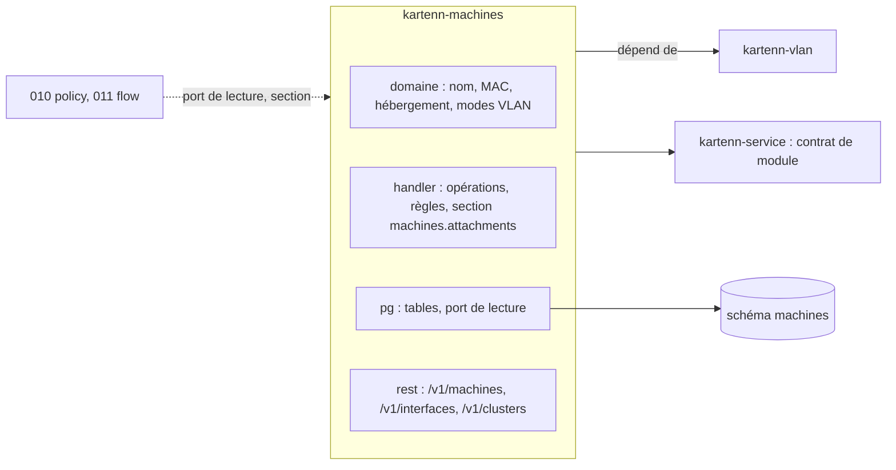

# 009 — Machines et interfaces : conception

## Vue d'ensemble



Module `machines` (crate `kartenn-machines`), construit sur le contrat de l'ADR 0026
tel que la 008 l'implémente ; aucun changement du noyau. Il dépend du module `vlan`
(M9) : dépendance Rust (crate `kartenn-vlan`, pour le type `vlan.vlan` et la propriété
`vlan.vlan`) et dépendance déclarée au registre.

## Changements

### Crates (REQ-009-1)

| Crate | Changement |
|---|---|
| `kartenn-machines` (nouvelle) | `name.rs` (nom d'hôte), `mac.rs` (EUI-48), `hosting.rs` (règles M5), `vlan_mode.rs` (M9), `rules.rs`, `handler.rs`, `section.rs` (REQ-009-23), `pg.rs` (feature `pg`, dont le port de lecture `pg::read`), `rest.rs` (feature `rest`), `migrations/`. AGPL-3.0. |
| `kartenn-server` | feature `machines` (par défaut, active `vlan`) ; module ajouté au registre. |
| `kartenn-bench` | jeu de référence augmenté (M15), mesures du module dans `bench-core`. |

### Types d'objets (REQ-009-1 à 7)

| Type | Collection | Parent (`module_object.parent_id`) | `core.owner` | `core.site` | Arbre |
|---|---|---|---|---|---|
| `machines.cluster` | `clusters` | — | obligatoire | facultatif | — |
| `machines.machine` | `machines` | — | obligatoire | facultatif | `machines` (racine) |
| `machines.interface` | `interfaces` | sa machine | hérité | hérité | `machines` |

Le rattachement n'est pas un objet de module : c'est une ligne datée de
`machines.attachment`, versionnée, rendue dans l'historique de l'interface.

### Données (schéma `machines`, migration `0001_machines.sql`)

```sql
CREATE TABLE machines.cluster (
    id uuid NOT NULL, slug text NOT NULL,
    valid_period tstzrange NOT NULL, sys_start timestamptz NOT NULL DEFAULT now(),
    changeset_id uuid NOT NULL,
    PRIMARY KEY (id, valid_period WITHOUT OVERLAPS),
    EXCLUDE USING GIST (slug WITH =, valid_period WITH &&)
);
CREATE TABLE machines.machine (
    id uuid NOT NULL,
    name text NOT NULL CHECK (name = lower(name) AND char_length(name) BETWEEN 1 AND 253),
    kind text NOT NULL CHECK (kind IN ('physical', 'virtual', 'container', 'appliance')),
    host_machine_id uuid,          -- hébergeur machine
    host_cluster_id uuid,          -- hébergeur cluster
    member_cluster_id uuid,        -- cluster d'un hôte physique
    valid_period …, sys_start …, changeset_id …,
    PRIMARY KEY (id, valid_period WITHOUT OVERLAPS),
    CHECK (num_nonnulls(host_machine_id, host_cluster_id) <= 1),
    CHECK (kind IN ('virtual', 'container') OR num_nonnulls(host_machine_id, host_cluster_id) = 0),
    CHECK (kind = 'physical' OR member_cluster_id IS NULL),
    CHECK (host_machine_id IS DISTINCT FROM id)
);
CREATE TABLE machines.interface (
    id uuid NOT NULL, machine_id uuid NOT NULL,
    name text NOT NULL CHECK (char_length(name) BETWEEN 1 AND 64),
    mac macaddr,                   -- EUI-48 ; bit de groupe contrôlé par CHECK
    enabled boolean NOT NULL DEFAULT true,
    vlan_mode text NOT NULL DEFAULT 'none' CHECK (vlan_mode IN ('none', 'access', 'trunk')),
    access_vlan_id uuid, native_vlan_id uuid,
    tagged_vlan_ids uuid[] NOT NULL DEFAULT '{}',
    valid_period …, sys_start …, changeset_id …,
    PRIMARY KEY (id, valid_period WITHOUT OVERLAPS),
    EXCLUDE USING GIST (machine_id WITH =, name WITH =, valid_period WITH &&),
    CHECK (mac IS NULL OR (get_byte(macaddr8_send(mac::macaddr8), 0) & 1) = 0)
);
CREATE TABLE machines.attachment (
    id uuid NOT NULL, interface_id uuid NOT NULL, address_id uuid NOT NULL,
    primary_for_family boolean NOT NULL DEFAULT false,
    family smallint NOT NULL CHECK (family IN (4, 6)),
    shared boolean NOT NULL,       -- usage vip ou anycast de l'adresse sur la période
    valid_period …, sys_start …, changeset_id …,
    PRIMARY KEY (id, valid_period WITHOUT OVERLAPS),
    EXCLUDE USING GIST (interface_id WITH =, address_id WITH =, valid_period WITH &&),
    EXCLUDE USING GIST (address_id WITH =, valid_period WITH &&) WHERE (NOT shared),
    EXCLUDE USING GIST (interface_id WITH =, family WITH =, valid_period WITH &&)
        WHERE (primary_for_family)
);
-- versionnées (ADR 0017) ; index : interface_by_machine, attachment_by_address,
-- attachment_by_interface, machine_by_host, machine_by_cluster, interface_by_mac.
```

Le contrôle exact du bit de groupe se fait en Rust (`mac.rs`) ; le `CHECK` SQL est la
défense finale (expression à valider à l'implémentation, sinon une fonction SQL
immuable). `tagged_vlan_ids` est un tableau : l'ensemble est petit (≤ 4 094) et se lit
toujours avec l'interface ; les références vers les VLAN sont contrôlées par le
gestionnaire (pas de clé étrangère sur un tableau).

`shared` recopie l'usage de l'adresse (`vip` ou `anycast`) sur la période : un
changement d'usage de l'adresse est un objet du noyau touché que `check` reçoit
(ADR 0026 clause 7) ; s'il rend partagée une adresse non partagée ou l'inverse, le
gestionnaire refuse si deux rattachements se chevauchent (`machines.address.taken`,
REQ-009-10). La recopie est réécrite par le module dans la même transaction.

### Opérations (REQ-009-2 à 12)

| `op` | Champs principaux | Clés de verrou |
|---|---|---|
| `machines.create_cluster` / `update_cluster` | `slug` ; `owner`, `site` (opérations du noyau planifiées) | — |
| `machines.create_machine` | `local`, `name`, `kind`, `owner`, `site`, `host` (`{machine|cluster: Ref}`), `member_of` | `machines.name:<owner>` |
| `machines.update_machine` | Merge Patch : `name`, `kind`, `host`, `member_of` | `machines.name:<owner>`, `machines.hosting` si `host` change |
| `machines.create_interface` | `local`, `machine`, `name`, `mac`, `enabled`, `vlan` (`{mode, access, native, tagged}`) | `machines.machine:<id>` |
| `machines.update_interface` | Merge Patch : `name`, `mac`, `enabled`, `vlan` | `machines.machine:<id>` |
| `machines.attach_address` | `local`, `interface`, `address`, `primary` | `machines.address:<id>` |
| `machines.detach_address` | `interface`, `address` | `machines.address:<id>` |

`owner` et `site` d'une machine ou d'un cluster sont des affectations de `core.owner` et
`core.site` que le gestionnaire ajoute au changeset (ADR 0026 clause 6), comme pour les
groupes de VLAN de la 008. L'unicité du nom par propriétaire (M3) se contrôle sur
l'état final, pour chaque machine dont le nom ou le propriétaire résolu change (le
différentiel des propriétés donne les changements de `core.owner`) ; la clé
`machines.name:<owner>` sérialise deux créations concurrentes.

`machines.hosting` : verrou global pris seulement quand un hébergeur change, pour que le
contrôle d'absence de cycle (parcours des hébergeurs, profondeur ≤ 2 par M5) voie un
état stable.

### Règles (REQ-009-4 à 13)

| Identifiant | Sévérité | Quand |
|---|---|---|
| `machines.name.invalid` | erreur | nom hors RFC 1123 §2.1 |
| `machines.name.duplicate` | erreur | même nom, même propriétaire résolu, périodes chevauchantes |
| `machines.cluster.duplicate` | erreur | slug |
| `machines.host.invalid` | erreur | combinaison hors M5, auto-hébergement, cycle, hébergeur clos |
| `machines.interface.duplicate` | erreur | même nom sur la machine |
| `machines.mac.invalid` | erreur | MAC mal formée ou de groupe |
| `machines.vlan.mode` | erreur | mode et VLAN incohérents, VLAN clos |
| `machines.address.taken` | erreur | adresse non partagée déjà rattachée |
| `machines.address.primary` | erreur | deux principales de même famille |
| `machines.address.closed` | erreur | adresse close sur la période |
| `machines.mac.duplicate` | avertissement | MAC universelle sur deux interfaces vivantes |
| `machines.address.vlan_mismatch` | avertissement | réseau de l'adresse portant un VLAN étranger à l'interface |
| `machines.host.site_mismatch` | avertissement | hébergé et hébergeur de sites résolus différents |

Les avertissements deviennent des anomalies (chemin commun, ADR 0026 clause 7) ;
`vlan_mismatch` est réévalué quand change le `vlan.vlan` d'un réseau (objet touché du
module `vlan`, dont `machines` dépend) ou le rattachement.

### Propriétés déclarées (REQ-009-8, 24)

| Clé | Type | Porteurs | Héritage |
|---|---|---|---|
| `machines.interface_role` | liste fermée, simple ; valeurs `administration`, `backup`, `monitoring`, `storage`, `cluster`, `service` | `machines.interface` | aucun |
| `machines.fqdn` | FQDN (003) | `machines.machine` | aucun |

Les types `machines.machine` et `machines.interface` sont porteurs admissibles pour toute
propriété (REQ-008-7) : rien de propre au module pour REQ-009-24.

### Références (REQ-009-14)

| Source | Cible | Politique |
|---|---|---|
| interface | machine | refus ; cascade : clôt l'interface |
| rattachement | interface | refus ; cascade : clôt le rattachement |
| rattachement | adresse (noyau) | refus ; cascade : clôt le rattachement |
| interface (accès, natif, étiquetés) | `vlan.vlan` | refus ; cascade : retire le VLAN (mise à nul, mode `none` si plus aucun) |
| machine (hébergeur) | machine, cluster | refus ; cascade : mise à nul |
| machine (membre) | cluster | refus ; cascade : mise à nul |
| machine, cluster (ancres) | entité, site | refus (via `core.owner`/`core.site`, 003) |

### Section `machines.attachments` (REQ-009-23)

Contribution au différentiel (ADR 0026 clause 13) : à partir des lignes de
`machines.attachment` écrites par le changeset (avant par l'historique de temps
système, après par la table courante), une ligne par (interface, adresse, portion de
période) : `machine`, `interface`, `address`, `before` (rattaché ou non, principal),
`after`, `period`. Les clôtures en cascade d'interfaces et de machines passent par la
clôture des rattachements, donc par la section.

### Port de lecture (REQ-009-16, 22, 25)

`kartenn_machines::read` (fonctions publiques, `&mut PgConnection`, donc utilisables
via `ModuleTx` dans la transaction ou sur une connexion de lecture) :

| Fonction | Rend |
|---|---|
| `addresses_of_machine(machine, valid_at, as_of)` | `(interface, nom, rôle résolu, adresse, valeur, principal)` |
| `addresses_of_interface(interface, valid_at, as_of)` | idem |
| `attachments_of_address(address, valid_at, as_of)` | `(interface, machine, rôle résolu)` |
| `machines_in_network(prefix, valid_at, as_of, page)` | machines dont une adresse rattachée est dans le réseau |
| `hosted_by(machine_or_cluster, …)`, `members_of(cluster, …)` | machines |
| `machine_values_of_addresses(addresses, keys, valid_at, as_of)` | par adresse : `(machine, interface, clé, valeurs résolues, explication)` ; une requête pour le lot (jointure des rattachements et de la résolution matérialisée des machines) ; la 010 compose avec la valeur de l'arbre (010/S27) |

`as_of` passé : lecture sur `table ∪ historique` comme les lectures datées du noyau
(`kartenn-store-pg/src/temporal.rs`). Le rôle se lit par la résolution de propriété du
noyau (clé `machines.interface_role`).

### Routes (REQ-009-15 à 18)

| Route | Rôle |
|---|---|
| `GET, POST /v1/clusters` ; `GET, PATCH, DELETE /v1/clusters/{id}` ; `GET /v1/clusters/{id}/machines` | clusters, membres et hébergés |
| `GET, POST /v1/machines` ; `GET, PATCH, DELETE /v1/machines/{id}` | filtres `name`, `name_prefix`, `kind`, `host`, `cluster`, `owner`, `site` ; la fiche inclut interfaces et adresses (résumé) |
| `GET /v1/machines/{id}/addresses`, `/hosted` | lectures croisées |
| `GET, POST /v1/interfaces` ; `GET, PATCH, DELETE /v1/interfaces/{id}` | filtres `machine`, `name`, `mac`, `address`, `vlan` |
| `POST /v1/interfaces/{id}/attachments`, `DELETE /v1/interfaces/{id}/attachments/{address}` | `attach_address`, `detach_address` (changeset d'une opération, `If-Match` de l'interface) |
| `GET /v1/machines?network=<prefix>` | machines d'un réseau |

Arêtes (REQ-009-17) déclarées au registre : `machines.has_address`, `machines.access`,
`machines.tagged`, `machines.native`, `machines.hosted_on` (machine → machine hôte),
`machines.hosted_in` (machine → cluster hôte), `machines.member_of`. Un type d'arête
n'a qu'un type d'extrémité : l'hébergement par un cluster a donc son propre nom.

Droits (M16) : `attach_address` exige `machines.interface.write` (ou `propose`) sur
l'interface et `core.address.read` sur l'adresse ; le gestionnaire ajoute ce second
contrôle par `WriteTx::rbac_outside` sur l'adresse avec la permission de lecture. Poser
un VLAN exige `vlan.read` sur chaque VLAN cité.

### Interface (REQ-009-20)

`web/plugins/machines/` (MPL-2.0), manifeste `"module": "machines"` (ADR 0025) : `view`
`machines`, `clusters` ; `tab` `machines` sur `address` et `prefix` ; `column` `machine`
sur `address` ; `action` `attach` sur `address` (choix d'une interface par recherche).
Écrit comme le plugin VLAN (008).

## Erreurs et cas limites

- Rattacher une adresse d'un domaine quelconque : permis (M8) ; seul le VLAN donne un
  avertissement.
- Adresse passée de `vip` à `host` alors qu'elle est rattachée deux fois : refus, liste
  des rattachements (REQ-009-10).
- Machine dont le propriétaire change par héritage (elle n'hérite de rien : `core.owner`
  est toujours propre) : sans objet ; une interface suit sa machine.
- Interface déplacée vers une autre machine : refus de structure (M7), clore et
  recréer ; l'historique garde l'ancienne.
- Conteneur sur une VM elle-même sur un cluster : permis, profondeur 2.
- Module `vlan` présent mais `machines` absent d'une build : tables de `machines` non
  touchées (REQ-008-2).

## Alternatives considérées

- Rattachement comme objet de module (`machines.attachment` dans `module_object`) :
  un UUID et un ETag pour un lien, sans usage ; l'historique de l'interface suffit.
- VLAN étiquetés en table de liaison : plus de jointures pour un ensemble toujours lu en
  bloc ; le tableau suffit (références contrôlées par le gestionnaire).
- MAC en `text` normalisé : `macaddr` valide la forme et indexe ; restitution formatée
  en Rust (RFC 9542 §1.1).

## Risques

- Machines d'un réseau (`machines_in_network`) : jointure rattachements × adresses
  contenues dans un /24 à 10⁵ machines ; index `attachment_by_address` et GiST des
  adresses du noyau ; budget REQ-009-21 mesuré.
- Unicité du nom par propriétaire résolu : coût du contrôle quand `core.owner` d'une
  entité change pour beaucoup de machines (il n'hérite pas : seule une affectation
  explicite change, objet par objet) ; borné.
- Contrôle du bit de groupe en SQL : expression à éprouver ; repli sur une fonction
  immuable.

## Stratégie de test

- Domaine pur : nom (RFC 1123, casse), MAC (formes d'entrée, restitution, bit de
  groupe), hébergement (table de vérité M5, cycles), modes VLAN.
- Intégration PostgreSQL : unicités concurrentes (nom, adresse), cascades, avertissements
  ouverts puis fermés, section `machines.attachments`, port de lecture daté (`as_of`).
- Module factice dépendant de `machines` : lecture du port et de la section dans la
  transaction (REQ-009-22, 23), propriété portée par une machine (REQ-009-24).
- HTTP : routes, filtres, droits M16, `If-Match`.
- Banc `bench-core` (REQ-009-21) ; E2E du plugin.

## ADR

Aucune nouvelle : le module applique l'ADR 0026.
