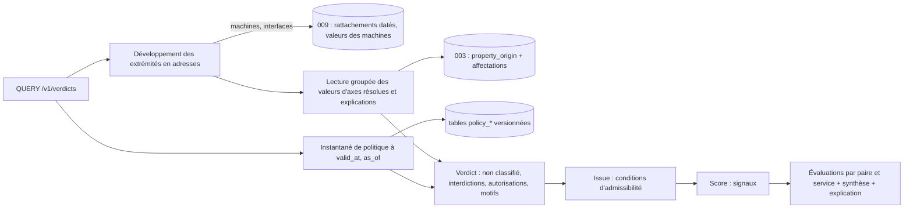

# 010 — Politique de flux : conception

## Vue d'ensemble

Le module Politique est une crate `kartenn-policy` (espace `policy`), qui dépend du
noyau et, facultativement (feature), de `kartenn-machines` (009). Elle suit le contrat
de module ([ADR 0026](../../docs/adr/0026-contrat-de-module.md), acceptée) : migrations
propres, types d'objets versionnés, opérations de changeset, règles, permissions,
collections REST, contribution au différentiel ; et, dans la v0.2, les points différés
de l'ADR (déclencheurs d'approbation, tâches de fond, événements de module).

Trois choix structurent la conception :

> 1. Les axes ne sont **pas** un mécanisme du module : ce sont des propriétés de la 003
>    (`policy.environment` et celles qu'un administrateur désigne). Résolution, héritage,
>    explication, filtrage, obligation et différentiel des nœuds sont ceux du noyau ; le
>    module ajoute la politique, l'évaluation et l'inférence.
> 2. La politique (≈ 10⁴ règles, 10³ services, 100 motifs) est petite : une évaluation se
>    calcule **en mémoire** sur un instantané de la politique à la date demandée, après
>    une lecture groupée des valeurs résolues des extrémités.
> 3. Verdict et issue sont **deux étapes** : la politique (règles, motifs) décide du
>    verdict ; l'admissibilité (conditions) décide de l'issue ; les signaux ne décident
>    de rien.

## Changements

### Données (REQ-010-1 à 10, 26, 29 à 37)

Toutes les tables sont versionnées selon l'ADR 0017 (table courante, `_history`,
déclencheur générique, `valid_period`, `sys_start`, `changeset_id`) et créées par les
migrations du module (ADR 0026, clause 3). Les objets de la politique sont des types de
module (`policy.rule`, `policy.pattern`…) inscrits dans `module_object` (clause 4) ; ils
n'ont pas d'ancre de périmètre (permissions globales, S15), sauf les règles d'inférence
qui citent un domaine.

| Table | Contenu | Contraintes |
|---|---|---|
| `policy_axis` | `property_key`, `carrier` (`tree`, `machine`), `inference` (visé par l'inférence) | une ligne par propriété désignée ; propriété de liste fermée ou de référence externe |
| `policy_value` | `value_id` (valeur de liste d'un axe), `label`, `description`, `transverse`, `rank` | une ligne par valeur décrite ; `policy.environment` y porte ses attributs (S2) |
| `policy_flow_type` | `id`, `key`, `label`, `description` | `key` unique par période (`EXCLUDE … WITH &&`) |
| `policy_service` | `id`, `key`, `label`, `flow_type_id` | `key` unique par période ; type de flux valide sur la période |
| `policy_service_entry` | `service_id`, `transport`, `ports int4range`, `icmp_type`, `icmp_code`, `protocol` | `CHECK` par transport ; GiST `(transport, ports)` |
| `policy_pattern` | `id`, `key`, `label` | `key` unique par période |
| `policy_rule` | `id`, `key`, `label`, `effect` (`allow`, `deny`), `flow_type_ids uuid[]`, `service_ids uuid[]`, `pattern_id` (appartenance), `required_pattern_ids uuid[]` | `key` unique par période ; sélecteur de flux non vide ; `required_pattern_ids` vide si `deny` |
| `policy_rule_term` | `rule_id`, `side` (`source`, `destination`), `axis_key`, `value_ids uuid[]` | un terme par (règle, côté, axe) ; valeurs non vides |
| `policy_rule_same` | `rule_id`, `axis_key` | contrainte « même valeur » |
| `policy_condition` | `id`, `key`, `kind`, `params jsonb`, `rule_ids uuid[]`, `flow_type_ids uuid[]` | `kind` dans la liste fermée du code ; `params` validés par le genre |
| `policy_signal` | `id`, `key`, `kind`, `params jsonb`, `weight int` | idem |
| `policy_text` | `object_id` (règle, motif, condition), `locale`, `body`, `url` | une ligne par (objet, langue) ; présence vérifiée par règle (S29) |
| `policy_exempt_role` | clé de rôle d'interface (009) exemptée de S10 | — |
| `policy_inference_rule` | `id`, `key`, `axis_key`, `parent_id` (exception), `priority`, `criteria jsonb`, `value_ids uuid[]`, `domain_id` (facultatif, porté pour le RBAC) | profondeur ≤ 4 ; `criteria` validés par genre |
| `policy_revision` | compteurs de révision : `policy`, `inference` | une ligne ; incrémentée dans la transaction du changeset |

**Écart à l'implémentation (le code fait foi, synchronisation 010-20).** Les tables
filles prévues ci-dessus sont repliées dans la ligne de l'objet :
`policy_service.entries jsonb` (pas de `policy_service_entry` ; l'index GiST des ports est
remplacé par l'index transport → intervalles de l'instantané) ; `policy_rule.source` et
`.destination jsonb` (termes par axe), `same text[]`, `texts jsonb` (pas de
`policy_rule_term`, `policy_rule_same`, `policy_text`) ; `texts jsonb` aussi sur
`policy_pattern` et `policy_condition`. Axes et valeurs sont cités par clé
(`property_key`, `value_key`, `value_keys text[]` des règles d'inférence) et non par
identifiant de valeur. Tables ajoutées : `policy_inference_check` (curseur de la tâche
d'écart d'inférence, migration 0002), `policy_report` et `policy_report_item` (0003).
Migrations du module : `0001_policy.sql` à `0003_report.sql`
(`crates/kartenn-policy/migrations/`).

Déclarations de propriétés (descripteurs du module, 003) :

| Clé | Type | Héritage | Porteurs |
|---|---|---|---|
| `policy.environment` | liste fermée, ensemble | arbre d'adressage | `domain`, `prefix` (conteneur, réseau), `address` |
| `policy.declared_environment` | liste fermée, ensemble ; valeurs de `policy.environment` (référentiel partagé, N7) | aucun | `machines.machine` |
| `policy.exposure` (exemple) | liste fermée, ensemble | arbre d'adressage | idem `policy.environment` |
| `policy.sensitivity`, `policy.criticality`, `policy.conduit_role` (exemples) | liste fermée, ensemble | arbre d'adressage (défaut hérité) | arbre et `machines.machine` |
| `policy.application`, `policy.owner` (exemples) | référence externe (N26), ensemble | arbre d'adressage (défaut hérité) | arbre et `machines.machine` |

Les déclarations d'exemple sont livrées par une opération d'installation facultative
(`policy.examples.install`), pas par le descripteur : l'administrateur peut les refuser,
les modifier ou les clore.

### Opérations (REQ-010-2, 4, 5, 8, 9, 21, 29 à 37, 40 à 53)

Opérations de changeset du module (enveloppe `Operation::Module`, ADR 0026 clause 6) :
`policy.axis.designate | release`, `policy.value.describe`, `policy.environment.create |
update | close`, `policy.flow_type.*`, `policy.service.*`, `policy.rule.*`,
`policy.pattern.*`, `policy.condition.*`, `policy.signal.*`, `policy.text.set | remove`,
`policy.matrix.set` (écriture d'une cellule de la vue, traduite en création, mise à jour
ou clôture de règle), `policy.exempt_role.*`, `policy.inference_rule.*`,
`policy.examples.install`. `policy.environment.create` planifie dans le même changeset
la création de la valeur de liste (opération du noyau) et ses attributs. L'obligation
par domaine et par axe (REQ-010-21) est l'opération du noyau `AddObligation` sur la
déclaration (N8, ADR 0026 : tâche 008-20).

**Opérations livrées** (`crates/kartenn-policy/src/module.rs`, le code fait foi) :
`axis.designate | update`, `value.describe`, `environment.create | close`,
`examples.install`, `{flow_type, service, pattern, rule, condition, signal}.create |
update`, `matrix.set`, `exempt_role.create`, `inference_rule.create | update`. La
clôture d'un objet passe par la clôture générique du noyau (`DELETE` des routes) ; il
n'y a pas de `text.set | remove` : les textes pédagogiques (langue par défaut `fr`,
constante) sont écrits par `create` et `update`. Règles livrées en plus du tableau :
`policy.axis.invalid`, `policy.key.duplicate`, `policy.key.syntax`,
`policy.label.invalid`, `policy.operation.invalid`, `policy.rule.term_empty`,
`policy.service.entries_empty`, `policy.text.invalid`, `policy.value.unknown`,
`policy.inference.criterion_invalid` ([catalogue](../../docs/spec/regles-modules.md)).

Validation sur l'état final (règles du module, identifiants stables REQ-002-37) :

| Règle | Sévérité | Cas |
|---|---|---|
| `policy.service.entry_invalid` | erreur | transport, port, type ICMP hors domaine |
| `policy.service.flow_type` | erreur | type de flux clos ou absent sur la période |
| `policy.service.wide_ports` | avertissement | > 1 024 ports d'un transport |
| `policy.rule.flow_selector_empty` | erreur | ni type ni service |
| `policy.rule.unknown_axis` | erreur | terme ou « même valeur » sur une propriété non désignée |
| `policy.rule.conditional_deny` | erreur | motifs requis sur une règle `deny` |
| `policy.matrix.stale` | erreur | `policy.matrix.set` sous `if_match` alors que la matrice du type de flux a changé (S35) |
| `policy.text.missing` | erreur | règle `deny`, motif ou condition sans texte dans la langue par défaut |
| `policy.condition.params_invalid`, `policy.signal.params_invalid` | erreur | paramètres hors du schéma du genre |
| `policy.inference.regex_invalid` | erreur | expression non ancrée, > 256 caractères, hors syntaxe linéaire |
| `policy.inference.depth` | erreur | exception de profondeur > 4 |
| `policy.reference.closed` | erreur | valeur, type, service, motif clos alors qu'un objet de politique le cite (liste) |
| `policy.machine.environment_mismatch` | avertissement | S10 |
| `policy.inference.conflict` | avertissement (anomalie du jeu) | REQ-010-45 |
| `policy.inference.mismatch` | avertissement (anomalie par nœud d'origine) | REQ-010-48 |

### Sérialisation et événements (S17)

Toute opération `policy.*` prend le verrou de module `policy` (ADR 0026 clause 14),
après les verrous de domaine. Chaque changeset qui touche la politique incrémente
`policy_revision.policy` (clé de cache et provenance) ; celui qui touche les règles
d'inférence incrémente `policy_revision.inference`. Événements de module (point différé
N15 de l'ADR, livré par la tâche 010-8) : `org.kartenn.policy.revised` (révision, résumé
du différentiel).

### Instantané de politique (REQ-010-11, 16, 28)

`PolicySnapshot` (domaine pur, `kartenn-policy/src/snapshot.rs`) : axes, attributs de
valeurs, types, services avec index transport → intervalles de ports, règles indexées
par service (développement des types en services à la construction), motifs, conditions,
signaux, textes. Chargé par une requête par table à (`valid_at`, `as_of`) via les
lectures datées du noyau (REQ-004-17).

Cache du processus (`cache::shared()`), partagé entre les requêtes et les préparations
d'écriture (matrice sous `If-Match`, S35) : l'instantané du **présent** est gardé sous la
révision ; une lecture de la révision (une ligne) précède chaque requête, un changement
recharge. Les instantanés passés (`as_of` < maintenant, immuables) sont gardés dans un
cache LRU de 16 entrées. Taille : ≈ 5 Mo pour le jeu du budget. Le cache n'est alimenté
que depuis une transaction qui n'a pas écrit la politique : la révision d'une écriture
non validée peut encore changer ou être annulée, et nommerait un autre contenu après un
rollback. La préparation de `policy.matrix.set` lit l'instantané avant toute écriture ;
le registre de flux (011) relit sans le cache la politique d'une transaction qui l'a
écrite. Le cache garde aussi lui-même cette condition : une transaction qui a écrit la
politique (`xmin` de la ligne de révision) la lit sans la garder. La clé nomme la base
(identifiant du cluster et oid de la base, lus avec la révision) : deux bases servies
par un même processus peuvent partager une révision, jamais une politique.

### Évaluation (REQ-010-11 à 15, 31, 32, 36 à 38)

Fonction pure `evaluate(snapshot, a: &Endpoint, b: &Endpoint, service, dossier) ->
Evaluation`, où `Endpoint` porte, par axe, l'ensemble résolu et sa source :

1. **Règles candidates** : celles dont le sélecteur de flux couvre `service`. Axes cités
   par les candidates ; si A ou B n'a pas de valeur sur l'un → `Denied { Unclassified {
   side, axis } }`.
2. **Application** d'une règle : pour chaque terme, l'ensemble de l'extrémité intersecte
   les valeurs du terme ; pour chaque « même valeur », les ensembles de A et B
   s'intersectent. La combinaison citée est la première intersection dans l'ordre des
   clés de valeurs.
3. **Interdictions** applicables → `Denied { Rule(id) }` ; décisive = la plus spécifique
   (nombre de termes, puis de valeurs exclues, puis clé) ; trois écartées citées.
4. **Autorisations inconditionnelles** applicables → `Allowed { Rule(id) }`.
5. **Conditionnelles** : motifs requis évalués (un motif correspond si l'une de ses
   règles `allow` s'applique et aucune de ses `deny`) ; un motif qui correspond →
   `Allowed { Pattern(id) }` ; sinon `AllowedPending { rule, expected_patterns }`.
6. Sinon `Denied { NoRule }`.
7. **Issue** : `Denied` → `Noncompliant` ; `AllowedPending` → `Review` ; sinon chaque
   condition dont le sélecteur couvre la règle décisive ou le type du service est
   évaluée (genre → fonction pure, lit `a`, `b`, `service`, `dossier`, attributs de
   valeur) ; une non remplie → `Review`, sinon `Automatic`. Sans dossier, les conditions
   qui le lisent sont `NotEvaluated` et l'issue est au mieux `Review`.
8. **Signaux** : chaque signal évalué ; liste et somme des poids.

Un port qu'aucun service ne couvre → `Denied { UnknownService }`, issue `Review`.

Le service `Query` du module :
- développe les extrémités en adresses (adresse : elle-même ; préfixe : lui-même ;
  interface, machine : port de lecture de la 009, M4) ;
- lit en **une** requête les valeurs résolues des axes cités par l'instantané pour
  toutes les adresses (lecture groupée, N9) et, pour les axes portés par la machine, les
  valeurs des machines rattachées (port de lecture 009, M10) ; compose selon S27 ;
- développe l'objet : service ; couple transport/port → services dont une entrée
  couvre le port ; type de flux → ses services ;
- calcule les évaluations (paires × services), la synthèse et l'issue de synthèse ;
  borne : 64 adresses par extrémité et 10⁴ évaluations par requête (au-delà, 422
  `policy.query.too_large`) ;
- réduit l'explication pour un appelant `policy.flow.request` (REQ-010-25).

### Cohérence des machines (REQ-010-17)

Règle du module exécutée sur les machines touchées par un changeset (machine créée ou
modifiée, rattachement changé, `policy.declared_environment` changé) **et** sur les
machines dont une adresse change d'environnement résolu (différentiel de propriétés,
lu par la contribution, ADR 0026 clause 13). Produit ou ferme l'anomalie
`policy.machine.environment_mismatch` (clause 7).

### Différentiel de politique (REQ-010-18, 19)

Contribution au différentiel du changeset (section `policy.combinations`, ADR 0026
clause 13), calculée après les écritures, sur la fenêtre du changeset :

1. Classement des changements : règles ajoutées, retirées ou modifiées ; motifs ;
   services dont le type ou les entrées changent ; types et valeurs clos.
2. **Combinaisons candidates** `(valeurs source, valeurs destination, service)` : pour
   une règle, ses termes (un terme absent développe « toute valeur » en une valeur
   joker de l'axe) × les services de son sélecteur de flux ; pour un motif, les
   combinaisons des règles qui l'exigent ; pour un service, ses combinaisons avant et
   après.
3. Verdict de principe de chaque candidat sur les instantanés **avant** et **après**, sur
   des extrémités synthétiques qui portent exactement les valeurs de la combinaison ;
   seuls les basculements (`denied`, `allowed`, `allowed` sous réserve) sont gardés,
   avec l'élément décisif de chaque côté.
4. Section stockée, paginée, décompte `opens` / `closes` / `pending` ; une simulation
   renvoie le décompte et les 100 premières entrées.

Section `policy.reclassified` : pour chaque nœud du différentiel de propriétés de la 003
dont un axe change, le nombre d'héritiers dont la valeur résolue change (lecture de
`property_origin`) ; elle nourrit `policy.reclassify`.

Borne : la combinatoire est celle des valeurs citées par les règles touchées, pas de
tous les axes ; au-delà de 10⁵ candidats, décompte d'abord (budget exceptionnel de la
003, REQ-003-26).

### Approbation (REQ-010-20)

Déclencheurs de module (point différé N5 de l'ADR 0026, livré par la tâche 010-9) :
`policy.write`, `policy.opens`, `policy.closes`, `policy.reclassify` (paramètre `min`),
évalués sur les sections du différentiel ; l'administrateur les ajoute à une politique
d'approbation (004/C6).

### Inférence (REQ-010-40 à 54)

Moteur pur (`kartenn-policy/src/inference.rs`) sur l'arbre d'adressage :

- **Critères** : énumération fermée (`Within`, `Equals`, `Family`, `Domain`,
  `ObjectKind`, `Site`, `Entity`, `Property { key, op }`, `NameRegex`, `PrefixLength`),
  chacun avec une liste de valeurs ; ET entre critères. Les expressions régulières
  passent par la crate `regex` (temps linéaire, sans retour arrière), ancrées, ≤ 256
  caractères.
- **Évaluation d'un nœud** : remonter ses ancêtres (lecture datée) ; pour chaque règle
  racine qui correspond à un ancêtre ou au nœud, descendre ses exceptions qui
  correspondent ; retenir la règle de plus haute priorité, puis le nœud de
  correspondance le plus profond ; égalité restante entre ensembles différents →
  candidats multiples.
- **Source de valeurs attendues** de la 003 (REQ-003-21 à 24), via le contrat amendé
  (N20, N28) : ancêtres, révision dynamique, lecture des règles dans la transaction,
  lot, candidats multiples.
- **Anomalies** : tâche de fond `policy.inference.check` (point différé N14 de l'ADR)
  après tout changeset qui touche les règles, et contrôle des objets créés ou modifiés
  dans le changeset ; une anomalie par nœud d'origine de la valeur déclarée, avec le
  décompte des héritiers.
- **Valeur par défaut** : à la création seule, attendu unique, si le nœud n'hérite de
  rien ; provenance `source:policy.inference@<révision>#<règle>`.

### Aperçu de l'inférence (REQ-010-55, S36)

> S36 acceptée le 2026-10-23 ; tâche 010-22.

Aucune route nouvelle : l'aperçu est une contribution de l'inférence au différentiel du
changeset, lue par la simulation et par la lecture du différentiel.

**Entrée.** `POST /v1/changesets?simulate=true` (REQ-004-9, 006/H2), corps d'une
soumission ordinaire : opérations `policy.inference_rule.create`, `…update` ou la
clôture d'une règle, seules ou dans un changeset composé (règle et ses exceptions,
reclassement de nœuds). Le plugin `policy` (017, tâche 017-15) y envoie le brouillon du
formulaire.

**Sortie.** Réponse 200 de simulation (violations, anomalies, différentiel) ; dans la
section du module `policy.combinations` (le contrat donne une section par module ;
`policy.reclassified` y est déjà un genre de ligne), deux genres de ligne :

| Genre | `object` | Contenu |
|---|---|---|
| `policy.inference.summary` | nul ; une ligne par axe visé par une règle touchée | `after` : `{axis, valid_at, scope, scope_exact, changed, opens, closes, origins_opened, origins_closed, truncated}` |
| `policy.inference.node` | le nœud | `before` et `after` : `{axis, revision, expected, candidates, rule, declared, origin, deviates}` |

- `expected` : l'ensemble attendu unique, ou `null` ; `candidates` : les ensembles à
  égalité (REQ-010-45), vide sinon ; `rule` : la clé de la règle retenue (de
  l'exception la plus profonde) ; `revision` : la révision du jeu d'avant, et celle que
  le changeset donnera ; `declared` : l'ensemble déclaré résolu, `origin` son nœud
  d'origine ; `deviates` : l'écart de REQ-010-47.
- Ordre des lignes : synthèse(s), puis les nœuds qui entrent en écart, ceux qui en
  sortent, puis les autres, chacun dans l'ordre de l'arbre (domaine, préfixe).
- Pagination : la simulation rend le décompte et les 100 premières lignes de la section
  (échantillon commun) ; un changeset soumis, appliqué ou retenu se lit par
  `GET /v1/changesets/{id}/diff?section=policy.combinations`, page par page
  (`links.next`).

**Calcul**, après les écritures, dans la transaction du changeset :

1. Règles touchées : les règles racines dont le changeset écrit la racine ou une
   exception, dans leur version d'avant et d'après.
2. Portée : les nœuds où l'une de ces versions correspond (critères de la racine, domaine
   cité compris : `infer::rules_at` l'ajoute en critère), plus leurs sous-arbres
   (transmission, REQ-010-43). Les critères indexés (préfixe, domaine, famille, type
   d'objet) filtrent en SQL ; les autres s'évaluent en mémoire sur ce reste. Décompte
   d'abord : au-delà de 10⁵ nœuds, la synthèse ne porte que `scope` (borne supérieure si
   le filtre indexé l'a déjà dépassé : `scope_exact: false`) et `truncated: true`, sans
   ligne de nœud ni décompte d'écarts.
3. Pour chaque nœud de la portée : attendu d'avant (règles et valeurs déclarées hors du
   changeset) et d'après (dans la transaction), par `inference::expected` sur sa chaîne ;
   écart d'avant et d'après par `inference::mismatch`. Seuls les nœuds dont l'attendu ou
   l'écart change sont gardés (`changed`).
4. Écarts : `opens`, `closes` comptent les nœuds ; `origins_opened` les nœuds d'origine
   qui gagnent un héritier en écart sans porter d'anomalie `policy.inference.mismatch`
   ouverte, `origins_closed` ceux dont l'anomalie ouverte perd tous ses héritiers en
   écart. Aucune anomalie n'est levée ni close ici : la tâche de fond
   `policy.inference_check` reste seule à le faire, après application.

**Temps.** `valid_at` : le début de validité le plus tôt des opérations d'inférence du
changeset, à défaut le présent ; règles, arbre et valeurs déclarées sont lus à cette
date. `as_of` : l'état connu à la transaction (avant) et l'état qu'elle écrit (après).
La section d'un changeset appliqué est figée à son calcul : la relire plus tard ne
réévalue rien ; elle porte son `valid_at`.

**Droits.** Ceux de l'écriture : le pipeline exige des opérations, simulées ou non,
`policy.inference.admin` sur le domaine cité, sinon globale (REQ-010-46) ; 403 sinon.
Une règle qui cite un domaine ne s'évalue que dans ce domaine : la portée ne sort pas
de ce que son auteur administre. La relecture d'un changeset soumis suit la règle
commune du différentiel (`core.changeset.read`) ; les valeurs d'un axe sensible sont
masquées sans `prop.<clé>.read`, comme dans le différentiel des propriétés (REQ-005-21).

**Erreurs.** Aucun problème nouveau : opérations invalides
(`policy.inference.regex_invalid`, `criterion_invalid`, `depth`) → 422
`changeset-refused`, sans section ; permission manquante → 403. Une portée trop grande
n'est pas une erreur (`truncated`).

**Approbation.** Aucune mesure nouvelle : `policy.opens` et `policy.closes` restent
celles du différentiel de politique (REQ-010-20).

### Rapport d'audit (REQ-010-22, 23)

Tâche de fond `policy.report` (ADR 0023, genre de module N14) déclenchée par `POST
/v1/policy-reports` (`valid_at`) ; une seule à la fois. Chaque rubrique est une requête
ensembliste sur `property_origin` et les affectations (non classifiés par axe : anti-
jointure par domaine ; transverses : appartenance d'une valeur transverse à l'ensemble
de l'origine, avec le nombre d'héritiers) et sur les tables de la politique ; les
rubriques « règles jamais appliquées » et « combinaisons sans flux » lisent les verdicts
matérialisés de la 011 quand elle est présente. Résultat stocké (`policy_report`,
`policy_report_item` paginé), purgé après 30 jours.

### Droits (REQ-010-24, 25)

Catalogue de permissions du module (ADR 0026 clause 8). Rôles livrés : lecteur +
`policy.catalogue.read`, `policy.verdict.read` ; demandeur + `policy.flow.request` ; éditeur +
écriture des axes ; administrateur de politique + `policy.*.admin`. La requête de
conformité vérifie `policy.verdict.read` et la lecture des objets désignés (prédicat
SQL de la 005), sinon `policy.flow.request` sur l'entité de la demande (champ `entity` du
dossier seulement : pas de repli sur l'entité de rattachement de l'appelant, choix de
010-13), sinon 404 ; l'explication réduite ne nomme aucun objet du référentiel (points
repérés par leur rang) ; dans le premier cas, les adresses
développées d'une machine lisible mais non lisibles une à une sont omises et comptées
(`hidden`). Un compte de service transmet « pour le compte de » (N31).

### API (REQ-010-27)

| Route | Rôle |
|---|---|
| `GET /v1/{policy-axes,environments,flow-types,services,policy-rules,policy-patterns,admissibility-conditions,risk-signals,inference-rules}` | listes datées, filtres (`flow_type`, `axis`, `value`, `effect`, `pattern`, `transport`, `port`) |
| `GET …/{id}`, `POST`, `PATCH`, `DELETE` | routes de ressource enveloppant un changeset (006/H2) |
| `GET /v1/policy-matrix?flow_type=…`, `PUT /v1/policy-matrix/{src}/{flow_type}/{dst}` | vue matricielle (REQ-010-34) ; le `PUT` exige `If-Match` (ETag de la matrice du type de flux : 428 absent, 412 périmé, S35) |
| `QUERY /v1/verdicts` | corps `{source, destination, service | transport+port | flow_type, dossier?, valid_at, as_of, locale?}` ; extrémités par `{kind, id}` |
| `GET /v1/verdicts?source=…&destination=…&service=…` | variante simple |
| `GET /v1/{collection}/{id}/suggestion?axis=…` | suggestion d'inférence (route transverse du noyau, ADR 0026 clause 9) |
| `POST /v1/policy-reports`, `GET /v1/policy-reports/{id}`, `GET …/items` | rapport d'audit |
| `POST /v1/changesets?simulate=true`, `GET /v1/changesets/{id}/diff?section=policy.combinations` (routes du noyau) | aperçu d'une règle d'inférence : lignes `policy.inference.*` (REQ-010-55, S36) |

Problèmes : `urn:kartenn:problem:policy-query-too-large` (422) ; les violations de
changeset suivent REQ-006-21.

**Livré par 010-18** (`crates/kartenn-policy/src/rest.rs`, le code fait foi) : les
collections ci-dessus plus `policy-values` et `policy-exempt-roles` ; les objets sont
rendus par un schéma générique `PolicyObject` (champs de leur table, période en
`valid_from`/`valid_to`), pas par un schéma par type ; les filtres `transport` et `port`
des services ne sont pas servis ; la clôture d'un environnement passe par
`policy.environment.close`. Le rapport d'audit est demandé et lu sous
`policy.rule.admin` (404 sinon) ; une demande pendant qu'un autre rapport tourne répond
409 avec son `Location`. Une interdiction posée dans la matrice exige un texte
pédagogique (`texts.fr`). **Amendé par S35** : le `PUT` d'une cellule n'est plus une
opération sans `If-Match` ; la route lit l'en-tête (428, 412) et le passe dans le membre
`if_match` de `policy.matrix.set` ; `prepare_set` lit la révision de la politique,
recalcule la vue du type de flux au présent et compare son empreinte (`matrix::fingerprint`,
ETag fort servi par le `GET`) ; l'écriture, sous le verrou `policy`, confirme que la
révision n'a bougé que par ce changeset (`matrix::check_set`), ce qui rend la comparaison
atomique sans prendre le verrou avant ceux des domaines (violation `policy.matrix.stale`
dans un changeset composé, 412 par la route). Tâches de fond : `policy.inference_check` (60 s, écart
d'inférence, amendement 4 de l'ADR 0026) et `policy.report` (5 s).

## Exigences envers le noyau, le contrat de module et la 009

Livrable du garde-fou D31 : ce que la v0.1 doit offrir pour que la 010 et la 011
s'ajoutent sans refonte. N1 à N24 et M1 à M7 viennent de la première rédaction de la 010
et de la 011 ; N25 à N37 et M8 à M10 viennent de l'entretien sécurité
([`besoin/ecarts.md`](besoin/ecarts.md) § 4, où ils étaient numérotés N21 à N33 et M7 à
M9 : renumérotés pour ne pas recouvrir N21 à N24 et M7 de la 011). L'état du contrat de
module suit la table de couverture de l'ADR 0026.

### Contrat de module (ADR 0026)

| # | Exigence | État |
|---|---|---|
| N1 | Tables versionnées dans les migrations du module, ordonnées par le DAG | fourni (clause 3, tâche 008-2) |
| N2 | Opérations de changeset de module, planifiées, validées, simulables, idempotentes, annulables, sous droits | fourni (clause 6, tâches 008-3, 4) |
| N3 | Règles de module sur l'état final, y compris sur les objets du noyau et des dépendances | fourni (clause 7) |
| N4 | Contribution nommée au différentiel, stockée, paginée, servie | fourni (clause 13, tâche 008-19) |
| N5 | Déclencheurs d'approbation de module, activés par l'administrateur seul | différé v0.2 (tâche 010-9) |
| N6 | Clés de verrou hors domaine ; clés d'ordre de l'outbox | verrous fournis (clause 14) ; ordre différé v0.2 |
| N7 | Opérations du noyau planifiées par une opération de module ; référentiel de valeurs partagé | premier volet fourni ; second différé v0.2 (tâche 010-7) |
| N8 | Obligations d'une propriété de module modifiables par l'administrateur | fourni (tâche 008-20) |
| N10 | Références vers le noyau, valeurs de liste fermée comprises | fourni (clause 12, tâche 008-7) |
| N11 | Anomalies de module, fermées par le module | fourni (clause 7) |
| N12 | Permissions de module globales, rôles livrés étendus | fourni (clause 8, tâche 008-6) |
| N13 | Collections du module, `QUERY`, contrat de référence, capacités | fourni (clause 9 : `/v1/<collection>`, S34) |
| N14 | Tâches de fond de module | différé v0.2 (tâche 010-14) |
| N15 | Événements de module | différé v0.2 (tâche 010-8) |
| N16 | État avant des tables du module dans la transaction | fourni (ADR 0017) |
| N21 à N23 | Voir le design de la 011 | fournis (clauses 12, 13, 15) |
| N34 | **Évaluation sans écriture** exposée par un module, même résultat que l'enregistrement | tenu par une route de lecture du module (`QUERY /v1/verdicts`) qui appelle la même fonction pure que la contribution de la 011 ; aucun ajout au contrat |
| N35 | **Événements de changement d'état dérivé** (issue changée, flux fermé, dérogation à échéance), calculés à la réévaluation ou par une tâche de fond | s'appuie sur N14 et N15 (différés v0.2) ; aucun ajout au contrat au-delà |
| N36 | **Vue de saisie** alternative d'un même ensemble d'objets (matrice des règles) | tenu par les routes du module (clause 9) et une opération de vue (`policy.matrix.set`) traduite en opérations de règles ; plugin 007 |
| N37 | Objet **non-conformité** consultable, filtrable, acquittable, distinct des anomalies | objets de module (011) ; l'acquittement des flux devenus non conformes réutilise celui des anomalies (clause 7) ; aucun ajout au contrat |

### Noyau (002 à 005)

| # | Exigence | État |
|---|---|---|
| N9 | **Lecture groupée** des valeurs résolues de plusieurs propriétés avec explication pour N objets à (`valid_at`, `as_of`) : 512 objets < 30 ms | à prévoir (tâche 010-2) |
| N17 | Propriété ensemble de liste fermée, héritable, avec remplacement, explication, filtrage et obligation par domaine | tenu (REQ-003-9, 11 à 16, 25) |
| N18 | Différentiel de propriétés complet disponible avant les contrôles et dans la simulation | tenu (REQ-003-19, 20) |
| N19 | Déclencheur d'approbation sur une propriété, directe ou indirecte | tenu (REQ-004-40) |
| N20 | Contrat de source de valeurs attendues amendé pour l'inférence (ancêtres, révision dynamique, lecture du module dans la transaction, lot) | à prévoir : amendement additif de la 003 (tâche 010-15) |
| N24 | Voir le design de la 011 | tenu |
| N25 | Propriété de liste fermée **déclarée par un administrateur** (P1) désignable comme axe, avec les garanties d'une propriété de module (héritage, remplacement, explication, obligation par domaine, lecture groupée) | à vérifier (P1 de la 003 ; la désignation est une donnée du module) |
| N26 | Type de valeur **référence externe** (système source en liste fermée administrable, identifiant, libellé en cache), comparable sur système et identifiant, sans vérification d'existence | à prévoir : nouveau type de valeur de la 003 |
| N27 | Attribut par valeur de liste fermée (transverse) | tenu dans le module (`policy_value`, S2 amendée) ; rien à offrir par le noyau |
| N28 | Source de valeurs attendues à **plusieurs candidats**, sans défaut, mode « suggestion seule » | à prévoir : avec N20 |
| N29 | **Simulation à blanc** d'un changeset non soumis, contributions de module comprises | tenu (REQ-004-9 ; sections calculées en simulation, ADR 0026 clause 13) |
| N30 | Déclencheur d'approbation sur un **seuil d'héritiers** reclassés | tenu par un déclencheur de module (`policy.reclassify`) sur la section `policy.reclassified` ; s'appuie sur N5 |
| N31 | **Identité agissant pour le compte d'un demandeur** sans compte kartenn, enregistrée comme auteur d'intention dans l'audit et le changeset | à prévoir : 004 (champ du changeset), 005, 012 (événement d'audit) |
| N32 | Permission **sans lecture des objets visés** (« demander un flux ») : opération dont le résultat est filtré, à concilier avec P7 | tenu dans le module (vérification de `policy.flow.request` sur l'entité, résultat filtré par le module) ; la 005 n'a qu'à admettre une permission de module portée par entité (clause 8) |
| N33 | **Textes pédagogiques** versionnés avec l'objet, par langue | tenu dans le module (`policy_text`, S29) |

### Module Machines et interfaces (009)

| # | Exigence |
|---|---|
| M1 | Machines et interfaces versionnées en bitemporel ; rattachement **daté** interface → adresses (VIP, anycast) |
| M2 | **Rôle d'interface** en liste fermée administrable, lisible par clé par un autre module |
| M3 | Machines (et interfaces) **porteuses** de propriétés non héritables déclarées par un autre module (`policy.declared_environment`) |
| M4 | Port de lecture : adresses d'une machine ou d'une interface à (`valid_at`, `as_of`), avec interface et rôle ; inverse : machines et interfaces d'une adresse |
| M5 | Les changements de rattachement sont des opérations typées, visibles par les contributions au différentiel et les règles des dépendants |
| M6 | `dependents()` des machines et interfaces extensible par les modules dépendants |
| M8 | Machines porteuses de **plusieurs** propriétés déclarées par d'autres modules ou par l'administrateur (sensibilité, criticité, application, propriétaire, rôle de conduit), lues par l'adresse à la date (REQ-009-24, 25) |
| M9 | **Rôle de conduit** lisible par clé : tenu comme axe porté par la machine (S26), donc par M8 ; rien de propre à la 009 |
| M10 | **Défaut hérité** pour un axe porté par la machine : la 009 rend, pour un lot d'adresses, les valeurs résolues des machines rattachées avec la machine et l'interface sources, pour que la 010 compose selon S27 et l'explique (REQ-009-25) |

M7 (section des rattachements changés) est un besoin de la 011.

## Erreurs et cas limites

| Cas | Comportement |
|---|---|
| Extrémité invisible ou absente, sans `policy.flow.request` | 404 commun (REQ-010-25) |
| Extrémité = plage | 422 `policy.query.unsupported_endpoint` (une plage ne porte pas de classification) |
| Préfixe en extrémité | évalué sur ses propres classifications, sans développer ses adresses |
| Adresse rattachée à plusieurs machines | axes de la machine : union (S27) ; environnement : par adresse (D22) |
| Service clos à la date | absent de l'instantané ; requête nommant ce service → 404 |
| Valeur d'axe close alors qu'un nœud ou une règle la cite | impossible : clôture refusée (REQ-010-2) |
| Interdiction et autorisation sur la même combinaison | refus, l'interdiction décisive, l'autorisation écartée citée |
| Motif requis qui exige lui-même une autorisation conditionnelle | un motif ne correspond que par ses propres règles ; pas de récursion (S24) |
| Règle sans terme, sélecteur de flux = un service | applicable à toute paire (« service interdit » si `deny`) |
| `valid_at` futur | lecture datée normale (états programmés) |
| Texte absent dans la langue demandée | langue par défaut de l'instance, langue indiquée |
| Aperçu d'inférence : portée > 10⁵ nœuds (S36) | synthèse seule, `truncated: true`, pas d'erreur ; les anomalies viendront de la tâche de fond |
| Aperçu d'inférence : candidats à égalité après le changeset | ligne de nœud avec `candidates`, jamais en écart (REQ-010-45, 47) |
| Aperçu d'inférence : règle future (`valid_from` à venir) | évaluée à ce début de validité, pas au présent |

## Alternatives considérées

- **Environnement comme objet de module** visé par une propriété de type référence :
  écarté (S2).
- **Matrice tri-état ou troisième effet** : écartés par D28 amendée et S25 (le cas
  douteux passe par l'issue, pas par le verdict).
- **Règles ordonnées** : écartées (S23) ; l'ordre porterait le sens et l'import
  changerait les résultats.
- **Langage d'expressions** (prédicats libres) pour sélecteurs et conditions : écarté ;
  explication, validation et budgets plus difficiles.
- **Verdicts matérialisés pour toutes les paires** de nœuds : 10¹² paires ; seule la
  011 matérialise, pour les flux déclarés.
- **Évaluation en SQL** : plus lente qu'en mémoire pour une politique de 10⁴ règles ;
  gardée pour le rapport d'audit.
- **Différentiel par nœud** : combinatoire (S11).
- **Route dédiée d'aperçu de l'inférence** (`QUERY /v1/inference-rules/preview`) et
  **aperçu calculé par le client** : écartés au profit du différentiel du changeset
  (S36).

## Risques et migration

- Les points différés N5, N14, N15 et le second volet de N7 de l'ADR 0026 sont livrés
  par les tâches de la 010 : s'ils ne s'ajoutent pas de façon additive, la 010 rouvre le
  contrat. L'ADR les a conçus comme méthodes à implémentation par défaut.
- N9, N20, N26, N28, N31 touchent le noyau : à porter dans les specs 003 à 005 et 012
  avant la v0.2.
- La combinatoire du différentiel croît avec le nombre d'axes cités par une règle ;
  bornée par le budget exceptionnel.
- Union permissive (D25) : une valeur transverse ouvre beaucoup ; mitigé par le
  différentiel, l'approbation, le signal dédié et le rapport.
- Aucune donnée existante à migrer : l'import passe par le convertisseur hors ligne
  (S28).

## Stratégie de test

- **Domaine pur** : `evaluate` contre un oracle naïf sur des politiques et ensembles
  aléatoires (proptest) : une interdiction applicable l'emporte toujours ; ajouter une
  autorisation n'ôte jamais une autorisation ; ajouter une interdiction n'en ajoute
  jamais ; permuter les règles ne change rien ; l'issue ne dépend jamais des signaux.
- **Conditions et signaux** : un test par genre ; dossier absent.
- **Inférence** : un test par exigence de la section G ; oracle sur arbres aléatoires
  pour le départage (priorité, profondeur, candidats multiples). Aperçu (S36) :
  les nœuds changés d'une simulation égalent ceux dont `inference::expected` diffère,
  évalué nœud par nœud sur tout l'arbre avant et après, sur de petits arbres aléatoires.
- **Différentiel** : comparaison avec le produit cartésien complet évalué avant et après
  sur de petites politiques aléatoires.
- **Intégration** (PostgreSQL) : verdicts datés, obligation par domaine et par axe,
  cohérence des machines, axes portés par la machine avec la 009, clôture refusée.
- **REST** : contrat OpenAPI, 404 d'extrémité invisible, explication réduite pour
  `policy.flow.request`, `QUERY` et `GET`.
- **Banc** `bench-policy` sur le jeu de 10⁶ objets : REQ-010-28 et 54 bloquants en CI.

## ADR

- [ADR 0030](../../docs/adr/0030-evaluation-sur-instantane.md) (acceptée à la
  synchronisation, budgets à mesurer par 010-1 et 010-19) : **évaluation en mémoire sur
  un instantané versionné de la politique, en deux étapes (verdict, puis issue)** (S8,
  S30).
- Amendements de l'ADR 0026 livrés pendant la 010 : `type_permissions` (S15),
  amendement 3 (`operation_permissions`, `ModuleTx::actors`), amendement 4
  (`run_job_findings`, constats d'une tâche de fond journalisés dans un changeset
  système).
- Amendements à prévoir : 003 (référence externe N26, source attendue N20 et N28,
  lecture groupée N9) ; 004 et 012 (auteur d'intention N31) ; ADR 0018 (clés d'ordre de
  l'outbox, second volet de N6).
