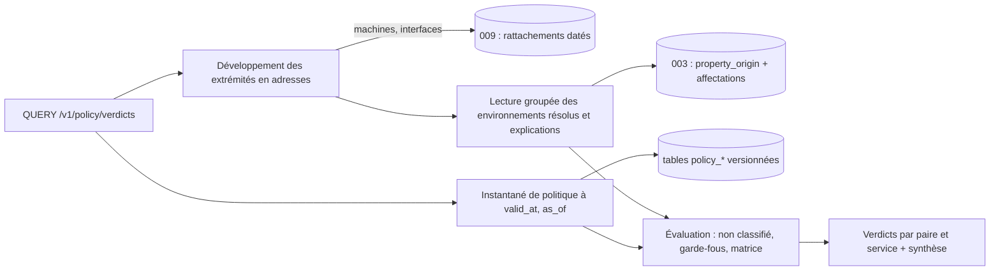

# 010 — Politique de flux : conception

## Vue d'ensemble

Le module Politique est une crate `kartenn-policy` (espace `policy`), qui dépend du
noyau et, facultativement (feature), de `kartenn-machines` (009). Elle suit le contrat
de module (ADR 0026, en cours ; esquisse :
[`docs/spec/architecture.md`](../../docs/spec/architecture.md) § Modularité) : migrations
propres, types d'objets versionnés, opérations de changeset, règles, permissions,
routes REST, tâches de fond, contribution au différentiel.

Deux choix structurent la conception :

> 1. L'environnement n'est **pas** un mécanisme du module : c'est une propriété de la
>    003 (`policy.environment`). Résolution, héritage, explication, filtrage, obligation
>    et différentiel des nœuds sont ceux du noyau ; le module n'ajoute que la politique.
> 2. La politique (≈ 10⁴ cellules, 10³ services, 500 garde-fous) est petite : un verdict
>    se calcule **en mémoire** sur un instantané de la politique à la date demandée,
>    après une lecture groupée des environnements résolus des extrémités.

Les règles d'inférence n'apparaissent pas : elles viendront comme une source de valeurs
attendues (003) après la session dédiée ([`inference-questions.md`](inference-questions.md)).

## Changements

### Données (REQ-010-1 à 10, 26)

Toutes les tables sont versionnées selon l'ADR 0017 (table courante, `_history`,
déclencheur générique, `valid_period`, `sys_start`, `changeset_id`) et créées par les
migrations du module.

| Table | Contenu | Contraintes |
|---|---|---|
| `policy_environment` | `id` = identifiant de la valeur de liste de `policy.environment` (`property_enum_value.id`), `label`, `description`, `transverse` | une ligne par valeur, même période que la valeur |
| `policy_flow_type` | `id`, `key`, `label`, `description` | `key` unique par période (`EXCLUDE … WITH &&`) |
| `policy_service` | `id`, `key`, `label`, `flow_type_id` | `key` unique par période ; type de flux valide sur la période |
| `policy_service_entry` | `service_id`, `transport` (`tcp`, `udp`, `sctp`, `dccp`, `icmp`, `icmpv6`, `ip`), `ports int4range`, `icmp_type`, `icmp_code`, `protocol` | `CHECK` par transport (ports 1–65535 seulement pour les quatre premiers ; type et code pour ICMP ; `protocol` pour `ip`) ; GiST `(transport, ports)` |
| `policy_guardrail` | `id`, `service_ids uuid[]` ou `flow_type_id` (exactement un), `source_env`, `destination_env` (nuls = tous), `reason` | `CHECK (num_nonnulls(...) = 1)` sur le sélecteur |
| `policy_matrix_cell` | `id`, `flow_type_id`, `source_env`, `destination_env` | unicité `(flow_type_id, source_env, destination_env, valid_period WITHOUT OVERLAPS)` |
| `policy_exempt_role` | clé de rôle d'interface (009) exemptée de S10 | — |

Déclarations de propriétés (descripteurs du module, 003) :

| Clé | Type | Héritage | Porteurs |
|---|---|---|---|
| `policy.environment` | liste fermée, ensemble | arbre d'adressage | `domain`, `prefix` (conteneur, réseau), `address` |
| `policy.declared_environment` | liste fermée, ensemble ; ses valeurs sont celles de `policy.environment` (référentiel de valeurs partagé, voir N7) | aucun | `machine` (009) |

### Opérations (REQ-010-2, 4, 5, 8, 9, 21)

Opérations de changeset du module (contrat de module, N2) :
`policy.environment.create | update | close`, `policy.flow_type.*`, `policy.service.*`,
`policy.guardrail.*`, `policy.matrix_cell.add | remove`, `policy.exempt_role.*`.
`policy.environment.create` planifie dans le même changeset la création de la valeur de
liste (opération du noyau) et la ligne d'attributs. L'obligation par domaine
(REQ-010-21) est une opération du noyau sur la déclaration (N8).

Validation sur l'état final (règles du module, identifiants stables REQ-002-37) :

| Règle | Sévérité | Cas |
|---|---|---|
| `policy.service.entry_invalid` | erreur | transport, port, type ICMP hors domaine |
| `policy.service.flow_type_missing` | erreur | type de flux clos ou absent sur la période |
| `policy.service.wide_ports` | avertissement | > 1 024 ports d'un transport |
| `policy.guardrail.selector_invalid` | erreur | ni services ni type, ou les deux |
| `policy.matrix.duplicate_cell` | erreur | cellule identique sur une période commune |
| `policy.reference.closed` | erreur | environnement, type ou service clos alors qu'un objet de politique le cite (liste) |
| `policy.machine.environment_mismatch` | avertissement | S10 |

### Sérialisation et événements (S17)

Toute opération `policy.*` prend le verrou consultatif de la clé `policy`, après les
verrous de domaine (ordre canonique de l'ADR 0015, N6). Événements CloudEvents
`kartenn.policy.<objet>.<action>` sur la clé d'ordre `policy` de l'outbox (ADR 0018).
Chaque changeset qui touche la politique incrémente une **révision de politique**
(compteur dans `policy_revision`, même transaction) qui sert de clé de cache.

### Instantané de politique (REQ-010-11, 16, 28)

`PolicySnapshot` (domaine pur, `kartenn-policy/src/snapshot.rs`) : environnements,
types, services avec index transport → intervalles de ports, garde-fous, cellules
indexées par `(flow_type, source_env, destination_env)`. Chargé par une requête par
table à (`valid_at`, `as_of`) via les lectures datées du noyau (REQ-004-17).

Cache par instance : l'instantané du **présent** est gardé sous la révision de
politique ; une lecture de la révision (une ligne) précède chaque requête de
conformité, un changement recharge. Les instantanés passés (`as_of` < maintenant, donc
immuables) sont gardés dans un cache LRU de 16 entrées. Taille : ≈ 2 Mo pour le jeu du
budget.

### Évaluation (REQ-010-11 à 15)

Fonction pure `evaluate(snapshot, envs_a, envs_b, service) -> Verdict` :

1. `envs_a` ou `envs_b` vide → `Denied { reason: Unclassified { side } }`.
2. Garde-fous dont le sélecteur couvre `service` (par service ou par type) et dont
   `(source_env, destination_env)` couvre au moins une paire de `envs_a × envs_b`
   (nul = tout) → `Denied { reason: Guardrail(id), pair }`. Le premier dans l'ordre des
   identifiants est cité, tous sont listés.
3. Cellule `(type de service, a, b)` pour une paire → `Allowed { cell, pair }` ; la paire
   citée est la première dans l'ordre des clés, toutes sont listées.
4. Sinon `Denied { reason: NoCell }`.

Le service `Query` du module :
- développe les extrémités en adresses (adresse : elle-même ; préfixe : lui-même ;
  interface, machine : port de lecture de la 009, N-M4) ;
- lit en **une** requête les environnements résolus et leurs explications de toutes les
  adresses (lecture groupée, N9) ;
- développe l'objet : service ; couple transport/port → services dont une entrée
  couvre le port (index de l'instantané) ; type de flux → ses services ;
- calcule les verdicts (paires × services) et la synthèse ; borne : 64 adresses par
  extrémité et 10⁴ verdicts par requête (au-delà, 422 `policy.query.too_large`).

### Cohérence des machines (REQ-010-17)

Règle du module exécutée sur les machines touchées par un changeset (machine créée ou
modifiée, rattachement d'interface changé, `policy.declared_environment` changé) **et**
sur les machines dont une adresse change d'environnement résolu (lu dans le différentiel
de propriétés, N4). Pour chacune : ensembles résolus de ses adresses hors interfaces
d'un rôle exempté, comparés entre eux et à l'environnement déclaré. Produit ou ferme
l'anomalie `policy.machine.environment_mismatch` (N11).

### Différentiel de politique (REQ-010-18, 19)

Contribution au différentiel du changeset (N4), calculée après les écritures, sur la
fenêtre du changeset comme celui des propriétés (003, § Différentiel) :

1. Classement des changements : cellules ajoutées ou retirées ; garde-fous ajoutés,
   retirés ou modifiés ; services dont le type ou les entrées changent ; types et
   environnements clos.
2. **Triplets candidats** `(e_src, e_dst, service)` : pour une cellule `(t, a, b)`, les
   services de type `t` × `{(a, b)}` ; pour un garde-fou, ses services (ou ceux de son
   type) × les paires qu'il couvre (un nul développe tous les environnements) ; pour un
   service, ses triplets avant et après.
3. Verdict de principe de chaque candidat sur les instantanés **avant** (état antérieur
   à la transaction) et **après**, sur des ensembles singletons ; seuls les basculements
   sont gardés, avec l'élément décisif de chaque côté.
4. Stockage ordonné (`policy_changeset_diff`, même forme que `changeset_diff`), décompte
   `opens` / `closes` dans le résultat, détail paginé ; une simulation renvoie le
   décompte et les 100 premières entrées.

Borne : 50 environnements → 2 500 paires ; un garde-fou sans environnement sur un type de
50 services → 125 000 candidats, évalués en mémoire (< 200 ms mesurés à confirmer,
tâche 010-1).

Les nœuds dont l'environnement change sont dans le différentiel de propriétés de la 003
(REQ-010-19). La 011 consomme les deux pour réévaluer les flux déclarés.

### Approbation (REQ-010-20)

Déclencheurs du module (N5) `policy.opens` et `policy.closes`, paramètre `min`
(entier ≥ 1), évalués sur le décompte du différentiel de politique ; l'administrateur
les ajoute à une politique d'approbation (`approval_policy`, 004/C6).

### Rapport d'audit (REQ-010-22, 23)

Tâche de fond `policy.report` (ADR 0023) déclenchée par `POST /v1/policy/reports`
(`valid_at`) ; une seule à la fois. Chaque rubrique est une requête ensembliste sur
`property_origin` et les affectations (non classifiés : anti-jointure par domaine ;
transverses : appartenance d'une valeur transverse à l'ensemble de l'origine, avec le
nombre d'héritiers) et sur les tables de la politique. Résultat stocké
(`policy_report`, `policy_report_item` paginé), purgé après 30 jours.

### Droits (REQ-010-24, 25)

Catalogue de permissions du module (N12) ; les permissions `*.admin` sont globales.
Rôles livrés : lecteur + `policy.read`, `policy.verdict.read` ; éditeur +
`policy.environment.write` ; admin + toutes. La requête de conformité vérifie
`policy.verdict.read` puis la lecture des objets désignés comme extrémités (prédicat
SQL de la 005) ; les adresses développées d'une machine lisible mais non lisibles une à
une sont omises du résultat et comptées (`hidden`).

### API (REQ-010-27)

| Route | Rôle |
|---|---|
| `GET /v1/policy/{environments,flow-types,services,guardrails,matrix-cells}` | listes datées, filtres (`flow_type`, `source_env`, `destination_env`, `transport`, `port`) |
| `GET …/{id}`, `POST`, `PATCH`, `DELETE` | routes de ressource enveloppant un changeset (006/H2) |
| `QUERY /v1/policy/verdicts` | corps `{source, destination, service | transport+port | flow_type, valid_at, as_of}` ; extrémités par `{kind, id}` |
| `GET /v1/policy/verdicts?source=…&destination=…&service=…` | variante simple |
| `POST /v1/policy/reports`, `GET /v1/policy/reports/{id}`, `GET …/items` | rapport d'audit |

Problèmes : `urn:kartenn:problem:policy-query-too-large` (422) ; les violations de
changeset suivent REQ-006-21.

## Exigences envers le noyau, le contrat de module et la 009

Livrable du garde-fou D31 : ce que la v0.1 doit offrir pour que la 010 et la 011
s'ajoutent sans refonte. Chaque point dit s'il est **déjà tenu** (vérifié dans la spec
ou le code de la v0.1) ou **à prévoir**.

### Contrat de module (ADR 0026)

| # | Exigence | État |
|---|---|---|
| N1 | Un module crée ses tables versionnées (ADR 0017 : déclencheur générique, historique, lectures datées) dans ses propres migrations, ordonnées après celles du noyau et de ses dépendances (DAG) | à prévoir (mécanisme de migrations par module) |
| N2 | Un module ajoute des **opérations de changeset** (`<module>.<objet>.<action>`), planifiées, validées sur l'état final, simulables, idempotentes, **annulables** (le module fournit l'inverse, REQ-004-34) et soumises aux droits | à prévoir |
| N3 | Un module ajoute des **règles** (identifiant stable, sévérité) exécutées sur l'état final dans la transaction, y compris sur des objets du noyau ou d'un module dont il dépend (S10 sur les machines) | à prévoir |
| N4 | Un module contribue au **différentiel** d'un changeset : point d'accroche après le différentiel des propriétés (étape G de la 003), qui lit ce différentiel (objets, avant, après) dans la transaction et produit une section nommée, stockée, paginée, rendue en simulation comme à l'application et exposée par l'API de façon générique | à prévoir |
| N5 | Un module fournit des **déclencheurs d'approbation** nommés et paramétrés, évalués après les différentiels, que seul l'administrateur active (REQ-004-39 intact) | à prévoir (`approval_policy` n'a que des déclencheurs fixes) |
| N6 | **Clés de sérialisation hors domaine** : un module déclare des clés de verrou (`policy`, `flow`) prises dans l'ordre canonique après les domaines (ADR 0015), et des clés d'ordre de l'outbox (ADR 0018) | à prévoir (amendement des ADR 0015 et 0018) |
| N7 | Une opération de module peut planifier des opérations du noyau dans le même changeset (création d'une valeur de liste avec ses attributs) ; deux propriétés peuvent partager un **référentiel de valeurs** de liste fermée (`policy.declared_environment` reprend les valeurs de `policy.environment`) | à prévoir (aujourd'hui chaque propriété a ses valeurs) |
| N8 | Les **obligations** d'une propriété déclarée par un module sont modifiables à l'exécution par changeset d'administrateur (portées domaine, entité, type), avec le contrôle de compatibilité de REQ-003-6 | à vérifier (`Declaration.obligations` vient du descripteur) |
| N10 | Un module déclare ses **références** vers des objets du noyau (valeurs de liste fermée comprises) pour que leur clôture soit refusée ou mise en cascade (D33, `dependents()`, REQ-004-25) | à prévoir (REQ-003-6 ne voit que les porteurs) |
| N11 | **Anomalies** produites par un module, sur ses objets ou sur ceux d'un module dont il dépend, listables et acquittables (REQ-002-36) ; un module ferme une anomalie quand la cause disparaît | à prévoir (anomalies du noyau seulement) |
| N12 | Catalogue de **permissions** de module, dont des permissions **globales** (sans périmètre) ; extension des rôles livrés | à vérifier (005 : permissions globales existent pour l'administration) |
| N13 | **Routes REST** du module sous `/v1/<module>/`, incluses dans le contrat OpenAPI de référence (REQ-006-34) et la méthode `QUERY` ; module listé dans `GET /v1/capabilities` | partiellement tenu (`modules` des capacités) |
| N14 | **Tâches de fond** de module (genres propres) exécutées par l'ordonnanceur à bail (ADR 0023) | à prévoir (genres fixes) |
| N15 | **Événements** de module (types CloudEvents `kartenn.<module>.*`) dans l'outbox | à prévoir |
| N16 | Un module lit, dans la transaction d'un changeset, l'état **avant** (versions antérieures à la transaction) de ses tables, comme le différentiel de la 003 | tenu par l'ADR 0017 (historique de temps système) |

### Noyau (002 à 004)

| # | Exigence | État |
|---|---|---|
| N9 | **Lecture groupée** des valeurs résolues d'une propriété avec explication pour N objets à (`valid_at`, `as_of`) : 512 objets < 30 ms | à prévoir (lecture objet par objet aujourd'hui) |
| N17 | Propriété ensemble de liste fermée, héritable sur l'arbre d'adressage, avec remplacement, explication, filtrage par appartenance et obligation par domaine | tenu (REQ-003-9, 11 à 16, 25) |
| N18 | Différentiel de propriétés complet (y compris effets indirects de structure, D34) disponible avant les contrôles et dans la simulation | tenu (REQ-003-19, 20) |
| N19 | Déclencheur d'approbation sur une propriété, directe ou indirecte | tenu (REQ-004-40) |
| N20 | Contrat de source de valeurs attendues amendé pour l'inférence (ancêtres, version dynamique, lecture du module, lot) | reporté à la session sur l'inférence ([`inference-questions.md`](inference-questions.md), I15) |

### Module Machines et interfaces (009)

| # | Exigence |
|---|---|
| M1 | Machines et interfaces versionnées en bitemporel ; rattachement **daté** interface → adresses (plusieurs adresses par interface ; une adresse peut être rattachée à plusieurs interfaces : VIP, anycast) |
| M2 | **Rôle d'interface** en liste fermée administrable (au moins administration, sauvegarde, supervision), lisible par clé par un autre module |
| M3 | Machines (et interfaces) **porteuses** de propriétés non héritables déclarées par un autre module (`policy.declared_environment`) |
| M4 | Port de lecture : adresses d'une machine ou d'une interface à (`valid_at`, `as_of`), avec interface et rôle ; inverse : machines et interfaces d'une adresse |
| M5 | Les changements de rattachement sont des opérations typées, visibles par les contributions au différentiel (N4) et les règles (N3) des modules qui dépendent de la 009 |
| M6 | `dependents()` des machines et interfaces extensible par les modules dépendants (la 011 refuse la clôture d'une machine citée par un flux actif, ou la met en cascade) |

## Erreurs et cas limites

| Cas | Comportement |
|---|---|
| Extrémité invisible ou absente | 404 commun (REQ-010-25) |
| Extrémité = plage | 422 `policy.query.unsupported_endpoint` (une plage ne porte pas d'environnement) |
| Préfixe en extrémité | évalué sur ses propres environnements, sans développer ses adresses |
| Adresse rattachée à plusieurs machines | sans effet sur le verdict (par adresse, D22) |
| Service clos à la date | absent de l'instantané ; requête nommant ce service → 404 |
| Environnement clos alors qu'un nœud le résout | impossible : clôture refusée (REQ-010-2) |
| Garde-fou et cellule sur la même paire | refus, les deux cités (REQ-010-11) |
| `valid_at` futur | lecture datée normale (états programmés) |

## Alternatives considérées

- **Environnement comme objet de module** visé par une propriété de type référence :
  écarté (S2) ; gain nul, filtrage et exemple 003 changés.
- **Matrice tri-état** (autoriser, refuser) : écartée par D28.
- **Verdicts matérialisés pour toutes les paires** de nœuds : 10¹² paires ; seul le
  registre de flux (011) matérialise des verdicts, pour les flux déclarés.
- **Évaluation en SQL** (jointure environnements × cellules) : plus lente qu'en mémoire
  pour une politique de 10⁴ cellules ; gardée pour le rapport d'audit.
- **Différentiel par nœud** (paires gagnées ou perdues par chaque nœud) : combinatoire
  (S11).

## Risques et migration

- Les points N1 à N16 touchent le contrat de module de la v0.1 : s'ils ne sont pas dans
  l'ADR 0026, la 010 exigera de rouvrir le pipeline. C'est le risque principal (D31).
- La lecture groupée (N9) conditionne les budgets machine × machine.
- Union permissive (D25) : un environnement transverse ouvre beaucoup ; mitigé par le
  différentiel (REQ-010-18), l'approbation (REQ-010-20) et le rapport (REQ-010-23).
- Aucune donnée existante à migrer : le module arrive en v0.2 ; un import initial de la
  matrice et du catalogue se fait par changeset (`POST /v1/imports`).

## Stratégie de test

- **Domaine pur** : `evaluate` contre un oracle naïf sur des politiques et ensembles
  aléatoires (proptest) : le refus d'un garde-fou l'emporte toujours ; ajouter une
  cellule n'ôte jamais une autorisation ; ajouter un garde-fou n'en ajoute jamais.
- **Entrées de service** : un test par ligne de REQ-010-5 (cas acceptés et refusés).
- **Différentiel** : comparaison avec le produit cartésien complet évalué avant et après
  sur de petites politiques aléatoires (le différentiel doit en être exactement les
  basculements).
- **Intégration** (PostgreSQL) : verdicts datés (REQ-010-16), obligation par domaine
  (REQ-010-21), cohérence des machines avec la 009 (REQ-010-17), clôture refusée
  (REQ-010-2, 4).
- **REST** : contrat OpenAPI, 404 d'extrémité invisible, `QUERY` et `GET`.
- **Banc** `bench-policy` sur le jeu de 10⁶ objets : REQ-010-28 bloquant en CI.

## ADR

- ADR proposée (numéro à attribuer à la fusion) : **verdicts en mémoire sur un
  instantané versionné de la politique** (S8, § Instantané).
- Amendements proposés : ADR 0015 et 0018 (clés hors domaine, N6) ; ADR 0026 (points N1
  à N16).
