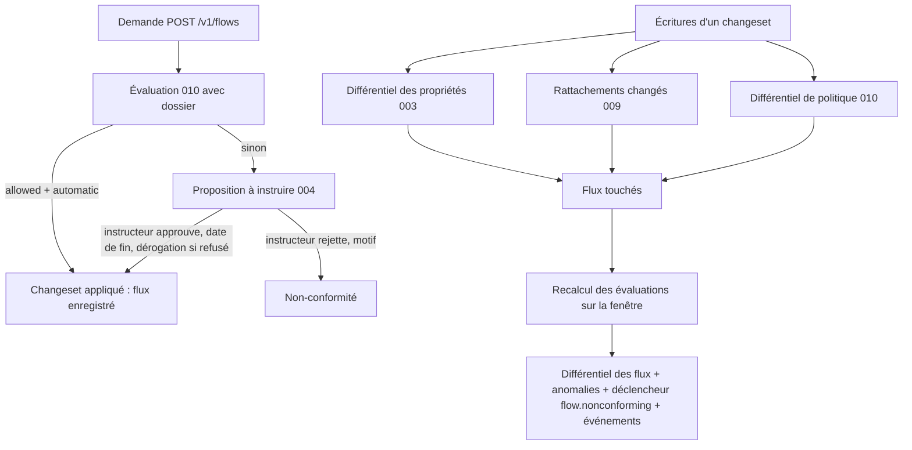

# 011 — Registre de flux : conception

## Vue d'ensemble

Crate `kartenn-flow` (espace `flow`), dépendante de `kartenn-policy` (010) et,
facultativement, de `kartenn-machines` (009). Elle réutilise l'évaluation de la 010
(`PolicySnapshot`, `evaluate`, dossier) et ajoute un **index incrémental** : les
évaluations de chaque flux, matérialisées, et l'index inverse adresse → flux, qui
permettent de trouver en une jointure les flux touchés par un différentiel.

> Décision centrale : les évaluations des flux (verdict, issue, conditions, score) sont
> matérialisées (`flow_evaluation`) et recalculées **dans la transaction du changeset**,
> par une contribution au différentiel qui s'exécute **après** celles de la 003
> (propriétés), de la 009 (rattachements) et de la 010 (politique), et qui lit leurs
> sections (ADR 0026, clause 13). L'état d'un flux (actif, non conforme, sous
> dérogation…) se **dérive** de cette évaluation, du changeset et du temps : un flux
> conforme n'a pas de date de fin (D30 amendée).

## Changements

### Données (REQ-011-1 à 4, 16, 20, 23, 25)

Tables versionnées (ADR 0017), types de module inscrits dans `module_object` (ADR 0026,
clause 4), ancrés sur l'entité du flux :

| Table | Contenu |
|---|---|
| `flow` | `id`, `kind` (`requested` ; `observed` réservé), `source_kind`, `source_id`, `destination_kind`, `destination_id`, `service_id`, `external_refs jsonb` (≥ 1 : système, identifiant ; le système donné par sa clé est stocké par l'identifiant de sa valeur de `core.external_system`, résolu à la complétion de l'opération), `justification` (facultative), `requester_id` (identité), `on_behalf_of jsonb` (référence externe typée, N26, ou texte), `responsibles jsonb`, `data_nature uuid[]` (valeurs de l'axe de sensibilité), `personal_data bool`, `entity_id`, `reviewed_by`, période (fin facultative) |
| `flow_waiver` | `flow_id`, `reason`, `accepted_risk`, `granted_by`, période (fin obligatoire) ; une dérogation par flux et par période |
| `flow_endpoint_address` | `flow_id`, `side`, `address_id` : adresses développées des extrémités, par segment de période (maintenue avec les rattachements 009) ; index `(address_id)` |
| `flow_evaluation` | `flow_id`, `source_address_id`, `destination_address_id`, `verdict`, `pending` (sous réserve), `outcome`, `reason`, `decisive_id`, `combination`, `unmet_conditions uuid[]`, `score`, `policy_revision` ; segments de période |
| `flow_summary` | `flow_id`, `summary`, `outcome`, décomptes ; segments de période ; index `(summary)`, `(outcome)` |
| `flow_registration` | `flow_id`, évaluation de l'enregistrement figée (synthèse, issue, élément décisif, révision, instructeur) |
| `flow_rejection` | `changeset_id` (proposition rejetée), demande normalisée, évaluation, `reason`, `rule_id`, `reviewed_by`, `requester_id`, `entity_id` : non-conformité d'une demande rejetée |
| `flow_notice` | `flow_id`, `kind`, `period_end` : échéances déjà notifiées |

Un préfixe en extrémité est une « adresse » au sens de ces tables (le nœud lui-même,
REQ-010-13). Les tables d'évaluation sont, comme `property_origin` (ADR 0016), un état
dérivé versionné en temps système : `as_of` passé se lit dans l'historique.

### Opérations et règles (REQ-011-1 à 4, 8 à 10, 21, 22)

Opérations `flow.{request | update | close | waive | approve_review}` (enveloppe de
module, ADR 0026 clause 6), sous le verrou `flow` (F13). `request` évalue la demande ;
la route `POST /v1/flows` soumet un changeset d'application si la synthèse est
`allowed` et l'issue `automatic`, sinon une **proposition** (REQ-004-41).
`approve_review` est ajoutée par l'instructeur à la proposition avant de l'approuver
(fin de période, dérogation éventuelle) ; le rejet d'une proposition (004) avec un motif
alimente `flow_rejection` (crochet de rejet du module, voir § Exigences, N38).

| Règle | Sévérité | Cas |
|---|---|---|
| `flow.endpoint.invalid` | erreur | plage, objet absent ou invalide sur une partie de la période |
| `flow.service.closed` | erreur | service non actif sur toute la période |
| `flow.reference.missing` | erreur | aucune référence externe |
| `flow.reference.system` | erreur | système d'une référence externe (ou de « pour le compte de ») qui ne nomme aucune valeur de `core.external_system` valide au début de l'opération |
| `flow.kind.reserved` | erreur | sorte `observed` en v0.2 |
| `flow.review.required` | erreur | application d'un flux dont l'issue n'est pas automatique sans `approve_review` |
| `flow.review.end_required` | erreur | flux instruit sans fin, ou au-delà de `review_max_months` |
| `flow.waiver.required` | erreur | enregistrement ou prolongation d'un flux refusé sans dérogation (REQ-011-8, 9) |
| `flow.verdict.denied` | avertissement (anomalie) | flux enregistré qu'un autre changement rend non conforme, sans dérogation valide ; fermée quand il redevient conforme (REQ-011-12) |
| `flow.verdict.partial` | avertissement | REQ-011-10 |
| `flow.waiver.invalid` | erreur | motif ou risque vide, fin absente ou au-delà du plafond, auteur = demandeur |
| `flow.separation` | erreur | instructeur = demandeur |
| `flow.referenced` | erreur | clôture d'une extrémité citée (REQ-011-3), via les références déclarées (clause 12) |

`update` refuse le changement d'extrémité ou de service (REQ-011-4) : le client crée un
nouveau flux et clôt l'ancien dans le même changeset.

**Prolongation (F20, amende l'écart « `update` ne fait que raccourcir »).** `update`
compare la fin demandée à la fin courante (lue par `complete`, comme l'identité) :
plus tôt → raccourcissement, appliqué comme aujourd'hui (`close_versioned`) ; plus tard,
ou retirée sur un flux daté → prolongation. `complete` trie alors la portion ajoutée
(`triage` sur `[fin courante, nouvelle fin)`, dossier du flux, politique du jour) et
range le triage dans l'opération complétée ; `review` du module rend `REVIEW` si la
synthèse n'est pas `allowed` ou l'issue pas `automatic`, comme pour `request`. À
l'application (après approbation s'il le faut), la version du flux est étendue
(`patch_flow` sur la nouvelle période, ancre `core.owner` et adresses développées
prolongées), l'évaluation est recalculée sur la portion ajoutée et
`flow_notice` annoncera la nouvelle fin. Contrôles : `check_review` sur la fin approuvée
(plafond compté depuis la décision), `flow.waiver.required` si la portion ajoutée est
refusée sans `waive`, `flow.separation` contre le demandeur du flux **et** l'auteur de
la prolongation (ou son `on_behalf_of`), `flow.update.ended` (erreur, nouvelle règle)
pour un flux dont la fin est passée. La mesure `created` compte les prolongations
(`pg::written_counts`). Un rejet passe par le crochet `ended` (N38) comme une demande :
`flow_rejection` garde la prolongation refusée, le flux garde sa fin.

### État dérivé (REQ-011-5, 24)

Fonction de lecture, dans l'ordre : changeset de création en attente → `requested` ;
rejeté, retiré ou expiré → `rejected` ; appliqué et `valid_at` avant le début →
`scheduled` ; `valid_at` après la fin → `expired`, ou `withdrawn` si la dernière
version a été raccourcie par `close` ; sinon synthèse courante `denied` → `waived` si
une dérogation couvre `valid_at`, `noncompliant` sinon ; sinon `active`. Un flux sans
fin ne passe jamais `expired` (validité dérivée). Les flux `requested` viennent des
propositions en attente (lecture de leurs opérations, N24).

**Lecture des demandes en attente (F19, corrige l'écart : `read::flows` ne rendait que
des flux appliqués).** Quand `state` cite `requested` (ou avec `review=pending`,
`changeset=<id>`), `read::flows` ajoute aux flux appliqués les propositions en attente
à `as_of` (004 : soumises, non terminées) dont une opération est `flow.request` ou une
prolongation `flow.update` ; chaque ligne est la demande telle que l'opération complétée
la garde (`id: null` pour une demande, l'`id` du flux pour une prolongation) avec un
membre `review` : `changeset`, `kind` (`request` | `extension`), `triage` (synthèse,
issue, élément décisif, conditions non remplies, score, avertissements, révision de
politique, évaluations par paire) lu dans `completed.triage`, sans recalcul. Si
l'opération complétée ne garde que la synthèse, le triage y est étendu aux évaluations
par paire (forme de la réponse de `POST /v1/flows`). Filtres appliqués aux lignes en
attente : extrémité exacte, service, type de flux, sorte, entité, demandeur, référence
externe, synthèse, issue, règle décisive (lus dans la demande et son triage) ; les
filtres par sous-arbre de préfixe, machine développée et valeur d'axe les excluent (pas
d'adresses développées avant l'application). Pagination : avec `requested` seul ou
`review=pending`, curseur sur le changeset et le rang de l'opération (plusieurs
demandes par proposition) ; `requested` combiné à
d'autres états : les lignes en attente suivent les flux appliqués. Droits : prédicat
RBAC sur l'entité de la demande pour `flow.read` et `flow.review`, ou
demandeur de la ligne (`flow.request`) ; triage réduit (REQ-010-25) pour qui ne
lit pas les extrémités.

### Réévaluation (REQ-011-11 à 13)

Contribution au différentiel du module (section `flow.flows`, ordre du DAG : après
003, 009, 010) :

1. **Flux touchés** :
   - flux écrits par le changeset ;
   - adresses du différentiel des propriétés pour un axe cité par l'instantané (003) →
     `flow_endpoint_address` → flux ;
   - interfaces ou machines dont les rattachements changent (section
     `machines.attachments`, M7) → recalcul de `flow_endpoint_address` pour les flux qui
     les citent → flux ; et machines dont un axe porté par la machine change (M8, M10) ;
   - combinaisons de la section `policy.combinations` (010) → flux dont le service
     figure dans une combinaison (index `flow(service_id)`), filtrés en mémoire par
     valeurs d'axes ; un changement de condition ou de signal touche tous les flux du
     sélecteur de la condition (index par type de flux).
2. **Recalcul** pour chaque flux touché, sur la fenêtre du changeset, segmentée aux
   bornes de la période du flux, des versions des rattachements, des origines des axes
   et de la politique ; lecture groupée des valeurs (N9) par lot de 512 adresses ;
   évaluation en mémoire (010) avec le dossier du flux.
3. **Écriture** des seuls segments qui changent (verrous de ligne dans l'ordre des
   `flow_id`, F13), fusion des segments contigus égaux.
4. **Différentiel** : flux dont la synthèse, un verdict ou l'issue change, décompte
   `nonconforming` (flux qui deviennent non conformes à la matrice de flux) /
   `conforming` (flux qui redeviennent conformes) / `outcome` ; anomalies ouvertes ou
   fermées (clause 7) ; déclencheur `flow.nonconforming` évalué sur le décompte (N5) ; événements
   `outcome_changed` (N15, N35) émis à l'application.

Simulation : même chemin, transaction annulée.

Garde-fou de volume : au-delà de 10⁵ flux touchés, le différentiel donne d'abord le
décompte et le changeset suit le budget exceptionnel de la 003 (REQ-003-26, < 60 s).

### Échéances (REQ-011-7)

Tâche de fond quotidienne `flow.expiry` (genre de module, N14) : flux datés et
dérogations dont la fin tombe à J-30 ou J-7 (réglable, `[flow] expiry_notice_days`) →
événements ; `flow_notice` évite les doublons et suit une prolongation. Un flux sans fin
n'a pas d'échéance.

### Non-conformités (REQ-011-25)

Vue de lecture : union de `flow_rejection` (demandes rejetées), des flux dont l'état
dérivé est `noncompliant` (avec l'anomalie `flow.verdict.denied`, acquittable) et des
flux `waived` ; chaque ligne porte le motif ou l'élément décisif, la règle et son texte
pédagogique (lus dans l'instantané à la date). Droits : lecture de l'entité, ou
demandeur de la ligne avec `flow.request`.

### Lecture et filtres (REQ-011-14 à 16)

Filtres SQL : extrémité exacte ; sous-arbre d'un préfixe (`flow_endpoint_address`
jointe aux adresses contenues, opérateur `<<=`) ; machine ; service, type ; sorte ; état
(prédicat sur période, changeset, `flow_summary`, `flow_waiver`) ; synthèse, issue,
règle décisive (`flow_evaluation.decisive_id`) ; dérogation, échéance ; entité,
demandeur, référence externe (`external_refs @>`) ; valeur d'axe d'une extrémité
(jointure de `flow_endpoint_address` et des valeurs résolues). Droits : prédicat RBAC
de la 005 sur `entity_id` (ADR 0021).

### API (REQ-011-18)

| Route | Rôle |
|---|---|
| `GET /v1/flows`, `QUERY /v1/flows` | liste filtrée, datée ; demandes en attente avec `state=requested`, instructions en attente avec `review=pending`, une proposition avec `changeset=<id>` (F19) |
| `GET /v1/flows/{id}`, `POST /v1/flows`, `PATCH`, `DELETE` | ressource ; `POST` trie (REQ-011-21) et rend l'évaluation ; `PATCH` d'une prolongation trie de même : 200 appliquée, 202 `ChangesetPending` à instruire (F20) |
| `GET /v1/flows/{id}/evaluations` | évaluations par paire, datées, avec explications (réduites selon REQ-010-25) |
| `GET /v1/flow-nonconformities` | non-conformités filtrées |
| `GET /v1/{collection}/{id}/flows` | flux d'un objet (REQ-011-15), pour adresses, préfixes, interfaces, machines |
| `POST /v1/changesets/{id}/approve`, `…/reject` | instruction (004), avec `approve_review` ajouté par l'instructeur |

## Exigences envers le noyau, le contrat de module et la 009

Celles de la 010 (design 010, § Exigences : N1 à N37, M1 à M10) s'appliquent, plus :

| # | Exigence | État |
|---|---|---|
| N21 | Les contributions au différentiel s'exécutent dans l'ordre du DAG des modules et chacune lit les résultats des précédentes (différentiel 003, rattachements 009, différentiel 010) | fourni (ADR 0026, clause 13) |
| N22 | Dépendants des objets du noyau (adresses, préfixes) extensibles par un module (flux qui les citent) | fourni (ADR 0026, clause 12) |
| N23 | Un objet de module peut référencer une **identité** par son identifiant, sans copie de donnée personnelle, et la pseudonymisation (REQ-004-33) s'y applique | fourni (ADR 0026, clause 15, règle de conception) |
| N24 | Une lecture peut connaître l'état d'un changeset (en attente, rejeté, appliqué) et ses opérations, pour dériver un état de module | tenu (004, lecture des changesets) |
| N38 | Un module est appelé au **rejet** d'une proposition qui contient ses opérations (motif du rejet, auteur), pour enregistrer un objet dérivé (non-conformité) dans la transaction du rejet | à prévoir : crochet additif du contrat de module, livré par la tâche 011-6 (méthode à implémentation par défaut) |
| N39 | Un module peut **exiger** qu'un changeset contenant ses opérations soit enregistré comme proposition, même si l'auteur détient l'écriture (issue non automatique), désigner la permission qui le valide (`flow.review`, en plus de REQ-004-42), et l'approbateur peut y ajouter une opération (`approve_review`) validée avec le reste | à prévoir : aujourd'hui une proposition naît seulement de l'absence du droit d'écriture (REQ-004-41) ; amendement additif de la 004 et du contrat (tâche 011-3) |
| M7 | La 009 publie, dans le changeset, la liste des interfaces et machines dont les rattachements changent, avec la période (pour N21) | fourni (REQ-009-23) |

## Erreurs et cas limites

| Cas | Comportement |
|---|---|
| Machine sans adresse sur une partie de la période | évaluation vide sur ce segment, synthèse `denied` motif `no_address` |
| Adresse d'extrémité close (cascade) | flux clos dans la même cascade |
| Flux expiré dont la politique change | pas de réévaluation hors de sa période |
| Flux conforme sans fin dont la politique change | réévalué ; `noncompliant` s'il bascule, sans écriture d'état |
| Dérogation échue, flux toujours refusé | `noncompliant` à la date de fin ; anomalie ouverte par la tâche `flow.expiry` |
| Prolongation d'un flux daté ou d'une dérogation | réévaluée sur la nouvelle portion contre la politique du jour ; celle d'un flux est triée et instruite si elle n'est pas automatique (F20) |
| Prolongation d'un flux `expired` ou `withdrawn` | refusée (`flow.update.ended`) : nouvelle demande (F20) |
| Demande sans dossier complet | issue `review` (condition « dossier ») : instruction |
| Port sans service | refusé, issue `review` (REQ-010-14) : instruction ; l'instructeur fait ajouter le service ou rejette |

## Alternatives considérées

- **Calcul des évaluations à la lecture** : simple, mais aucun différentiel sans tout
  recalculer (D30).
- **Date de fin et prolongation automatique pour tous les flux** : écartée par Q16
  (écriture périodique sans humain) ; validité dérivée à la place.
- **Refus à l'enregistrement d'un flux à instruire** : écarté (Q2) ; la demande est
  gardée comme proposition, ce qui trace l'instruction.
- **Verrou `flow` pris par tout changeset qui touche une classification** : sérialise
  l'instance ; remplacé par des verrous de ligne (F13).
- **État stocké** (`status`) : écarté (F4).

## Risques et migration

- La réévaluation dans la transaction alourdit les changesets de structure et de
  politique : budget REQ-011-19 à confirmer au banc.
- Dépend de N4, N21, N22, M7 (fournis) et de N5, N14, N15, N38 (points différés ou à
  ajouter) : sans eux, la réévaluation et les événements devraient passer par l'outbox,
  hors de la transaction.
- La sorte `observed` (v0.3) ajoutera des flux sans demandeur ni instruction ; les
  colonnes du demandeur restent donc facultatives au niveau du schéma, obligatoires par
  règle pour `requested`.

## Stratégie de test

- **Oracle** : évaluations matérialisées égales, après toute suite aléatoire de
  changesets (classifications, règles, conditions, rattachements, flux), au recalcul
  complet.
- **Triage et instruction** : un test par branche de REQ-011-21 et REQ-011-22,
  séparation des tâches.
- **Cycle de vie** : un test par état de REQ-011-5 ; validité dérivée (aucune écriture).
- **Conformité** : REQ-011-8 à 12, dérogations (plafond, recertification, échéance) et
  anomalies.
- **Non-conformités** : les trois sources, droits du demandeur.
- **Différentiel** : cas de REQ-011-13 en simulation.
- **Banc** `bench-flow` (10⁵ flux) : REQ-011-19 bloquant en CI.

## ADR

- [ADR 0031](../../docs/adr/0031-evaluations-de-flux-materialisees.md) (acceptée,
  2026-10-22) : **évaluations de flux matérialisées, maintenues dans la transaction par
  une contribution au différentiel ordonnée par le DAG des modules ; état et validité
  dérivés**.
- Amendements de l'ADR 0026 : crochet de fin de proposition `ended` (N38) et revue
  forcée (N39), amendement 2 (spec 016) ; permission propre à une opération
  (`flow.request`) et acteurs du changeset, amendement 3 ; constats des tâches de
  fond (échéance d'une dérogation), amendement 4.

## Écarts au design (le code fait foi, 2026-10-22)

- Règles : `flow.verdict.denied` est un **avertissement** (anomalie) ; le refus à
  l'enregistrement sans dérogation est l'erreur `flow.waiver.required` (une règle n'a
  qu'une sévérité). Deux règles ajoutées : `flow.field.invalid` et `flow.update.identity`.
- Le refus de clore une extrémité citée passe par la règle générique du noyau
  `core.object.dependents` (008-7), qui liste les flux, et non par `flow.referenced`.
- Opérations : l'écriture directe de maintenance s'appelle `flow.flow.register` (sans
  route dédiée : `POST /v1/changesets`) ; route `POST /v1/flows/{id}/waiver` ajoutée
  (F6). Résorbés par les amendements : `update` qui ne faisait que raccourcir la période
  (F20, prolongation triée et instruite, tâche 13) ; demandes en attente non servies par
  la lecture (F19, tâche 12).
- La demande d'un flux exige aussi `prop.core.owner.write` sur l'entité : le flux est
  ancré par une affectation ordinaire de `core.owner`, bornée à sa vie.
- Lectures : le prédicat RBAC est appliqué par les routes ; une page est coupée avant le
  filtre des droits (parfois plus courte, sans fuite) ; les non-conformités se lisent
  par curseur signé (021-29, REQ-021-35 : date décroissante, puis l'identifiant du flux
  ou du changeset rejeté ; la clé de la dernière ligne lue avant le filtre des droits) ;
  le demandeur lit son flux avec des évaluations réduites.
- Les jointures sur le noyau (adresses, préfixes, origines des valeurs, machines) sont lues
  à l'assertion courante ; seules les tables du module suivent `as_of`.
- Échéances : fenêtres de 30 et 7 jours en constantes (pas de configuration de module dans
  le contrat).
- Mois calendaires en UTC, jour borné à la fin du mois ; un flux sans paire d'adresses est
  `denied` et `noncompliant`.
- Réévaluation (011-10) : lots de 512 flux, chaque étape lue en une requête par lot, les
  flux d'un même instant évalués ensemble ; seules les tables dérivées dont les lignes
  changent sont réécrites. La politique d'une révision validée est gardée par l'instance
  (comme le cache des requêtes de la 010), sous la clé (base, révision) ; une transaction
  qui a écrit la politique relit la sienne. Index B-tree sur `flow_id` des tables dérivées (migration 0002 du module).
