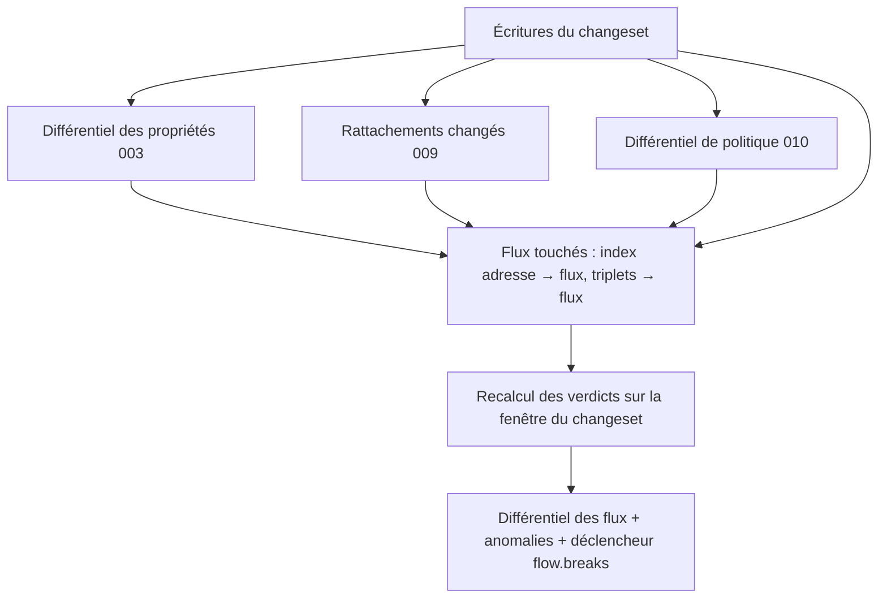

# 011 — Registre de flux : conception

## Vue d'ensemble

Crate `kartenn-flow` (espace `flow`), dépendante de `kartenn-policy` (010) et,
facultativement, de `kartenn-machines` (009). Elle réutilise l'évaluation de la 010
(`PolicySnapshot`, `evaluate`) et ajoute un **index incrémental** : les verdicts de
chaque flux, matérialisés, et l'index inverse adresse → flux, qui permettent de trouver
en une jointure les flux touchés par un différentiel.

> Décision centrale : les verdicts des flux sont matérialisés (`flow_verdict`) et
> recalculés **dans la transaction du changeset**, par une contribution au différentiel
> qui s'exécute **après** celles de la 003 (propriétés), de la 009 (rattachements) et de
> la 010 (politique), et qui lit leurs résultats.

## Changements

### Données (REQ-011-1 à 4, 16)

Tables versionnées (ADR 0017) :

| Table | Contenu |
|---|---|
| `flow` | `id`, `source_kind`, `source_id`, `destination_kind`, `destination_id`, `service_id`, `justification`, `requester_id` (identité), `on_behalf_of`, `entity_id`, `external_ref`, `waiver_reason`, `waiver_until`, période |
| `flow_endpoint_address` | `flow_id`, `side` (`source`, `destination`), `address_id` : adresses développées des extrémités, par segment de période (maintenue avec les rattachements 009) ; index `(address_id)` |
| `flow_verdict` | `flow_id`, `source_address_id`, `destination_address_id`, `verdict`, `reason`, `decisive_id`, `pair` ; segments de période |
| `flow_summary` | `flow_id`, `summary` (`allowed`, `partial`, `denied`), décomptes ; segments de période ; index `(summary)` |

Un préfixe en extrémité est une « adresse » au sens de ces tables (le nœud lui-même,
REQ-010-13). Les tables de verdicts sont, comme `property_origin` (ADR 0016), un état
dérivé versionné en temps système : `as_of` passé se lit dans l'historique.

### Opérations et règles (REQ-011-1 à 4, 8 à 10)

Opérations `flow.flow.create | update | close` (contrat de module, N2), sous le verrou
`flow` (F13). Règles :

| Règle | Sévérité | Cas |
|---|---|---|
| `flow.endpoint.invalid` | erreur | plage, objet absent ou invalide sur une partie de la période |
| `flow.service.closed` | erreur | service non actif sur toute la période |
| `flow.verdict.denied` | erreur à l'écriture d'un flux sans dérogation ; avertissement (anomalie) quand un autre changement le casse | REQ-011-8, 12 |
| `flow.verdict.partial` | avertissement | REQ-011-10 |
| `flow.waiver.invalid` | erreur | motif vide, fin absente ou après celle du flux |
| `flow.referenced` | erreur | clôture d'une extrémité citée (REQ-011-3), via `dependents()` |

`update` refuse le changement d'extrémité ou de service (REQ-011-4) : le client crée un
nouveau flux et clôt l'ancien dans le même changeset.

### État dérivé (REQ-011-5)

Fonction de lecture : changeset de création (état 004 : en attente, rejeté, appliqué)
puis position de `valid_at` dans la période ; `withdrawn` si la dernière version a été
raccourcie par une clôture (opération `close`) plutôt qu'arrivée à son terme
(distinguées par l'opération enregistrée dans le changeset). Les flux `requested`
viennent des propositions et changesets en attente (lecture de leurs opérations).

### Réévaluation (REQ-011-11 à 13)

Contribution au différentiel du module (N4, ordre du DAG : après 003, 009, 010) :

1. **Flux touchés** :
   - flux écrits par le changeset ;
   - adresses du différentiel des propriétés pour `policy.environment` (003) →
     `flow_endpoint_address` → flux ;
   - interfaces ou machines dont les rattachements changent (009) → recalcul de
     `flow_endpoint_address` pour les flux qui les citent → flux ;
   - triplets du différentiel de politique (010) → flux dont le service figure dans un
     triplet (index `flow(service_id)`), filtrés en mémoire par paire d'environnements.
2. **Recalcul** pour chaque flux touché, sur la fenêtre du changeset, segmentée aux
   bornes de la période du flux, des versions des rattachements, des origines
   d'environnement des adresses et de la politique ; une lecture groupée des
   environnements (N9) par lot de 512 adresses ; évaluation en mémoire (010).
3. **Écriture** des seuls segments qui changent (verrous de ligne dans l'ordre des
   `flow_id`, F13), fusion des segments contigus égaux.
4. **Différentiel** : flux dont la synthèse ou un verdict change, stocké
   (`flow_changeset_diff`), décompte `breaks` / `heals` / `changes` ; anomalies ouvertes
   ou fermées (N11) ; déclencheur `flow.breaks` évalué sur le décompte (N5).

Simulation : même chemin, transaction annulée.

Garde-fou de volume : au-delà de 10⁵ flux touchés, le différentiel donne d'abord le
décompte et le changeset suit le budget exceptionnel de la 003 (REQ-003-26, < 60 s).

### Échéances (REQ-011-7)

Tâche de fond quotidienne `flow.expiry` (ADR 0023) : flux dont la fin de période tombe à
J-30 ou J-7 (réglable, `[flow] expiry_notice_days`) → événements ; un enregistrement
`flow_notice (flow_id, kind, period_end)` évite les doublons et suit une prolongation.

### Lecture et filtres (REQ-011-14 à 16)

Filtres SQL : extrémité exacte (`source_id`/`destination_id`) ; sous-arbre d'un préfixe
(`flow_endpoint_address` jointe aux adresses contenues, opérateur `<<=`) ; machine
(adresses de la machine) ; service, type (jointure), état (prédicat sur période et
changeset), synthèse (`flow_summary`), dérogation, entité, demandeur, échéance. Droits :
prédicat RBAC de la 005 sur `entity_id` (ADR 0021).

### API (REQ-011-18)

| Route | Rôle |
|---|---|
| `GET /v1/flows`, `QUERY /v1/flows` | liste filtrée, datée |
| `GET /v1/flows/{id}`, `POST /v1/flows`, `PATCH`, `DELETE` | ressource (changeset d'une opération) |
| `GET /v1/flows/{id}/verdicts` | verdicts par paire, datés, avec explications |
| `GET /v1/{collection}/{id}/flows` | flux d'un objet (REQ-011-15), pour adresses, préfixes, interfaces, machines |

## Exigences envers le noyau, le contrat de module et la 009

Celles de la 010 (design 010, § Exigences : N1 à N16, M1 à M6) s'appliquent, plus :

| # | Exigence | État |
|---|---|---|
| N21 | Les contributions au différentiel s'exécutent dans l'ordre du DAG des modules et chacune lit les résultats des précédentes (différentiel 003, rattachements 009, différentiel 010) | à prévoir (ADR 0026) |
| N22 | `dependents()` des objets du noyau (adresses, préfixes) extensible par un module (flux qui les citent) | à prévoir (ADR 0026 ; 004 liste aujourd'hui les seuls dépendants du noyau) |
| N23 | Un objet de module peut référencer une **identité** par son identifiant, sans copie de donnée personnelle, et la pseudonymisation (REQ-004-33) s'y applique | à vérifier (005) |
| N24 | Une lecture peut connaître l'état d'un changeset (en attente, rejeté, appliqué) et ses opérations, pour dériver un état de module | tenu (004, lecture des changesets) |
| M7 | La 009 publie, dans le changeset, la liste des interfaces et machines dont les rattachements changent, avec la période (pour N21) | à prévoir |

## Erreurs et cas limites

| Cas | Comportement |
|---|---|
| Machine sans adresse sur une partie de la période | verdict vide sur ce segment, synthèse `denied` motif `no_address` |
| Adresse d'extrémité close (cascade) | flux clos dans la même cascade |
| Flux déjà expiré dont la politique change | pas de réévaluation hors de sa période (la fenêtre du changeset ne le couvre pas) |
| Dérogation échue, flux toujours non conforme | anomalie `flow.verdict.denied` ouverte à la date de fin de la dérogation (tâche `flow.expiry`) |
| Prolongation d'un flux | réévaluée sur la nouvelle portion seulement |

## Alternatives considérées

- **Calcul des verdicts à la lecture** : simple, mais aucun différentiel sans tout
  recalculer (D30).
- **Verrou `flow` pris par tout changeset qui touche un environnement** : sérialise
  l'instance entière ; remplacé par des verrous de ligne (F13).
- **État stocké** (`status`) : écarté (F4).

## Risques et migration

- La réévaluation dans la transaction alourdit les changesets de structure (insertion
  d'un conteneur au-dessus de nombreux flux) : budget REQ-011-19 à confirmer au banc.
- Dépend de N4, N21, N22 et M7 : sans eux, la réévaluation devrait passer par l'outbox,
  donc hors de la transaction, ce qui interdit le différentiel avant application (D30).

## Stratégie de test

- **Oracle** : verdicts matérialisés égaux, après toute suite aléatoire de changesets
  (environnements, cellules, garde-fous, rattachements, flux), au recalcul complet.
- **Cycle de vie** : un test par état de REQ-011-5.
- **Conformité** : REQ-011-8 à 12, dérogations et anomalies (ouverture, fermeture).
- **Différentiel** : cas de REQ-011-13 en simulation.
- **Banc** `bench-flow` (10⁵ flux) : REQ-011-19 bloquant en CI.

## ADR

- ADR proposée (numéro à attribuer à la fusion) : **verdicts de flux matérialisés,
  maintenus dans la transaction par une contribution au différentiel ordonnée par le
  DAG des modules**.
