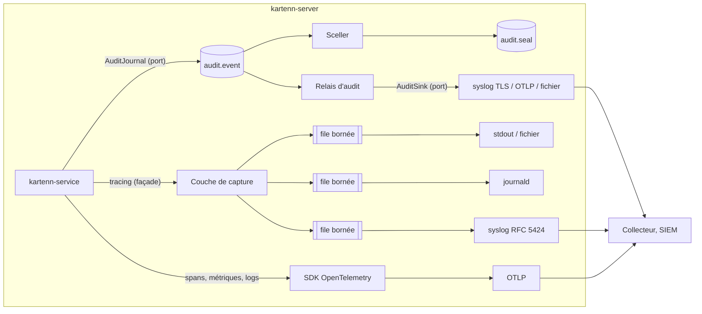

# 012 — Journalisation, observabilité et audit : conception

## Vue d'ensemble

Deux chemins indépendants (REQ-012-1) :



1. **Audit** : `kartenn-service` construit des événements typés et les remet au port
   `AuditJournal`. L'adaptateur PostgreSQL les insère dans la transaction de l'action
   (ou seul, avant la réponse). Deux tâches de fond les scellent et les exportent.
2. **Logs techniques** : le code n'utilise que `tracing`. Une couche de capture convertit
   chaque événement une seule fois en enregistrement, puis le distribue à des files
   bornées, une par sortie. Les sorties formatent et écrivent dans leur propre tâche.
3. **OpenTelemetry** : spans et métriques par le SDK ; logs techniques par la couche de
   capture, comme les autres sorties (une sortie `otlp` qui remet les enregistrements
   déjà masqués au fournisseur de logs du SDK).

## Changements

### Crates et dépendances (REQ-012-2) — ADR 0019

| Crate | Contenu ajouté | Dépendances nouvelles |
|---|---|---|
| `kartenn-core` | `audit` : type `AuditEvent`, `Severity`, `Criticality`, `Actor`, `Outcome` ; catalogue des événements (comme `rules.rs`) ; empreinte canonique d'un événement et d'un lot ; `Secret<T>` | `sha2` |
| `kartenn-service` | port `AuditJournal` ; `RequestContext` (acteur, source, corrélation) ; émission des événements dans le pipeline et les autres cas d'usage ; adaptateur en mémoire `MemoryJournal` | `tracing` (façade seulement) |
| `kartenn-store-pg` | adaptateur `PgAuditJournal` ; scellement, relais, purge, vérification ; migration `0023_audit.sql` | — |
| `kartenn-telemetry` (nouvelle) | couche de capture, sorties (stdout, fichier, journald, syslog), table des sévérités, configuration des filtres et rechargement, exporteurs d'audit (`AuditSink`), mise en place d'OpenTelemetry | `tracing-subscriber`, `tracing-appender`, `tracing-journald`, `tracing-opentelemetry`, `opentelemetry`, `opentelemetry_sdk`, `opentelemetry-otlp`, `tokio-rustls` |
| `syslog-sender` (nouvelle, indépendante) | message RFC 5424/3164, validation, cadrage, transports local, UDP, TCP, TLS (L24) | `tokio`, `tokio-rustls`, `rustls-pki-types` |
| `kartenn-server` | configuration (`figment` : TOML puis variables `KARTENN_*` et `OTEL_*`), composition, sous-commandes `run`, `audit verify` | `figment` |

`kartenn-core` et `kartenn-service` ne voient aucune crate de sortie : vérifié par un test
qui lit `cargo metadata` (REQ-012-2).

### Modèle d'un événement d'audit (REQ-012-8 à 10, 18)

Type `kartenn_core::audit::AuditEvent`, sérialisé en JSON pour l'export :

| Champ | Contenu |
|---|---|
| `id`, `seq` | UUID v7 ; numéro attribué par la base (ordre d'export) |
| `name` | nom du catalogue (`authn.login.failed`, `data.objects.read`…) |
| `severity`, `criticality` | REQ-012-4 ; `low`, `normal`, `high` (L22), fixés par le catalogue |
| `occurred_at`, `recorded_at` | horloge de l'instance ; `now()` de la transaction (REQ-012-3) |
| `actor` | `{kind: person\|service_account\|system\|unknown, id, auth_method, issuer}` ; `claimed` : HMAC-SHA256 de l'identifiant revendiqué si `unknown` (REQ-012-9) |
| `source` | IP du client (après mandataires de confiance), agent utilisateur borné à 256 octets |
| `target` | `{kind, ids: [uuid]}` ; jamais de valeur |
| `outcome`, `reason` | `success`, `failure`, `denied` ; code de raison du catalogue ou identifiant de règle |
| `motive`, `changeset` | motif de l'action ; changeset référencé |
| `trace_id`, `span_id`, `request_id` | corrélation (REQ-012-6) |
| `service` | version, identifiant d'instance |
| `details` | objet JSON, champs déclarés par le catalogue pour ce nom |

Le **catalogue** (`kartenn_core::audit::catalogue`) déclare pour chaque nom : sévérité,
criticité, champs de `details`, exigences servies, correspondance OCSF (classe,
activité) et ECS (`event.category`, `event.action`). Il est publié dans
`docs/spec/evenements-audit.md`, généré et vérifié par un test (`KARTENN_BLESS=1`),
comme `regles-noyau.md` (REQ-012-30). Un événement émis avec un nom absent du catalogue
est une erreur de compilation : les noms sont des constantes.

### Contexte de requête (REQ-012-6, 9)

`kartenn_service::RequestContext { actor, source, request_id, trace }` accompagne chaque
cas d'usage. `submit`, `validate_pending`, les imports et les lectures le reçoivent ;
`ChangesetRequest.author` en est dérivé (inchangé pour la 004). `RequestContext::system()`
sert aux tâches de fond. La 005 le remplira depuis l'authentification, la 006 depuis
HTTP ; d'ici là, les tests et le binaire le construisent.

### Port `AuditJournal` (REQ-012-2, 11)

```text
trait AuditJournal {
    // dans la transaction d'une écriture : WriteTx::audit(&AuditEvent)
    async fn record(&self, event: &AuditEvent) -> Result<(), AuditError>;   // seul, avant la réponse
}
```

- Écritures : `WriteTx` gagne `audit(&mut self, &AuditEvent)` ; le pipeline y écrit
  `changeset.<état>` et, en cas de refus de droits, `authz.denied`, dans la transaction
  du journal du changeset (`record_journal`). Un échec fait échouer la transaction
  (REQ-012-11).
- Hors écriture (authentification, lectures, consultation de l'audit) : `record` avant de
  rendre le résultat ; une erreur remonte en `RequestError::Audit` (503 en 006).
- `MemoryJournal` (adaptateur de test) garde les événements dans un `Vec` partagé.

### Schéma `audit` (REQ-012-11 à 16) — migration `0023_audit.sql`

```text
audit.event     (seq bigint identity, id uuid, name text, severity text, criticality text,
                 occurred_at, recorded_at timestamptz DEFAULT now(), actor_kind, actor_id,
                 auth_method, issuer, claimed bytea, source_ip inet, user_agent text,
                 target_kind, target_ids uuid[], outcome, reason, motive, changeset_id,
                 trace_id, span_id, request_id, service_version, instance_id, details jsonb)
                 PARTITION BY LIST (criticality) → chacune PARTITION BY RANGE (recorded_at), mensuelle
audit.sealed    (seal_id, event_seq, criticality, recorded_at)   — même partitionnement
audit.seal      (seq bigint identity, id uuid, created_at, prev_hash bytea, hash bytea,
                 count int, signature bytea NULL, key_id text NULL)
audit.delivery  (sink text, event_seq, criticality, recorded_at, delivered_at) — même partitionnement
```

- Droits : `kartenn_app` a `INSERT, SELECT` sur `audit.event`, `audit.sealed`,
  `audit.seal`, `audit.delivery` ; ni `UPDATE`, ni `DELETE`, ni `TRUNCATE` (REQ-012-12).
- Partitions : créées à l'avance par la procédure de maintenance existante
  (`kartenn_history_maintenance`, étendue) ; partition par défaut pour l'imprévu.
- Index : `audit.event (recorded_at)`, `(actor_id, recorded_at)`, `(name, recorded_at)`,
  GIN sur `target_ids` (recherche par objet) ; `audit.sealed (event_seq)` ;
  `audit.delivery (sink, event_seq)`.
- Pourquoi `audit.sealed` et `audit.delivery` plutôt qu'une colonne : le rôle applicatif
  n'a pas `UPDATE` sur les événements.

### Scellement (REQ-012-13, 14) — ADR 0019

- Tâche `seal_once` (une instance à la fois, verrou consultatif) toutes les 15 s : prend
  les événements validés **sans ligne dans `audit.sealed`**, dans l'ordre de `seq`, jusqu'à
  10 000 ; calcule `h_i = SHA-256(JCS(événement_i))` (RFC 8785) puis
  `hash = SHA-256(prev_hash ‖ count ‖ h_1 ‖ … ‖ h_n)` ; insère le sceau et les lignes
  `audit.sealed` dans une transaction ; signe `hash` en Ed25519 si une clé est configurée
  (L23) ; enregistre l'événement `audit.seal.created` (qui sera scellé au tour suivant)
  et l'exporte comme tout événement.
- Un événement d'une transaction longue, validé après un lot plus récent, entre dans le
  lot suivant : l'appartenance est enregistrée, il n'y a donc pas de trou (comme
  l'outbox, ADR 0018). Délai maximal : 15 s plus la durée de la transaction (REQ-012-13 :
  60 s).
- `kartenn-server audit verify <base> [<clé publique>]` : recalcule chaque lot, vérifie
  le chaînage et les signatures, désigne le premier lot faux (événement modifié, ajouté
  ou supprimé) et sort en code 2. La même vérification tourne chaque nuit (événement
  `audit.chain.broken`, ERROR, si elle échoue).
- **Précision (tâche 012-10)** : un lot mélange criticités et mois, purgés à des dates
  différentes. Chaque membre garde l'empreinte de son événement
  (`audit.sealed.event_hash`) et les appartenances ne sont pas purgées : le lot se
  recalcule depuis ces empreintes, et chaque événement encore présent est comparé à la
  sienne. Chaque purge est consignée (`audit.purge`) : un événement absent hors d'un
  mois purgé est une suppression. Les événements non scellés depuis plus de dix minutes
  sont signalés.
- La clé de signature (facultative) se lit dans un fichier désigné par la configuration
  (`audit.signing_key_file`), au format PKCS#8 ; la clé publique et son identifiant sont
  exportés dans `audit.seal.created`.

### Export de l'audit (REQ-012-15, 26, 34)

- Port `AuditSink { name(), async deliver(&[AuditEvent]) -> Result<(), SinkError> }`.
  Adaptateurs : `SyslogSink` (TCP ou TLS, comptage d'octets ; livré quand l'écriture
  TCP est faite, faute d'accusé applicatif en syslog : limite documentée), `OtlpSink`
  (requête OTLP logs **attendue**, sans le processeur par lots qui abandonne), `FileSink`
  (JSON par ligne, `fsync` par lot).
- **Forme exportée** (précision, tâche 012-11) : la ligne stockée de `audit.event` en
  JSON, celle que les sceaux prennent en empreinte, et non une forme remaniée : un
  récepteur peut ainsi vérifier un événement contre son sceau. L'adaptateur OTLP
  (`OtlpSink`) utilise l'exporteur de logs du SDK OpenTelemetry, appelé directement et
  attendu : il vient avec la tâche 15.
- Relais par sortie (une instance à la fois par sortie) : lit par `seq` croissant les
  événements validés sans livraison pour cette sortie, par lots de 500, livre, puis
  insère les lignes `audit.delivery`. Reprise sans trou après arrêt (même schéma que
  l'outbox). Métrique : âge du plus ancien événement non livré par sortie.
- Une sortie en échec depuis plus d'une minute : événement `sys.output.unavailable`,
  puis `sys.output.available` au retour (REQ-012-26).

### Rétention (REQ-012-16, L22)

- Configuration `audit.retention = { low = "90d", normal = "365d", high = "1095d" }`.
- Tâche quotidienne (rôle propriétaire, comme `maintenance::history_partitions`) : pour
  chaque partition mensuelle échue, vérifie que tous ses événements sont scellés et
  livrés à chaque sortie d'audit configurée, puis détache et supprime la partition
  d'événements et de `delivery`, et consigne la purge dans `audit.purge`. Les
  appartenances (`sealed`, avec les empreintes) et les sceaux restent : la vérification
  repart du premier sceau dont le lot est encore présent, chaque lot étant vérifiable
  seul avec son `prev_hash`.

### Lectures auditées (REQ-012-18)

- Chaque cas d'usage de lecture (`read::object`, pages, arbre, occupation, différentiel,
  audit) reçoit le `RequestContext` et enregistre `data.objects.read` (`low`) : critères
  (paramètres de filtre normalisés), identifiants renvoyés (bornés à la page). Une
  propriété sensible lue ajoute `data.sensitive.read` (`high`).
- Propriété sensible : nouvel attribut `sensitive` de la déclaration (amendement de la
  003 : colonne de `property_declaration`, opération `DeclareProperty`/`UpdateProperty`),
  modifiable par l'administration et audité.
- Coût : une insertion par requête de lecture, à mesurer par le banc (REQ-012-23).

### Logs techniques (REQ-012-4, 5, 20, 22, 29)

**Capture unique.** `kartenn_telemetry::CaptureLayer` (couche `tracing-subscriber`)
transforme un événement en `Record { time, severity, name, target, message, fields,
trace_id, span_id }` :
- `name` : le champ `name:` de l'événement (`tracing::event!(name: "pipeline.changeset.applied", …)`),
  sinon la cible (chemin du module) ;
- champs : valeurs bornées à 2 Kio (marque `…[+N octets]`), champs de la liste de
  masquage (`password`, `token`, `authorization`, `cookie`, `secret`, `dsn`,
  `connection_string`) remplacés par `***` ;
- un `Arc<Record>` est poussé dans la file de chaque sortie dont le filtre l'accepte
  (`try_send` : si pleine, compteur d'abandons de la sortie incrémenté).

**Sorties** (chacune une tâche tokio qui formate et écrit) :

| Sortie | Format | Transport |
|---|---|---|
| `stdout` | texte lisible ou JSON par ligne | sortie standard |
| `file` | JSON par ligne | fichier, rotation par taille laissée à l'exploitant (logrotate) avec réouverture sur `SIGHUP` |
| `journald` | protocole natif, `MESSAGE_ID` = UUID v5 du nom, `PRIORITY` selon la table | socket `AF_UNIX` |
| `syslog` | RFC 5424 (L19), `MSGID` = nom, SD `meta sequenceId`, MSG = JSON, BOM | socket local, TCP ou TLS (rustls), comptage d'octets, reconnexion avec attente exponentielle |

Le formatage et le transport syslog viennent de la bibliothèque `syslog-sender` (L24 :
aucune crate existante ne pratique le comptage d'octets ni n'accepte l'horodatage de
l'événement) ; elle est testée contre un analyseur strict (`syslog_rfc5424`) et contre le
récepteur syslog du collecteur.

**`syslog-sender`** (API publique, sans dépendance vers kartenn) :
- `Message` : priorité (`Facility`, `Severity`), horodatage fourni par l'appelant
  (microsecondes, UTC), `hostname`, `app_name`, `procid`, `msgid` (validés : caractères
  imprimables US-ASCII, longueurs de RFC 5424 §6), `StructuredData` (SD-ID et noms
  validés, valeurs échappées §6.3.3), corps UTF-8 avec BOM ou octets bruts ;
- `Format` : `Rfc5424`, `Rfc3164` (socket local seulement) ; longueur maximale avec
  troncature en fin, sur une frontière UTF-8 ;
- `Framing` : `OctetCounting` (défaut en TCP et TLS), `LineFeed`, aucun en datagramme ;
- `Transport` : socket local (datagramme ou flux), UDP, TCP, TLS (rustls, version
  minimale 1.2, sans 0-RTT) ; `Sender` asynchrone (tokio) qui écrit un lot et ne rend la
  main qu'une fois écrit, se reconnecte avec attente exponentielle bornée et signale les
  erreurs à l'appelant (aucune file interne : la mise en file est l'affaire de
  l'appelant) ;
- tests : vecteurs de RFC 5424 §6.5, aller-retour par `syslog_rfc5424`, propriétés
  (`proptest`) sur l'échappement et la troncature, serveur TCP et TLS de test.

**Table des sévérités** : une seule fonction `kartenn_telemetry::severity::map` fournit
les codes syslog, OTel et journald de REQ-012-4 ; toutes les sorties l'appellent.
`tracing-journald` est configuré avec cette table (`with_priority_mappings`).

**Neutralisation** : le format texte remplace CR, LF et les caractères de contrôle par
`\uXXXX` ; JSON échappe naturellement ; le syslog échappe `"`, `\`, `]` dans les SD et
borne le message (8 Kio par défaut, troncature en fin, RFC 5424 §6.1).

### OpenTelemetry (REQ-012-7, 24, 25)

- Fournisseurs de traces, de métriques et de logs du SDK, exporteur OTLP gRPC (`tonic`,
  TLS par rustls et le fournisseur ring, sans aws-lc) ; HTTP/protobuf n'est pas branché
  (précision de la tâche 012-15 : le client HTTP de rustls tire aws-lc ; à ajouter si un
  déploiement l'exige) ; ressource `service.name =
  kartenn`, `service.version`, `service.instance.id` (UUID v7 au démarrage).
- Couches : `tracing-opentelemetry` pour les spans, **sans les événements** (filtre de
  couche qui ne laisse passer que les spans) ; les logs passent par la couche de capture
  et une sortie `otlp` ; un test vérifie qu'un événement n'arrive qu'une fois au
  collecteur.
- Précision de la tâche 012-20 (secrets témoins) : le pont
  `opentelemetry-appender-tracing` lisait les champs bruts de `tracing`, sans le masquage
  de la capture, et un processeur de logs du SDK ne peut pas retirer un attribut. Les logs
  OTLP passent donc par la capture (masquage, file bornée, filtre changeable à chaud) ;
  l'exporteur de spans est enveloppé d'un exporteur qui masque les attributs des spans
  (mêmes noms, mêmes URL que la capture) avant l'envoi.
- Boucle de télémétrie : `hyper`, `h2`, `tonic`, `reqwest`, `tower` et `opentelemetry*`
  ne sont jamais exportés en OTLP (écartés par la sortie `otlp` et par la couche des
  spans), quel que soit le filtre.
- Échantillonneur : `ParentBased(TraceIdRatio(r))`, `r` configurable (1,0 par défaut) ;
  le parent n'est suivi que si l'appelant est dans `telemetry.trusted_callers`
  (adresses ou comptes de service), sinon nouvelle racine liée (`link`) au contexte reçu
  (REQ-012-7). Le propagateur ne lit pas `baggage`.
- `sqlx` : spans `db.*` par une couche d'instrumentation des requêtes du store
  (`#[instrument]` sur les fonctions publiques, `db.query.summary` et texte de requête
  sans paramètres) ; les logs d'instructions de `sqlx` sont coupés.
- Métriques (noms OpenTelemetry quand ils existent) : `http.server.request.duration`,
  `db.client.connection.count`, `kartenn.changeset.count{state}`,
  `kartenn.pipeline.duration`, `kartenn.log.dropped{output}`,
  `kartenn.audit.export.lag{sink}`, `kartenn.audit.unsealed`,
  `kartenn.audit.write.failures`, `kartenn.clock.skew`.

### Filtres et changement à chaud (REQ-012-27)

- Chaque sortie a un `EnvFilter` dans un `reload::Handle` (on recharge le **filtre**,
  pas la couche).
- Table `observability_override (output, filter, expires_at, changeset_id)` : une
  opération d'administration (permission `core.observability.admin`, auditée
  `config.log_filter.changed`) l'écrit ; chaque instance la relit toutes les 10 s,
  applique les filtres non échus et revient à la configuration à l'échéance (24 h au
  plus). L'audit n'a pas de filtre : rien ne l'atteint.

### Configuration (REQ-012-31)

```toml
[telemetry]
outputs = [
  { kind = "stdout", format = "json", filter = "info" },
  { kind = "syslog", transport = "tls", address = "logs.example.net:6514", filter = "warn",
    ca_file = "/etc/kartenn/ca.pem" },
  { kind = "otlp", filter = "info" },       # point de terminaison : OTEL_EXPORTER_OTLP_ENDPOINT
]
sampling_ratio = 1.0
trusted_callers = ["10.0.0.0/8"]

[audit]
sinks = [{ kind = "syslog", transport = "tls", address = "siem.example.net:6514" }]
retention = { low = "90d", normal = "365d", high = "1095d" }
signing_key_file = "/run/secrets/kartenn-audit.pk8"   # facultatif
hmac_key_file = "/run/secrets/kartenn-audit-hmac"      # identifiants revendiqués
```

Une sortie de type inconnu, sans adresse ou au filtre invalide empêche le démarrage.
Sans section `telemetry`, une sortie `stdout` JSON au niveau `info`. La clé HMAC est
générée et stockée en base (`audit.instance_key`, lisible par le rôle applicatif) si
aucun fichier n'est fourni, pour qu'elle soit la même sur toutes les instances.

### Horloge, erreurs, arrêt (REQ-012-32 à 34)

- Écart d'horloge : `SELECT clock_timestamp()` comparé à l'horloge locale au démarrage
  et toutes les 5 min (demi-durée d'aller-retour retranchée) ; WARN et métrique au-delà
  de 1 s.
- Panique : `std::panic::set_hook` écrit un ERROR (message, emplacement, `trace_id`)
  avant le gestionnaire par défaut ; les erreurs de requête deviennent des
  `problem+json` génériques avec `request_id` (006).
- Arrêt : à `SIGTERM`, arrêt des relais après leur lot en cours, vidage des files des
  sorties et `shutdown()` des fournisseurs OTel, dans 10 s au total ; un dernier log
  donne le nombre d'événements techniques perdus.

### Environnement de développement (REQ-012-35)

Fait : collecteur OpenTelemetry et OpenObserve (`devenv.nix`, L17). Le binaire, lancé
dans `devenv shell`, exporte vers `127.0.0.1:4317` (`OTEL_EXPORTER_OTLP_ENDPOINT`) et
peut écrire en syslog vers `127.0.0.1:5514`.

## Erreurs et cas limites

| Cas | Comportement | REQ |
|---|---|---|
| Insertion d'audit impossible (base, droits) | action refusée (503), aucun effet, ERROR technique | 11 |
| Sortie technique bloquée | abandons comptés, autres sorties intactes, WARN limité | 22, 26 |
| Sortie d'audit coupée | événements en base, retard mesuré, livraison à la reprise | 15, 26 |
| Transaction longue | son événement d'audit est scellé et exporté au tour suivant | 13, 15 |
| Rafale d'échecs d'authentification | agrégation par minute et par (source, empreinte) au-delà de 10 | 19 |
| Clé de signature illisible | démarrage refusé si configurée | 13 |
| Partition échue non exportée | conservée, WARN quotidien | 16 |
| Horloge en avance ou en retard | WARN, métrique ; `recorded_at` (base) fait foi pour l'ordre | 32 |

## Alternatives considérées

- **Chaînage événement par événement** : verrou global sur toutes les instances (D9).
- **Audit par OTLP seulement** : le SDK abandonne en cas de saturation.
- **Base d'audit séparée** : plus d'écriture atomique avec l'action (L20).
- **Couche `fmt` de `tracing-subscriber` par sortie** : formatage sur le thread de la
  requête et autant de captures que de sorties ; la capture unique formate hors du
  chemin chaud.
- **Crates syslog existantes** : aucune ne pratique le comptage d'octets ni n'accepte
  l'horodatage de l'événement (tableau en L24).
- **`config-rs` pour la configuration** : `figment` gère TOML et variables imbriquées
  avec des erreurs localisées ; choix réversible.

## Risques

- **Volume des lectures auditées** : à 5 requêtes de lecture par seconde en moyenne et
  2 Kio par événement (100 identifiants), 0,9 Gio par jour, soit environ 80 Gio pour
  90 jours de `low`. À mesurer au banc ; leviers : borne du nombre d'identifiants
  enregistrés par événement, critères seuls (configuration), rétention `low` plus courte.
- **Évolution des crates OpenTelemetry** (0.x, traces encore bêta côté Rust) : versions
  épinglées, adaptateur isolé dans `kartenn-telemetry`.
- **Syslog sans accusé applicatif** : une perte après l'écriture TCP n'est pas détectée ;
  la séquence `meta sequenceId` permet au récepteur de la voir. RELP n'est pas prévu.
- **Coût du scellement** : SHA-256 de 10 000 événements par tour, négligeable ; JCS à
  implémenter (petit, testé contre les vecteurs de la RFC 8785).

## Stratégie de test

- Unitaires (`kartenn-core`) : catalogue (noms uniques, criticité, champs), JCS (vecteurs
  RFC 8785), empreinte de lot, `Secret` masqué.
- Unitaires (`kartenn-telemetry`) : table des sévérités, formateur RFC 5424 (analyseur
  strict, échappements, BOM, troncature, cadrage), neutralisation, masquage, files
  bornées et compteurs.
- Intégration (`kartenn-service`, `MemoryJournal` et PostgreSQL) : un scénario par ligne de
  REQ-012-8 ; échec fermé (droit `INSERT` retiré) ; ajout seul (`SET ROLE`) ; scellement
  avec transaction longue ; vérification détectant modification, ajout, suppression ;
  relais avec coupure et reprise ; purge conditionnelle ; agrégation des échecs.
- Bout en bout (`kartenn-server`, collecteur de devenv) : cinq sorties actives, même
  événement partout ; secrets témoins introuvables ; un seul export par événement en
  OTLP ; contexte de trace propagé.
- Banc : `bench-core` avec trois configurations de télémétrie (aucune, référence, sortie
  bloquée) — REQ-012-23.

## ADR

- [`docs/adr/0019-journal-audit-scelle-en-base.md`](../../docs/adr/0019-journal-audit-scelle-en-base.md) (proposé)
