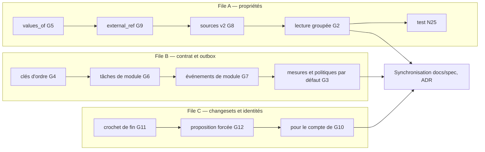

# 016 — Amendements du noyau pour la v0.2 : conception

Exigences : [`requirements.md`](requirements.md) (REQ-016-1 à 16). Décisions :
[`decisions.md`](decisions.md). Contre l'état du système décrit par `docs/spec/`
(architecture, data, interfaces) et l'ADR 0026 avec son amendement 1.

## Vue d'ensemble

Les trois files touchent des fichiers disjoints, hormis `module.rs`
(`kartenn-service/src/module.rs`), où B et C ajoutent chacune des méthodes à
implémentation par défaut : B passe en premier sur ce fichier, C s'y rebase.

## A. Propriétés

### Liste partagée (REQ-016-2, G5)
- Données : colonne `values_of text NULL` de la déclaration (`property_declaration`),
  référence à la clé d'une déclaration de même déclarant ; la table des valeurs reste
  indexée par la déclaration **propriétaire** des valeurs. La résolution d'une clé de
  valeur passe par `coalesce(values_of, key)`.
- Règle `core.declaration.values_of` : déclarant différent, cible absente, cible qui
  emprunte elle-même, cible d'un autre type que liste fermée.
- Où : `kartenn-core/src/properties.rs` (`PropertyDeclaration`), store `properties.rs`,
  `property_read::enum_values`, `declarations.rs`.

### Référence externe (REQ-016-3, G9)
- Domaine : `TypeSpec::ExternalRef`, `Scalar::External { system: Uuid, id: String,
  label: Option<String> }` ; l'ordre et l'égalité de `Scalar` ignorent `label`.
- Données : la valeur est stockée en `jsonb` `{"system": …, "id": …, "label": …}` dans
  la colonne de valeur existante des affectations, avec un index d'expression sur
  `(system, id)` pour le filtrage (REQ-003-25). Liste fermée `core.external_system`
  livrée vide, administrable.
- REST : `external_ref` dans l'énumération des types et la forme des valeurs (contrat de
  référence régénéré, ajout seul).
- Où : `kartenn-core/src/values.rs`, `properties.rs`, store `properties.rs`, `filter.rs`.

### Sources de valeurs attendues v2 (REQ-016-4, 5, G8)
- Contrat : `ExpectedValueSource::expected` reçoit un `ExpectedContext` (dates, lecteur
  des valeurs résolues des ancêtres via la lecture groupée, lecture de la transaction) et
  rend `Expected::{None, One(Suggestion), Candidates(Vec<Suggestion>)}` ; méthode
  `expected_many` à implémentation par défaut (boucle sur `expected`) ; `revision(&ctx)`
  remplace `version()`.
- Pipeline : `expected::defaults` n'écrit que sur `One` ; `expected::check` n'ouvre
  d'anomalie que sur `One` différent ; `suggest` rend tous les candidats.
- REST : la réponse de suggestion gagne `candidates` (tableau), le champ existant reste
  rempli si un seul candidat.
- Où : `kartenn-service/src/expected.rs`, `kartenn-rest/src/properties.rs` (route
  `…/suggestion`), store `expected.rs`.

### Lecture groupée (REQ-016-1, 6, G2, G13)
- Store : `property_read::resolved_many(objects, keys, valid_at, as_of)` en une requête :
  jointure des origines matérialisées (ADR 0016) sur `unnest($objects)` × `unnest($keys)`,
  lecture des valeurs et de la chaîne par objet d'origine ; temps système par la lecture
  datée existante.
- Service : `reads::resolved_many` filtre par `readable` (005) et masque les sensibles.
- Banc : budget « 512 × 6 < 30 ms » ajouté à `bench-properties`.
- Où : `kartenn-store-pg/src/explain.rs` (modèle), `property_read.rs`,
  `kartenn-service/src/reads.rs`, `kartenn-bench`.

## B. Contrat de module, outbox, tâches

### Clés d'ordre (REQ-016-14, G4)
- Migration du noyau : colonne `order_keys text[] NOT NULL` de l'outbox, remplie depuis
  `domain_ids` pour l'existant (`domain:<uuid>`) ; `domain_ids` reste lue tant qu'un
  consommateur de la v0.1 peut l'exiger, puis sera retirée (amendement 4 de l'ADR 0018).
- Écriture : les clés d'ordre d'un changeset = domaines + clés de verrou de module
  (`ModulePlan`, clause 14).
- Relais : l'ordre de livraison par consommateur suit la séquence ; la règle « pas de
  dépassement » s'exprime par clé d'ordre au lieu du domaine.
- Où : `kartenn-store-pg/src/outbox.rs`, `write.rs` (insertion de l'événement),
  ADR 0018.

### Tâches de module (REQ-016-16, G6)
- Contrat : `Module::jobs() -> &'static [JobSpec { name, period }]` ;
  `ModuleHandler::run_job(name, tx, journal)`.
- Déploiement : `deploy` insère `<module>.<tâche>` dans `job` (période mise à jour,
  `enabled = false` pour une tâche retirée : colonne `enabled boolean NOT NULL DEFAULT
  true`).
- Ordonnanceur : `kartenn-server/src/jobs.rs` route un nom qualifié vers le gestionnaire
  du module.

### Événements de module (REQ-016-15, G7)
- Contrat : `Module::events() -> &'static [&'static str]` ; `ModuleTx::emit(name,
  subject, data)` ; registre : nom émis non déclaré → erreur.
- Écriture : une ligne de l'outbox par événement émis, au commit du changeset ou de la
  tâche, type `org.kartenn.<module>.<nom>`, `source` de l'instance, clés d'ordre du
  changeset (ou `<module>:<tâche>`).

### Mesures et politiques par défaut (REQ-016-7, 8, G3)
- Contrat : `Module::measures() -> &'static [&'static str]`,
  `ModuleHandler::measure(ctx: &CheckContext) -> Vec<(String, u64)>` (sections lues dans
  le contexte) ; `Module::default_policies()`.
- Données : `approval_policy.module_triggers jsonb NOT NULL DEFAULT '[]'` (couples mesure,
  seuil), `approval_policy.origin text NOT NULL DEFAULT 'admin'` ; table
  `module_default_policy(module, name)` qui retient les politiques déjà installées.
- Évaluation : dans `review.rs`, après les sections du différentiel, en simulation comme à
  l'application.

## C. Changesets et identités

### Crochet de fin (REQ-016-9, G11)
- Contrat : `ModuleHandler::ended(ctx: EndContext { changeset, how: Rejected | Withdrawn
  | Expired, motive, by, plans }, tx)` sans effet par défaut.
- Appel : `review::reject`, `review::withdraw`, `review::expire_pending`, dans leur
  transaction ; une erreur du module annule la fin de la proposition.

### Proposition forcée (REQ-016-10, 11, G12)
- Contrat : `ModuleHandler::review(plan) -> Option<&'static str>` (permission de
  validation) ; `OperationType::review_only` pour les opérations jointes à la validation.
- Pipeline : `rights.rs` décide « proposition » si une opération est revue, même avec
  l'écriture ; la permission retenue est stockée sur le changeset (`review_permission
  text NULL`).
- Validation : `review::approve` vérifie REQ-004-42, la permission retenue sur le
  périmètre, l'auteur ≠ validateur ; les opérations jointes sont planifiées, contrôlées
  et appliquées dans la même transaction que la proposition ; refus 422
  `core.review.operation` si une opération jointe n'est pas `review_only`.
- REST : `POST /v1/changesets/{id}/approve` accepte un corps facultatif `operations`
  (ajout).

### Pour le compte d'un demandeur (REQ-016-12, 13, G10)
- Authentification : l'en-tête est lu par la couche REST (`authn.rs`), analysé en
  dictionnaire RFC 9651 ; refus 403 si l'appelant n'est pas un compte de service détenteur
  de `core.identity.act_on_behalf` (permission globale, catalogue 005).
- Identité : `identity.kind = 'requester'` (aucun secret, aucune liaison possible),
  retrouvée par (`iss`, `sub`) ; pseudonymisation existante (REQ-004-33).
- Changeset : colonne `on_behalf_of uuid NULL` (identité `requester`) ; restitué dans la
  fiche du changeset.
- Audit : champ `on_behalf_of` des événements (schéma `evenements-audit.schema.json`
  étendu) ; `authn.on_behalf` enregistré à la création d'une identité `requester`.

## Erreurs et cas limites

| Cas | Comportement |
|---|---|
| Mesure inconnue dans une politique | 422 `core.approval_policy.trigger` |
| Politique par défaut supprimée par l'administrateur | jamais réinstallée (table de suivi) |
| Source sans candidat pour un objet créé | aucune valeur par défaut, aucune anomalie |
| `Kartenn-On-Behalf-Of` mal formé | 400 problème `bad-request` |
| `Kartenn-On-Behalf-Of` sur une lecture | 400 : l'en-tête n'a de sens qu'en écriture |
| Proposition forcée dont le module disparaît du build | la proposition reste ; sa validation est refusée (`core.review.module`) |
| Événement émis par une simulation | jamais écrit (la transaction est annulée) |

## Alternatives considérées

Voir [`decisions.md`](decisions.md) : route REST de lecture groupée, ordre global,
domaine fictif par module, copie des listes de valeurs, jeton délégué RFC 8693, second
changeset de revue.

## Risques

- **Lecture groupée** : le budget de 30 ms suppose les origines matérialisées ; à
  mesurer d'abord sur `bench-properties` (première tâche de la file A).
- **Outbox** : la migration remplit `order_keys` sur toute la table ; sur une base de
  10⁶ événements, prévoir un remplissage par lots dans la migration.
- **Proposition forcée** : élargit ce qu'un validateur peut écrire ; les opérations
  jointes passent par les mêmes contrôles de droits, seulement celles déclarées « de
  revue ».

## Stratégie de test

Chaque exigence a son test d'intégration (`tests/it/`, ADR 0027 ; attribut `pg_test`,
ADR 0028) ; les modules de test existants (`dummy_module.rs`, `kit_module.rs`) gagnent
une mesure, une tâche, un événement, une opération revue. Bancs : `bench-properties`
(REQ-016-1). Contrat de référence régénéré par `kartenn-server openapi` et comparé (ajouts
seuls).

## ADR

- Amendement 2 de l'ADR 0026 : `jobs`, `events`/`emit`, `measures`/`default_policies`,
  `ended`, `review`.
- Amendement 4 de l'ADR 0018 : clés d'ordre.
