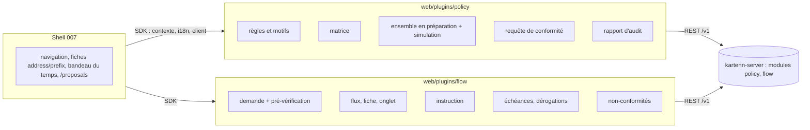
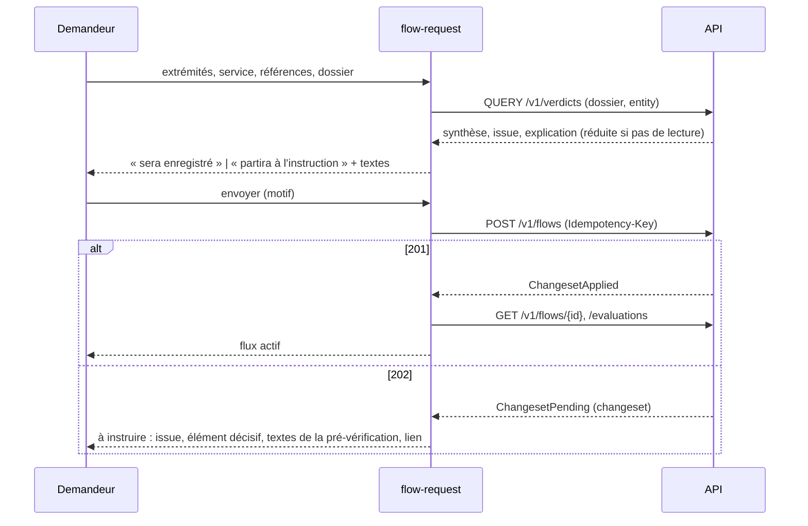

# 017 — Plugins Politique et Flux : conception

## Vue d'ensemble



Deux plugins de première partie (U1), écrits comme `web/plugins/vlan` et
`web/plugins/machines` (U2) : un manifeste, un `src/index.ts` qui définit des Custom
Elements par `definePlugin`, des catalogues FR et EN, un test Vitest par le bac à sable
du SDK. Aucun changement du shell ni du SDK ; côté serveur, trois amendements de module
décidés avec la 017 et livrés avant les écrans qui en dépendent (U13) : `If-Match` de
la matrice (010/S35, tâche 010-21), demandes en attente lues comme des flux (011/F19,
tâche 011-12), prolongation instruite (011/F20, tâche 011-13). Le design suit les
arbitrages de Q-017-1 à 7 ([`decisions.md`](decisions.md)) ; les écrans suivent les
maquettes validées par l'utilisateur (U14), qui priment sur les descriptions d'écran
ci-dessous en cas d'écart (le design est alors amendé).

## Rôles et permissions

| Rôle (vocabulaire) | Permissions utiles | Écrans |
|---|---|---|
| Responsable sécurité | `policy.catalogue.read`, `policy.rule.admin`, `policy.service.admin`, `policy.flow_type.admin`, `policy.environment.admin`, `policy.axis.admin`, `policy.inference.admin`, `policy.verdict.read` | règles, motifs, matrice, catalogue complet, inférence, différentiel, requête, rapport |
| Approbateur de politique | `core.changeset.approve` (politique d'approbation `policy.*`) | vue des sections d'un changeset (puis validation dans le shell) |
| Lecteur | `policy.catalogue.read`, `policy.verdict.read`, `flow.flow.read` (rôle livré `reader`) | lectures, requête de conformité complète |
| Demandeur | `flow.flow.request`, `policy.flow.request`, `prop.core.owner.write` sur l'entité | demande, pré-vérification réduite, mes demandes, mes non-conformités |
| Instructeur | `flow.flow.review`, `flow.flow.waive`, `flow.flow.read` sur l'entité | file d'instruction (demandes et prolongations), décision, dérogations, échéances |

Aucun rôle livré ne porte les permissions du demandeur ni de l'instructeur ; les parcours
E2E les créent par l'API (`/v1/roles`, `/v1/bindings`). Une vue nomme dans le manifeste
la permission sans laquelle le shell la masque ; une vue ouverte par deux permissions
alternatives n'en nomme aucune et décide elle-même par `context.user.has()` (U7).

## Changements

### Plugin `policy` (REQ-017-1, 3)

`web/plugins/policy/` (MPL-2.0), paquet `@kartenn/plugin-policy`, manifeste
`"module": "policy"`, `"sdk": "^0.1"`. Éléments (préfixe `policy-`, REQ-007-5) :

| Point | id | Élément | Objets | Permission | Exigences |
|---|---|---|---|---|---|
| view | `rules` | `policy-rules` | — | `policy.catalogue.read` | 4, 5 |
| view | `matrix` | `policy-matrix` | — | `policy.catalogue.read` | 6, 7, 8 |
| view | `catalogue` | `policy-catalogue` | — | `policy.catalogue.read` | 10, 30, 31 |
| view | `inference` | `policy-inference` | — | `policy.catalogue.read` | 32, 33, 34 |
| view | `compliance` | `policy-compliance` | — | (aucune : `policy.verdict.read` ou `policy.flow.request`) | 11, 12 |
| view | `changes` | `policy-changes` | — | `policy.catalogue.read` | 8, 9 |
| view | `reports` | `policy-reports` | — | `policy.rule.admin` | 14 |
| action | `check` | `policy-check` | `address`, `prefix` | (aucune, décidée par l'élément) | 13 |
| action | `expected` | `policy-expected` | `address`, `prefix` | `policy.catalogue.read` | 33 |

Sous-chemins des vues (`/x/policy/<vue>/<reste>`, `web/shell/src/router.ts`) :
`rules/<id>`, `rules/new`, `matrix?flow_type=<clé>`, `catalogue/<collection>/<id>`,
`inference/<id>`, `inference/mismatches`, `changes/<changeset>`, `reports/<id>` ; filtres et dates dans la requête de l'URL (W9).

#### Règles et motifs (REQ-017-4, 5)

| Écran | Routes | Permission d'écriture |
|---|---|---|
| Liste des règles, filtres `key`, `effect`, `pattern`, `flow_type`, `service` | `GET /v1/policy-rules` | — |
| Fiche d'une règle, historique | `GET /v1/policy-rules/{id}`, `…/history` | — |
| Créer, modifier, clore | `POST /v1/policy-rules`, `PATCH …/{id}` (Merge Patch, `If-Match`), `DELETE …/{id}` (`If-Match`) | `policy.rule.admin` |
| Motifs : liste, fiche, écriture | `/v1/policy-patterns` (mêmes formes) | `policy.rule.admin` |

Formulaire d'une règle : sélecteurs source et destination comme liste « axe → valeurs »
(axes de `GET /v1/policy-axes`, valeurs de `GET /v1/policy-values?axis=`), contraintes
« même valeur », types de flux (`/v1/flow-types`) et services (`/v1/services`), effet,
motifs requis (effet `allow` seulement), texte par langue (`fr` exigé pour `deny`). Les
membres acceptés sont ceux de `crates/kartenn-policy/src/objects.rs:SPECS` ; les objets
sont servis par le schéma générique `PolicyObject`, que le plugin type localement (pas
de schéma par type dans le contrat). Une règle `deny` sans texte ne s'envoie pas ; le
serveur reste juge (`policy.text.missing`).

#### Matrice (REQ-017-6, 7 ; Q-017-1, Q-017-7)

- Lecture : `GET /v1/policy-matrix?flow_type=<clé>` à `valid_at`/`as_of` ; axes des
  lignes et colonnes = environnements vivants à la date (`GET /v1/environments`) ; une
  cellule absente de `cells` est vide (refus par défaut) ; `outside` affiché avec un
  lien vers `rules?flow_type=<id>`, les règles hors vue marquées (une règle est dans la
  vue si une cellule la cite dans `rules`).
- Rendu : `<table>` à en-têtes de lignes (`scope="row"`) et de colonnes, une cellule
  focalisable par le motif « grille » de l'APG (flèches, Origine, Fin) ; état lu par un
  libellé et une icône (« autoriser », « interdire », « sous motif », « par défaut :
  refus »), la couleur ne fait que doubler (U12).
- Écriture : choisir une cellule ouvre un panneau (état, motifs pour `conditional`,
  texte `fr` pour `deny`, libellé) ; le changement va dans l'**ensemble en préparation**
  du plugin (mémoire de la vue, perdu à la fermeture de l'onglet, rien hors du
  navigateur avant la soumission, comme le brouillon de W10). L'ensemble garde l'ETag de
  la matrice lue pour chaque type de flux touché (010/S35, Q-017-7).
- Soumission (Q-017-1, A) : l'ensemble devient un changeset composé d'opérations
  `policy.matrix.set` (enveloppe de module), chacune avec `if_match` = l'ETag lu, soumis
  par `POST /v1/changesets` avec un motif et une clé d'idempotence ; une seule cellule
  peut passer par le `PUT` de la cellule, sous `If-Match`. 201 → matrice relue ; 202 →
  lien vers `changes/<changeset>` ; 412 ou `policy.matrix.stale` → matrice relue,
  ensemble gardé, nouvel ETag repris à la soumission suivante.

#### Ensemble en préparation et différentiel (REQ-017-8, 9 ; Q-017-1)

```mermaid
sequenceDiagram
  participant R as Responsable sécurité
  participant P as policy-matrix / policy-rules
  participant A as API
  R->>P: change des cellules, une règle
  P->>A: POST /v1/changesets?simulate=true (opérations de l'ensemble)
  A-->>P: violations, sections policy.combinations, policy.reclassified, flow.flows (décompte, 100 premières lignes)
  P-->>R: s'ouvre / se ferme / sous réserve ; flux qui cassent ou guérissent
  R->>P: soumettre (motif)
  P->>A: POST /v1/changesets (Idempotency-Key)
  A-->>P: 201 appliqué | 202 retenu (policy.opens…)
  P-->>R: matrice relue | lien changes/<id>
```

- La simulation est relancée après une pause de saisie (même délai que le brouillon du
  shell) et à la demande.
- Rendu d'une section : décompte par nature (`opens`, `closes`, `pending` ; `breaks`,
  `heals`, `outcome`), puis lignes (combinaison source, destination, service, élément
  décisif avant et après) ; « voir tout » mène à `changes/<id>` une fois soumis.
- Vue `changes/<changeset>` : `GET /v1/changesets/{id}` (motif, état, auteur, politique
  d'approbation), puis `GET /v1/changesets/{id}/diff?section=policy.combinations` (et
  `policy.reclassified`, `flow.flows`) page par page (`links.next`) ; lien vers la fiche du
  changeset du shell (`/changesets/<id>`) où l'approbateur valide ou rejette.
- La section `flow.flows` n'est demandée que si `flow` figure dans `modules` des
  capacités ; le plugin `policy` la lit comme des données, sans dépendre du plugin `flow`.

#### Catalogue (REQ-017-10, 30, 31 ; Q-017-5)

Tous les objets de la 010 s'écrivent dans le plugin (Q-017-5), selon les opérations que
leur collection sert (`crates/kartenn-policy/src/rest.rs:COLLECTIONS`) :

| Collection | Écriture | Permission |
|---|---|---|
| `/v1/services` (filtres `key`, `flow_type`) | création, modification (`label`, `flow_type`, `entries`), clôture | `policy.service.admin` |
| `/v1/flow-types` | création, modification (`label`, `description`), clôture | `policy.flow_type.admin` |
| `/v1/environments` | création (`policy.environment.create`), description (`policy.value.describe` par `/v1/policy-values`), clôture (`policy.environment.close`) | `policy.environment.admin` |
| `/v1/policy-axes` | désignation (`property`, `carrier`, `inference`), modification (`carrier`, `inference`), retrait | `policy.axis.admin` |
| `/v1/policy-values` (filtre `axis`) | description (`label`, `description`, `transverse`, `rank`) ; ni création ni clôture : la liste des valeurs est celle de la propriété du noyau | `policy.axis.admin` |
| `/v1/admissibility-conditions` | création, modification, clôture (texte pédagogique exigé) | `policy.rule.admin` |
| `/v1/risk-signals` | création (`key`, `kind`, `params`, `weight`), modification, clôture | `policy.rule.admin` |
| `/v1/policy-exempt-roles` | création (`role`), clôture | `policy.rule.admin` |
| `/v1/inference-rules` | voir « Inférence » | `policy.inference.admin` |

Chaque collection a la même forme d'écran : liste datée et filtrée, fiche avec
historique, formulaire dont les membres sont ceux de `COLLECTIONS` (un formulaire
générique piloté par une table de membres par collection, typé localement comme
`PolicyObject`), écriture par la route de ressource (U5). Une modification qui change
des verdicts (signal, condition, rôle exempté) peut passer par l'ensemble en
préparation pour être simulée avant soumission. Le catalogue sert aussi de source aux
listes de choix des formulaires (règles, requête, demande de flux).

#### Inférence (REQ-017-32 à 34 ; Q-017-5)

| Écran | Routes | Permission d'écriture |
|---|---|---|
| Règles d'inférence : liste, fiche, historique, révision du jeu | `GET /v1/inference-rules`, `…/{id}`, `…/history` | — |
| Créer, modifier, clore une règle (axe visé, attendus, critères, exceptions imbriquées ≤ 4, priorité, domaine) | `POST /v1/inference-rules`, `PATCH …/{id}` (`If-Match`), `DELETE …/{id}` | `policy.inference.admin` (sur le domaine cité, sinon globale) |
| Attendu d'un nœud et son explication (action `expected`) | `GET /v1/{addresses,prefixes}/{id}/properties/{key}/suggestion`, `…/explanation` (routes transverses du noyau) | — |
| Écarts (`inference/mismatches`) | `GET /v1/anomalies?rule=policy.inference.mismatch`, `POST /v1/anomalies/{id}/acknowledgement` | acquittement selon le noyau |
| Aperçu d'une règle avant écriture (REQ-017-34) | **aucune route** : attend un amendement de la 010 à rédiger (section de différentiel ou simulation de l'inférence) | — |

Formulaire d'une règle : critères pris dans la liste fermée du serveur (préfixe, famille,
domaine, type d'objet, site et entité, valeur d'une autre propriété, nom par expression
régulière…, REQ-010-42) ; exceptions éditées en arbre, profondeur bornée côté client
à 4 (`policy.inference.depth` du serveur fait foi) ; violations
`policy.inference.regex_invalid`, `criterion_invalid`, `depth` placées sur leur critère
ou leur exception ; avertissement `policy.inference.conflict` affiché. L'explication
d'un attendu montre la règle et sa chaîne d'exceptions, la révision, le nœud de
correspondance, chaque critère et sa valeur observée, les règles écartées (trois au
plus) ; plusieurs candidats à égalité sont tous montrés, sans écart.

#### Requête de conformité (REQ-017-11 à 13)

- Formulaire : extrémités par sorte (`address`, `prefix`, `interface`, `machine` ; les
  deux dernières seulement si `machines` est actif), choisies par recherche dans les
  listes lisibles ou par identifiant collé (Q-017-2, A) ; objet : service, ou
  transport + port, ou type de flux ; dossier facultatif (références, demandeur,
  responsables, nature des données, période → `dossier.fields`, valeurs d'axes →
  `dossier.values`) ; entité (exigée pour une réponse sous `policy.flow.request`) ;
  `valid_at`, `as_of` repris du contexte.
- Appel : `QUERY /v1/verdicts` (corps `PolicyVerdictQuery`) ; le lien partageable de la
  vue porte la forme `GET /v1/verdicts` à paramètres quand il n'y a pas de dossier.
- Résultat : synthèse (`allowed`/`partial`/`denied`, issue la plus défavorable,
  décomptes), révision de politique, puis une ligne par évaluation (points par rang,
  service, verdict, issue, score) dépliable en explication : élément décisif (règle,
  motif, cause `unclassified`/`no_rule`/`unknown_service`/`pending` et motifs attendus),
  combinaison, règles écartées et pourquoi, conditions (`met`, `unmet`,
  `not_evaluated`), signaux. Les textes pédagogiques sont lus dans `texts` des règles,
  motifs et conditions citées (`GET` de l'objet, mis en cache le temps de la vue) dans la
  langue de l'utilisateur, sinon `fr` avec la langue indiquée (U6).
- Explication : `full` → par point et axe, valeurs, source (`tree` ou `machine`),
  origine liée à sa fiche, chaîne ; `reduced` → rangs, valeurs, aucune lecture
  complémentaire (U8) ; `hidden` > 0 → « n adresses non lisibles omises ».
- Problèmes : `policy-query-too-large` (422) ; 404 d'une extrémité → « absente ou non
  autorisée ».
- Action `check` (fiches `address`, `prefix`) : mène à `/x/policy/compliance` avec la
  source pré-remplie ; masquée si l'utilisateur n'a ni `policy.verdict.read` ni
  `policy.flow.request`.

#### Rapport d'audit (REQ-017-14)

`POST /v1/policy-reports` (`valid_at`) → 201 et `Location`, ou 409 avec le `Location` du
rapport en cours ; la vue relit `GET /v1/policy-reports/{id}` toutes les 5 s tant que
l'état n'est pas `done` (la tâche `policy.report` tourne toutes les 5 s) ; décompte par
rubrique (`counts`, `null` → « indisponible ») ; détail `GET …/items?rubric=&after=` par
pages de 100 ; export JSON : concaténation des pages d'une rubrique, téléchargée par le
navigateur (aucune route d'export). Toutes ces lectures sont sous `policy.rule.admin`
(404 sinon).

### Plugin `flow` (REQ-017-2, 3)

`web/plugins/flow/` (MPL-2.0), paquet `@kartenn/plugin-flow`, manifeste
`"module": "flow"`. Éléments (préfixe `flow-`) :

| Point | id | Élément | Objets | Permission | Exigences |
|---|---|---|---|---|---|
| view | `request` | `flow-request` | — | `flow.flow.request` | 15, 16 |
| view | `flows` | `flow-flows` | — | (aucune : `flow.flow.read` ou `flow.flow.request`) | 17, 18, 25 |
| view | `review` | `flow-review` | — | `flow.flow.review` | 20, 21 |
| view | `expiring` | `flow-expiring` | — | `flow.flow.read` | 22, 23 |
| view | `nonconformities` | `flow-nonconformities` | — | (aucune : lecture ou demande) | 24 |
| tab | `flows` | `flow-tab` | `address`, `prefix` | `flow.flow.read` | 19 |
| action | `request-from` | `flow-request-from` | `address`, `prefix` | `flow.flow.request` | 15 |

Sous-chemins : `flows/<id>`, `request?source=<sorte>:<id>&from=<flux>` (pré-remplissage
depuis une fiche, ou depuis un flux terminé ou à remplacer), `review/<changeset>`.

#### Demande (REQ-017-15, 16 ; Q-017-2)



- Champs et corps : `FlowRequest` (`web/sdk/src/api/schema.d.ts`) ; système des
  références pris dans `GET /v1/property-declarations/core.external_system/values` ;
  nature des données = valeurs de l'axe de sensibilité désigné (`GET /v1/policy-axes`,
  puis `policy-values?axis=`) ; entité choisie parmi les entités lisibles ou par
  identifiant collé (Q-017-2, A) ; responsables facultatifs, par identifiant d'identité.
- La pré-vérification se relance quand un champ qui la change bouge (extrémités, service,
  dossier, entité, début) ; le formulaire n'impose pas de l'avoir vue, l'envoi trie de
  toute façon (REQ-011-21).
- Une réponse 202 ne porte que le changeset : l'issue montrée est celle de la
  pré-vérification, marquée comme telle.
- Refus du serveur : `flow.reference.missing`, `flow.endpoint.invalid`,
  `flow.service.closed`, `flow.kind.reserved`, `core.object.forbidden` (droit
  `prop.core.owner.write` manquant sur l'entité) placés sur leurs champs.

#### Flux, fiche, onglet (REQ-017-17 à 19, 25 ; Q-017-6)

| Écran | Routes |
|---|---|
| Liste, filtres de REQ-011-14 dans l'URL (`endpoint`, `prefix`, `machine`, `service`, `flow_type`, `kind`, `state`, `summary`, `outcome`, `decisive`, `waived`, `ending_before`, `entity`, `requester`, `external_ref`, `axis`) | `GET /v1/flows` ; `QUERY /v1/flows` si l'URL dépasse 2 000 caractères |
| « Mes demandes » | `GET /v1/flows?requester=<context.user.identity>&state=…,requested` (demandes en attente comprises, 011/F19) |
| Fiche | `GET /v1/flows/{id}`, `…/evaluations`, `…/history` |
| Modifier, avancer la fin, prolonger, clore | `PATCH /v1/flows/{id}` (`FlowPatch`, `If-Match` ; prolongation → 200 ou 202 `ChangesetPending`, 011/F20), `DELETE /v1/flows/{id}` (`If-Match`) |
| Onglet « Flux » | `GET /v1/addresses/{id}/flows`, `GET /v1/prefixes/{id}/flows` |
| Flux d'une machine, d'une interface | liste filtrée `machine=<id>`, `endpoint=interface:<id>` (Q-017-6, A) |

Fiche : état dérivé à la date, synthèse et issue, dérogation (fin, motif, risque),
évaluations par paire (verdict, issue, élément décisif, conditions non remplies, score,
révision de politique) ; réduites (adresses et élément décisif `null`) pour le
demandeur sans `flow.flow.read`, rendues sans complément (U8). Changer une extrémité ou
le service n'est pas offert : « nouvelle demande pré-remplie » ouvre `request?from=<id>`.
« Prolonger » (flux daté non terminé, Q-017-4 B) : nouvelle fin, pré-vérification de la
portion ajoutée par `QUERY /v1/verdicts` avec le dossier du flux, `PATCH` ; sur 202, la
fiche garde l'ancienne fin et affiche « prolongation en attente » avec le lien vers son
changeset (ligne `review.kind = extension` de la lecture, 011/F19). Un flux terminé
n'offre que la nouvelle demande pré-remplie.

#### Instruction (REQ-017-20, 21 ; Q-017-3)

File (Q-017-3, B ; après la tâche 011-12) : `GET /v1/flows?review=pending` (filtres de
la liste, page de 100, curseur), chaque ligne portant `review` : changeset à instruire,
nature (`request` : demande, `id` nul ; `extension` : prolongation d'un flux existant)
et évaluation du triage (synthèse, issue, élément décisif, conditions non remplies,
score, avertissements, évaluations par paire), lue telle quelle, sans recalcul. La fiche
d'instruction `review/<changeset>` relit la ligne par `changeset=<id>` et le changeset
par `GET /v1/changesets/{id}` (motif, auteur, `on_behalf_of`, état pour `If-Match`).

Décision (`review/<changeset>`) :

| Geste | Route | Corps |
|---|---|---|
| Approuver | `POST /v1/changesets/{id}/validation` (`If-Match` : état du changeset) | `operations` : `approve_review` (`flow`, `end` ≤ date de la décision + 12 mois, demande ou prolongation) ; si la synthèse est `denied`, aussi `waive` (`reason`, `accepted_risk`, `end` ≤ min(fin du flux, octroi + 6 mois)) |
| Rejeter | `POST /v1/changesets/{id}/rejection` | `motive` (obligatoire) ; la règle en cause vient de l'évaluation du triage |

Les boutons sont absents si l'auteur du changeset (ou `on_behalf_of`), ou pour une
prolongation le demandeur du flux, est l'utilisateur ;
le serveur reste juge (`flow.separation`, 403 sans `flow.flow.review`, REQ-016-11).

#### Dérogations et échéances (REQ-017-22, 23 ; Q-017-4)

- Dérogation d'un flux appliqué : `POST /v1/flows/{id}/waiver` (`FlowWaiver`) ; 200
  accordée, 202 retenue (déclencheur `flow.waiver`) ; la recertification est le même
  geste sur un flux déjà dérogé, et la fiche relue montre la nouvelle évaluation.
- Échéances : `GET /v1/flows?ending_before=<maintenant + 30 j>` (la lecture couvre la fin
  du flux et celle d'une dérogation en cours) ; marque « J-7 » si la plus proche des deux
  fins tombe dans 7 jours ; tri par fin croissante. Actions : recertifier (dérogation),
  prolonger (flux daté, Q-017-4, B ; voir « Flux, fiche, onglet »).

#### Non-conformités (REQ-017-24)

`GET /v1/flow-nonconformities` avec `entity`, `requester`, `rule`, `from`, `to`, `state`,
`kind`, dates du contexte (une page, sans curseur : la vue l'indique si la page est
pleine) ; ligne : état (`rejected`, `noncompliant`, `waived`), date, motif, règle
(`rule_key`, `rule_label`) et texte (`rule_texts`, langue de l'utilisateur, repli `fr`
indiqué), lien vers le flux ou le changeset rejeté. Acquitter un flux `noncompliant` :
anomalie lue par `GET /v1/anomalies?rule=flow.verdict.denied` (rapprochée par l'objet),
puis `POST /v1/anomalies/{id}/acknowledgement`. « Mes non-conformités » :
`requester=<context.user.identity>`.

### Temps, droits, langue (REQ-017-26, 3)

- Chaque élément s'abonne au contexte du SDK et relit ses données à un changement de
  `valid_at`, `as_of` ou de langue (REQ-007-14) ; hors présent, aucun formulaire
  d'écriture ni bouton de soumission n'est rendu (W9).
- Les erreurs sont des `ApiProblem` du SDK : traduites par `type`, 412 → « relire en
  gardant la saisie », 422 → violations sur les champs, 404 → « absent ou non autorisé ».
- Catalogues sous l'espace de noms du plugin ; codes de règles du serveur traduits par
  une table `rules.<id>` dans le catalogue, `detail` en repli.

## Erreurs et cas limites

- Matrice d'un type de flux sans environnement vivant à la date : table vide et message,
  pas d'erreur.
- Cellule `conditional` sans motif : refusée côté client ; `deny` avec motifs :
  `policy.rule.conditional_deny` du serveur affichée.
- Changeset retenu (202) pendant que l'ensemble en préparation contient d'autres
  cellules : l'ensemble est vidé de ce qui a été soumis, le reste demeure.
- Requête de conformité au-delà de 64 adresses par extrémité ou 10⁴ évaluations : 422
  `policy-query-too-large`, invitation à restreindre.
- Demande dont la pré-vérification et le triage divergent (politique changée entre
  deux) : la réponse du serveur fait foi, la vue la montre en remplaçant la
  pré-vérification.
- Flux sans paire d'adresses : `denied` et `noncompliant` (écart du design 011) ; la
  fiche le dit (« aucune adresse à la date »).
- Liste de non-conformités pleine (pas de curseur) : la vue invite à restreindre les
  filtres.
- Instructeur qui est aussi le demandeur « pour le compte de » : traité comme le
  demandeur (boutons absents).

## Alternatives considérées

- Un seul plugin « politique et flux » : rejeté, U1 (un module retiré doit emporter ses
  écrans ; publics distincts).
- Vue framework (Vue 3) dans les plugins : permis par W7, rejeté pour garder la forme de
  la 008 et de la 009 (U2) ; à reconsidérer si la matrice et les formulaires de règles
  deviennent trop lourds en Custom Elements nus.
- Écrire chaque cellule de la matrice immédiatement (`PUT` à chaque clic) : rejeté, le
  responsable ne verrait pas le différentiel d'un ensemble de changements (UC-7).
- Passer par le brouillon du shell (`draft.add`) : le brouillon simule, mais n'affiche
  pas les sections de module ; garder l'ensemble dans le plugin évite d'amender la 007
  (Q-017-1).
- Édition de la politique en texte (TOML) dans l'interface : rejetée, l'import hors ligne
  (REQ-010-35) couvre ce besoin.

## Risques

- Formulaire de règle sur un schéma générique (`PolicyObject`) : les membres ne sont pas
  typés par le contrat ; un test Vitest par membre accepté (`objects.rs:SPECS`) et le
  parcours E2E protègent contre une dérive.
- Dépendance aux amendements de module (010-21, 011-12, 011-13) : les écrans de la
  matrice en écriture, de la file d'instruction et de la prolongation attendent leur
  livraison ; les autres avancent sans eux.
- Grain de l'`If-Match` de la matrice (010/S35) : la matrice d'un type de flux, pas la
  cellule ; deux responsables sur des cellules distinctes d'un même type se voient
  refuser l'un l'autre (412) et doivent relire, ce que l'ensemble en préparation absorbe.
- Formulaires du catalogue complet (Q-017-5) : onze collections, dont l'inférence et ses
  exceptions en arbre ; un formulaire générique piloté par table limite le code, au prix
  d'une ergonomie moins fine (les maquettes, U14, en décident).
- Demandeurs sans lecture du référentiel (Q-017-2) : l'option A les cantonne aux
  identifiants collés, ce qui peut rendre le formulaire inutilisable pour eux.
- Budgets (REQ-017-29) : le banc navigateur de la 007 n'existe pas encore (007, tâche
  24) ; mesure indicative d'ici là.

## Stratégie de test

- Vitest (bac à sable du SDK, `fetch` simulé typé par le contrat) : rendu de chaque
  élément ; matrice (états, `outside`, clavier, cellule absente = défaut) ; ensemble en
  préparation et rendu des sections simulées ; requête complète et réduite (aucun appel
  sortant en réduit) ; formulaire de demande (refus client, 201, 202, idempotence) ;
  décision d'instruction (corps de validation, boutons absents pour le demandeur) ;
  échéances (J-30, J-7) ; clés FR = EN.
- Test serveur : plugins publiés seulement avec leur module
  (`crates/kartenn-rest/tests/it/plugins.rs`, sur les manifestes et catalogues du dépôt).
- Parcours Playwright (Chromium, Firefox, axe-core à chaque étape) :
  `web/e2e/journeys/policy.spec.ts` (responsable sécurité) et
  `web/e2e/journeys/flow.spec.ts` (demandeur, instructeur ; deux identités de
  `web/e2e/users.toml`).

## ADR

Aucune : les plugins appliquent l'ADR 0025 (contrat des plugins) et les décisions de la
007. Les amendements de contrat décidés avec la 017 sont consignés dans la spec de leur
module (010/S35, 011/F19, F20) ; l'aperçu d'une règle d'inférence attend un amendement
de la 010 à rédiger.
