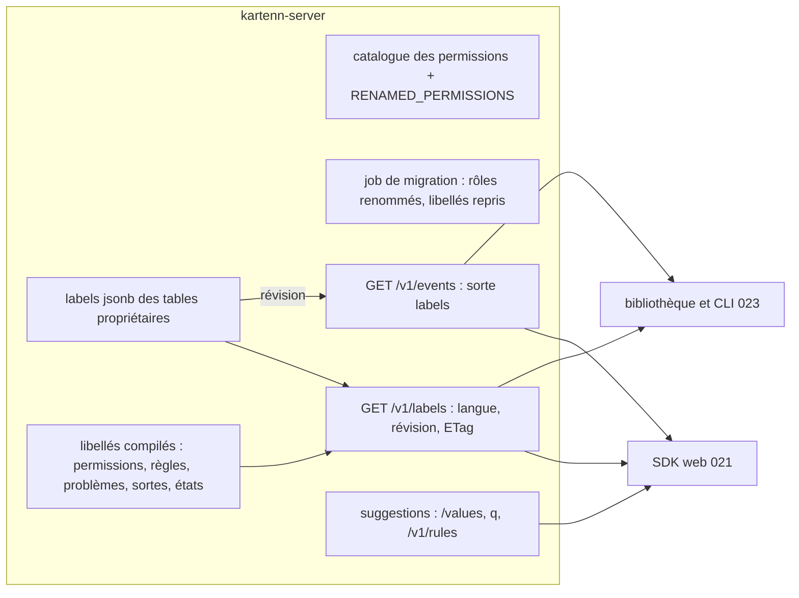

# 018 — Retours d'usage de la v0.2 : conception

Statut : **validée le 2026-10-23**.

## Vue d'ensemble



Trois changements indépendants, en trois flux (R25) : (A) renommage des permissions ;
(B) libellés en base, libellés compilés, dictionnaire négocié, événement `labels`, client
Python ; (C) routes de suggestion. Les écrans sont ceux de la 021.

## État des lieux (inventaire du 2026-10-22)

### Permissions

- 61 permissions statiques : 32 du noyau (`kartenn-core/src/authz.rs`, l. 43 à 74),
  6 `vlan` (`kartenn-vlan/src/module.rs`, l. 124), 9 `machines`
  (`kartenn-machines/src/module.rs`, l. 168), 9 `policy` (`kartenn-policy/src/module.rs`,
  l. 311), 5 `flow` (`kartenn-flow/src/module.rs`, l. 92) ; plus la famille dynamique
  `prop.<clé>.{read,write,propose}` (`kartenn-core/src/properties.rs`).
- Rôles livrés : `BUILTIN_ROLES` (`authz.rs`, l. 269), resynchronisés au démarrage
  (`kartenn-service/src/rbac.rs`) ; `BuiltinRole::entries_with` ajoute les lectures des
  modules aux rôles qui lisent les entités ; libellés en français seulement.
- Stockage : `role_permission.permission text` (migration 0028), bitemporel, contrainte à
  **trois segments** ; `binding` cite le rôle par identifiant ; aucune migration SQL ni
  `approval_policy` ne cite une permission.
- Permissions par défaut des sortes : `type_read_permission` / `type_write_permission`
  (`authz.rs`, l. 133-154) rendent `<sorte>.read`.
- Occurrences : ~190 usages hors tests dans `crates/*/src`, ~500 dans les tests, ~50
  dans les bancs ; web : manifestes `web/plugins/{vlan,machines}` ; contrat : la
  description de `waive_flow` (`flow.flow.waive`) ; docs : `docs/spec/permissions.md`
  (généré), `interfaces.md`, `invariants.md`, ADR 0026 ; specs 005 à 017.
- Jokers : serveur, `*` et `prop.*.<action>` seulement (`valid_role_entry`, `grants`).

### Clés et libellés

| Valeur | Stockage | Libellé aujourd'hui |
|---|---|---|
| Valeur de liste fermée (`property_enum_value.key`) | migration 0011 | aucun |
| Déclaration de propriété | `property_declaration.key` | aucun |
| Environnement (valeur de `policy.environment`) | clé au noyau, `policy_value.label` | une langue, nullable |
| Valeur d'un autre axe | `policy_value.label` | une langue |
| Type de flux, service, motif, règle | `label NOT NULL` | une langue |
| Condition, signal | clé seule | aucun |
| Texte pédagogique | `texts jsonb {langue: {body, url}}` | par langue (précédent) |
| Rôle | `role.key`, `role.label` | une langue (rôles livrés en français) |
| Permission | code, description française | une langue |
| Règle (`Rule.id`, `summary`) | code, résumé français, non servi | une langue |
| Problem Details (`urn:kartenn:problem:<slug>`) | code, `title` anglais | une langue |
| Sortes, états, natures, usages | code | catalogues des clients seulement |

Aucune lecture d'`Accept-Language` côté serveur (W11 l'avait écartée) ; aucun libellé ne
sert de clé.

## Changements

### A. Permissions (REQ-018-1 à 6)

#### Correspondance des permissions

Onze permissions changent de nom ; les autres sont inchangées.

| Ancien nom | Nouveau nom |
|---|---|
| `vlan.vlan.read` | `vlan.read` |
| `vlan.vlan.write` | `vlan.write` |
| `vlan.vlan.propose` | `vlan.propose` |
| `machines.machine.read` | `machines.read` |
| `machines.machine.write` | `machines.write` |
| `machines.machine.propose` | `machines.propose` |
| `flow.flow.read` | `flow.read` |
| `flow.flow.request` | `flow.request` |
| `flow.flow.review` | `flow.review` |
| `flow.flow.write` | `flow.write` |
| `flow.flow.waive` | `flow.waiver.grant` (Q-018-1) |

Inchangées (50 + la famille `prop`) :

- `core` : `core.{entity,site,domain,prefix,range,address}.{read,write,propose}`,
  `core.changeset.approve`, `core.changeset.read`, `core.anomaly.acknowledge`,
  `core.property.admin`, `core.approval_policy.admin`, `core.rbac.read`,
  `core.rbac.admin`, `core.role.admin`, `core.issuer.admin`, `core.account.admin`,
  `core.audit.read`, `core.identity.pseudonymise`, `core.identity.act_on_behalf`,
  `core.observability.admin`.
- `vlan` : `vlan.group.{read,write,propose}`.
- `machines` : `machines.cluster.{read,write,propose}`,
  `machines.interface.{read,write,propose}`.
- `policy` : `policy.catalogue.read`, `policy.verdict.read`, `policy.flow.request`,
  `policy.{axis,environment,flow_type,service,rule}.admin`, `policy.inference.admin`.
- `prop.<clé>.{read,write,propose}`, `prop.*.<action>`, `*`.

#### Code

- `authz.rs` : `RENAMED_PERMISSIONS: &[(&str, &str)]` ; catalogues de module renommés ;
  `type_read_permission` et `type_write_permission` appliquent R2 quand la sorte n'a pas
  de `TypePermissions` ; tests : aucune ressource nommée comme une action, aucun nom
  `m.m.a`, table sans cible inconnue, ancien nom refusé par `valid_role_entry`
  (`core.role.invalid`, REQ-018-3).
- Migration SQL `00NN_permission_names.sql` : contrainte de
  `role_permission.permission` relâchée (R5), sur la table et son historique.
- Rôles personnalisés (Q-018-3) : étape `rename_permissions` du job de migration, après
  `sync_modules` : lit les entrées courantes des rôles non livrés, et s'il en trouve
  d'anciennes, soumet un changeset de l'auteur `système`, motif
  `permission rename 018`, qui clôt l'ancienne entrée et ouvre la nouvelle (une seule si
  le rôle avait déjà le nouveau nom) ; rien sinon. Rôles livrés : resynchronisés comme
  aujourd'hui.
- `docs/spec/permissions.md` : la génération ajoute « Anciens noms » depuis
  `RENAMED_PERMISSIONS`.
- Clients : manifestes `web/plugins/{vlan,machines}` (shell actuel, jusqu'à la 021) ;
  description de `waive_flow` dans le contrat ; aucun nom dans `clients/python`.

### B. Libellés (REQ-018-7 à 13, 21)

#### Stockage (Q-018-5, 6, 7)

- Colonne `labels jsonb NOT NULL DEFAULT '{}'` (`{<langue>: <texte>}`) sur
  `property_declaration`, `property_enum_value`, `role`, `policy_flow_type`,
  `policy_service`, `policy_pattern`, `policy_rule`, `policy_condition`,
  `policy_signal` ; versionnée avec la ligne ; `CHECK (jsonb_typeof(labels) =
  'object')` ; règle `core.label.invalid` dans le pipeline, partagée par les modules
  (remplace `policy.label.invalid`).
- Migration : `labels = jsonb_build_object(<langue par défaut>, label)` ;
  `policy_value.label` → `labels` de la valeur de même clé dans `property_enum_value` ;
  puis suppression des colonnes `label` (aucune compatibilité, Q-018-2). `policy_value`
  garde description, transverse, rang.
- **Révision des libellés** : table `label_revision (id smallint PRIMARY KEY CHECK (id =
  1), revision bigint)` ; le store l'incrémente dans la transaction d'un changeset dont
  une opération écrit `labels` (une ligne verrouillée seulement par ces changesets,
  rares) et note la révision dans l'outbox pour l'événement `labels`.
- Langue par défaut : `[i18n] default_locale` (configuration du serveur), passée au noyau
  et aux modules ; le type `Locale` (`kartenn-policy/src/model.rs:484`) migre au noyau ;
  `kartenn-policy/src/codec.rs:DEFAULT_LOCALE` disparaît.

#### Écritures

- `declare_property`, `update_property`, `add_enum_value` acceptent `labels` ; opération
  nouvelle `update_enum_value {property, key, labels}` (libellés seuls ; la clé ne change
  pas) ; `PUT /v1/roles/{key}` prend `{labels, entries}` ; opérations de la politique :
  `labels` au lieu de `label` ; `value.describe` et `environment.create` écrivent les
  libellés du noyau.
- Synchronisation (R10) : les descripteurs (`PropertySpec`, valeurs) portent
  `labels: &[(&str, &str)]` ; `sync_modules` écrit dans son changeset ce qui manque ou ce
  dont la version courante vient d'un changeset `système` ; jamais un libellé
  d'administrateur.

#### Libellés compilés (R8 b, REQ-018-10)

- Une structure `Labels { fr: &'static str, en: &'static str }` à côté de chaque
  définition : `Permission.description` (aujourd'hui une phrase française),
  `Rule.summary` (idem), `ProblemKind::title` (aujourd'hui anglais) ; tables nouvelles
  pour les sortes (`core.prefix`… et celles déclarées par les modules au registre des
  types), les états (`changeset.state`, `import.state`, `flow.state`, `flow.outcome`,
  `flow.verdict`…), les natures et usages. Les modules exposent les leurs par le contrat
  de module (ADR 0026 : fonction `labels()` du module, additive).
- Empreinte des libellés compilés : calculée au démarrage (hachage du rendu canonique),
  partie de la révision du dictionnaire.

#### Dictionnaire `GET /v1/labels` (R19 à R24)

Paramètres : `lang` (étiquette BCP 47, prioritaire sur `Accept-Language`), `spaces`
(liste), `valid_at`, `as_of`.

```json
{
  "lang": "fr",
  "default_lang": "fr",
  "revision": "1842-9f3a",
  "valid_at": "2026-10-23T10:00:00Z",
  "spaces": {
    "value": {"policy.environment": {"prod": "Production", "preprod": "Préproduction"}},
    "property": {"policy.environment": "Environnement"},
    "role": {"reader": "Lecteur"},
    "permission": {"flow.read": "Lire les flux",
                   "flow.flow.read": "Lire les flux — anciennement"},
    "rule": {"import.unknown-reference": "Référence inconnue dans l'import"},
    "problem": {"changeset-refused": "Changement refusé par les règles"},
    "kind": {"core.prefix": "Préfixe", "machines.machine": "Machine"},
    "state": {"changeset.pending": "En attente"},
    "policy.flow_type": {"ssh": "Administration à distance"}
  },
  "fallback": {"lang": "fr", "keys": ["value/policy.environment/legacy"]}
}
```

- Espaces : un par famille ; une valeur de liste fermée est rangée sous sa propriété ;
  les objets de la politique sous `policy.<collection>` et leur clé. Une entrée sans
  libellé dans la langue servie prend celui de la langue par défaut et figure dans
  `fallback` ; sans libellé du tout, elle est absente.
- En-têtes : `Content-Language`, `Vary: Accept-Language`, `ETag:
  "<révision>.<empreinte>"` (006/H19, l'empreinte couvrant la langue, les espaces et le
  filtrage par droits), `Cache-Control` selon REQ-018-17.
- Lecture datée : colonnes `labels` lues à (`valid_at`, `as_of`) comme toute lecture ;
  libellés compilés de la version courante.
- Droits (R24) : filtrage par espace avant l'assemblage ; un appelant ne reçoit pas
  d'espace qu'il ne lit pas, et l'empreinte en tient compte.
- Mise en œuvre : une requête par table propriétaire (catalogues courts) ; mise en
  mémoire par instance du résultat au présent par (langue, révision, ensemble de droits),
  invalidée quand la révision change.
- Contrat : route ajoutée à `openapi.rs` et à `openapi-v1.json`, schéma `Labels`.

#### Événement SSE `labels` (R23, amende 022)

```text
event: labels
id: k1.…
data: {"revision":"1843-9f3a"}
```

- Source : l'événement d'outbox du changeset qui a incrémenté la révision
  (`org.kartenn.labels.changed`, émis dans la transaction) ; le lecteur partagé de la 022
  le traduit en sorte `labels` (ligne ajoutée à la table de traduction, 022 design
  « Format »), remis à toute connexion, sans filtre `types`.
- Client : relire `/v1/labels` avec `If-None-Match` ; à `ready` et `reset`, tout
  relire (022, « Contrat consommé par les clients »).

#### Client Python (REQ-018-21, amende 023/T15)

- `kartenn` (bibliothèque) : `client.labels(lang)` rend un dictionnaire en cache par
  (profil, langue, révision), dans le cache XDG du catalogue (023/T20), relu sous
  `If-None-Match` ; `resolve(space, key)` avec repli sur la clé ; invalidation par
  `labels` et `ready` quand le flux d'événements est ouvert (`events.py`), sinon par ETag
  à chaque lancement.
- CLI : la langue est celle de 023/T21 ; tables avec libellés, `--keys` et formats de
  données avec clés (T15 inchangé sur ce point).

### C. Suggestions (REQ-018-22, 23 ; Q-018-8)

- `GET /v1/property-declarations/{key}/values` : `{key, valid_from, valid_to}`,
  paramètres `valid_at`, `q`, `cursor`, `page_size` (20 par défaut) ; `q` compare la clé et
  chaque libellé (`labels` de toutes les langues) par préfixe insensible à la casse ;
  listes courtes, sans index dédié.
- `q` sur les collections citables par une référence : `entities`, `sites`, `domains`
  (`slug`), `machines`, `interfaces` (`name`), `clusters`, `vlan-groups` (`slug`), `vlans`
  (`name`, `vid`), `prefixes`, `addresses` (`value`, déjà servi par `value=`) ; préfixe
  insensible à la casse sous les prédicats RBAC existants ; index `lower(<champ>)
  text_pattern_ops` là où il manque (à mesurer).
- `GET /v1/rules` : `rules::catalogue()` (identifiant, sévérité, module) ; libellés par
  le dictionnaire (espace `rule`).
- Banc : `bench-core`, suggestion par préfixe sur le jeu complet, p95 < 50 ms.
- Livré (tâches 14 à 16) : `q` vaut une fois, 1 à 100 caractères, gardé par le curseur ;
  20 éléments par page dès que `q` est donné (sauf `page_size`) ; refusé sur `ranges`
  (citées par identifiant) et avec un filtre `prop.…` (lu par identifiant) ; machines
  et interfaces comparées par leur nom en minuscules, VLAN par nom ou VID ; préfixes et
  adresses suggérés dans l'ordre de leur texte puis du domaine (index en collation `C`,
  migration 0062 : dans l'ordre de la liste, un préfixe rare parcourait chaque domaine) ;
  une liste courante lit la table courante seule et `q` se planifie avec sa valeur.
  `GET /v1/rules` : une page, `q` sur l'identifiant ; les codes du tri d'un import
  (`import.*`, 006/H18) y figurent, groupe `IMPORT_RULES` hors de la grammaire à trois
  segments des autres règles. CLI : complétion par `q` au-delà d'une page.

### Évolution différée : langage de requête (REQ-018-24)

Hors de la 018. À reprendre par la spec qui le concevra : grammaire publiée (EBNF),
traduction vers les filtres de `filter.rs`, autocomplétion par les routes de la
section C (une route générique de suggestion à reconsidérer alors), coloration doublée
d'un indice autre que la couleur, erreurs avec position et code, éditeur accessible.

## Ce que la 021 reprend

La 021 (shell v2) spécifie les écrans issus de R11 à R17 (« Repris par la 021 » des
exigences) et consomme : le dictionnaire et l'événement `labels` (cache du SDK, repli
sur la clé, attribut `lang` en repli), les routes de suggestion, `update_enum_value`,
les codes déjà servis. La 018 ne touche pas au shell actuel au-delà du renommage des
permissions dans les manifestes et de ce qu'il faut pour garder son build vert (champ
`labels` des rôles).

## Impact sur la 017 et ses maquettes

La 017 n'est pas modifiée ici. Amendements à y porter :

- **Noms** : vocabulaire, tableau « Rôles et permissions », manifestes prévus (017-2,
  017-3), tests et parcours : `flow.flow.*` → `flow.*`, `flow.flow.waive` →
  `flow.waiver.grant`.
- **Libellés** : en-têtes de la matrice, règles, services, types de flux, environnements
  affichés par le dictionnaire, clé lisible ; formulaires du catalogue (REQ-017-10, 30) :
  `labels` par langue au lieu de `label` ; `value.describe` écrit les libellés du noyau.
- **Codes** : règle décisive, clés d'objets, violations et non-conformités avec leur code
  (forme de la 021).
- **Filtres** : liste des flux et non-conformités par le constructeur de la 021.
- **Maquettes (017-1)** : mêmes éléments que celles de la 021 (code, libellé, cellule
  éditable, constructeur de filtres).

## Amendements d'autres specs (portés par la tâche 17)

| Spec | Amendement |
|---|---|
| 003 | REQ-003-1 à 5 : `labels` des déclarations et des valeurs ; `update_enum_value` ; P12 : libellés synchronisés (R10) ; `/values` avec `q`, `valid_at` |
| 005 | K12 : forme des noms (R2) ; REQ-005-16 : grammaire des entrées ; rôles livrés et libellés FR/EN ; `label` → `labels` |
| 006 | Contrat : `labels`, suppression de `label`, `GET /v1/labels`, `default_locale` aux capacités, `q`, `GET /v1/rules`, `update_enum_value` ; seule route qui varie selon la langue |
| 007 | W11 amendée : codes et données traduits par le dictionnaire, textes de l'interface aux clients |
| 008, 009 | Noms `vlan.*`, `machines.*` ; manifestes |
| 010 | S2 : libellés des environnements au noyau ; S5 : `core.label.invalid` ; S29 : langue par défaut en configuration ; tableau des tables (`labels`) |
| 011 | F12 : noms `flow.*`, `flow.waiver.grant` |
| 012 | Les événements d'audit antérieurs gardent les anciens noms (R6) |
| 017 | « Impact sur la 017 » |
| 022 | R2 : sorte `labels` ; table de traduction outbox → SSE ; contrat consommé |
| 023 | T15 : libellés par le dictionnaire (Q-023-3 close) ; cache (T20) |
| `docs/spec/` | `permissions.md` (généré), `interfaces.md`, `invariants.md`, `data.md`, `regles-noyau.md` (`core.label.invalid`), `evenements-audit.md` |
| ADR | 0010 (RBAC) : amendement sur le nommage ; ADR 0040 « Dictionnaire de libellés » (numéro libre après 0039) |

## Erreurs et cas limites

- Rôle personnalisé citant l'ancien **et** le nouveau nom : la migration clôt l'ancien,
  garde le nouveau.
- Rôle refusé à la migration (entrée invalide pour une autre raison) : le déploiement
  échoue, comme un refus de `sync_modules`.
- Valeur close à `valid_at` : présente au dictionnaire daté où elle était valide ;
  absente des suggestions à une date où elle ne l'est pas.
- Langue non livrée demandée (`de`) : Lookup, puis langue par défaut ; `Content-Language`
  dit la langue servie.
- `lang` mal formée : 400 `bad-request`.
- Dictionnaire lu entre l'écriture et l'événement : l'ETag change déjà ; l'événement ne
  sert qu'à prévenir.
- Deux changesets de libellés concurrents : la ligne de révision les sérialise ; deux
  incréments, deux événements.

## Alternatives considérées

- Alias des anciens noms : rejetés (Q-018-2).
- Libellés dans le corps des objets, résolus par `Accept-Language` : rejeté (Q-018-4) :
  un ETag par langue sur chaque objet.
- Table de libellés partagée : rejetée (Q-018-6).
- Renommer les sortes d'objets : rejeté (R4).
- Révision tirée de l'horloge système (`max(sys_start)`) plutôt qu'un compteur : rejetée,
  un `max` par table à chaque lecture et aucune source pour l'événement.

## Risques

- Volume du renommage : ~750 occurrences ; renommage mécanique par crate, test
  d'absence des anciens noms.
- Sortes de module sans `TypePermissions` : le changement de `type_*_permission` change
  leurs droits ; tests de droits par sorte.
- Ligne de révision : point de sérialisation des changesets qui écrivent des libellés ;
  acceptable (rares), à mesurer au banc.
- Dictionnaire filtré par droits : autant de variantes en mémoire que d'ensembles de
  droits ; clé de cache par ensemble d'espaces lisibles (peu de combinaisons).
- Suppression de `label` : casse le shell actuel (`RolesView`) et le plugin d'exemple de
  la 017 en cours de conception : corrigé dans la même tâche.

## Stratégie de test

- Rust : catalogue (noms, ressources ≠ actions, correspondance, refus des anciens noms),
  `type_*_permission`, migration des rôles (idempotence, liaisons, lecture datée,
  changeset `système`), `core.label.invalid`, `update_enum_value`, synchronisation des
  libellés, complétude des libellés compilés FR/EN, dictionnaire (négociation, repli,
  ETag, 304, lecture datée, droits par espace), événement `labels`, `/values` (`q`,
  `valid_at`), `q` sous RBAC, `/v1/rules`.
- Bancs : `bench-core` (dictionnaire, suggestions).
- Python : pytest (cache par révision, invalidation par `labels`, repli sur la clé ;
  CLI : libellés en table, clés en JSON).

## ADR

- Amendement de l'ADR 0010 (RBAC) : forme des noms de permissions.
- ADR 0040 « Dictionnaire de libellés » : R19 à R24, Q-018-4 à 7.
