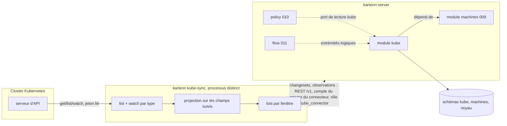

# 019 — Modèle de calcul et Kubernetes : conception

**Statut : validée le 2026-11-09 par l'utilisateur (tâche 0b).** La conception suit les décisions de l'utilisateur sur
Q-019-1 à 13 ([`decisions.md`](decisions.md) § Arbitrages, 2026-11-09) et X1 à X16 ;
elle est remise en accord avec les specs 022, 024 à 027 (tâche 0a). ADR
[0043](../../docs/adr/0043-observations-hors-referentiel.md) (observations) et
[0044](../../docs/adr/0044-connecteur-kubernetes.md) (connecteur), statut `proposed`.

## Vue d'ensemble



Deux pièces : le **module** `kube` (crate `kartenn-kube`), construit sur le contrat de
l'ADR 0026 comme la 009 (le VLAN est un objet du cœur depuis la 026 : il n'y a plus de
module `vlan` à imiter), sans changement du schéma du noyau ; le **connecteur**
(`kartenn-kube-sync`, sous-commande `kube-sync` de l'image), client REST de kartenn
(D7, Q-019-6). Le module se teste seul, par des changesets écrits à la main ; le
connecteur se teste contre un faux serveur d'API Kubernetes et un vrai serveur kartenn.

Chaîne modélisée (REQ-019-11) :

```
ingress ──routes_to──▶ service ──selects──▶ workload ─(observé)─▶ nœud ──runs_on──▶ machine ──hosted_on/in──▶ hyperviseur | cluster de virtualisation
   │                      │                                         │
   └─ adresses vip        └─ IP de cluster, externes (vip)          └─ plages de pods (réseaux)
```

## Changements

### Crates

| Crate | Changement |
|---|---|
| `kartenn-kube` (nouvelle) | domaine pur (`names.rs` : noms DNS et clés de labels ; `selector.rs` : sélecteurs d'égalité et d'ensemble ; `owner.rs` : remontée au workload ; `tracked.rs` : projection des champs suivis), `handler.rs`, `rules.rs`, `pg.rs` (feature `pg`, dont `read`), `rest.rs` (feature `rest`), `observations.rs`, `migrations/`. AGPL-3.0. |
| `kartenn-kube-sync` (nouvelle) | connecteur : configuration, client Kubernetes (`kube` sans features par défaut et `k8s-openapi` en `v1_33`, sur une pile TLS rustls et ring qui ne connaît que la CA configurée, Q-019-12), boucle list/watch, rapprochement, lots, client REST tiré du contrat OpenAPI, revue de ses droits. Binaire appelé par la sous-commande. |
| `kartenn-machines` | propriété `machines.platform`, filtre `hypervisor`, lecture `machines_of_addresses` et `machine_by_name` pour le rapprochement (REQ-019-1, 23). Additif. |
| `kartenn-policy` | porteur workload des axes, extrémités logiques, composition de la valeur d'axe d'un workload (REQ-019-32 à 35). |
| `kartenn-flow` | extrémités logiques, réévaluation, `flow.endpoint.absent` (REQ-019-35 à 37). |
| `kartenn-server` | feature `kube` (active `machines`), active par défaut comme `machines`, `policy` et `flow` ; sous-commande `kube-sync`. |
| `kartenn-core`, `kartenn-service` | additifs : rôle livré déclaré par un module (ADR 0044), inscription d'audit d'un lot d'observations et ses deux événements (ADR 0043). |
| `kartenn-bench` | jeu augmenté (X14), mesures du module et du connecteur. |

### Types d'objets (REQ-019-4 à 10)

| Type | Collection REST | Parent | `core.owner`, `core.site` | Arbre | Ancrage de domaine |
|---|---|---|---|---|---|
| `kube.cluster` | `kube-clusters` | — | obligatoire, facultatif | `kube` (racine) | — |
| `kube.node` | `kube-nodes` | cluster | hérités | `kube` | domaine des pods |
| `kube.namespace` | `kube-namespaces` | cluster | hérités | `kube` | domaine des pods |
| `kube.workload` | `workloads` | namespace | hérités | `kube` | domaine des pods |
| `kube.service` | `kube-services` | namespace | hérités | `kube` | domaine des services |
| `kube.ingress` | `ingresses` | namespace | hérités | `kube` | domaine des adresses externes, à défaut des services |

L'ancrage de domaine (ADR 0026 clause 4) place les objets d'un cluster dans ses domaines
désignés : RBAC par domaine (le rôle `kube_connector` y est lié, X10) et verrou par
domaine (ADR 0015) pour les lots du connecteur. Le cluster lui-même n'est pas ancré : il
se déclare et se lit sous ses ancres `core.owner` et `core.site`. Chaque collection est
désignée par `{id}` ; sa clé naturelle est un filtre (006/H3).

### Données (schéma `kube`, migration `0001_kube.sql`)

Esquisse ; colonnes de temps (`valid_period`, `sys_start`, `changeset_id`) et
`kartenn_make_versioned` comme la 009.

```sql
CREATE TABLE kube.cluster (
    id uuid NOT NULL, slug text NOT NULL,
    pod_domain_id uuid NOT NULL, service_domain_id uuid NOT NULL,
    external_domain_id uuid,            -- adresses LoadBalancer / externalIPs
    pod_container_ids uuid[] NOT NULL DEFAULT '{}',   -- conteneurs du noyau
    service_network_ids uuid[] NOT NULL DEFAULT '{}', -- réseaux du noyau
    machines_cluster_id uuid,           -- machines.cluster, affichage seulement
    retention_days smallint NOT NULL DEFAULT 30 CHECK (retention_days BETWEEN 1 AND 400),
    tracked_label_keys text[] NOT NULL DEFAULT '{}',   -- en plus de ceux du module
    batch_window_seconds smallint NOT NULL DEFAULT 10 CHECK (batch_window_seconds BETWEEN 1 AND 300),
    batch_max_operations integer NOT NULL DEFAULT 500 CHECK (batch_max_operations BETWEEN 1 AND 10000),
    create_node_machines boolean NOT NULL DEFAULT false,
    connector_group_id uuid,            -- groupe kartenn (025), X5 ; jamais une identité
    …, PRIMARY KEY (id, valid_period WITHOUT OVERLAPS),
    EXCLUDE USING GIST (slug WITH =, valid_period WITH &&)
);
CREATE TABLE kube.node (
    id uuid NOT NULL, cluster_id uuid NOT NULL, name text NOT NULL, uid uuid,
    machine_id uuid,                    -- machines.machine physical|virtual
    addresses jsonb NOT NULL DEFAULT '[]',  -- [{type, value}] tels que lus
    range_ids uuid[] NOT NULL DEFAULT '{}', -- réseaux du noyau (plages de pods)
    pod_cidrs cidr[] NOT NULL DEFAULT '{}', -- plages telles que lues (Q-019-14)
    zone text, absent_since timestamptz,
    …, EXCLUDE USING GIST (cluster_id WITH =, name WITH =, valid_period WITH &&),
    EXCLUDE USING GIST (machine_id WITH =, valid_period WITH &&) WHERE (machine_id IS NOT NULL)
);
CREATE TABLE kube.namespace (
    id uuid NOT NULL, cluster_id uuid NOT NULL, name text NOT NULL, uid uuid,
    labels jsonb NOT NULL DEFAULT '{}', absent_since timestamptz,
    …, EXCLUDE USING GIST (cluster_id WITH =, name WITH =, valid_period WITH &&)
);
CREATE TABLE kube.workload (
    id uuid NOT NULL, namespace_id uuid NOT NULL,
    kind text NOT NULL CHECK (kind IN ('deployment','statefulset','daemonset','cronjob',
                                       'job','replicaset','pod')),
    name text NOT NULL, uid uuid, labels jsonb NOT NULL DEFAULT '{}',
    service_account text, ports jsonb NOT NULL DEFAULT '[]',  -- déclarés
    host_network boolean NOT NULL DEFAULT false, absent_since timestamptz,
    …, EXCLUDE USING GIST (namespace_id WITH =, kind WITH =, name WITH =, valid_period WITH &&)
);
CREATE TABLE kube.service (
    id uuid NOT NULL, namespace_id uuid NOT NULL, name text NOT NULL, uid uuid,
    type text NOT NULL CHECK (type IN ('cluster_ip','node_port','load_balancer','external_name')),
    headless boolean NOT NULL DEFAULT false, external_name text,
    ports jsonb NOT NULL DEFAULT '[]',
    cluster_address_ids uuid[] NOT NULL DEFAULT '{}', external_address_ids uuid[] NOT NULL DEFAULT '{}',
    workload_ids uuid[] NOT NULL DEFAULT '{}',  -- sélection, calculée par le connecteur
    absent_since timestamptz,
    …, EXCLUDE USING GIST (namespace_id WITH =, name WITH =, valid_period WITH &&)
);
CREATE TABLE kube.ingress ( … class text, rules jsonb, tls_hosts text[], address_ids uuid[] … );
-- Paramètres du module (kube.settings.*, 027/P4, REQ-019-34 ; Q-019-35) : trois types
-- du module, versionnés, globaux, écrits par changeset sous kube.settings.edit
-- (type_permissions), lus sous kube.cluster.read.
CREATE TABLE kube.label_mapping (     -- (clé, valeur de label, axe) unique à tout instant
    id uuid NOT NULL, label_key text NOT NULL, label_value text NOT NULL,
    axis_key text NOT NULL, axis_value text NOT NULL, …
);
CREATE TABLE kube.admitted_values (   -- un objet par (namespace, axe) : l'ensemble admis
    id uuid NOT NULL, namespace_id uuid NOT NULL, axis_key text NOT NULL,
    axis_values text[] NOT NULL, …
);
CREATE TABLE kube.tracked_label (     -- clés de labels suivies dans tous les clusters
    id uuid NOT NULL, label_key text NOT NULL, …
);
-- index : node_by_machine, workload_by_namespace, service_by_workload (GIN sur workload_ids),
-- *_by_uid, labels GIN.
```

Les tableaux d'identifiants suivent le précédent de `tagged_vlan_ids` (009) : ensembles
petits, lus en bloc, références contrôlées par le gestionnaire. `labels` ne contient que
les clés suivies (X4).

Précision (2026-11-10, tâche 4b) : un cluster sans domaine externe
(`external_domain_id` nul) tient les adresses externes de ses services dans son domaine
des services, comme l'ancrage de l'ingress ; une même IP à la fois IP de cluster et
adresse externe, les deux domaines confondus, est une seule adresse du noyau, citée par
`cluster_address_ids` et `external_address_ids`.

Précision (2026-11-10, tâche 4c) : `kube.ingress.rules` est l'ensemble trié des routes
`{host, path, path_type, service, port}` (le backend par défaut est la route sans hôte,
chemin ni type), le service nommé par son nom dans le namespace, sans référence ; ses
adresses (`address_ids`) vivent dans le domaine externe du cluster, à défaut dans son
domaine des services, comme son ancrage.

**Journal d'observation** (non versionné, hors référentiel, Q-019-4, X7,
[ADR 0043](../../docs/adr/0043-observations-hors-referentiel.md)) :

```sql
CREATE TABLE kube.observation_batch (    -- un lot accepté ; son empreinte est à l'audit
    id uuid NOT NULL PRIMARY KEY, cluster_id uuid NOT NULL, author uuid NOT NULL,
    received_at timestamptz NOT NULL, opened integer NOT NULL, closed integer NOT NULL,
    content_hash bytea NOT NULL          -- SHA-256 du contenu canonique (copie de l'audit)
);
CREATE TABLE kube.pod_observation (
    cluster_id uuid NOT NULL, namespace text NOT NULL, pod_name text NOT NULL, pod_uid uuid NOT NULL,
    workload_id uuid, node_id uuid, ip inet, host_network boolean NOT NULL,
    observed tstzrange NOT NULL,        -- [vu, disparu) ; borne haute ouverte tant que vivant
    opened_batch uuid NOT NULL,         -- lot qui l'a ouverte
    closed_batch uuid,                  -- lot qui a posé la borne haute
    PRIMARY KEY (cluster_id, pod_uid, ip)
) PARTITION BY …;                        -- par temps, détail à la tâche 6 (contraintes ci-dessous)
-- index GiST (cluster_id, ip inet_ops, observed) ; btree (workload_id, observed).
```

Garde-fous tenus par le schéma et la route (REQ-019-16) :

- **Ajout seul** : le rôle PostgreSQL de l'application n'a sur `pod_observation` que
  `INSERT` et `UPDATE (observed, closed_batch)` ; un déclencheur refuse toute mise à
  jour qui ne fait pas que poser la borne haute d'une période encore ouverte (et le lot
  qui la pose). Ni `DELETE` ni `TRUNCATE`. Le test le vérifie sous le rôle de
  l'application, en SQL direct.
- **Validation à l'entrée**, dans la transaction du lot : chaque IP est dans un conteneur
  de plage de pods du cluster, dans un réseau de plage d'un de ses nœuds ou parmi les
  adresses lues de ses nœuds ; workload et nœud cités sont du cluster ; une fermeture
  vise une observation ouverte du même cluster. Un écart refuse le lot entier (422,
  `kube.observation.invalid`, lignes nommées).
- **Audit** : le noyau inscrit `observation.batch.recorded` (cluster, `opened`,
  `closed`, `hash`, lot) dans la transaction du lot ; le contenu canonique est la liste
  triée des ouvertures (toutes les colonnes sauf la borne haute) puis des fermetures
  (`pod_uid`, `ip`, borne haute), sérialisée en JSON canonique (RFC 8785). La tâche de
  fond `kube.observations_verify` (quotidienne) recalcule l'empreinte des lots dont
  aucune ligne n'est purgée (`observation_batch.earliest` après la borne de purge de
  leur cluster, Q-019-24) et inscrit `observation.batch.altered` en cas d'écart ;
  l'empreinte de l'audit scellé fait foi, la copie de `observation_batch` ne sert qu'à
  la recherche.
- **Purge** (tâche de fond `kube.observations_purge`, ADR 0023 ; Q-019-20) : par
  cluster, une fonction du propriétaire du schéma supprime les lignes fermées depuis
  plus que la rétention du cluster et avance sa borne de purge ; une partition de jour
  est détachée et supprimée quand tous les clusters l'ont dépassée ; une observation
  ouverte n'est jamais purgée. Les partitions de jours sont créées d'avance par la tâche
  de fond. Le partitionnement est fixé par la tâche 6a (précision ci-dessous).

Précision (2026-11-12, tâche 6c, migration `0007_observation_retention.sql`) : les noms
de tâches de module sont `[a-z][a-z0-9_]*` (REQ-016-16), d'où `observations_verify` et
`observations_purge`. `earliest` est le plus petit début ouvert et la plus petite fin
posée par le lot, l'instant du lot s'il n'écrit rien ; la borne de purge d'un cluster
(`kube.observation_purge_bound.purged_before`) dit que toute observation fermée du
cluster finie avant elle est supprimée : un lot est entier si `earliest` n'est pas avant
la borne scellée. Le journal tient contre un rôle applicatif compromis (Q-019-29). La
fonction `kube.observation_purge()` (propriétaire, `SECURITY DEFINER`, à l'instant de sa
transaction, sans paramètre : le rôle de l'application la déclenche sans choisir la date)
avance la borne de chaque cluster selon la plus grande rétention de ses versions, en
temps valide et en temps système (`kube.cluster_history`), en vigueur dans la fenêtre de
leur propre rétention (sinon la dernière version), jamais en arrière, supprime ses
fermées finies avant elle (et ses ouvertes, pour un cluster clos avant elle), crée les jours d'aujourd'hui à sept jours, puis supprime
(`DROP`) les jours dont la fin précède la plus petite borne ; créations et suppressions
viennent en dernier, leur verrou sur `pod_observation_closed` n'étant tenu que jusqu'à la
validation. Elle rend une ligne par cluster, que la tâche scelle
(`observation.journal.purged` : `before`, `after`, `deleted`, `dropped`). Un
déclencheur refuse une ligne ouverte ou fermée sous un lot qui n'est pas écrit par la
transaction (`xmin` du lot), un autre refuse un lot dont `received_at` n'est pas `now()`.
La vérification compare d'abord chaque borne à la plus grande `after` scellée de son
cluster (`purge_bound`), puis lit par un curseur, en une seule requête donc un seul
instantané, les événements `observation.batch.recorded` groupés par le détail `batch`,
les bornes scellées et les lignes : pour chaque lot, un seul événement (sinon
`event_duplicated`, ou `event_missing` hors d'un mois que l'audit a purgé, où la copie de
`observation_batch` sert d'empreinte attendue), son `recorded_at` égal à `received_at`
(`received_at`), son `earliest` égal au scellé (`earliest`), puis, si la borne scellée ne
l'a pas atteint, son empreinte recalculée (`content`). Un écart est signalé à chaque
passage, un par lot (cible : le cluster ; `outcome` `failure`, `reason` l'écart), par
`ModuleTx::audit` dans la transaction de la tâche (ADR 0026, amendement 13).

Un pod en `hostNetwork` est noté sans `ip` (l'adresse est celle du nœud).

Précision (2026-11-11, tâche 6a, migration `0006_observation.sql`) : `pod_observation`
est partitionnée par liste sur `upper_inf(observed)` : une partition des observations
ouvertes, et celle des fermées, partitionnée par intervalle sur `upper(observed)`, un
jour UTC par partition (`pod_observation_AAAAMMJJ`), créée par la fonction du
propriétaire `kube.observation_partition(jour)` quand un lot ferme dans ce jour ; une
fermeture déplace la ligne de la partition des ouvertes vers son jour. Une clé
d'expression n'admet pas de clé primaire, et `ip` est nulle en `hostNetwork` : l'unicité
porte sur les seules ouvertes (`(cluster_id, pod_uid, ip) NULLS NOT DISTINCT`), la
validation refuse le reste ; un index (`cluster_id`, `pod_uid`) sert ces contrôles dans
chaque partition. `opened_batch` et `closed_batch` sont des clés étrangères vers
`observation_batch` : aucune fin ne se pose hors d'un lot accepté. Les partitions de
jours sont communes aux clusters ; la purge est par cluster (Q-019-20) : une fonction du
propriétaire supprime les lignes d'un cluster passées sa rétention, sous une borne de
purge écrite par cluster (lue par la vérification), et un jour est détaché et supprimé
quand tous les clusters l'ont dépassé. L'écriture d'un lot
(`kartenn_kube::observations::record`) : lots d'un cluster sérialisés (verrou
consultatif de transaction) ; les jours des fermetures créés avant toute lecture du
journal, pour qu'aucun lot ne tienne une lecture des fermées en attendant le verrou de
création d'un jour (sans cycle entre deux clusters) ; une fermeture qui ne met rien à
jour refuse le lot ; une ouverture identique à une
observation ouverte n'écrit rien et n'est pas comptée (reprise du connecteur après un
redémarrage), différente elle refuse le lot, comme la réouverture d'une observation
fermée ; une fermeture doit suivre le début ; un instant à venir est ramené à celui du
lot. Le contenu canonique est le tableau JSON `[ouvertures, fermetures]`, chaque liste
triée par (`pod_uid`, `ip`), instants en RFC 3339 UTC à la microseconde.

### Opérations

| `op` | Auteur, permission | Rôle |
|---|---|---|
| `kube.create_cluster` / `update_cluster` | administrateur, `kube.cluster.edit` | déclaration du cluster (domaines, plages, rétention, labels suivis propres, fenêtre de lot, groupe du connecteur) ; `owner`, `site` planifiés |
| `kube.sync` | connecteur (membre du groupe du connecteur), `kube.<type>.edit` des objets écrits | lot : `upsert` et `close` d'objets par identifiant externe, `mark_absent`, `clear_absent` ; crée et clôt les réseaux de plages et les adresses `vip` qu'il cite ; à l'`upsert` d'un workload, pose `kube.namespace` et **dérive** les valeurs d'axes de ses labels suivis, admises dans son namespace (`AssignProperty`, `UnassignProperty` du noyau planifiés, ADR 0026 clause 6, sous leurs propres droits ; Q-019-33) ; le `close` d'un namespace cité par des valeurs admises devient un `mark_absent`, avertissement `kube.namespace.held` (précision de Q-019-35, 2026-11-12) |
| `kube.set_label_mapping {action: upsert\|close, …}` | `kube.settings.edit` (globale, 027/P4, P5 ; par `type_permissions` du type `kube.label_mapping`, Q-019-35) | `upsert {label_key, label_value, axis, value}` crée la correspondance de (clé, valeur de label, axe) ou change sa valeur d'axe ; `close {id}` la clôt |
| `kube.set_admitted_values {namespace: {id}, axis, values}` | idem (`kube.admitted_values`) | remplace l'ensemble des valeurs admises de l'axe dans le namespace ; un ensemble vide clôt l'objet |
| `kube.set_tracked_labels {keys}` | idem (`kube.tracked_label`) | remplace la liste des clés de labels suivies du module : crée les clés nouvelles, clôt les absentes |

Une correspondance ne vise ni `kube.namespace` (géré par le serveur, Q-019-39) ni une
propriété sensible ; son axe est une liste fermée portée par `kube.workload`, sa valeur
une valeur vivante de cette liste ; les valeurs admises sont des valeurs vivantes de la
liste de l'axe (`kube.operation.invalid` sinon) ; écrire des valeurs admises demande
aussi `kube.namespace.read` sur leur namespace (tâche 7c). Le changeset qui écrit un paramètre
re-dérive les affectations des workloads concernés (Q-019-36, tâche 7d3).

Une écriture suit la grammaire de la 024 (M7) : `edit` crée et soumet le changeset,
`approval.self` l'applique dans la même requête, `apply` applique celui d'un autre.

Une seule opération de synchronisation, qui porte un lot, garde le changeset compact
(une enveloppe, N lignes) et fait passer tout le lot par la même validation. Clés de
verrou : `kube.cluster:<id>` (deux lots d'un même cluster ne se croisent pas), puis les
domaines touchés.

### Règles

| Identifiant | Sévérité | Quand |
|---|---|---|
| `kube.object.managed` | erreur | champ suivi écrit par un autre auteur qu'un compte de service membre du groupe du connecteur du cluster (REQ-019-12) |
| `kube.connector.direct` | erreur | changeset d'un membre d'un groupe de connecteur qui porte une autre opération que `kube.sync` (REQ-019-30) |
| `kube.operation.invalid` | erreur | opération mal formée : champ inconnu ou manquant, valeur hors bornes (rétention, fenêtre de lot), objet cité inconnu ou domaine qui ne vit pas sur la période, domaine des pods d'un cluster changé tant qu'il a des nœuds ou des namespaces vivants, ancrés dans ce domaine (ajoutée à la tâche 3b, comme `machines.operation.invalid`) |
| `kube.cluster.range_domain` | erreur | plage hors du domaine désigné |
| `kube.cluster.connector_group` | erreur | groupe du connecteur inexistant ou clos sur la période |
| `kube.node.duplicate`, `kube.namespace.duplicate`, `kube.workload.duplicate`, `kube.service.duplicate`, `kube.ingress.duplicate` (ajoutée à la tâche 4c) | erreur | identité en double sur des périodes chevauchantes |
| `kube.node.machine_kind` | erreur | machine désignée ni `physical` ni `virtual`, ou déjà désignée |
| `kube.name.invalid`, `kube.label.invalid` | erreur | nom ou label hors syntaxe (réf. § Namespace, labels) |
| `kube.node.range_outside` | avertissement | plage de pods hors des conteneurs déclarés |
| `kube.node.unmatched` | avertissement | nœud sans machine ou correspondance ambiguë |
| `kube.object.absent` | avertissement | objet cité disparu du cluster |
| `kube.ingress.backend_missing` | avertissement | règle d'ingress vers un service absent |
| `kube.label.not_admitted` | avertissement | valeur d'axe d'un label non admise dans le namespace : règle du serveur, levée par la dérivation de `kube.sync` ou du changeset des paramètres (Q-019-33) |
| `kube.namespace.managed` | erreur | affectation ou retrait de `kube.namespace` autre que ceux que planifie `kube.sync` (`CheckContext::operations`, Q-019-39) |
| `kube.namespace.held` (ajoutée à la tâche 7c) | avertissement | namespace absent de son cluster que des valeurs admises gardent : le `close` du connecteur est devenu un `mark_absent` ; l'avertissement nomme les valeurs admises à retirer, son anomalie se ferme à leur retrait ou au retour du namespace (précision de Q-019-35, 2026-11-12) |
| `kube.machine.looks_like_pod` | avertissement | machine `container` qui ressemble à un pod (REQ-019-3) : évaluée par le module kube sur les opérations de machines du changeset (`CheckContext::operations`), observations ouvertes seules ; levée seulement pour un auteur qui tient `kube.observation.read` sur le domaine des pods du cluster du nœud, sans quoi elle ferait oracle ; le pod n'est jamais nommé, l'avertissement et son anomalie disent « ressemble à un pod d'un cluster » ; réévaluée quel que soit l'auteur sur une machine qui n'y ressemble plus (close, renommée, déplacée), dont l'anomalie se ferme (Q-019-32, deux amendements) |
| `kube.sync.stale` | avertissement | cluster sans lot ni signet depuis 10 min (connecteur arrêté) |

Hors règles : `kube.observation.invalid` est le code du Problem Details (422) d'un lot
d'observations refusé à l'entrée ; un lot ne passe pas par le pipeline des règles.

Précision (2026-11-11, tâche 5b) : `mark_absent` et `clear_absent` ne portent que
l'identité de l'objet ; `absent_since` est le début de la période de l'opération (instant
d'observation, REQ-019-24), gardé par une seconde observation ; un `upsert` de la même
identité lève l'absence. `kube.object.absent` vaut pour tout objet absent, ses dépendants
connus dans son message et ses sujets : services qui sélectionnent un workload, ingress
qui routent vers un service par son nom, workloads, services et ingress d'un namespace,
objets qui portent une propriété de référence vers lui ; elle est réévaluée sur les objets
écrits et les absents qu'ils citent. Un service absent manque à l'ingress qui le vise
(`kube.ingress.backend_missing`).

### Droits, rôles et audit (X10, X16)

| Permission | Global | Objet |
|---|---|---|
| `kube.cluster.{read,edit,apply,approval.self}` | — | déclaration d'un cluster |
| `kube.node.*`, `kube.namespace.*`, `kube.workload.*`, `kube.service.*`, `kube.ingress.*` (mêmes actions) | — | objets miroirs (champs suivis réservés au connecteur par `kube.object.managed`) |
| `kube.observation.read` | — | journal d'observation, sur le domaine des pods du cluster (Q-019-23) |
| `kube.observation.record` | — | lot d'observations (rôle `kube_connector` seulement), sur le domaine des pods du cluster (Q-019-23) |
| `kube.settings.{edit,apply,approval.self}` | oui | paramètres du module, types `kube.label_mapping`, `kube.admitted_values`, `kube.tracked_label` par `type_permissions` (lus sous `kube.cluster.read`, pas de `kube.settings.read`, Q-019-35) |

Rôles livrés : lecteur, éditeur, approbateur reçoivent `kube.<type>.read` ;
l'approbateur, `kube.<type>.apply` ; `kube.observation.read` n'est dans aucun des
trois. Rôle livré par le module : `kube_connector` (contenu en X10), lié au groupe du
connecteur sur les domaines désignés du cluster ; le module le déclare au registre
(ajout au contrat, ADR 0044) et la synchronisation des rôles livrés le crée.

Événements d'audit nouveaux (catalogue du noyau, ADR 0043) : `observation.batch.recorded`
(INFO, criticité normale ; `journal`, `cluster`, `batch`, `opened`, `closed`, `hash`,
`clamped`, `skew_max` : lignes datées après l'instant du lot et ramenées à lui, leur plus
grande avance en millisecondes, Q-019-26) et
`observation.batch.altered` (ERROR, criticité haute ; `journal`, `batch`, `expected`,
`found`). Le premier s'inscrit dans la transaction du lot par `record_in(tx, event)` du
port du journal PostgreSQL ; un lot vide est audité comme les autres (Q-019-21, 22). Ils
apparaissent dans `docs/spec/evenements-audit.md` et `evenements-audit.schema.json`,
générés, quand le code les déclare (tâche 6).

### Événements poussés (022)

Aucun type d'événement propre (ADR 0026 clause 10) : un changeset qui écrit des objets
`kube.*` (lot du connecteur, déclaration d'un cluster, paramètres) produit l'événement
`changes` commun, filtrable par `types=kube.workload…` et par `domains` (ancrage de
domaine), sous les droits de lecture de chaque objet ; un lot de 500 opérations est un
seul événement (REQ-022-5). Un lot d'observations n'en produit aucun : il n'est pas un
changeset et n'entre pas dans l'outbox.

### Propriétés

| Clé | Type | Porteurs | Héritage |
|---|---|---|---|
| `machines.platform` | liste fermée simple, livrée vide | `machines.machine` | aucun |
| `kube.namespace` | référence externe (système `kube`, déclaré par le module, Q-019-38) | `kube.workload` | aucun (posée par `kube.sync` seul, Q-019-39 ; identifiant `<id du cluster>/<nom>`, libellé `<slug du cluster>/<nom>`, Q-019-37) |

Les axes de la politique portés par un workload (REQ-019-32) : une déclaration n'hérite
que le long d'**un** arbre (`Declaration::inherit`, `kartenn-core/src/properties.rs`). La
composition « workload, sinon namespace, sinon cluster, sinon arbre d'adressage sur la
plage de pods » est donc faite par la **lecture** (`kartenn_kube::read::axis_values`),
comme la 010 compose déjà valeur de machine et valeur de l'arbre (010/S27, REQ-010-31),
sans changer le noyau. L'explication cite le porteur qui a servi. Les trois premiers
niveaux sont les origines que le noyau tient pour une propriété héritable (un objet de
module hérite le long de l'arbre de son module, REQ-008-6), le workload seul pour une
propriété qui ne l'est pas. Le dernier lit la valeur de l'arbre d'adressage sur chaque
**conteneur de plages de pods** du cluster (`pod_container_ids`) à la date : la plage
d'un pod n'est connue que par le journal, hors du référentiel et sous
`kube.observation.read` ; les plages des nœuds sont sous ces conteneurs et en héritent.
Chaque conteneur qui a une valeur en donne une ; leur union, comme celle des machines
d'une adresse (REQ-010-31), est au lecteur. Un cluster sans conteneur déclaré lit le
domaine des pods (`pod_domain_id`). Jamais les plages observées par le journal (Q-019-30,
tâche 7a).

### Références (D33)

| Source | Cible | Politique |
|---|---|---|
| nœud, namespace | cluster | refus ; cascade : clôt |
| workload, service, ingress | namespace | refus ; cascade : clôt |
| nœud | machine (009) | refus ; cascade : mise à nul |
| nœud | réseau de plage (noyau) | refus ; cascade : clôt le réseau avec le nœud (le connecteur) |
| service, ingress | adresse `vip` (noyau) | refus ; cascade : clôt l'adresse avec son dernier porteur (partagée entre les services et ingress d'un cluster, Q-019-17, ADR 0026 amendement 10) |
| service | workload | mise à nul (retrait de la sélection) |
| valeurs admises (`kube.admitted_values`) | namespace | refus (Q-019-35) ; le `close` de `kube.sync` devient un `mark_absent` (`kube.namespace.held`) |
| cluster | domaines, conteneurs, réseaux | refus |
| flux (011) | workload, namespace, service | refus ; le connecteur passe l'objet absent (REQ-019-22) |

La mise à nul service → workload vaut sans cascade pour la clôture d'un workload par
`kube.sync` : le gestionnaire y ajoute le retrait du workload de la sélection de chaque
service qui le cite ; une clôture directe sans cascade reste refusée (D33, le noyau ne
met à nul qu'en cascade).

### Section de différentiel `kube.objects`

Une ligne par portion de temps sur laquelle un objet miroir est créé, modifié, clos,
passé absent ou présent de nouveau (un objet en a plusieurs quand l'écriture couvre
plusieurs de ses versions), comme `machines.attachments` : type, objet, période, état
avant et après, absent pour une création (avant) ou une clôture (après). La 010 la lit
pour savoir quels workloads changent d'axe ou de sélection ; la 011 pour réévaluer
(REQ-019-36). Le cluster, déclaré et non reflété, n'y figure pas.

L'état est un objet JSON à liste fermée de champs, aux noms stables, indépendants des
colonnes (Q-019-19) ; les références sont des identifiants, `absent_since` un instant
RFC 3339 en UTC (`Z`) ou `null` :

| Type | Champs |
|---|---|
| `kube.node` | `cluster`, `name`, `uid`, `machine`, `addresses` (`[{type, value}]`), `pod_networks` (réseaux du noyau), `zone`, `absent_since` |
| `kube.namespace` | `cluster`, `name`, `uid`, `labels`, `absent_since` |
| `kube.workload` | `namespace`, `kind`, `name`, `uid`, `labels`, `service_account`, `ports`, `host_network`, `absent_since` |
| `kube.service` | `namespace`, `name`, `uid`, `service_type`, `headless`, `external_name`, `ports`, `cluster_addresses`, `external_addresses`, `workloads`, `absent_since` |
| `kube.ingress` | `namespace`, `name`, `uid`, `class`, `rules`, `tls_hosts`, `addresses` (adresses du noyau), `absent_since` |

### Port de lecture (`kartenn_kube::read`)

| Fonction | Rend |
|---|---|
| `workloads_of(namespace | service | cluster, valid_at, as_of)` | workloads (identifiant, namespace, cluster, sorte, nom), par nom de namespace puis nom et sorte |
| `axis_values(workloads, keys, valid_at, as_of)` | par workload et clé : valeurs, porteur source (`workload`, `namespace`, `cluster`, `tree`), objet qui tient l'affectation et objet pour lequel elle est résolue (le workload, ou le conteneur de plages de pods) ; une requête pour le lot (tâche 7a) |
| `execution_chain(workload, valid_at, reader)` | nœuds observés, machines, hyperviseurs, clusters de virtualisation, encadrée comme `who_had` (Q-019-31) : `kube.observation.read` sur le `pod_domain` du cluster exigé du lecteur ; motif `retention` au-delà de la rétention, `closed` pour un objet clos, `unobserved` (chaîne vide) pour un workload jamais observé ; la lecture est journalisée (`record_read`) ; précisions (tâche 7b) : un maillon par nœud vu à la date (observations dans la rétention, `of_workload`), sa machine par `kube.runs_on`, l'hyperviseur ou le cluster de virtualisation par `machines.hosted_on` / `hosted_in`, tous à la date ; rien (`None`) pour un workload inconnu ou un lecteur sans le droit, comme les routes répondent 404 ou 403 ; le port journalise lui-même (`data.objects.read`, les pods dont il s'est servi), sauf un objet clos, qui ne l'est pas plus qu'un 410 |
| `who_had(ip, domain, at, reader)` | observations (pod, workload, nœud) des seuls clusters où le lecteur a `kube.observation.read` ; vide hors rétention, motif `retention` ; `ip` une adresse ou un réseau, un pod en `hostNetwork` répondu par les adresses de son nœud à `at` (tâche 6d) ; un cluster clos du domaine qui vivait à `at` ne répond rien, motif `closed`, qui l'emporte sur `retention` ; l'appelant journalise la lecture (Q-019-28) |
| `service_addresses(service, …)` | adresses `vip` |

### Connecteur

**Configuration** (TOML, comme `kartenn.toml`) : URL de kartenn et fichier du secret du
compte de service ; par cluster : slug kartenn, URL du serveur d'API, fichier de la CA,
fichier du jeton (relu à chaque renouvellement) ou couple certificat/clé ; période du
repli ; `allow_excess_rights` (défaut faux). La fenêtre de lot n'est pas un réglage
local : c'est une propriété du `kube.cluster` (REQ-019-5), lue au démarrage et relue à
chaque lot.

**Démarrage** : lit la déclaration du cluster dans kartenn
(`GET /v1/kube-clusters?slug=<slug>`, puis par `{id}`), vérifie que son compte est
membre du groupe du connecteur que désigne le cluster (`GET /v1/me`) et refuse sinon ; interroge ses droits sur le cluster
par une revue d'accès sur soi (API d'autorisation de Kubernetes,
https://kubernetes.io/docs/reference/access-authn-authz/authorization/ , « Checking API
access » ; non relu par la recherche de la note, à vérifier à la tâche 13) et refuse de
démarrer si un verbe d'écriture ou `secrets` est permis (REQ-019-28).

**Boucle par type** (nœuds, namespaces, contrôleurs, pods, services, EndpointSlices,
ingress) :
1. liste par pages (`limit`, `continue`) ; reprise du début si le jeton expire (410) ;
2. **rapprochement** : état de kartenn du cluster lu par l'API, différence calculée sur
   les champs suivis, objets absents de la liste clos ou passés absents ;
3. watch depuis la `resourceVersion` de la liste, `allowWatchBookmarks=true` ; la
   dernière version reçue (événement ou signet) est gardée en mémoire ; coupure : reprise
   à cette version ; `410 Gone` : retour en 1 ;
4. chaque événement est projeté (X4) ; un pod alimente le journal (début ou fin
   d'observation) et, par ses `ownerReferences`, la remontée à son workload (cache des
   ReplicaSets et Jobs vers leur contrôleur) ;
5. la sélection d'un service est l'ensemble des workloads des pods de ses EndpointSlices,
   dédoublonnés sur tous les slices du service (réf. § EndpointSlice) ; un service sans
   sélecteur garde ses endpoints au journal seulement ;
6. **lots** : différences regroupées par fenêtre en un changeset `kube.sync`
   (`Idempotency-Key` = empreinte du cluster, du type et de la fenêtre), observations en
   un lot `POST /v1/kube-clusters/{id}/observations`.

Ordre des lots : namespaces et nœuds avant workloads, workloads avant services, pour que
les références existent. Le connecteur garde en mémoire l'état projeté du cluster (pas
de stockage local) : un redémarrage refait la liste et le rapprochement.

**Métriques** (OpenTelemetry, D35) : retard du dernier lot, reprises, relistes, lots
refusés, objets absents, mode de repli.

### Politique et flux (amendements de la 010 et de la 011)

- **010** : `Carrier::Workload` à côté de l'arbre et de la machine (REQ-010-29) ;
  `Endpoint::Workload | Namespace | Service` (REQ-010-13) ; l'instantané (ADR 0030) ne
  change pas, l'évaluation reçoit pour une extrémité logique un « point » portant ses
  valeurs d'axes au lieu d'une adresse ; une paire d'extrémités logiques donne un
  verdict. Un namespace développe ses workloads ; un service développe ses workloads
  (source dans le cluster) ou ses adresses `vip` (source hors du cluster, sans
  traduction : la destination effective après NAT relève de la v0.4). `hostNetwork` :
  adresses des machines des nœuds observés, suivant D22.
- **011** : extrémités logiques acceptées (REQ-011-2) ; réévaluation sur la section
  `kube.objects` et sur les changements de propriétés des porteurs `kube.*`
  (REQ-011-11) ; évaluations matérialisées (ADR 0031) inchangées, une ligne par paire
  logique ; avertissement `flow.endpoint.absent`.
- **Labels** (Q-019-33, 34, 36) : le **serveur** dérive. À chaque `upsert` d'un workload,
  `kube.sync` lit ses labels suivis, les correspondances `kube.label_mapping` (globales)
  et les valeurs admises `kube.admitted_values` de son namespace, et planifie les
  affectations d'axe (`AssignProperty` du noyau, provenance `module:kube#label:<clé>`,
  ADR 0026 amendement 14) et les retraits (`UnassignProperty`) de celles qu'un label
  disparu ou une correspondance close ne justifie plus ; une valeur non admise est
  ignorée et lève `kube.label.not_admitted`. Le changeset qui écrit un paramètre
  re-dérive de même les workloads concernés, par leurs labels stockés (index GIN
  `workload_labels`), dans sa transaction ; son auteur doit tenir les droits de
  propriété sur l'effet, sinon le changeset reste une proposition. Une affectation de
  provenance `input` sur le même workload l'emporte : la dérivation ne la remplace ni ne
  la retire. Le connecteur ne lit les paramètres que pour savoir quelles clés suivre
  (X4) ; il n'envoie jamais d'affectation d'axe. Précisions de la tâche 7d2 (choix
  réversibles) : sans valeurs admises pour un axe dans le namespace, rien n'y est admis ;
  deux labels qui donnent un même axe : la valeur admise du label de la plus petite clé
  l'emporte ; une correspondance dont l'axe ou la valeur n'est plus valide est ignorée sans
  avertissement ; `kube.namespace` porte la provenance `module:kube#namespace` ; un
  `upsert` qui ne change rien n'écrit aucune affectation.

### Routes

| Route | Rôle |
|---|---|
| `GET, POST /v1/kube-clusters` (filtre `?slug=`) ; `GET, PATCH, DELETE /v1/kube-clusters/{id}` | déclaration (`kube.cluster.*`) |
| `POST /v1/kube-clusters/{id}/observations` | lot d'observations (`kube.observation.record`, membre du groupe du connecteur ; corps `{opened, closed}`, workload et nœud en références `{id}` ; au plus `batch_max_operations` lignes ; 201 `{id, received_at, opened, closed, hash}`, empreinte en hexadécimal ; 422 `invalid-batch`, `code` `kube.observation.invalid`, `violations` à pointeurs JSON ; un lot vide est audité comme les autres ; Q-019-21) |
| `GET /v1/kube-clusters/{id}/observations?ip=&at=` ; `GET /v1/workloads/{id}/observations` | journal (`kube.observation.read`, domaine des pods du cluster ; `ip=` une adresse ou un réseau ; hors rétention 200 avec `items: []` et `reason: "retention"` ; lectures journalisées par `record_read` ; Q-019-25 ; pages par curseur, triées par début, pod et IP, sans `valid_at` ni `as_of` ; cluster ou workload invisible ou absent → 404, visible sans le droit → 403 journalisé, comme l'écriture ; clos (ou workload d'un cluster clos) → 410 `gone`, Q-019-28) |
| `GET /v1/kube-nodes`, `/v1/kube-namespaces`, `/v1/workloads`, `/v1/kube-services`, `/v1/ingresses` (+ `/{id}`) | lectures datées, filtres de REQ-019-38 (`kube.<type>.read`) |
| `GET /v1/workloads/{id}/chain` | chaîne d'exécution |
| `GET, POST /v1/kube-label-mappings`, `GET, PATCH, DELETE /v1/kube-label-mappings/{id}` ; `PUT /v1/kube-namespaces/{id}/admitted-values` ; `GET, PUT /v1/kube-tracked-labels` | paramètres du module (`kube.settings.*`), un changeset d'une opération (`If-Match`) |
| `GET /v1/machines?hypervisor=true` (009) | hyperviseurs |

Les objets miroirs n'ont pas de `POST`/`PATCH` de champs suivis : ils s'écrivent par
`kube.sync` dans un changeset. Toute route désigne un objet par `{id}` (006/H3).

### Interface

`web/plugins/kube/` (MPL-2.0), manifeste `"module": "kube"` ; vues `kube-clusters`,
`workloads` ; onglet `workloads` sur `address` et `prefix` ; panneau « chaîne
d'exécution » sur `machines.machine` ; maquettes d'abord (017/U14). Le plugin se tient à
jour par les événements `changes` filtrés sur les types `kube.*` (022) ; le journal
d'observation n'émet rien : l'onglet « Workloads » relit à la demande.

## Volumétrie (X14)

| Élément | Lignes courantes | Versions sur 3 ans (estimation) |
|---|---|---|
| clusters, nœuds | 2·10³ | ≈ 10⁴ (renouvellement de nœuds) |
| namespaces | 10⁴ | ≈ 3·10⁴ |
| workloads | 10⁵ | ≈ 6·10⁵ (2 changements suivis par an) |
| services, ingress | 6·10⁴ | ≈ 4·10⁵ (sélections) |
| adresses `vip`, réseaux de plages | 7·10⁴ | ≈ 2·10⁵ |
| observations | 3·10⁶ (fenêtre de 30 jours) | — (purgées) |

Soit moins de 2·10⁶ versions ajoutées au référentiel, dans la marge de D2. Sans X4 ni
X7 (Q-019-3 B), l'ordre de grandeur serait 10⁸.

## Exigences envers le noyau, la 009, la 010 et la 011

| # | Besoin | Tenu par |
|---|---|---|
| B1 | objets de module porteurs de propriétés, arbre de module | ADR 0026 clauses 4, 5 (fourni) |
| B2 | opérations du noyau planifiées par un lot (réseaux, adresses `vip`, affectations) | clause 6 (fourni) |
| B3 | auteur du changeset et opérations qu'il a écrites, lisibles par une règle (`kube.object.managed`, `kube.connector.direct`) | `CheckContext::author` et `CheckContext::operations` (amendement 11, additif, Q-019-18, fourni par la tâche 5a) |
| B4 | route hors changeset auditée par lot | ADR 0043 : inscription d'audit d'un lot par le noyau, `observation.batch.recorded` et `.altered`, inscrits par `record_in(tx, event)` (fourni, tâche 6b ; ADR 0019 et 0026, amendements du 2026-11-11) |
| B5 | adresses d'une machine par adresse et machine par nom | 009, ajout additif |
| B6 | porteur workload, extrémités logiques | amendements de la 010 et de la 011 (tâches 12, 13) |
| B7 | rôle de connecteur confiné à un cluster | pas de périmètre « objet de module » (ADR 0026 clause 4) : groupe du connecteur (025/G1, G2) lié au rôle `kube_connector` sur les domaines désignés du cluster, types `kube.*` ancrés sur ces domaines, règles `kube.object.managed` et `kube.connector.direct` (X10, ADR 0044) |
| B8 | rôle livré par un module | ajout additif au contrat de module (ADR 0026 clause 8, ADR 0044), à fournir (tâche 11) |
| B9 | identifiants des objets du noyau créés par un lot, cités par ses données | crochet `ModuleHandler::planned`, amendement 8 (additif, clause 6) de l'ADR 0026 (Q-019-14), fourni (tâche 3a) |
| B10 | provenance d'une valeur dérivée d'un label, distincte d'une saisie | forme `module:<module>#<motif>` du noyau, portable par une opération planifiée par un module seulement, migration du `CHECK` de `0011_properties.sql` (`0078`), donnée par le crochet `ModuleHandler::provenance` : amendement 14 de l'ADR 0026 (Q-019-34), fourni (tâche 7d1) |
| B11 | système externe `kube` de l'axe `kube.namespace` | systèmes externes dans `ModuleDeclarations` (`external_systems`), valeurs de `core.external_system` par la synchronisation du noyau : amendement 15 de l'ADR 0026 (Q-019-38), fourni (tâche 7d1) ; le module déclare le système `kube` et l'axe `kube.namespace` (tâche 7d2) |

## Erreurs et cas limites

- Deux clusters aux plages de pods identiques : domaines distincts (Q-019-5), pas de
  conflit ; si l'administrateur leur désigne le même domaine, l'unicité des réseaux
  refuse le second lot (`core.prefix.duplicate`), le connecteur le signale.
- Nœud recréé sous le même nom (réf. § Node) : même `kube.node`, nouvel UID noté.
- Pod sans IP (phase `Pending`) : pas d'observation tant que `podIPs` est vide.
- Workload sans pod (réplicas à zéro) : présent, sans observation ; la politique
  l'évalue sur ses axes.
- Service `external_name` : pas d'adresse ; extrémité refusée comme destination de flux
  (`flow.endpoint.no_address`), le FQDN étant hors du modèle de la 010.
- Lot refusé par une règle d'erreur (par exemple plage dans un domaine mal désigné) : le
  connecteur garde la différence, la renvoie à la fenêtre suivante, et lève
  `kube.sync.rejected` dans ses métriques ; il ne boucle pas plus d'une fois par minute.
- Connecteur arrêté : `kube.sync.stale` ; les objets restent tels qu'au dernier lot.
- Domaine des pods changé sur un cluster qui a des nœuds ou des namespaces vivants :
  refusé (`kube.operation.invalid`, Q-019-15) ; pas de ré-ancrage.
- Domaine des services ou des adresses externes changé (posé ou retiré compris) sur un
  cluster qui a des services ou des ingress vivants : refusé de même (Q-019-17,
  tâche 4f).
- Proposition forcée (016/G12) ou approbation exigée par un lot (mesure `policy.opens`
  dépassée par une valeur de label) : le lot reste un changeset `pending` (024 : le
  compte a `approval.self`, mais la politique le retient) ; le connecteur attend sa
  décision avant les lots qui en dépendent (à affiner à la
  tâche 13).

## Alternatives considérées

- Pod comme objet versionné ou adresse du noyau : Q-019-3 B, rejeté (volume).
- Sélection d'un service recalculée par kartenn à partir des labels : exige de stocker
  tous les labels des gabarits (churn) ; le connecteur la calcule et ne transmet que
  l'ensemble.
- Nœud comme `kind` de machine : X2.
- Connecteur dans le serveur : Q-019-6 B.
- NetworkPolicy importées comme règles de la 010 : sémantiques incompatibles (union
  d'autorisations par pod, sans refus) ; une comparaison est une évolution (Q-019-10).

## Risques

- Gros clusters : la liste initiale des pods (10⁴ par cluster) et la remontée aux
  workloads tiennent en mémoire du connecteur (≈ quelques Mo par 10⁴ objets projetés) ;
  à mesurer au banc.
- Labels de version dans les gabarits : exclus par défaut, mais un administrateur peut en
  ajouter à la liste suivie ; documenter le coût.
- Escalade par labels : bornée par les valeurs admises (Q-019-7), paramètres écrits
  sous `kube.settings.*` seulement ; une valeur qui ouvre des flux passe par le
  différentiel et une politique d'approbation peut retenir le lot.
- Connecteur compromis : il peut faire porter une IP à un autre workload de son cluster
  dans le journal (attribution fausse en enquête) ; borné par la validation des IP, le
  cluster, l'ajout seul et l'audit par lot (X7), pas supprimé.
- Écart d'horloge entre cluster et kartenn sur `creationTimestamp` : date bornée par
  l'instant d'observation (jamais dans le futur).
- Délai sous charge : 50 écritures/s (D14) partagées avec les humains ; une fenêtre de
  10 s garde un changeset par cluster et par fenêtre.

## Stratégie de test

- Domaine pur : noms DNS et labels (réf.), sélecteurs, remontée `ownerReferences`
  (ReplicaSet → Deployment, Job → CronJob, pod nu), projection des champs suivis (un
  changement d'image ne produit rien).
- Intégration PostgreSQL : unicités, références et cascades, `kube.object.managed`,
  absence, lecture `axis_values` (composition et explication), journal (partitions,
  purge, `who_had`).
- Connecteur : faux serveur d'API (réponses de liste et de watch scriptées, coupure,
  `410`, signets, droits en trop) contre un vrai serveur kartenn de test ; convergence
  vérifiée par un oracle (état projeté du faux serveur = état de kartenn).
- Politique et flux : verdicts workload × workload, namespace, service, `hostNetwork` ;
  réévaluation sur changement de label admis.
- HTTP, plugin (Playwright, axe-core), bancs (X14). Un essai contre un vrai cluster
  local reste manuel (hors CI) et documenté dans `docs/exploitation/`.

## ADR

Rédigées le 2026-11-09, statut `proposed`, acceptées à la tâche 17 :
[0043 — Observations : hors référentiel, hors changesets](../../docs/adr/0043-observations-hors-referentiel.md)
(Q-019-4 et ses garde-fous) ;
[0044 — Connecteur Kubernetes : processus distinct, lecture seule, droits vérifiés](../../docs/adr/0044-connecteur-kubernetes.md)
(Q-019-6, X8, X10).
