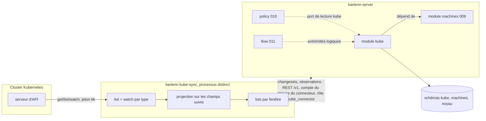

# 019 — Modèle de calcul et Kubernetes : conception

**Statut : validée le 2026-11-09 par l'utilisateur (tâche 0b).** La conception suit les décisions de l'utilisateur sur
Q-019-1 à 13 ([`decisions.md`](decisions.md) § Arbitrages, 2026-11-09) et X1 à X16 ;
elle est remise en accord avec les specs 022, 024 à 027 (tâche 0a). ADR
[0043](../../docs/adr/0043-observations-hors-referentiel.md) (observations) et
[0044](../../docs/adr/0044-connecteur-kubernetes.md) (connecteur), statut `proposed`.

## Vue d'ensemble



Deux pièces : le **module** `kube` (crate `kartenn-kube`), construit sur le contrat de
l'ADR 0026 comme la 009 (le VLAN est un objet du cœur depuis la 026 : il n'y a plus de
module `vlan` à imiter), sans changement du schéma du noyau ; le **connecteur**
(`kartenn-kube-sync`, sous-commande `kube-sync` de l'image), client REST de kartenn
(D7, Q-019-6). Le module se teste seul, par des changesets écrits à la main ; le
connecteur se teste contre un faux serveur d'API Kubernetes et un vrai serveur kartenn.

Chaîne modélisée (REQ-019-11) :

```
ingress ──routes_to──▶ service ──selects──▶ workload ─(observé)─▶ nœud ──runs_on──▶ machine ──hosted_on/in──▶ hyperviseur | cluster de virtualisation
   │                      │                                         │
   └─ adresses vip        └─ IP de cluster, externes (vip)          └─ plages de pods (réseaux)
```

## Changements

### Crates

| Crate | Changement |
|---|---|
| `kartenn-kube` (nouvelle) | domaine pur (`names.rs` : noms DNS et clés de labels ; `selector.rs` : sélecteurs d'égalité et d'ensemble ; `owner.rs` : remontée au workload ; `tracked.rs` : projection des champs suivis), `handler.rs`, `rules.rs`, `pg.rs` (feature `pg`, dont `read`), `rest.rs` (feature `rest`), `observations.rs`, `migrations/`. AGPL-3.0. |
| `kartenn-kube-sync` (nouvelle) | connecteur : configuration, client Kubernetes (Q-019-12), boucle list/watch, rapprochement, lots, client REST tiré du contrat OpenAPI, revue de ses droits. Binaire appelé par la sous-commande. |
| `kartenn-machines` | propriété `machines.platform`, filtre `hypervisor`, lecture `machines_of_addresses` et `machine_by_name` pour le rapprochement (REQ-019-1, 23). Additif. |
| `kartenn-policy` | porteur workload des axes, extrémités logiques, composition de la valeur d'axe d'un workload (REQ-019-32 à 35). |
| `kartenn-flow` | extrémités logiques, réévaluation, `flow.endpoint.absent` (REQ-019-35 à 37). |
| `kartenn-server` | feature `kube` (active `machines`), active par défaut comme `machines`, `policy` et `flow` ; sous-commande `kube-sync`. |
| `kartenn-core`, `kartenn-service` | additifs : rôle livré déclaré par un module (ADR 0044), inscription d'audit d'un lot d'observations et ses deux événements (ADR 0043). |
| `kartenn-bench` | jeu augmenté (X14), mesures du module et du connecteur. |

### Types d'objets (REQ-019-4 à 10)

| Type | Collection REST | Parent | `core.owner`, `core.site` | Arbre | Ancrage de domaine |
|---|---|---|---|---|---|
| `kube.cluster` | `kube-clusters` | — | obligatoire, facultatif | `kube` (racine) | — |
| `kube.node` | `kube-nodes` | cluster | hérités | `kube` | domaine des pods |
| `kube.namespace` | `kube-namespaces` | cluster | hérités | `kube` | domaine des pods |
| `kube.workload` | `workloads` | namespace | hérités | `kube` | domaine des pods |
| `kube.service` | `kube-services` | namespace | hérités | `kube` | domaine des services |
| `kube.ingress` | `ingresses` | namespace | hérités | `kube` | domaine des adresses externes, à défaut des services |

L'ancrage de domaine (ADR 0026 clause 4) place les objets d'un cluster dans ses domaines
désignés : RBAC par domaine (le rôle `kube_connector` y est lié, X10) et verrou par
domaine (ADR 0015) pour les lots du connecteur. Le cluster lui-même n'est pas ancré : il
se déclare et se lit sous ses ancres `core.owner` et `core.site`. Chaque collection est
désignée par `{id}` ; sa clé naturelle est un filtre (006/H3).

### Données (schéma `kube`, migration `0001_kube.sql`)

Esquisse ; colonnes de temps (`valid_period`, `sys_start`, `changeset_id`) et
`kartenn_make_versioned` comme la 009.

```sql
CREATE TABLE kube.cluster (
    id uuid NOT NULL, slug text NOT NULL,
    pod_domain_id uuid NOT NULL, service_domain_id uuid NOT NULL,
    external_domain_id uuid,            -- adresses LoadBalancer / externalIPs
    pod_container_ids uuid[] NOT NULL DEFAULT '{}',   -- conteneurs du noyau
    service_network_ids uuid[] NOT NULL DEFAULT '{}', -- réseaux du noyau
    machines_cluster_id uuid,           -- machines.cluster, affichage seulement
    retention_days smallint NOT NULL DEFAULT 30 CHECK (retention_days BETWEEN 1 AND 400),
    tracked_label_keys text[] NOT NULL DEFAULT '{}',   -- en plus de ceux du module
    batch_window_seconds smallint NOT NULL DEFAULT 10 CHECK (batch_window_seconds BETWEEN 1 AND 300),
    batch_max_operations integer NOT NULL DEFAULT 500 CHECK (batch_max_operations BETWEEN 1 AND 10000),
    create_node_machines boolean NOT NULL DEFAULT false,
    connector_group_id uuid,            -- groupe kartenn (025), X5 ; jamais une identité
    …, PRIMARY KEY (id, valid_period WITHOUT OVERLAPS),
    EXCLUDE USING GIST (slug WITH =, valid_period WITH &&)
);
CREATE TABLE kube.node (
    id uuid NOT NULL, cluster_id uuid NOT NULL, name text NOT NULL, uid uuid,
    machine_id uuid,                    -- machines.machine physical|virtual
    addresses jsonb NOT NULL DEFAULT '[]',  -- [{type, value}] tels que lus
    range_ids uuid[] NOT NULL DEFAULT '{}', -- réseaux du noyau (plages de pods)
    zone text, absent_since timestamptz,
    …, EXCLUDE USING GIST (cluster_id WITH =, name WITH =, valid_period WITH &&),
    EXCLUDE USING GIST (machine_id WITH =, valid_period WITH &&) WHERE (machine_id IS NOT NULL)
);
CREATE TABLE kube.namespace (
    id uuid NOT NULL, cluster_id uuid NOT NULL, name text NOT NULL, uid uuid,
    labels jsonb NOT NULL DEFAULT '{}', absent_since timestamptz,
    …, EXCLUDE USING GIST (cluster_id WITH =, name WITH =, valid_period WITH &&)
);
CREATE TABLE kube.workload (
    id uuid NOT NULL, namespace_id uuid NOT NULL,
    kind text NOT NULL CHECK (kind IN ('deployment','statefulset','daemonset','cronjob',
                                       'job','replicaset','pod')),
    name text NOT NULL, uid uuid, labels jsonb NOT NULL DEFAULT '{}',
    service_account text, ports jsonb NOT NULL DEFAULT '[]',  -- déclarés
    host_network boolean NOT NULL DEFAULT false, absent_since timestamptz,
    …, EXCLUDE USING GIST (namespace_id WITH =, kind WITH =, name WITH =, valid_period WITH &&)
);
CREATE TABLE kube.service (
    id uuid NOT NULL, namespace_id uuid NOT NULL, name text NOT NULL, uid uuid,
    type text NOT NULL CHECK (type IN ('cluster_ip','node_port','load_balancer','external_name')),
    headless boolean NOT NULL DEFAULT false, external_name text,
    ports jsonb NOT NULL DEFAULT '[]',
    cluster_address_ids uuid[] NOT NULL DEFAULT '{}', external_address_ids uuid[] NOT NULL DEFAULT '{}',
    workload_ids uuid[] NOT NULL DEFAULT '{}',  -- sélection, calculée par le connecteur
    absent_since timestamptz,
    …, EXCLUDE USING GIST (namespace_id WITH =, name WITH =, valid_period WITH &&)
);
CREATE TABLE kube.ingress ( … class text, rules jsonb, tls_hosts text[], address_ids uuid[] … );
-- Paramètres du module (kube.settings.*, 027/P4, REQ-019-34) : versionnés, globaux,
-- écrits par changeset sous kube.settings.edit.
CREATE TABLE kube.label_mapping (
    id uuid NOT NULL, label_key text NOT NULL, label_value text NOT NULL,
    axis_key text NOT NULL, axis_value text NOT NULL, …
);
CREATE TABLE kube.admitted_value (  -- valeurs d'axe admises par namespace
    id uuid NOT NULL, namespace_id uuid NOT NULL, axis_key text NOT NULL, axis_value text NOT NULL, …
);
CREATE TABLE kube.tracked_label (    -- clés de labels suivies dans tous les clusters
    id uuid NOT NULL, label_key text NOT NULL, …
);
-- index : node_by_machine, workload_by_namespace, service_by_workload (GIN sur workload_ids),
-- *_by_uid, labels GIN.
```

Les tableaux d'identifiants suivent le précédent de `tagged_vlan_ids` (009) : ensembles
petits, lus en bloc, références contrôlées par le gestionnaire. `labels` ne contient que
les clés suivies (X4).

**Journal d'observation** (non versionné, hors référentiel, Q-019-4, X7,
[ADR 0043](../../docs/adr/0043-observations-hors-referentiel.md)) :

```sql
CREATE TABLE kube.observation_batch (    -- un lot accepté ; son empreinte est à l'audit
    id uuid NOT NULL PRIMARY KEY, cluster_id uuid NOT NULL, author uuid NOT NULL,
    received_at timestamptz NOT NULL, opened integer NOT NULL, closed integer NOT NULL,
    content_hash bytea NOT NULL          -- SHA-256 du contenu canonique (copie de l'audit)
);
CREATE TABLE kube.pod_observation (
    cluster_id uuid NOT NULL, namespace text NOT NULL, pod_name text NOT NULL, pod_uid uuid NOT NULL,
    workload_id uuid, node_id uuid, ip inet, host_network boolean NOT NULL,
    observed tstzrange NOT NULL,        -- [vu, disparu) ; borne haute ouverte tant que vivant
    opened_batch uuid NOT NULL,         -- lot qui l'a ouverte
    closed_batch uuid,                  -- lot qui a posé la borne haute
    PRIMARY KEY (cluster_id, pod_uid, ip)
) PARTITION BY …;                        -- par temps, détail à la tâche 6 (contraintes ci-dessous)
-- index GiST (cluster_id, ip inet_ops, observed) ; btree (workload_id, observed).
```

Garde-fous tenus par le schéma et la route (REQ-019-16) :

- **Ajout seul** : le rôle PostgreSQL de l'application n'a sur `pod_observation` que
  `INSERT` et `UPDATE (observed, closed_batch)` ; un déclencheur refuse toute mise à
  jour qui ne fait pas que poser la borne haute d'une période encore ouverte (et le lot
  qui la pose). Ni `DELETE` ni `TRUNCATE`. Le test le vérifie sous le rôle de
  l'application, en SQL direct.
- **Validation à l'entrée**, dans la transaction du lot : chaque IP est dans un conteneur
  de plage de pods du cluster, dans un réseau de plage d'un de ses nœuds ou parmi les
  adresses lues de ses nœuds ; workload et nœud cités sont du cluster ; une fermeture
  vise une observation ouverte du même cluster. Un écart refuse le lot entier (422,
  `kube.observation.invalid`, lignes nommées).
- **Audit** : le noyau inscrit `observation.batch.recorded` (cluster, `opened`,
  `closed`, `hash`, lot) dans la transaction du lot ; le contenu canonique est la liste
  triée des ouvertures (toutes les colonnes sauf la borne haute) puis des fermetures
  (`pod_uid`, `ip`, borne haute), sérialisée en JSON canonique (RFC 8785). La tâche de
  fond `kube.observations.verify` (quotidienne) recalcule l'empreinte des lots dont
  aucune ligne n'est purgée et inscrit `observation.batch.altered` en cas d'écart ;
  l'empreinte de l'audit scellé fait foi, la copie de `observation_batch` ne sert qu'à
  la recherche.
- **Purge** (tâche de fond `kube.observations.purge`, ADR 0023) : détache et supprime
  des partitions entières dont toutes les observations sont fermées depuis plus que la
  rétention de leur cluster ; une observation ouverte n'est jamais purgée. Le
  partitionnement (par cluster puis par temps de fin, avec une partition des
  observations ouvertes, ou autre) est fixé à la tâche 6 sous ces contraintes ; la purge
  passe par une fonction du propriétaire du schéma, seule à pouvoir détacher une
  partition.

Un pod en `hostNetwork` est noté sans `ip` (l'adresse est celle du nœud).

### Opérations

| `op` | Auteur, permission | Rôle |
|---|---|---|
| `kube.create_cluster` / `update_cluster` | administrateur, `kube.cluster.edit` | déclaration du cluster (domaines, plages, rétention, labels suivis propres, fenêtre de lot, groupe du connecteur) ; `owner`, `site` planifiés |
| `kube.sync` | connecteur (membre du groupe du connecteur), `kube.<type>.edit` des objets écrits | lot : `upsert` et `close` d'objets par identifiant externe, `mark_absent`, `clear_absent` ; crée et clôt les réseaux de plages et les adresses `vip` qu'il cite, pose `kube.namespace` et les valeurs d'axes des labels admis (opérations du noyau planifiées, ADR 0026 clause 6, sous leurs propres droits) |
| `kube.set_label_mapping`, `kube.set_admitted_values`, `kube.set_tracked_labels` | `kube.settings.edit` (globale, 027/P4, P5 ; `operation_permissions`, ADR 0026 amendement 3) | paramètres du module : correspondances, valeurs admises par namespace, labels suivis du module (REQ-019-34) |

Une écriture suit la grammaire de la 024 (M7) : `edit` crée et soumet le changeset,
`approval.self` l'applique dans la même requête, `apply` applique celui d'un autre.

Une seule opération de synchronisation, qui porte un lot, garde le changeset compact
(une enveloppe, N lignes) et fait passer tout le lot par la même validation. Clés de
verrou : `kube.cluster:<id>` (deux lots d'un même cluster ne se croisent pas), puis les
domaines touchés.

### Règles

| Identifiant | Sévérité | Quand |
|---|---|---|
| `kube.object.managed` | erreur | champ suivi écrit par un autre auteur qu'un compte de service membre du groupe du connecteur du cluster (REQ-019-12) |
| `kube.connector.direct` | erreur | changeset d'un membre d'un groupe de connecteur qui porte une autre opération que `kube.sync` (REQ-019-30) |
| `kube.operation.invalid` | erreur | opération mal formée : champ inconnu ou manquant, valeur hors bornes (rétention, fenêtre de lot), objet cité inconnu ou domaine qui ne vit pas sur la période, domaine des pods d'un cluster changé tant qu'il a des nœuds ou des namespaces vivants, ancrés dans ce domaine (ajoutée à la tâche 3b, comme `machines.operation.invalid`) |
| `kube.cluster.range_domain` | erreur | plage hors du domaine désigné |
| `kube.cluster.connector_group` | erreur | groupe du connecteur inexistant ou clos sur la période |
| `kube.node.duplicate`, `kube.namespace.duplicate`, `kube.workload.duplicate`, `kube.service.duplicate` | erreur | identité en double sur des périodes chevauchantes |
| `kube.node.machine_kind` | erreur | machine désignée ni `physical` ni `virtual`, ou déjà désignée |
| `kube.name.invalid`, `kube.label.invalid` | erreur | nom ou label hors syntaxe (réf. § Namespace, labels) |
| `kube.node.range_outside` | avertissement | plage de pods hors des conteneurs déclarés |
| `kube.node.unmatched` | avertissement | nœud sans machine ou correspondance ambiguë |
| `kube.object.absent` | avertissement | objet cité disparu du cluster |
| `kube.ingress.backend_missing` | avertissement | règle d'ingress vers un service absent |
| `kube.label.not_admitted` | avertissement | valeur d'axe d'un label non admise dans le namespace |
| `kube.machine.looks_like_pod` | avertissement | machine `container` qui ressemble à un pod (REQ-019-3) |
| `kube.sync.stale` | avertissement | cluster sans lot ni signet depuis 10 min (connecteur arrêté) |

Hors règles : `kube.observation.invalid` est le code du Problem Details (422) d'un lot
d'observations refusé à l'entrée ; un lot ne passe pas par le pipeline des règles.

### Droits, rôles et audit (X10, X16)

| Permission | Global | Objet |
|---|---|---|
| `kube.cluster.{read,edit,apply,approval.self}` | — | déclaration d'un cluster |
| `kube.node.*`, `kube.namespace.*`, `kube.workload.*`, `kube.service.*`, `kube.ingress.*` (mêmes actions) | — | objets miroirs (champs suivis réservés au connecteur par `kube.object.managed`) |
| `kube.observation.read` | — | journal d'observation, sur le périmètre du cluster |
| `kube.observation.record` | — | lot d'observations (rôle `kube_connector` seulement) |
| `kube.settings.{edit,apply,approval.self}` | oui | paramètres du module (lus sous `kube.cluster.read`) |

Rôles livrés : lecteur, éditeur, approbateur reçoivent `kube.<type>.read` ;
l'approbateur, `kube.<type>.apply` ; `kube.observation.read` n'est dans aucun des
trois. Rôle livré par le module : `kube_connector` (contenu en X10), lié au groupe du
connecteur sur les domaines désignés du cluster ; le module le déclare au registre
(ajout au contrat, ADR 0044) et la synchronisation des rôles livrés le crée.

Événements d'audit nouveaux (catalogue du noyau, ADR 0043) : `observation.batch.recorded`
(INFO, criticité normale ; `journal`, `cluster`, `batch`, `opened`, `closed`, `hash`) et
`observation.batch.altered` (ERROR, criticité haute ; `journal`, `batch`). Ils
apparaissent dans `docs/spec/evenements-audit.md` et `evenements-audit.schema.json`,
générés, quand le code les déclare (tâche 6).

### Événements poussés (022)

Aucun type d'événement propre (ADR 0026 clause 10) : un changeset qui écrit des objets
`kube.*` (lot du connecteur, déclaration d'un cluster, paramètres) produit l'événement
`changes` commun, filtrable par `types=kube.workload…` et par `domains` (ancrage de
domaine), sous les droits de lecture de chaque objet ; un lot de 500 opérations est un
seul événement (REQ-022-5). Un lot d'observations n'en produit aucun : il n'est pas un
changeset et n'entre pas dans l'outbox.

### Propriétés

| Clé | Type | Porteurs | Héritage |
|---|---|---|---|
| `machines.platform` | liste fermée simple, livrée vide | `machines.machine` | aucun |
| `kube.namespace` | référence externe (système `kube`) | `kube.workload` | aucun (posée par le connecteur) |

Les axes de la politique portés par un workload (REQ-019-32) : une déclaration n'hérite
que le long d'**un** arbre (`Declaration::inherit`, `kartenn-core/src/properties.rs`). La
composition « workload, sinon namespace, sinon cluster, sinon arbre d'adressage sur la
plage de pods » est donc faite par la **lecture** (`kartenn_kube::read::axis_values`),
comme la 010 compose déjà valeur de machine et valeur de l'arbre (010/S27, REQ-010-31),
sans changer le noyau. L'explication cite le porteur qui a servi.

### Références (D33)

| Source | Cible | Politique |
|---|---|---|
| nœud, namespace | cluster | refus ; cascade : clôt |
| workload, service, ingress | namespace | refus ; cascade : clôt |
| nœud | machine (009) | refus ; cascade : mise à nul |
| nœud | réseau de plage (noyau) | refus ; cascade : clôt le réseau avec le nœud (le connecteur) |
| service, ingress | adresse `vip` (noyau) | refus ; cascade : clôt l'adresse |
| service | workload | mise à nul (retrait de la sélection) |
| cluster | domaines, conteneurs, réseaux | refus |
| flux (011) | workload, namespace, service | refus ; le connecteur passe l'objet absent (REQ-019-22) |

### Section de différentiel `kube.objects`

Une ligne par objet miroir créé, modifié, clos ou passé absent : type, identité, champs
suivis avant et après. La 010 la lit pour savoir quels workloads changent d'axe ou de
sélection ; la 011 pour réévaluer (REQ-019-36).

### Port de lecture (`kartenn_kube::read`)

| Fonction | Rend |
|---|---|
| `workloads_of(namespace | service | cluster, valid_at, as_of)` | workloads |
| `axis_values(workloads, keys, valid_at, as_of)` | par workload et clé : valeurs, porteur source, explication (une requête pour le lot) |
| `execution_chain(workload, valid_at)` | nœuds observés, machines, hyperviseurs, clusters de virtualisation |
| `who_had(ip, domain, at, reader)` | observations (pod, workload, nœud) des seuls clusters où le lecteur a `kube.observation.read` ; vide hors rétention, motif `retention` |
| `service_addresses(service, …)` | adresses `vip` |

### Connecteur

**Configuration** (TOML, comme `kartenn.toml`) : URL de kartenn et fichier du secret du
compte de service ; par cluster : slug kartenn, URL du serveur d'API, fichier de la CA,
fichier du jeton (relu à chaque renouvellement) ou couple certificat/clé ; période du
repli ; `allow_excess_rights` (défaut faux). La fenêtre de lot n'est pas un réglage
local : c'est une propriété du `kube.cluster` (REQ-019-5), lue au démarrage et relue à
chaque lot.

**Démarrage** : lit la déclaration du cluster dans kartenn
(`GET /v1/kube-clusters?slug=<slug>`, puis par `{id}`), vérifie que son compte est
membre du groupe du connecteur que désigne le cluster (`GET /v1/me`) et refuse sinon ; interroge ses droits sur le cluster
par une revue d'accès sur soi (API d'autorisation de Kubernetes,
https://kubernetes.io/docs/reference/access-authn-authz/authorization/ , « Checking API
access » ; non relu par la recherche de la note, à vérifier à la tâche 13) et refuse de
démarrer si un verbe d'écriture ou `secrets` est permis (REQ-019-28).

**Boucle par type** (nœuds, namespaces, contrôleurs, pods, services, EndpointSlices,
ingress) :
1. liste par pages (`limit`, `continue`) ; reprise du début si le jeton expire (410) ;
2. **rapprochement** : état de kartenn du cluster lu par l'API, différence calculée sur
   les champs suivis, objets absents de la liste clos ou passés absents ;
3. watch depuis la `resourceVersion` de la liste, `allowWatchBookmarks=true` ; la
   dernière version reçue (événement ou signet) est gardée en mémoire ; coupure : reprise
   à cette version ; `410 Gone` : retour en 1 ;
4. chaque événement est projeté (X4) ; un pod alimente le journal (début ou fin
   d'observation) et, par ses `ownerReferences`, la remontée à son workload (cache des
   ReplicaSets et Jobs vers leur contrôleur) ;
5. la sélection d'un service est l'ensemble des workloads des pods de ses EndpointSlices,
   dédoublonnés sur tous les slices du service (réf. § EndpointSlice) ; un service sans
   sélecteur garde ses endpoints au journal seulement ;
6. **lots** : différences regroupées par fenêtre en un changeset `kube.sync`
   (`Idempotency-Key` = empreinte du cluster, du type et de la fenêtre), observations en
   un lot `POST /v1/kube-clusters/{id}/observations`.

Ordre des lots : namespaces et nœuds avant workloads, workloads avant services, pour que
les références existent. Le connecteur garde en mémoire l'état projeté du cluster (pas
de stockage local) : un redémarrage refait la liste et le rapprochement.

**Métriques** (OpenTelemetry, D35) : retard du dernier lot, reprises, relistes, lots
refusés, objets absents, mode de repli.

### Politique et flux (amendements de la 010 et de la 011)

- **010** : `Carrier::Workload` à côté de l'arbre et de la machine (REQ-010-29) ;
  `Endpoint::Workload | Namespace | Service` (REQ-010-13) ; l'instantané (ADR 0030) ne
  change pas, l'évaluation reçoit pour une extrémité logique un « point » portant ses
  valeurs d'axes au lieu d'une adresse ; une paire d'extrémités logiques donne un
  verdict. Un namespace développe ses workloads ; un service développe ses workloads
  (source dans le cluster) ou ses adresses `vip` (source hors du cluster, sans
  traduction : la destination effective après NAT relève de la v0.4). `hostNetwork` :
  adresses des machines des nœuds observés, suivant D22.
- **011** : extrémités logiques acceptées (REQ-011-2) ; réévaluation sur la section
  `kube.objects` et sur les changements de propriétés des porteurs `kube.*`
  (REQ-011-11) ; évaluations matérialisées (ADR 0031) inchangées, une ligne par paire
  logique ; avertissement `flow.endpoint.absent`.
- **Labels** : le connecteur lit les paramètres `kube.label_mapping` (globaux) et
  `kube.admitted_value` des namespaces de son cluster, par l'API ; il pose dans le lot les affectations d'axe (opération du noyau
  `AssignProperty`, provenance « connecteur, label `<clé>` ») et retire celles qu'un label
  disparu ne justifie plus. Une affectation humaine sur le même workload l'emporte : le
  connecteur ne remplace jamais une valeur de provenance humaine.

### Routes

| Route | Rôle |
|---|---|
| `GET, POST /v1/kube-clusters` (filtre `?slug=`) ; `GET, PATCH, DELETE /v1/kube-clusters/{id}` | déclaration (`kube.cluster.*`) |
| `POST /v1/kube-clusters/{id}/observations` | lot d'observations (`kube.observation.record`, membre du groupe du connecteur ; 201 avec l'identifiant du lot et son empreinte, 422 `kube.observation.invalid`) |
| `GET /v1/kube-clusters/{id}/observations?ip=&at=` ; `GET /v1/workloads/{id}/observations` | journal (`kube.observation.read`, périmètre du cluster) |
| `GET /v1/kube-nodes`, `/v1/kube-namespaces`, `/v1/workloads`, `/v1/kube-services`, `/v1/ingresses` (+ `/{id}`) | lectures datées, filtres de REQ-019-38 (`kube.<type>.read`) |
| `GET /v1/workloads/{id}/chain` | chaîne d'exécution |
| `GET, POST /v1/kube-label-mappings`, `GET, PATCH, DELETE /v1/kube-label-mappings/{id}` ; `PUT /v1/kube-namespaces/{id}/admitted-values` ; `GET, PUT /v1/kube-tracked-labels` | paramètres du module (`kube.settings.*`), un changeset d'une opération (`If-Match`) |
| `GET /v1/machines?hypervisor=true` (009) | hyperviseurs |

Les objets miroirs n'ont pas de `POST`/`PATCH` de champs suivis : ils s'écrivent par
`kube.sync` dans un changeset. Toute route désigne un objet par `{id}` (006/H3).

### Interface

`web/plugins/kube/` (MPL-2.0), manifeste `"module": "kube"` ; vues `kube-clusters`,
`workloads` ; onglet `workloads` sur `address` et `prefix` ; panneau « chaîne
d'exécution » sur `machines.machine` ; maquettes d'abord (017/U14). Le plugin se tient à
jour par les événements `changes` filtrés sur les types `kube.*` (022) ; le journal
d'observation n'émet rien : l'onglet « Workloads » relit à la demande.

## Volumétrie (X14)

| Élément | Lignes courantes | Versions sur 3 ans (estimation) |
|---|---|---|
| clusters, nœuds | 2·10³ | ≈ 10⁴ (renouvellement de nœuds) |
| namespaces | 10⁴ | ≈ 3·10⁴ |
| workloads | 10⁵ | ≈ 6·10⁵ (2 changements suivis par an) |
| services, ingress | 6·10⁴ | ≈ 4·10⁵ (sélections) |
| adresses `vip`, réseaux de plages | 7·10⁴ | ≈ 2·10⁵ |
| observations | 3·10⁶ (fenêtre de 30 jours) | — (purgées) |

Soit moins de 2·10⁶ versions ajoutées au référentiel, dans la marge de D2. Sans X4 ni
X7 (Q-019-3 B), l'ordre de grandeur serait 10⁸.

## Exigences envers le noyau, la 009, la 010 et la 011

| # | Besoin | Tenu par |
|---|---|---|
| B1 | objets de module porteurs de propriétés, arbre de module | ADR 0026 clauses 4, 5 (fourni) |
| B2 | opérations du noyau planifiées par un lot (réseaux, adresses `vip`, affectations) | clause 6 (fourni) |
| B3 | auteur du changeset lisible par une règle (`kube.object.managed`) | `CheckContext::changeset` (amendement 1, fourni) |
| B4 | route hors changeset auditée par lot | ADR 0043 : inscription d'audit d'un lot par le noyau, `observation.batch.recorded` et `.altered` (à fournir, tâche 6) |
| B5 | adresses d'une machine par adresse et machine par nom | 009, ajout additif |
| B6 | porteur workload, extrémités logiques | amendements de la 010 et de la 011 (tâches 12, 13) |
| B7 | rôle de connecteur confiné à un cluster | pas de périmètre « objet de module » (ADR 0026 clause 4) : groupe du connecteur (025/G1, G2) lié au rôle `kube_connector` sur les domaines désignés du cluster, types `kube.*` ancrés sur ces domaines, règles `kube.object.managed` et `kube.connector.direct` (X10, ADR 0044) |
| B8 | rôle livré par un module | ajout additif au contrat de module (ADR 0026 clause 8, ADR 0044), à fournir (tâche 11) |

## Erreurs et cas limites

- Deux clusters aux plages de pods identiques : domaines distincts (Q-019-5), pas de
  conflit ; si l'administrateur leur désigne le même domaine, l'unicité des réseaux
  refuse le second lot (`core.prefix.duplicate`), le connecteur le signale.
- Nœud recréé sous le même nom (réf. § Node) : même `kube.node`, nouvel UID noté.
- Pod sans IP (phase `Pending`) : pas d'observation tant que `podIPs` est vide.
- Workload sans pod (réplicas à zéro) : présent, sans observation ; la politique
  l'évalue sur ses axes.
- Service `external_name` : pas d'adresse ; extrémité refusée comme destination de flux
  (`flow.endpoint.no_address`), le FQDN étant hors du modèle de la 010.
- Lot refusé par une règle d'erreur (par exemple plage dans un domaine mal désigné) : le
  connecteur garde la différence, la renvoie à la fenêtre suivante, et lève
  `kube.sync.rejected` dans ses métriques ; il ne boucle pas plus d'une fois par minute.
- Connecteur arrêté : `kube.sync.stale` ; les objets restent tels qu'au dernier lot.
- Proposition forcée (016/G12) ou approbation exigée par un lot (mesure `policy.opens`
  dépassée par une valeur de label) : le lot reste un changeset `pending` (024 : le
  compte a `approval.self`, mais la politique le retient) ; le connecteur attend sa
  décision avant les lots qui en dépendent (à affiner à la
  tâche 13).

## Alternatives considérées

- Pod comme objet versionné ou adresse du noyau : Q-019-3 B, rejeté (volume).
- Sélection d'un service recalculée par kartenn à partir des labels : exige de stocker
  tous les labels des gabarits (churn) ; le connecteur la calcule et ne transmet que
  l'ensemble.
- Nœud comme `kind` de machine : X2.
- Connecteur dans le serveur : Q-019-6 B.
- NetworkPolicy importées comme règles de la 010 : sémantiques incompatibles (union
  d'autorisations par pod, sans refus) ; une comparaison est une évolution (Q-019-10).

## Risques

- Gros clusters : la liste initiale des pods (10⁴ par cluster) et la remontée aux
  workloads tiennent en mémoire du connecteur (≈ quelques Mo par 10⁴ objets projetés) ;
  à mesurer au banc.
- Labels de version dans les gabarits : exclus par défaut, mais un administrateur peut en
  ajouter à la liste suivie ; documenter le coût.
- Escalade par labels : bornée par les valeurs admises (Q-019-7), paramètres écrits
  sous `kube.settings.*` seulement ; une valeur qui ouvre des flux passe par le
  différentiel et une politique d'approbation peut retenir le lot.
- Connecteur compromis : il peut faire porter une IP à un autre workload de son cluster
  dans le journal (attribution fausse en enquête) ; borné par la validation des IP, le
  cluster, l'ajout seul et l'audit par lot (X7), pas supprimé.
- Écart d'horloge entre cluster et kartenn sur `creationTimestamp` : date bornée par
  l'instant d'observation (jamais dans le futur).
- Délai sous charge : 50 écritures/s (D14) partagées avec les humains ; une fenêtre de
  10 s garde un changeset par cluster et par fenêtre.

## Stratégie de test

- Domaine pur : noms DNS et labels (réf.), sélecteurs, remontée `ownerReferences`
  (ReplicaSet → Deployment, Job → CronJob, pod nu), projection des champs suivis (un
  changement d'image ne produit rien).
- Intégration PostgreSQL : unicités, références et cascades, `kube.object.managed`,
  absence, lecture `axis_values` (composition et explication), journal (partitions,
  purge, `who_had`).
- Connecteur : faux serveur d'API (réponses de liste et de watch scriptées, coupure,
  `410`, signets, droits en trop) contre un vrai serveur kartenn de test ; convergence
  vérifiée par un oracle (état projeté du faux serveur = état de kartenn).
- Politique et flux : verdicts workload × workload, namespace, service, `hostNetwork` ;
  réévaluation sur changement de label admis.
- HTTP, plugin (Playwright, axe-core), bancs (X14). Un essai contre un vrai cluster
  local reste manuel (hors CI) et documenté dans `docs/exploitation/`.

## ADR

Rédigées le 2026-11-09, statut `proposed`, acceptées à la tâche 17 :
[0043 — Observations : hors référentiel, hors changesets](../../docs/adr/0043-observations-hors-referentiel.md)
(Q-019-4 et ses garde-fous) ;
[0044 — Connecteur Kubernetes : processus distinct, lecture seule, droits vérifiés](../../docs/adr/0044-connecteur-kubernetes.md)
(Q-019-6, X8, X10).
