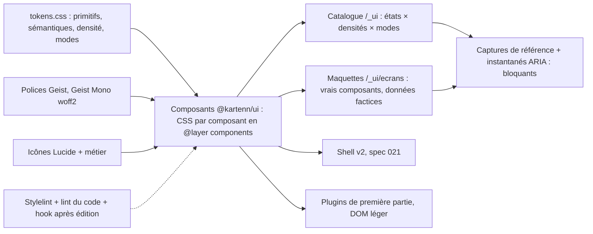

# 020 — Système de design : conception

## Vue d'ensemble

Un paquet `@kartenn/ui` (`web/v2/ui/`, MPL-2.0) porte **tout** le vocabulaire visuel : jetons,
couches CSS, police, icônes, composants. Le shell et les plugins de première partie
l'importent par l'import map (ADR 0038) ; un plugin tiers sans framework reçoit au moins
les jetons et la feuille. Le catalogue `/_ui` du shell montre chaque composant dans chaque
état ; les maquettes des écrans clés y sont construites avec les mêmes composants ; les
captures de référence et les instantanés ARIA verrouillent le tout.



Ordre de travail (ADR 0039, § 6) : jetons → composants en version visuelle → maquettes
validées → composants complets (états, clavier, captures) → écrans (021). Un seul agent à
la fois sur les jetons et la bibliothèque.

## Brief (validé, trois tours, 2026-10-23)

Décrit par traits ; aucune référence nommée.

- **Nature** : outil de travail dense et quotidien, à fortes données (tables, arbres,
  différentiels, matrices) ; pas une vitrine.
- **Références d'ambiance** : outils de suivi de tickets sobres, denses et rapides, où
  tout se fait au clavier, avec palette de commandes et peu de couleur.
- **Ton** : sobre et précis ; neutres teintés de bleu ; **accent bleu du logo**
  (`#0b5cad`), un peu plus présent que dans un outil neutre ; couleur réservée aux états
  (vert, ambre, rouge, violet « en revue »), aux environnements et au différentiel.
- **Densité** : dense par défaut, lignes d'environ 28 px ; densité confortable au choix.
- **Thème** : celui du système, clair ou sombre ; choix forcé possible.
- **Navigation** : barre latérale repliable, palette Ctrl+K, fil d'Ariane (spec 021).
- **Temps et brouillon** : barre d'état haute, pastille de date, bande colorée hors
  présent, « Brouillon (n) » qui ouvre un panneau (spec 021).
- **Formes** : petits rayons, bordures fines teintées, ombres pour les couches
  flottantes seulement.
- **Police** : Geist et Geist Mono ; chiffres tabulaires ; chasse fixe pour les adresses.
- **Icônes** : Lucide, trait de 1,5 px.
- **Raccourcis** : complets et découvrables (Ctrl+K, `/`, `g` + lettre, `c`, `e`, `?`),
  montrés dans les menus et les infobulles.
- **États** : sobres et utiles ; une phrase et une action ; squelettes ; erreur avec code
  copiable et identifiant de requête.
- **Direction visuelle** : « Ardoise » : neutres teintés de bleu, barre latérale foncée qui
  encadre une surface de travail claire posée en panneaux, bleu un peu plus présent.
- **Clichés à éviter** : cartes arrondies identiques à ombre grise, dégradés décoratifs,
  icônes colorées sans sens, animation d'entrée des listes, gros titres creux, couleur
  sans libellé.

## Jetons (REQ-020-4 à 11)

Un seul fichier, `web/v2/ui/src/tokens/tokens.css`, en `@layer tokens`. Trois blocs :
`:root` (clair, compacte), mode sombre (`@media (prefers-color-scheme: dark)` sous
`:root:not([data-theme="light"])`, et `:root[data-theme="dark"]`), densité confortable
(`:root[data-density="comfortable"]`). Noms en `--k-<rôle>-<variante>`.

### Couleurs (REQ-020-5, 6)

Valeurs de départ tirées de la direction « Ardoise » (base commune et surcharges de la
direction). Écarts : `text-muted` clair foncé de `#637084` à `#5d6a7e` (4,24:1 sur
`accent-soft`, sous 4,5:1, pour une ligne sélectionnée) ; `border-control` ajouté, les
bordures fines de la direction (1,45:1) ne suffisant pas à identifier un champ (WCAG
1.4.11) ; en clair, `ok` foncé de `#1e7f48` à `#147942` et `warn` de `#a15c00` à
`#9d5800` (tâche 5, 2026-10-24 : leur texte sur leur propre fond atténué tombait à 4,27
et 4,41:1 ; 4,62 et 4,64:1 après).

| Jeton | Clair | Sombre | Rôle |
|---|---|---|---|
| `--k-bg` | `#f3f5f9` | `#0d1219` | fond de la zone de travail |
| `--k-surface` | `#ffffff` | `#131a24` | panneaux, tables, couches flottantes |
| `--k-surface-sunken` | `#f1f4f8` | `#18202b` | survol de ligne, champs en lecture, code |
| `--k-sidebar-bg` | `#1c2433` | `#0a0e14` | barre latérale |
| `--k-sidebar-fg` | `#a9b4c6` | `#8f9cb0` | texte de la barre latérale |
| `--k-sidebar-active-bg` | `#2a3547` | `#18212e` | entrée active ou survolée |
| `--k-sidebar-active-fg` | `#ffffff` | `#ffffff` | texte de l'entrée active, marque |
| `--k-sidebar-active-icon` | `#8cc0f5` | `#8cc0f5` | icône de l'entrée active |
| `--k-text` | `#16191f` | `#e6e8ec` | texte |
| `--k-text-muted` | `#5d6a7e` | `#8796ab` | texte secondaire, en-têtes de colonne |
| `--k-border` | `#e1e6ee` | `#222c39` | séparateurs (décoratifs) |
| `--k-border-strong` | `#cfd7e3` | `#2d3949` | contours de panneau |
| `--k-border-control` | `#7d8a9e` | `#5f6f86` | contour des champs, cases, interrupteurs (≥ 3:1) |
| `--k-accent` | `#0b5cad` | `#4d94e0` | action principale, lien, sélection |
| `--k-accent-fg` | `#ffffff` | `#0a0c0f` | texte sur l'accent |
| `--k-accent-soft` | `#e3edf9` | `#14273f` | ligne sélectionnée, pastille de filtre, brouillon |
| `--k-focus-ring` | `#0b5cad` | `#6aa8ea` | anneau de focus (2 px, décalage 1 px) |
| `--k-band-bg` | `#fff4dc` | `#3a2c0c` | bande « hors présent » |
| `--k-band-fg` | `#6b4400` | `#f2cf8a` | texte de la bande |

Interaction (tâche 10, 2026-10-24), tirés des précédents par `color-mix` dans le fichier
des jetons, donc justes dans les deux modes : `--k-hover` (texte 6 % sur `surface`,
survol d'un contrôle neutre ou d'une ligne), `--k-active` (11 %, appui, bouton enfoncé),
`--k-accent-hover` et `--k-danger-hover` (l'accent ou `ko` mêlé de 14 % de texte),
`--k-danger` (= `state-ko-fg`) et `--k-danger-fg` (= `accent-fg`) ; `--k-scrim` (voile
d'un dialogue modal, `rgb(16 24 40 / .36)` en clair, `rgb(0 0 0 / .56)` en sombre). Le
test des contrastes couvre `text` sur `hover` et `active`, `accent-fg` sur
`accent-hover`, `danger-fg` sur `danger` et `danger-hover`.

Chargement (revue du 2026-10-25) : `--k-skeleton`, remplissage d'une barre de squelette
(texte 14 % sur `surface`), et `--k-skeleton-sheen`, le reflet qui la traverse, plus
clair que la barre dans les deux modes (`surface` en clair, texte 30 % sur `surface` en
sombre). Décoratifs, ils n'ont pas de 3:1 dû, mais un test garde la barre lisible sur
`surface`, `surface-sunken` et `hover` (≥ 1,2:1, environ 1,4:1 sur `surface`) et le reflet
détaché de la barre (≥ 1,25:1) : l'ancien couple (`surface-sunken`, reflet `hover`, 1,1:1
et 1,04:1) ne se voyait pas.

Contrastes calculés le 2026-10-23 (à recalculer par le test) : `text`/`surface` 17,6 et
14,3 ; `text-muted`/`accent-soft` 4,64 et 5,02 ; `accent`/`surface` 6,67 et 5,52 ;
`border-control`/`surface` 3,5 et 3,4 ; `band-fg`/`band-bg` 7,8 et 9,1 ;
`sidebar-fg`/`sidebar-bg` 7,4 et 7,0.

### États (REQ-020-7)

| État | Clair | Sombre | Libellé par défaut | Icône |
|---|---|---|---|---|
| `ok` | `#147942` | `#49bd7c` | « Conforme », « Appliqué » | `circle-check` |
| `warn` | `#9d5800` | `#e0a23d` | « Avertissement » | `triangle-alert` |
| `ko` | `#bb342d` | `#ee7a70` | « Erreur », « Refusé » | `circle-x` |
| `review` | `#6c47c2` | `#a68cf0` | « En revue » | `git-pull-request` |
| `info` | = `accent` | = `accent` | « Brouillon », « Information » | `info` |
| `neutral` | = `text-muted` | = `text-muted` | « Inactif », « Clos » | `circle-dashed` |

Chaque état donne trois jetons : `--k-state-<s>-fg` (la valeur), `--k-state-<s>-bg`
(`color-mix(in oklab, var(--k-state-<s>-fg) 12%, var(--k-surface))`) et
`--k-state-<s>-border` (même mélange à 40 %). `color-mix` n'est permis que dans le fichier
de jetons. Différentiel : `--k-diff-added` = `ok`, `--k-diff-removed` = `ko`,
`--k-diff-changed` = `warn`, toujours doublés d'un signe (`+`, `−`, `~`) et d'un libellé.

### Environnements (REQ-020-8)

Palette fermée de six teintes, `--k-env-1` à `--k-env-6`, affichées en pastille de 7 px
devant le libellé. La direction « Ardoise » réutilisait l'accent, l'ambre d'état et le
violet « en revue » pour trois environnements : la palette proposée les rend distincts des
états (Q-020-1).

| Jeton | Clair | Sombre |
|---|---|---|
| `--k-env-1` (bleu) | `#0b5cad` | `#6aa8ea` |
| `--k-env-2` (sarcelle) | `#0f7c86` | `#3cc0c9` |
| `--k-env-3` (magenta) | `#a8327a` | `#e37ab8` |
| `--k-env-4` (olive) | `#5f7000` | `#a6bb3a` |
| `--k-env-5` (ardoise) | `#4a5a70` | `#9aa8bc` |
| `--k-env-6` (brun) | `#7a5230` | `#c89b72` |

Attribution (décidée le 2026-10-23) : teinte déduite de la clé de l'environnement
(empreinte stable modulo 6), donc identique pour tous les utilisateurs ; plus tard, un
choix de l'administrateur parmi les six par un attribut de la valeur (avec les libellés de
la 018), qui prime sur l'empreinte.

### Espacement, rayons, bordures, élévation (REQ-020-9)

- Espacement, base 4 px : `--k-space-0` 0 ; `-px` 1 px ; `-0-5` 2 px ; `-1` 4 ; `-2` 8 ;
  `-3` 12 ; `-4` 16 ; `-5` 20 ; `-6` 24 ; `-8` 32 ; `-10` 40 ; `-12` 48.
- Rayons : `--k-radius-sm` 3 px (case, raccourci clavier) ; `-md` 5 px (contrôles, pastilles
  de filtre, badges de code) ; `-lg` 8 px (panneaux, couches flottantes) ; `-full` 999 px
  (pastilles d'état, compteurs).
- Bordures : `--k-border-width` 1 px ; `--k-focus-width` 2 px ; `--k-focus-offset` 1 px ;
  liseré de sélection ou de brouillon : 2 px intérieur, couleur `accent`.
- Élévation, couches flottantes seulement : `--k-shadow-overlay` (menu, popover,
  infobulle, liste de choix) `0 4px 12px rgb(16 24 40 / .12), 0 1px 3px rgb(16 24 40 /
  .08)` ; `--k-shadow-modal` (dialogue, tiroir, palette) `0 12px 32px rgb(16 24 40 / .18)` ;
  en sombre, opacités doublées et contour `border-strong` (une ombre se voit mal sur fond
  sombre). Aucun autre `box-shadow` qu'un liseré intérieur.

### Typographie (REQ-020-10)

Familles : `--k-font-sans: "Geist", system-ui, sans-serif` ; `--k-font-mono: "Geist Mono",
ui-monospace, monospace`. Fichiers `woff2` variables (graisses 400 à 600), sous-ensembles
latin et latin étendu, servis par `@kartenn/ui` sous `/assets/` avec empreinte ;
`font-display: swap` ; préchargement de la seule police sans (`<link rel=preload>` dans
`index.html`, fichier, pas de style en ligne).

| Jeton | Taille / interligne | Usage |
|---|---|---|
| `--k-text-xs` | 11 / 16 px | compteurs, raccourcis, légendes |
| `--k-text-sm` | 12 / 16 px | en-têtes de colonne, aides, pastilles |
| `--k-text-md` | 13 / 20 px | **corps**, cellules, contrôles |
| `--k-text-lg` | 14 / 20 px | titres de panneau, de section |
| `--k-text-xl` | 16 / 24 px | titre de fiche |
| `--k-text-2xl` | 20 / 28 px | titre de page (rare) |
| `--k-text-mono` | 12,5 / 20 px | adresses, préfixes, codes en cellule |

Graisses : `--k-weight-regular` 400, `-medium` 500, `-semibold` 600. Chiffres :
`font-variant-numeric: tabular-nums` posé par la base sur les cellules, compteurs, dates
et sur toute la chasse fixe. Pas d'italique décoratif.

### Densité (REQ-020-2, 17)

| Jeton | Compacte (défaut) | Confortable |
|---|---|---|
| `--k-row-height` | 28 px | 36 px |
| `--k-header-height` (en-tête de table) | 30 px | 40 px |
| `--k-control-height-sm` / `-md` / `-lg` | 24 / 28 / 32 px | 28 / 36 / 40 px |
| `--k-control-padding-inline` (sm / md / lg) | 6 / 9 / 12 px | 8 / 12 / 16 px |
| `--k-cell-padding-inline` | 10 px | 12 px |
| `--k-tree-indent` | 14 px | 18 px |
| `--k-icon-size` / `-lg` | 16 / 20 px | 16 / 20 px |

Une cible de 24 px en compacte tient WCAG 2.5.8 ; une case à cocher de 14 px garde une
zone cliquable de 24 px par son étiquette ou sa cellule.

### Mouvement (REQ-020-11)

`--k-duration-instant` 0 ms ; `-short` 120 ms (survol, couleur, infobulle) ; `-medium`
200 ms (ouverture d'une couche, tiroir, dépliage). `--k-ease-standard`
`cubic-bezier(.2, 0, 0, 1)` ; `--k-ease-exit` `cubic-bezier(.4, 0, 1, 1)`. Sous
`prefers-reduced-motion: reduce`, toutes les durées valent 0 ms sauf `--k-duration-fade`
(80 ms, opacité seule). Aucune animation en boucle hors indicateur de chargement, lui-même
remplacé par un squelette statique sous mouvement réduit. `--k-duration-spin` (900 ms,
0 sous mouvement réduit) et `--k-ease-linear` font tourner cet indicateur (tâche 10).

Politique (relecture du 2026-10-25, note
[`mouvement-interface.md`](../../docs/reference/mouvement-interface.md)) : l'interface
était jugée rapide mais figée ; le mouvement s'ajoute avec parcimonie, pour dire d'où vient
une couche et ce qui vient de changer.

| Interaction | Mouvement | Entrée / sortie |
|---|---|---|
| Panneau latéral, languette | `translateX` (depuis le bord) + opacité ; la surface prend sa largeur sans animation | `medium` `standard` / `short` `exit` |
| Dialogue, surimpression d'une grille agrandie | opacité + `scale(.98 → 1)` ; voile en fondu | `medium` / `short` |
| Menu, popover, sélecteur de période | opacité + `translateY(4px)` depuis son ancre | `short` / `fade` |
| Infobulle | opacité, après son délai ; sortie sans animation | `fade` / 0 |
| Toast | `translateY(8px)` + opacité ; pause au survol et au focus | `medium` / `short` |
| Ligne ajoutée à un brouillon | fond `--k-accent-soft` qui s'estompe, sans déplacer les voisines | `slow` |
| Ligne retirée | fondu avant retrait (ou passage à l'état barré) | `short` |
| Indicateur d'onglet | `translateX` de la barre | `medium` |
| Survol, croix d'une matrice, ligne active | couleur de fond seule, sans `transform` | `fade` |
| Chevron d'un nœud, d'un repli | `rotate` du seul glyphe ; le contenu apparaît d'un coup | `short` |

Jamais animés : actualisation, tri ou filtre d'une grille, valeur d'une cellule,
défilement (`scroll-behavior` au défaut), virtualisation, ouverture d'un nœud d'arbre (le
contenu), changement de page.

Règles : `transform`, `opacity` et couleurs seulement ; focus placé sans attendre la fin
d'une transition ; couche active dès sa première image ; pas de `mode="out-in"`, pas de
View Transitions (elles bloquent le pointeur, VT1 § 7.1.1) ; transitions CSS
interruptibles, sans minuterie. Nouveau jeton `--k-duration-slow` (300 ms, 80 ms sous
mouvement réduit : un fondu de couleur reste permis) ; aucune réponse à une action ne
dure plus. Le reflet du squelette s'arrête après 5 s sur un fond fixe (WCAG 2.2.2). Le menu
de l'utilisateur gagne « Mouvement : celui du système / réduit » (technique SCR40), qui
pose `data-motion="reduce"` sur la racine et applique les mêmes jetons que la préférence
du système.

Réalisation (2026-10-25). Jetons ajoutés : `--k-duration-slow` ; les amplitudes
`--k-motion-shift-sm` / `-md` / `-lg` (4 / 8 / 24 px) et `--k-motion-scale` (0,98), nulles
(0 px, 1) sous mouvement réduit ; `--k-turn-quarter` / `-half` (90° / 180°, rotation d'un
chevron). `--k-ease-standard` sert d'entrée (décélération), `--k-ease-exit` de sortie. Le
bloc `:root[data-motion="reduce"]` est identique au bloc de la requête média (test) : sous
mouvement réduit, toute durée vaut 0 ms sauf `fade` et `slow` (80 ms) ; la durée d'opacité
d'une couche s'écrit `max(var(--k-duration-medium), var(--k-duration-fade))`, si bien que
la couche se fond en 80 ms sans bouger. Mise en œuvre :
- **Couches de Reka** (`Dialog`, `AlertDialog`, surimpression d'`ExpandableGrid`, `Drawer`,
  `CommandPalette`, `Menu`) : entrée par transition depuis `@starting-style` (sans prise en
  charge, la couche apparaît d'un coup) ; sortie par l'animation `k-fade-out` (opacité
  seule), parce que la `Presence` de Reka ne retient une couche que jusqu'à son
  `animationend`, pas un `transitionend`. Couche fermée : `pointer-events: none`.
- **`SidePanel`** : `<Transition>` de Vue (pas d'animation au premier rendu ni au
  changement de page), classes `k-side-panel-enter-*` / `-leave-*`, seule classe d'état de
  la bibliothèque ; le chevron de la languette entre de même.
- **Infobulle** : fondu `fade` depuis `@starting-style` ; sortie immédiate. Pas de toast
  (composant absent).
- **Chevrons** : un seul glyphe `chevron-right` (classe `k-chevron`, `data-open`) tourné
  d'un quart (`TreeGrid`, `SidebarNav`, `DiffList`), retourné en RTL ; ceux d'un menu, du
  bouton scindé, du compteur de brouillons et de la pastille de date tournent d'un demi-tour
  sous `aria-expanded="true"`. La languette du panneau n'existe que fermée : pas de
  rotation.
- **Survol, croix, ligne active** : `background-color` en `fade` (`DataGrid`, `TreeGrid`,
  `MatrixGrid`, et les contrôles qui passaient en `short`).
- **Brouillon** : `DataGrid` marque `data-fresh` la ligne dont l'état devient `draft` après
  le premier rendu (une ligne masquée par un filtre puis remontrée garde son dernier état et
  ne clignote pas) ; animation `k-row-fresh` de `--k-accent-soft` vers son fond, en
  `slow`, retirée à son `animationend`. Ligne retirée : nouvel état `removed` (barrée,
  atténuée, signe « − », mot caché « retirée dans le brouillon »), sans fondu de retrait.
- **Onglets** : pas de barre glissante ; l'indicateur reste la bordure de l'onglet actif, en
  fondu de couleur (une barre demanderait des positions physiques mesurées et des
  exceptions de lint).
- **Squelette** : deux passages du reflet (3,6 s), puis `animation-fill-mode: forwards` le
  laisse hors de la barre ; immobile sous `data-motion="reduce"` comme sous la préférence.
- **Réglage** : `applyMotion("system" | "reduce")` et `currentMotion()` de `@kartenn/ui` ;
  l'entrée « Mouvement » du menu de l'utilisateur de la maquette du cadre bascule entre les
  deux. Le shell réel ne câble encore ni thème ni densité : le réglage l'y rejoindra.
- **Tests** : jetons (durées nulles sauf `fade` et `slow`, amplitudes nulles, deux blocs
  identiques) ; `shell/test/motion.test.ts` (happy-dom) : attribut posé et retiré, focus
  rendu sans attendre la sortie du panneau, ligne de brouillon éclairée une fois. Avant axe,
  le parcours attend la fin des animations finies (une couche se fond même sous mouvement
  réduit) ; les captures les avancent à leur fin (`animations: "disabled"`).

### Tailles (tâches 10 à 12, 2026-10-24)

Largeurs du cadre et des couches, pour qu'aucun écran n'en écrive : `--k-size-sidebar`
208 px et `-sidebar-collapsed` 48 px, `--k-size-status-bar` 40 px (spec 021, « Cadre ») ;
`--k-size-panel-sm` / `-md` / `-lg` 240 / 320 / 420 px (côté d'un `Split`, tiroir,
popover) ; `--k-size-dialog-sm` / `-md` / `-lg` 400 / 560 / 720 px ; `--k-size-menu-min`
180 px ; `--k-size-tooltip-max` 280 px ; `--k-size-field` 240 px ; colonnes de grille
`--k-size-col-xs` / `-sm` / `-md` / `-lg` 56 / 96 / 160 / 240 px, `fill` valant
`minmax(md, 1fr)`. Un test vérifie que toute propriété lue par une feuille existe (jeton
public, alias local déclaré, ou valeur posée par CSSOM).

## Architecture CSS (REQ-020-12 à 14)

```
web/ui/src/
  styles/layers.css     @layer reset, tokens, base, components, plugins, utilities;
  styles/reset.css      @layer reset   (boîte, marges, formulaires hérités)
  tokens/tokens.css     @layer tokens  (seul fichier à valeurs brutes)
  tokens/fonts.css      @layer tokens  (@font-face)
  styles/base.css       @layer base    (corps, liens, focus, chasse fixe, sélection)
  components/<Nom>/…css @layer components (une feuille par composant)
  styles/utilities.css  @layer utilities (rares : visually-hidden, truncate)
```

- `layers.css` est importé **en premier** par `@kartenn/ui/style.css`, qui concatène le
  tout ; l'ordre des couches est donc fixé avant toute règle, quel que soit l'ordre de
  chargement des plugins.
- Classes : `k-<composant>` et `k-<composant>__<partie>`, état en attribut ARIA ou
  `data-state` (pas de classe d'état), variante en `data-variant`, taille en `data-size`.
- Plugins de première partie : `@layer plugins`, préfixe `k-<plugin>-` (ADR 0038).
- **Stylelint** (`web/v2/stylelint.config.js`), règles : `declaration-strict-value` (couleurs,
  `font-*`, `border-radius`, `box-shadow`, `transition*`, `animation*`, `z-index`,
  `gap`, `margin*`, `padding*`, `inset*`, `width`/`height` hors `%`, `auto`, `0`) qui
  exige `var(--k-…)` ; `color-no-hex` et `function-disallowed-list` (`rgb`, `hsl`,
  `color-mix`) hors `tokens/` ; `declaration-no-important` ;
  `selector-max-id: 0` ; `selector-max-compound-selectors: 3` ;
  `liberty/use-logical-spec` ou équivalent ; règle maison « toute règle dans une couche
  connue » ; `box-shadow` permis seulement dans les feuilles des composants flottants
  (liste fermée en configuration). Choix d'outil peu coûteux à défaire : les règles
  maison sont écrites avec l'API de plugins de Stylelint.
- **Lint du code** : interdiction des éléments `button`, `input`, `select`, `textarea`,
  `table` bruts dans `web/shell/src/**` hors `_ui/` et dans `web/plugins/*/src/**` ;
  interdiction d'une liaison de style en chaîne et de `v-html`/`dangerouslySetInnerHTML`
  hors liste blanche (`eslint-plugin-vue` : `vue/no-restricted-html-elements`,
  `vue/no-static-inline-styles`, `vue/no-v-html`) ; `no-restricted-imports` refuse les
  composants Reka interdits (REQ-020-33).
- **CSP** : feuilles compilées en fichiers ; valeurs dynamiques par
  `el.style.setProperty('--k-…', v)` (CSSOM, permis par `style-src 'self'`,
  web-navigateur.md § CSP Level 3) ; aucun `cssText`. Un parcours dédié
  (`csp.spec.ts`) écoute `securitypolicyviolation` pendant la visite de tout le
  catalogue.

### Structure avant style (REQ-020-34, 36 ; 024/M12, M15)

- **Emplacements** : le cadre et les composants de mise en page posent les emplacements
  en grille ; toute piste élastique est `minmax(0, 1fr)` et tout enfant de grille ou de
  flex qui porte un contenu long a `min-inline-size: 0` ; le contenu long défile dans son
  emplacement (`overflow: auto`), jamais la page.
- **Tables** : en-tête et lignes dans **une seule** grille CSS : `grid-template-columns`
  sur la grille, chaque ligne (en-tête comprise) en `grid-column: 1 / -1` et
  `grid-template-columns: subgrid` ; en-tête collant (`position: sticky`) dans le même
  conteneur de défilement. La barre de défilement et les colonnes `fill` décalent donc
  l'en-tête et les lignes ensemble. Virtualisation : les lignes rendues gardent la
  grille, l'espace hors fenêtre est un remplissage de hauteur fixe.
- **Surimpressions** : menus, sélecteurs, infobulles et popovers sortent dans la couche
  des surimpressions (`providePortalTarget`, élément `layers` du cadre) ; la surface est
  un contexte d'empilement isolé (`isolation: isolate`) : un en-tête collant ne passe
  jamais au-dessus d'une surimpression ni du panneau droit.
- **Barres d'outils** : `Toolbar` mesure ses actions (`ResizeObserver`) et replie celles
  qui ne tiennent plus dans « … », de la fin vers le début (ordre de priorité déclaré) ;
  jamais de retour à la ligne.
- **Messages jamais coupés** (revue du 2026-10-25) : une phrase (résultat d'une
  simulation, description d'une opération, motif) va à la ligne ; l'ellipse
  (`text-overflow: ellipsis`) ne sert qu'aux libellés, clés et titres, et seulement là où
  le texte entier reste lisible ailleurs (infobulle, copie, colonne élargie, vue
  agrandie). Une liste longue dans un lieu étroit est une `ExpandableGrid`, pas une liste
  tronquée.
- **Contrôle** : le parcours `layout.spec.ts` mesure `scrollWidth ≤ clientWidth` du
  document sur chaque maquette à 1024, 1280, 1440 et 1920 px, et l'égalité des bords gauches
  en-tête/cellule de chaque table (REQ-020-34).

## Icônes (REQ-020-15)

- `lucide` (ISC), version épinglée ; importées une à une depuis `@kartenn/ui/icons`, qui
  réexporte la liste fermée des icônes utilisées (contrôle du poids, cohérence) ; trait
  `1.5`, `width`/`height` par `--k-icon-size`.
- Icônes métier dessinées dans `web/v2/ui/src/icons/metier/` : grille 24, trait 1,5, extrémités
  et jonctions arrondies, sans remplissage, comme Lucide. Liste initiale : préfixe, plage,
  adresse, domaine d'adressage, VLAN, interface, machine en cluster, flux, environnement,
  dérogation, changeset, brouillon. Relues sur une planche au catalogue avec les icônes
  Lucide voisines.
- Composant `Icon` : `aria-hidden="true"` par défaut ; nom accessible obligatoire si
  l'icône est seule porteuse de sens (type vérifié).

## Inventaire des composants (REQ-020-16 à 23)

Base : SFC Vue 3 sur **Reka UI** (version exacte) là où il convient ; grille et navigation
verticale de l'arbre virtualisé écrites par kartenn ; virtualisation : `TreeVirtualizer`
de Reka pour l'arbre, `@tanstack/vue-virtual` pour la grille (design § « Vue et Reka
UI »). États communs : repos, survol, focus visible, actif, désactivé ; les autres
sont listés.

| # | Composant | Motif APG ou rôle | États propres | Notes |
|---|---|---|---|---|
| 1 | `Stack`, `Cluster`, `Grid`, `Split` | — (mise en page) | — | suppriment le CSS d'écran ; espacement par jeton |
| 2 | `Button` | Button | chargement, variantes `primary`, `secondary`, `ghost`, `danger` ; interdit avec motif | raccourci affiché par `Kbd` en option ; interdit par les droits : `aria-disabled="true"` (reste focalisable), infobulle « Il faut `<permission>` » au survol et au focus (024/M14) |
| 3 | `IconButton` | Button | idem | nom accessible obligatoire, infobulle automatique |
| 4 | `TextField`, `FormField` | — (champ natif étiqueté) | lecture seule, invalide, en attente | étiquette, aide, erreur liée (`aria-describedby`) ; variante chasse fixe |
| 5 | `Select`, `Combobox` | Listbox ; Combobox (`aria-autocomplete="list"`) | ouvert, vide, chargement des suggestions | suggestions tirées de l'API par le cache ; débrayage 150 ms |
| 6 | `FilterChip`, `FilterPicker` | Button + Combobox en séquence (propriété → opérateur → valeur) | brouillon de filtre, invalide | REQ-020-20 ; liste fermée des propriétés fournie par l'hôte ; sérialisable dans l'URL |
| 7 | `DateTimeField`, `PeriodPicker` | Date Picker Dialog ; champs segmentés (spin button) | hors présent, invalide | `valid_at`, `as_of`, raccourcis « maintenant », « hier », « début du mois » ; fuseau nommé |
| 8 | `Checkbox` | Checkbox (deux et trois états) | mixte | sélection de lignes |
| 9 | `Switch` | Switch | — | réglages binaires seulement |
| 10 | `Tabs` | Tabs (activation manuelle) | onglet de plugin en chargement, en erreur | onglets de fiche, onglets de plugins |
| 11 | `Menu`, `MenuButton` | Menu Button, Menu | entrée désactivée avec motif | raccourcis affichés à droite ; le motif d'une entrée désactivée (permission manquante, politique) est son infobulle et sa description (`aria-describedby`) |
| 12 | `Dialog`, `AlertDialog` | Dialog (Modal), Alert Dialog | — | focus piégé et rendu ; confirmation destructive ; option `contained` : le corps tient dans la boîte, un enfant qui défile (une grille) défile en place, en-tête collant, titre et actions visibles (`ExpandableGrid`) |
| 13 | `Drawer` | Dialog (modal) | ouvert | dialogue latéral modal (formulaire long) ; le panneau droit du cadre est `SidePanel` (#30) |
| 14 | `Toast` | `role="status"` ou `alert` | succès, erreur persistante | pause au survol et au focus (WCAG 2.2.1) ; les erreurs restent jusqu'à fermeture |
| 15 | `Tooltip` | Tooltip | — | jamais seul porteur d'une information nécessaire ; WCAG 1.4.13 |
| 16 | `Popover` | Dialog non modal | — | aperçu d'un objet, détail d'un code |
| 17 | `Breadcrumb` | Breadcrumb | élément courant | `aria-current="page"` |
| 18 | `SidebarNav` | Disclosure (groupes) dans un repère `navigation` | replié en icônes, groupe ouvert, entrée active | entrées de plugins regroupées par espace (021) |
| 19 | `CommandPalette` | Combobox dans un Dialog modal | aucune entrée, chargement | Ctrl+K ; commandes, navigation, objets récents |
| 20 | `DataGrid` | Grid (données) | ligne sélectionnée, en brouillon, en revue, cellule en édition, invalide, en attente, cellule en chargement (`Skeleton`) | une seule grille, lignes en `subgrid` (§ « Structure avant style ») ; virtualisée ; tri `aria-sort` et filtre sur chaque colonne (REQ-020-34) ; colonnes redimensionnables au clavier ; colonne de plugin (W5) ; une colonne de message (`wrap` : motif, description) va à la ligne et la ligne grandit, jamais coupée ; clés, noms et nombres restent sur une ligne (revue du 2026-10-25) |
| 21 | `TreeGrid`, `Tree` | Treegrid ; Tree View | nœud déplié, chargement des enfants, en brouillon, cible acceptée, cible refusée, déplacement en attente, déplacement refusé | virtualisé, enfants paginés ; `aria-setsize="-1"` tant que la dernière page n'est pas lue ; parent `derived` (aucun déplacement) ou `declared` (déplacement contrôlé, REQ-020-31) ; invariant d'affichage (REQ-020-32) |
| 22 | `CodeBadge` | Button (copier) | copié | chasse fixe ; annonce `role="status"` « Copié » |
| 23 | `KeyLabel`, `EnvChip` | — | libellé absent (clé seule) | REQ-020-21 ; clé en infobulle et copiable |
| 24 | `StatusBadge` | — | les six états | couleur + icône + libellé |
| 25 | `Skeleton`, `EmptyState`, `ErrorState` | `aria-busy` ; — ; `role="alert"` | — | REQ-020-23 ; `Skeleton` : barres de 12 px (`--k-space-3`) en `--k-skeleton`, animées d'un reflet `--k-skeleton-sheen` (bande de la moitié de la barre, 2 × `--k-duration-spin`, linéaire), immobiles sous mouvement réduit, remplissage gardé ; aussi dans les cellules d'un `DataGrid` en chargement ; `ErrorState` montre la phrase courante, le code et `Request-Id` (`CodeBadge`) |
| 26 | `InlineAlert` | `role="status"` ou `alert` | quatre états | violations sous un formulaire |
| 27 | `DatePill`, `DraftCounter`, `TimeBand` | Button ; Button (bascule, `aria-expanded`) et Menu Button (liste des brouillons) ; `role="status"` | hors présent ; compteur à 0 ; panneau ouvert | barre d'état de la 021 ; `DatePill` ouvre `PeriodPicker` en surimpression ; `DraftCounter` ouvert (`expanded`) : son icône de brouillon devient une croix, ce que fera le prochain clic (revue du 2026-10-25) |
| 28 | `Kbd`, `ShortcutHint` | — | — | rendu des raccourcis dans menus, infobulles, aide `?` |
| 29 | `DiffList` | liste groupée par objet, Disclosure | ajout, retrait, modification, anomalie | avant/après par attribut et propriété ; virtualisée au-delà de 200 lignes |
| 30 | `SidePanel` | région `complementary` (non modale) + Tabs | ouvert, replié, onglet actif, redimensionné, replié en languette | panneau droit de la 021 : surimpression de la surface, 420 px par défaut, poignée redimensionnable au clavier (Window Splitter), Échap ferme et rend le focus au déclencheur (024/M8) ; option `rail` : replié, il laisse au bord de fin une languette dans le flux (piste `auto` de l'hôte, une largeur de contrôle) dont le bouton à chevron « Ouvrir le panneau » (`aria-expanded="false"`) le rouvre sur son dernier onglet et y porte le focus ; la languette ne couvre jamais la surface, à toute largeur, `cover` compris ; le pied ne paraît que si l'hôte le remplit pour l'onglet devant (pas de bande vide) (revue du 2026-10-25) |
| 31 | `CommitForm` | — (champs étiquetés) | motif prérempli, motif requis manquant | résumé sur une ligne, description facultative ; Ctrl+Entrée émet `submit` (024/M9, REQ-020-37) |
| 32 | `SplitButton` | Button + Menu Button | action choisie, entrée désactivée avec motif, chargement | action par défaut à gauche, chevron à droite (`aria-haspopup="menu"`) ; choisir une entrée change l'action du bouton sans la lancer (REQ-020-37) |
| 33 | `Toolbar` | Toolbar | actions repliées dans « … » | flèches entre les actions (APG Toolbar) ; repli par priorité (REQ-020-36) |
| 34 | `MatrixGrid` | Grid (données) | cellule active, cellule en brouillon, en revue, croix de survol | en-têtes de lignes et de colonnes de même composant, figés dans les deux sens ; virtualisée dans les deux sens au-delà de 50 × 50 (REQ-020-35) ; croix : la cellule survolée, sinon la cellule active, éclaire sa ligne et sa colonne, en-têtes compris (`data-cross`, fond `--k-hover`, en-têtes en `--k-text`) ; la cellule active garde son liseré d'accent (forme, pas seulement couleur) ; sens du flux (option `axes`) : le coin dit « Destination → » et « Source ↓ » (seul énoncé du sens au repos, quand la croix n'est sur aucune cellule) ; quand la croix est sur une cellule, de petites pointes d'accent (8 × 6 px, pseudo-éléments vides, hors de l'arbre d'accessibilité) sont posées sur des bordures et tracent un seul chemin source → flux → destination : le long de la ligne, sur la bordure de fin de l'en-tête de la ligne source et sur la bordure de début de la cellule montrée, elles pointent vers la grille (de la source vers la cellule) ; le long de la colonne, sur la bordure haute de la cellule montrée et sur la bordure basse de l'en-tête de la colonne destination, elles pointent vers le haut (de la cellule vers la destination) ; la cellule est « de cette source vers cette destination » ; en écriture de droite à gauche, les pointes horizontales sont retournées ; plus aucune flèche dans le texte des en-têtes ; le sens est dit en mots par le nom de la grille et le coin (revue du 2026-10-25) |
| 35 | `BarChart` | `role="img"` nommé par un résumé, table de données cachée | survol d'une barre (infobulle), série vide | histogramme d'une série dans le temps (une barre par point, ordre de lecture) en SVG maison, sans dépendance ; mesuré par `ResizeObserver`, dessiné en pixels CSS (traits nets, aucune déformation) ; hauteur par jeton ; jetons seulement (`--k-accent`, `--k-border`, `--k-text-muted`), clair et sombre ; résumé (nombre de points, bornes, maximum, dernier) ; valeurs en chiffres tabulaires ; infobulle `decorative` au survol (la table cachée porte les mêmes données) ; ligne de base, graduation du maximum, première et dernière étiquettes (revue du 2026-10-25) |
| 36 | `BarList` | table (en-têtes de ligne, valeurs) | valeur au-delà de l'échelle | barres horizontales d'une distribution (occupation, part) : libellé, barre décorative (`aria-hidden`), valeur ; échelle commune (`max`, sinon la plus grande valeur) ; la valeur est toujours écrite, la barre ne fait que la montrer (revue du 2026-10-25) |
| 37 | `ExpandableGrid` | Grid (données) + Button qui ouvre un Dialog (Modal) | compacte, agrandie | une liste qui peut être longue (flux cassés d'un brouillon, membres d'un groupe) gardée compacte dans un lieu étroit (panneau, section) : nombre de lignes au-dessus, quelques lignes visibles (`visibleRows`, 5 par défaut) puis la grille défile, colonnes réduites au besoin (`compactColumns`) ; bouton « Agrandir » (`IconButton`, nommé « Agrandir : <libellé> », `aria-haspopup="dialog"`) qui ouvre la même table dans une boîte large (`Dialog` `lg`, `contained`) : toutes les colonnes, tri et filtres partagés (tenus par l'hôte, comme pour `DataGrid`), focus piégé, Échap ferme et rend le focus au bouton ; rien n'est coupé en silence, le reste est à un bouton (revue du 2026-10-25) |

Contrat d'édition en place (`DataGrid`, `TreeGrid`, REQ-020-19), indépendant du métier :
- l'hôte fournit pour chaque cellule `editable: boolean` (droits, présent, `as_of`), un
  éditeur (`TextField`, `Select`, `Combobox`, `DateTimeField`) et une fonction de
  validation locale (types tirés du contrat) ;
- Entrée ou F2 ouvre l'éditeur ; Échap annule ; Entrée ou Tab valide et émet
  `commit({ row, column, value })` ; l'hôte rend ensuite l'état de la cellule :
  `pending`, `draft`, `review`, `error` (avec code) ou valeur appliquée ;
- en mode navigation, les flèches déplacent la cellule active (APG Grid) ; en mode
  édition, elles appartiennent à l'éditeur ;
- l'arbre ne change jamais lui-même la place d'un nœud : il rend la relation
  parent-enfant de son modèle, et rien d'autre (REQ-020-32).

Contrat de déplacement (`TreeGrid`, `Tree`, REQ-020-31, 32) :

```ts
type ParentMode = 'derived' | 'declared';
type MoveCheck = { ok: true } | { ok: false; reason: string; code?: string };
interface TreeMoveProps<N> {
  parentMode: ParentMode;                          // 'derived' : aucun déplacement offert
  canMove?(node: N, target: N | null): MoveCheck;  // synchrone, pour chaque cible survolée ou listée
  onMove?(intent: { node: N; target: N | null }): void; // intention seulement
  moveState?(node: N): 'idle' | 'pending' | { refused: MoveCheck };
}
```

- `derived` : pas de `draggable`, pas de Ctrl+X/Ctrl+V, pas d'action « Déplacer vers… ».
- `declared` : glisser-déposer, **et** « Couper » (Ctrl+X) puis « Coller dans » (Ctrl+V)
  sur la cible, **et** « Déplacer vers… » (`Combobox` des seules cibles où `canMove` rend
  `ok`). Pendant un glisser, la cible survolée n'est mise en évidence (`data-drop="ok"`)
  qu'après `canMove` ; sinon `data-drop="refused"`, infobulle du motif et `CodeBadge` du
  code, annonce `role="status"` ; `dragover` sans `preventDefault`, donc dépôt impossible.
- Après un dépôt accepté : `onMove(intention)` ; le nœud garde sa place d'origine avec
  `moveState = 'pending'` (icône et `aria-busy`) ; il ne change de place que si le modèle
  fourni par l'hôte change ; `refused` affiche motif et code sur le nœud.
- Garde de développement : à chaque rendu, pour chaque ligne visible, le parent visuel
  (ligne de niveau `aria-level - 1` qui la précède) doit être le parent du modèle ; sinon
  erreur levée (builds de développement et de test seulement).

## Catalogue `/_ui` (REQ-020-24)

- Routes du shell, chargées seulement si `import.meta.env.MODE !== 'production'` (morceau
  séparé, absent du manifeste du build de production) : `/_ui` (index), `/_ui/jetons`,
  `/_ui/icones`, `/_ui/c/<composant>` (tous les états, en grille : densité × mode),
  `/_ui/ecrans/<maquette>`.
- Chaque page de composant déclare ses états dans un fichier `<Nom>.catalogue.*` sœur du
  composant ; la même déclaration nourrit les captures (un état = une capture).
- Données factices : `web/v2/ui/src/fixtures/` (domaines, préfixes, adresses, environnements
  `prod`/`rece`/`deve` et libellés, identifiants, codes de problème), anonymisées, sans
  lien avec un SI réel.
- Artefact : l'intégration continue publie le build de test du catalogue (Q-020-2).
- Commutateurs en tête de page : mode, densité, langue ; état reflété dans l'URL pour que
  la capture d'un état soit une URL.

## Maquettes (REQ-020-25)

Construites avec les composants en version visuelle (tâches P2), puis validées par
l'utilisateur sur captures, en clair et en sombre, aux quatre largeurs ; la revue du
2026-10-24 (spec 024) les fait reprendre et revalider (E0 ajoutée) ; la validation est consignée dans
[`decisions.md`](decisions.md) (§ « Validations des maquettes »).

| # | Maquette | Ce qu'elle doit montrer |
|---|---|---|
| E0 | Accueil | tableau de bord : tuiles du cœur (`GET /v1/stats`) et `widget` de deux plugins, une tuile en chargement (024) ; histogramme des changesets appliqués par jour (`BarChart`), occupation des groupes de VLAN (`BarList`) |
| E1 | Topographie | barre latérale, barre d'état, arbre des préfixes avec « + » sur un nœud, table filtrée par environnement avec une ligne en brouillon et une en revue, panneau droit sur l'onglet Détail (écran de la direction, révisé par la 024) |
| E2 | Fiche d'un préfixe | titre, attributs, propriétés résolues et leur explication, occupation, historique, onglets de plugins, menu d'actions |
| E3 | Liste d'adresses | filtres typés (pastilles), édition en place d'une cellule, cellule invalide avec code, sélection multiple et action groupée |
| E4 | Changeset et revue | différentiel groupé par objet, anomalies rattachées, actions de revue selon les droits (une action interdite grisée, permission en infobulle, sans encart des droits), état « en revue » |
| E5 | Brouillon | panneau droit sur l'onglet Brouillon au-dessus d'une liste, opérations, simulation en cours puis avec violations codées, `CommitForm` et `SplitButton` ouvert ; page `/drafts` |
| E6 | Lecture au passé | bande ambre, pastille de date et sélecteur de période ouvert en surimpression, écritures grisées avec motif, chronologie des versions |
| E7 | Administration | rôles et liaisons, permissions `module.action` (spec 018), secret affiché une fois |
| E8 | Palette et aide | palette Ctrl+K (commandes, navigation, objets), aide `?` des raccourcis |
| E9 | États | vide (phrase + action), chargement (squelettes), erreur (code + `Request-Id`), 412 avec saisie gardée, 202 « proposé, en revue » |
| E10 | Hôte de plugin | vue pleine page d'un plugin (VLAN) et matrice de politique (017, `MatrixGrid` : croix de survol, sens source → destination) dans le cadre du shell ; onglet Brouillon de la matrice : cellules changées par source → destination, avant et après (`DiffList`), effet simulé (comptes, `InlineAlert` du nombre de flux cassés, puis la liste en `ExpandableGrid`), autres opérations, pied commun (simulation, `CommitForm`, `SplitButton`) |

## Régression visuelle (REQ-020-26, 27)

- Projet Playwright `visual` dans `web/v2/e2e/` : Chromium seul (navigateur Nix,
  `playwright-driver`), polices résolues par une configuration fontconfig épinglée par
  Nix (`PLAYWRIGHT_KARTENN_FONTCONFIG`, même rendu sur toute machine), viewport 1280 × 800
  pour les états du catalogue ; maquettes et écrans à 1440, 1280, 1024 et 768 px
  (hauteur 900, 024/REQ-024-27), `deviceScaleFactor: 1`, `colorScheme` et
  `reducedMotion: 'reduce'` fixés par projet, `page.clock.setFixedTime` à une date fixe,
  locale `fr-FR` et fuseau `Europe/Paris` fixes ; serveur `vite preview` d'un build de test
  sur `127.0.0.1`, au port `KARTENN_PREVIEW_PORT` ou, à défaut, un port libre choisi au
  lancement (le même pour le serveur et la `baseURL` ; plusieurs worktrees en parallèle) ;
  `4173` reste le port d'un `vite preview` lancé à la main.
- `expect(page).toHaveScreenshot({ animations: 'disabled', caret: 'hide',
  maxDiffPixelRatio: 0.001 })` par état et par maquette, en clair et en sombre ;
  références sous `web/v2/e2e/visual/__screenshots__/`, versionnées.
- `toMatchAriaSnapshot` pour chaque composant interactif et chaque maquette.
- Régénération : commande devenv `k-web-shots [--update]`, sous `k-heavy`, qui refuse de
  tourner hors de `devenv shell` (variable d'environnement de devenv absente). Une
  référence modifiée se relit dans le diff (images) avant commit.
- `k-web-check` lance le projet `visual` (CLAUDE.md, ADR 0024).

## Accessibilité (REQ-020-18, 28)

- `expectAccessible` (fixture existante, `web/e2e/fixtures/index.ts`, déjà avec les
  étiquettes `wcag2a` à `wcag22aa`), appelée sur chaque page du catalogue et chaque
  maquette.
- Scripts clavier par motif APG (`web/v2/e2e/components/<composant>.spec.ts`) : ils jouent
  les touches du motif et vérifient focus, `aria-*` et annonce ; exemples :
  Tree View (flèches, Origine, Fin, `*`, saisie de caractères), Grid (flèches, Origine,
  Fin, Ctrl+Origine, Page suivante, Entrée/F2, Échap), Combobox (Alt+Flèche bas, Échap,
  Entrée), Dialog (Tab piégé, Échap, retour du focus), Menu (flèches, Origine, Fin,
  Échap), Tabs (flèches, activation manuelle).
- Revue `a11y-auditor` (ADR 0039) à la fin de chaque composant interactif.

## Budgets (REQ-020-29)

Poids par `size.mjs` ; bancs de composants par un projet Playwright `components-bench`
qui reprend le protocole du prototype D-1 (build de production, `vite preview`, Chromium
sans ralenti, 1440 × 900, 5 passes, médiane ; latence = du `timeStamp` de l'événement au
premier `requestAnimationFrame` après l'état attendu ; trames perdues = 1 − trames
observées / (durée ÷ 16,67 ms) ; tas par CDP après `collectGarbage`). Seuils = 2 × la
mesure du prototype :

| Mesure | Prototype (médiane) | Budget |
|---|---|---|
| JS `@kartenn/ui` + `vue`, gzip | 91,5 Ko (premier chargement, application comprise) | ≤ 120 Ko (dont `@kartenn/ui` ≤ 90 Ko) |
| Arbre 10⁵ : première ligne | 155 ms | ≤ 300 ms |
| Arbre : dépliage de 1 000 enfants | 43 ms | ≤ 90 ms |
| Arbre : Flèche bas, p75 | 14,8 ms | ≤ 32 ms |
| Arbre : défilement de 5 000 lignes | 0,2 % de trames perdues, 0 tâche longue | ≤ 1 %, 0 tâche longue |
| Grille 10⁴ : filtre / tri / édition | 31 / 14 / 15 ms | ≤ 60 / 30 / 30 ms |
| Grille : Flèche bas, p75 | 14,4 ms | ≤ 32 ms |
| Tas : arbre chargé / après défilement / grille | 19,4 / 24,6 / 21,6 Mo | ≤ 40 / 50 / 45 Mo |

La machine du prototype était partagée (charge 1,4 à 4,8) : les médianes sont prudentes.
Les budgets du shell entier, sous ralenti ×4, sont dans la 021.

## Arborescence

```
web/v2/ui/                        @kartenn/ui (MPL-2.0)
  package.json  LICENSE
  src/index.ts                  exports des composants et de l'adaptateur de données (021)
  src/style.css                 point d'entrée de la feuille (layers, reset, tokens, base, composants)
  src/tokens/  src/styles/  src/icons/  src/fonts/  src/fixtures/
  src/components/<Nom>/         composant, feuille, tests, déclaration de catalogue
web/v2/shell/src/_ui/              routes du catalogue et des maquettes (hors production)
web/v2/e2e/visual/                 captures et instantanés
web/v2/e2e/components/             scripts clavier APG
web/v2/stylelint.config.js
```

## Vue et Reka UI (D-1 tranché le 2026-10-23)

Pile : `vue` 3.5, `reka-ui` (version exacte), `@tanstack/vue-virtual`. Fichiers : SFC
`<script setup lang="ts">` dont le bloc `<style>` est extrait en `.css` au build, dans
`@layer components` ; jamais `.ce.vue` ; `:style` en objet (CSSOM).

Leçons du prototype (compte rendu, § 3), devenues règles de `@kartenn/ui` :

| Constat | Règle |
|---|---|
| La sélection simple de `TreeRoot` stocke une **copie** de l'élément (identité perdue : un déplacement a supprimé le mauvais nœud) ; Reka enveloppe le `v-model` dans un `ref` profond | sélection et opérations par identifiant ; nœuds `markRaw`, listes en `shallowRef` ; test de régression |
| Haut/Bas de l'arbre virtualisé : Reka vise le voisin **rendu** ; en répétition rapide, des appuis sont perdus (462 à 498 sur 500) | Haut et Bas gérés par `@kartenn/ui` sur l'index aplati (défilement, index « en attente ») ; script : 500 appuis, focus exact |
| Pas de `*` ; Entrée sélectionne au lieu de renommer ; le tampon de recherche concatène les touches non imprimables | gestionnaire placé **avant** ceux de Reka (`stopImmediatePropagation`) ; dépend de l'ordre des écouteurs : version épinglée, scripts clavier à chaque montée |
| `ComboboxViewport` et `Splitter` injectent un `<style>` (violation `style-src-elem`) | composants interdits par le lint ; parcours CSP sur tout le catalogue |
| Combobox ouverte : `aria-hidden` sur le reste de la page (`useHideOthers`, sans option) | filtres en popover avec liste ouverte au focus ; deux Échap (liste puis popover), dits dans l'aide |
| Pas de grille dans Reka (≈ 490 lignes maison au prototype) | `DataGrid` maison : index de lignes et colonnes, tabindex itinérant, navigation, sélection, édition, en-têtes triables, filtre d'en-tête par Alt+Flèche bas (convention maison, listée dans l'aide) ; script APG Grid complet |
| Slots de `TreeVirtualizer` typés `Record<string, any>`, clés `string` imposées | enveloppes typées dans `@kartenn/ui` ; aucun transtypage dans les écrans |
| Ligne focalisée démontée quand la molette la sort de la fenêtre : focus sur `<body>` | la ligne focalisée reste montée (ou le focus revient au conteneur avec `aria-activedescendant`) |
| Nom accessible d'une ligne = tout son contenu | `aria-label` court, détail par `aria-describedby` |
| Glisser : dépôt « dans » un parent seulement | suffit (arbres à parent déclaré, REQ-020-31) |

Ce que Reka apporte sans retouche (prototype) : Dialog, Popover, Combobox (hors
Viewport), NumberField, Toolbar, ToggleGroup, flèches gauche/droite, Début/Fin et
sélection de l'arbre, `aria-level`/`setsize`/`posinset` ; axe sans violation.

Alternative rejetée : React 19 et React Aria (prototype jumeau) ; voir l'ADR 0036,
« Alternatives ».

## Erreurs et cas limites

- Police non chargée : repli `system-ui` ; métriques ajustées (`size-adjust`) pour limiter
  le décalage ; les captures attendent `document.fonts.ready`.
- Libellé absent dans la langue : clé affichée en chasse fixe (REQ-020-21), jamais une
  chaîne vide.
- Code de problème inconnu du catalogue de traduction : `detail` brut et code affiché
  (REQ-007-29).
- Couleur d'environnement : deux environnements peuvent tomber sur la même teinte (six
  teintes) ; le libellé lève l'ambiguïté ; le choix de l'administrateur, plus tard, la
  supprime.
- Mode forcé « sombre » et capture : chaque capture fixe son mode, jamais celui de la
  machine.

## Alternatives considérées

Voir l'ADR 0036 (utilitaires, CSS Modules, bibliothèque complète, polices système,
maquettes jetables, captures non bloquantes) ; jetons en JSON au format DTCG puis générés
en CSS (Q-020-3).

## Risques

- **Captures instables** (anticrénelage, sous-pixel) : Chromium seul, police locale,
  facteur d'échelle 1, seuil faible mais non nul ; une capture instable se corrige à la
  source, jamais en relevant le seuil sans décision.
- **Doublons de composants** par des agents parallèles : bibliothèque écrite par un seul
  agent ; revue `ui-reviewer` qui cherche les motifs dupliqués.
- **Comportements non documentés de Reka** (quatre sur neuf difficultés du prototype,
  deux en bogues de données silencieux) : version exacte, scripts clavier et parcours CSP
  à chaque montée, contournements isolés dans `@kartenn/ui` et listés dans le skill
  `kartenn-ui`.
- **Grille maison** : la part la plus risquée en accessibilité est du code kartenn ;
  script APG Grid complet et revue `a11y-auditor` avec un lecteur d'écran.
- **Poids de la police** : sous-ensembles et préchargement unique ; mesuré par
  `size.mjs`.

## Stratégie de test

| Niveau | Quoi | Bloquant |
|---|---|---|
| Vitest | contrastes, liste des jetons, sérialisation des filtres, clé/libellé, copie d'un code | oui |
| Stylelint, lint du code | REQ-020-12 à 14 | oui |
| Playwright `visual` | captures et instantanés ARIA du catalogue et des maquettes | oui |
| Playwright `components` | scripts clavier APG, axe `wcag22aa`, violations CSP | oui |
| `components-bench`, `size.mjs` | budgets REQ-020-29 | oui |
| Revues | `ui-reviewer`, `a11y-auditor` à la fin de chaque composant et maquette | revue |

## ADR

[0036](../../docs/adr/0036-systeme-de-design-kartenn-ui.md) (système de design),
[0038](../../docs/adr/0038-partage-des-composants-avec-les-plugins.md) (partage avec les
plugins), [0039](../../docs/adr/0039-outillage-claude-qualite-interface.md) (outillage
Claude), acceptées le 2026-10-23 (D-1 : Vue 3).

## Références

- WCAG 2.2 : https://www.w3.org/TR/WCAG22/ (1.4.1, 1.4.3, 1.4.10, 1.4.11, 1.4.13, 2.1.4,
  2.2.1, 2.3.3, 2.4.7, 2.4.11, 2.5.7, 2.5.8).
- WAI-ARIA APG, motifs : https://www.w3.org/WAI/ARIA/apg/patterns/ (button, checkbox,
  combobox, dialog-modal, alertdialog, disclosure, grid, menu-button, switch, tabs,
  tooltip, treegrid, treeview, breadcrumb).
- CSP et styles : `docs/reference/web-navigateur.md` § CSP Level 3 ; MDN
  `Content-Security-Policy/style-src`, « Violation cases ».
- Captures : https://playwright.dev/docs/test-snapshots ;
  https://playwright.dev/docs/aria-snapshots ; https://playwright.dev/docs/clock.
- Couches en cascade : https://www.w3.org/TR/css-cascade-5/#layering.
- `prefers-reduced-motion` : https://www.w3.org/TR/mediaqueries-5/#prefers-reduced-motion.
- Licences : SIL OFL 1.1 (https://openfontlicense.org/) ; ISC (Lucide) ; MPL-2.0.
