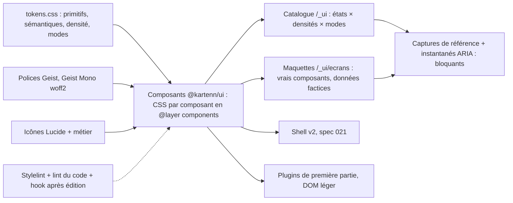

# 020 — Système de design : conception

## Vue d'ensemble

Un paquet `@kartenn/ui` (`web/v2/ui/`, MPL-2.0) porte **tout** le vocabulaire visuel : jetons,
couches CSS, police, icônes, composants. Le shell et les plugins de première partie
l'importent par l'import map (ADR 0038) ; un plugin tiers sans framework reçoit au moins
les jetons et la feuille. Le catalogue `/_ui` du shell montre chaque composant dans chaque
état ; les maquettes des écrans clés y sont construites avec les mêmes composants ; les
captures de référence et les instantanés ARIA verrouillent le tout.



Ordre de travail (ADR 0039, § 6) : jetons → composants en version visuelle → maquettes
validées → composants complets (états, clavier, captures) → écrans (021). Un seul agent à
la fois sur les jetons et la bibliothèque.

## Brief (validé, trois tours, 2026-10-23)

Décrit par traits ; aucune référence nommée.

- **Nature** : outil de travail dense et quotidien, à fortes données (tables, arbres,
  différentiels, matrices) ; pas une vitrine.
- **Références d'ambiance** : outils de suivi de tickets sobres, denses et rapides, où
  tout se fait au clavier, avec palette de commandes et peu de couleur.
- **Ton** : sobre et précis ; neutres teintés de bleu ; **accent bleu du logo**
  (`#0b5cad`), un peu plus présent que dans un outil neutre ; couleur réservée aux états
  (vert, ambre, rouge, violet « en revue »), aux environnements et au différentiel.
- **Densité** : dense par défaut, lignes d'environ 28 px ; densité confortable au choix.
- **Thème** : celui du système, clair ou sombre ; choix forcé possible.
- **Navigation** : barre latérale repliable, palette Ctrl+K, fil d'Ariane (spec 021).
- **Temps et brouillon** : barre d'état haute, pastille de date, bande colorée hors
  présent, « Brouillon (n) » qui ouvre un panneau (spec 021).
- **Formes** : petits rayons, bordures fines teintées, ombres pour les couches
  flottantes seulement.
- **Police** : Geist et Geist Mono ; chiffres tabulaires ; chasse fixe pour les adresses.
- **Icônes** : Lucide, trait de 1,5 px.
- **Raccourcis** : complets et découvrables (Ctrl+K, `/`, `g` + lettre, `c`, `e`, `?`),
  montrés dans les menus et les infobulles.
- **États** : sobres et utiles ; une phrase et une action ; squelettes ; erreur avec code
  copiable et identifiant de requête.
- **Direction visuelle** : « Ardoise » : neutres teintés de bleu, barre latérale foncée qui
  encadre une surface de travail claire posée en panneaux, bleu un peu plus présent.
- **Clichés à éviter** : cartes arrondies identiques à ombre grise, dégradés décoratifs,
  icônes colorées sans sens, animation d'entrée des listes, gros titres creux, couleur
  sans libellé.

## Jetons (REQ-020-4 à 11)

Un seul fichier, `web/v2/ui/src/tokens/tokens.css`, en `@layer tokens`. Trois blocs :
`:root` (clair, compacte), mode sombre (`@media (prefers-color-scheme: dark)` sous
`:root:not([data-theme="light"])`, et `:root[data-theme="dark"]`), densité confortable
(`:root[data-density="comfortable"]`). Noms en `--k-<rôle>-<variante>`.

### Couleurs (REQ-020-5, 6)

Valeurs de départ tirées de la direction « Ardoise » (base commune et surcharges de la
direction). Écarts : `text-muted` clair foncé de `#637084` à `#5d6a7e` (4,24:1 sur
`accent-soft`, sous 4,5:1, pour une ligne sélectionnée) ; `border-control` ajouté, les
bordures fines de la direction (1,45:1) ne suffisant pas à identifier un champ (WCAG
1.4.11) ; en clair, `ok` foncé de `#1e7f48` à `#147942` et `warn` de `#a15c00` à
`#9d5800` (tâche 5, 2026-10-24 : leur texte sur leur propre fond atténué tombait à 4,27
et 4,41:1 ; 4,62 et 4,64:1 après).

| Jeton | Clair | Sombre | Rôle |
|---|---|---|---|
| `--k-bg` | `#f3f5f9` | `#0d1219` | fond de la zone de travail |
| `--k-surface` | `#ffffff` | `#131a24` | panneaux, tables, couches flottantes |
| `--k-surface-sunken` | `#f1f4f8` | `#18202b` | survol de ligne, champs en lecture, code |
| `--k-sidebar-bg` | `#1c2433` | `#0a0e14` | barre latérale |
| `--k-sidebar-fg` | `#a9b4c6` | `#8f9cb0` | texte de la barre latérale |
| `--k-sidebar-active-bg` | `#2a3547` | `#18212e` | entrée active ou survolée |
| `--k-sidebar-active-fg` | `#ffffff` | `#ffffff` | texte de l'entrée active, marque |
| `--k-sidebar-active-icon` | `#8cc0f5` | `#8cc0f5` | icône de l'entrée active |
| `--k-text` | `#16191f` | `#e6e8ec` | texte |
| `--k-text-muted` | `#5d6a7e` | `#8796ab` | texte secondaire, en-têtes de colonne |
| `--k-border` | `#e1e6ee` | `#222c39` | séparateurs (décoratifs) |
| `--k-border-strong` | `#cfd7e3` | `#2d3949` | contours de panneau |
| `--k-border-control` | `#7d8a9e` | `#5f6f86` | contour des champs, cases, interrupteurs (≥ 3:1) |
| `--k-accent` | `#0b5cad` | `#4d94e0` | action principale, lien, sélection |
| `--k-accent-fg` | `#ffffff` | `#0a0c0f` | texte sur l'accent |
| `--k-accent-soft` | `#e3edf9` | `#14273f` | ligne sélectionnée, pastille de filtre, brouillon |
| `--k-focus-ring` | `#0b5cad` | `#6aa8ea` | anneau de focus (2 px, décalage 1 px) |
| `--k-band-bg` | `#fff4dc` | `#3a2c0c` | bande « hors présent » |
| `--k-band-fg` | `#6b4400` | `#f2cf8a` | texte de la bande |

Interaction (tâche 10, 2026-10-24), tirés des précédents par `color-mix` dans le fichier
des jetons, donc justes dans les deux modes : `--k-hover` (texte 6 % sur `surface`,
survol d'un contrôle neutre ou d'une ligne), `--k-active` (11 %, appui, bouton enfoncé),
`--k-accent-hover` et `--k-danger-hover` (l'accent ou `ko` mêlé de 14 % de texte),
`--k-danger` (= `state-ko-fg`) et `--k-danger-fg` (= `accent-fg`) ; `--k-scrim` (voile
d'un dialogue modal, `rgb(16 24 40 / .36)` en clair, `rgb(0 0 0 / .56)` en sombre). Le
test des contrastes couvre `text` sur `hover` et `active`, `accent-fg` sur
`accent-hover`, `danger-fg` sur `danger` et `danger-hover`.

Chargement (revue du 2026-10-25) : `--k-skeleton`, remplissage d'une barre de squelette
(texte 14 % sur `surface`), et `--k-skeleton-sheen`, le reflet qui la traverse, plus
clair que la barre dans les deux modes (`surface` en clair, texte 30 % sur `surface` en
sombre). Décoratifs, ils n'ont pas de 3:1 dû, mais un test garde la barre lisible sur
`surface`, `surface-sunken` et `hover` (≥ 1,2:1, environ 1,4:1 sur `surface`) et le reflet
détaché de la barre (≥ 1,25:1) : l'ancien couple (`surface-sunken`, reflet `hover`, 1,1:1
et 1,04:1) ne se voyait pas.

Contrastes calculés le 2026-10-23 (à recalculer par le test) : `text`/`surface` 17,6 et
14,3 ; `text-muted`/`accent-soft` 4,64 et 5,02 ; `accent`/`surface` 6,67 et 5,52 ;
`border-control`/`surface` 3,5 et 3,4 ; `band-fg`/`band-bg` 7,8 et 9,1 ;
`sidebar-fg`/`sidebar-bg` 7,4 et 7,0.

### États (REQ-020-7)

| État | Clair | Sombre | Libellé par défaut | Icône |
|---|---|---|---|---|
| `ok` | `#147942` | `#49bd7c` | « Conforme », « Appliqué » | `circle-check` |
| `warn` | `#9d5800` | `#e0a23d` | « Avertissement » | `triangle-alert` |
| `ko` | `#bb342d` | `#ee7a70` | « Erreur », « Refusé » | `circle-x` |
| `review` | `#6c47c2` | `#a68cf0` | « En revue » | `git-pull-request` |
| `info` | = `accent` | = `accent` | « Brouillon », « Information » | `info` |
| `neutral` | = `text-muted` | = `text-muted` | « Inactif », « Clos » | `circle-dashed` |

Chaque état donne trois jetons : `--k-state-<s>-fg` (la valeur), `--k-state-<s>-bg`
(`color-mix(in oklab, var(--k-state-<s>-fg) 12%, var(--k-surface))`) et
`--k-state-<s>-border` (même mélange à 40 %). `color-mix` n'est permis que dans le fichier
de jetons. Différentiel : `--k-diff-added` = `ok`, `--k-diff-removed` = `ko`,
`--k-diff-changed` = `warn`, toujours doublés d'un signe (`+`, `−`, `~`) et d'un libellé.

### Environnements (REQ-020-8)

Palette fermée de six teintes, `--k-env-1` à `--k-env-6`, affichées en pastille de 7 px
devant le libellé. La direction « Ardoise » réutilisait l'accent, l'ambre d'état et le
violet « en revue » pour trois environnements : la palette proposée les rend distincts des
états (Q-020-1).

| Jeton | Clair | Sombre |
|---|---|---|
| `--k-env-1` (bleu) | `#0b5cad` | `#6aa8ea` |
| `--k-env-2` (sarcelle) | `#0f7c86` | `#3cc0c9` |
| `--k-env-3` (magenta) | `#a8327a` | `#e37ab8` |
| `--k-env-4` (olive) | `#5f7000` | `#a6bb3a` |
| `--k-env-5` (ardoise) | `#4a5a70` | `#9aa8bc` |
| `--k-env-6` (brun) | `#7a5230` | `#c89b72` |

Attribution (décidée le 2026-10-23) : teinte déduite de la clé de l'environnement
(empreinte stable modulo 6), donc identique pour tous les utilisateurs ; plus tard, un
choix de l'administrateur parmi les six par un attribut de la valeur (avec les libellés de
la 018), qui prime sur l'empreinte.

### Espacement, rayons, bordures, élévation (REQ-020-9)

- Espacement, base 4 px : `--k-space-0` 0 ; `-px` 1 px ; `-0-5` 2 px ; `-1` 4 ; `-2` 8 ;
  `-3` 12 ; `-4` 16 ; `-5` 20 ; `-6` 24 ; `-8` 32 ; `-10` 40 ; `-12` 48.
- Rayons : `--k-radius-sm` 3 px (case, raccourci clavier) ; `-md` 5 px (contrôles, pastilles
  de filtre, badges de code) ; `-lg` 8 px (panneaux, couches flottantes) ; `-full` 999 px
  (pastilles d'état, compteurs).
- Bordures : `--k-border-width` 1 px ; `--k-focus-width` 2 px ; `--k-focus-offset` 1 px ;
  liseré de sélection ou de brouillon : 2 px intérieur, couleur `accent`.
- Élévation, couches flottantes seulement : `--k-shadow-overlay` (menu, popover,
  infobulle, liste de choix) `0 4px 12px rgb(16 24 40 / .12), 0 1px 3px rgb(16 24 40 /
  .08)` ; `--k-shadow-modal` (dialogue, tiroir, palette) `0 12px 32px rgb(16 24 40 / .18)` ;
  en sombre, opacités doublées et contour `border-strong` (une ombre se voit mal sur fond
  sombre). Aucun autre `box-shadow` qu'un liseré intérieur.

### Typographie (REQ-020-10)

Familles : `--k-font-sans: "Geist", system-ui, sans-serif` ; `--k-font-mono: "Geist Mono",
ui-monospace, monospace`. Fichiers `woff2` variables (graisses 400 à 600), sous-ensembles
latin et latin étendu, servis par `@kartenn/ui` sous `/assets/` avec empreinte ;
`font-display: swap` ; préchargement de la seule police sans (`<link rel=preload>` dans
`index.html`, fichier, pas de style en ligne).

| Jeton | Taille / interligne | Usage |
|---|---|---|
| `--k-text-xs` | 11 / 16 px | compteurs, raccourcis, légendes |
| `--k-text-sm` | 12 / 16 px | en-têtes de colonne, aides, pastilles |
| `--k-text-md` | 13 / 20 px | **corps**, cellules, contrôles |
| `--k-text-lg` | 14 / 20 px | titres de panneau, de section |
| `--k-text-xl` | 16 / 24 px | titre de fiche |
| `--k-text-2xl` | 20 / 28 px | titre de page (rare) |
| `--k-text-mono` | 12,5 / 20 px | adresses, préfixes, codes en cellule |

Graisses : `--k-weight-regular` 400, `-medium` 500, `-semibold` 600. Chiffres :
`font-variant-numeric: tabular-nums` posé par la base sur les cellules, compteurs, dates
et sur toute la chasse fixe. Pas d'italique décoratif.

### Densité (REQ-020-2, 17)

| Jeton | Compacte (défaut) | Confortable |
|---|---|---|
| `--k-row-height` | 28 px | 36 px |
| `--k-header-height` (en-tête de table) | 30 px | 40 px |
| `--k-control-height-sm` / `-md` / `-lg` | 24 / 28 / 32 px | 28 / 36 / 40 px |
| `--k-control-padding-inline` (sm / md / lg) | 6 / 9 / 12 px | 8 / 12 / 16 px |
| `--k-cell-padding-inline` | 10 px | 12 px |
| `--k-tree-indent` | 14 px | 18 px |
| `--k-icon-size` / `-lg` | 16 / 20 px | 16 / 20 px |

Une cible de 24 px en compacte tient WCAG 2.5.8 ; une case à cocher de 14 px garde une
zone cliquable de 24 px par son étiquette ou sa cellule.

### Mouvement (REQ-020-11)

`--k-duration-instant` 0 ms ; `-short` 120 ms (survol, couleur, infobulle) ; `-medium`
200 ms (ouverture d'une couche, tiroir, dépliage). `--k-ease-standard`
`cubic-bezier(.2, 0, 0, 1)` ; `--k-ease-exit` `cubic-bezier(.4, 0, 1, 1)`. Sous
`prefers-reduced-motion: reduce`, toutes les durées valent 0 ms sauf `--k-duration-fade`
(80 ms, opacité seule). Aucune animation en boucle hors indicateur de chargement, lui-même
remplacé par un squelette statique sous mouvement réduit. `--k-duration-spin` (900 ms,
0 sous mouvement réduit) et `--k-ease-linear` font tourner cet indicateur (tâche 10).

Politique (relecture du 2026-10-25, note
[`mouvement-interface.md`](../../docs/reference/mouvement-interface.md)) : l'interface
était jugée rapide mais figée ; le mouvement s'ajoute avec parcimonie, pour dire d'où vient
une couche et ce qui vient de changer.

| Interaction | Mouvement | Entrée / sortie |
|---|---|---|
| Panneau latéral, languette | `translateX` (depuis le bord) + opacité ; la surface prend sa largeur sans animation | `medium` `standard` / `short` `exit` |
| Dialogue, surimpression d'une grille agrandie | opacité + `scale(.98 → 1)` ; voile en fondu | `medium` / `short` |
| Menu, popover, sélecteur de période | opacité + `translateY(4px)` depuis son ancre | `short` / `fade` |
| Infobulle | opacité, après son délai ; sortie sans animation | `fade` / 0 |
| Toast | `translateY(8px)` + opacité ; pause au survol et au focus | `medium` / `short` |
| Ligne ajoutée à un brouillon | fond `--k-accent-soft` qui s'estompe, sans déplacer les voisines | `slow` |
| Ligne retirée | fondu avant retrait (ou passage à l'état barré) | `short` |
| Indicateur d'onglet | `translateX` de la barre | `medium` |
| Survol, croix d'une matrice, ligne active | couleur de fond seule, sans `transform` | `fade` |
| Chevron d'un nœud, d'un repli | `rotate` du seul glyphe ; le contenu apparaît d'un coup | `short` |

Jamais animés : actualisation, tri ou filtre d'une grille, valeur d'une cellule,
défilement (`scroll-behavior` au défaut), virtualisation, ouverture d'un nœud d'arbre (le
contenu), changement de page.

Règles : `transform`, `opacity` et couleurs seulement ; focus placé sans attendre la fin
d'une transition ; couche active dès sa première image ; pas de `mode="out-in"`, pas de
View Transitions (elles bloquent le pointeur, VT1 § 7.1.1) ; transitions CSS
interruptibles, sans minuterie. Nouveau jeton `--k-duration-slow` (300 ms, 80 ms sous
mouvement réduit : un fondu de couleur reste permis) ; aucune réponse à une action ne
dure plus. Le reflet du squelette tourne tant que la zone charge ; le mécanisme d'arrêt
que demande WCAG 2.2.2 (au-delà de 5 s) est le réglage de mouvement réduit, du système ou
de l'application, sous lequel la barre reste sur son fond fixe (revue du 2026-10-25,
soir ; note `mouvement-interface.md`, « Implications »). Le menu
de l'utilisateur gagne « Mouvement : celui du système / réduit » (technique SCR40), qui
pose `data-motion="reduce"` sur la racine et applique les mêmes jetons que la préférence
du système.

Réalisation (2026-10-25). Jetons ajoutés : `--k-duration-slow` ; les amplitudes
`--k-motion-shift-sm` / `-md` / `-lg` (4 / 8 / 24 px) et `--k-motion-scale` (0,98), nulles
(0 px, 1) sous mouvement réduit ; `--k-turn-quarter` / `-half` (90° / 180°, rotation d'un
chevron). `--k-ease-standard` sert d'entrée (décélération), `--k-ease-exit` de sortie. Le
bloc `:root[data-motion="reduce"]` est identique au bloc de la requête média (test) : sous
mouvement réduit, toute durée vaut 0 ms sauf `fade` et `slow` (80 ms) ; la durée d'opacité
d'une couche s'écrit `max(var(--k-duration-medium), var(--k-duration-fade))`, si bien que
la couche se fond en 80 ms sans bouger. Mise en œuvre :
- **Couches de Reka** (`Dialog`, `AlertDialog`, surimpression d'`ExpandableGrid`, `Drawer`,
  `CommandPalette`, `Menu`) : entrée par transition depuis `@starting-style` (sans prise en
  charge, la couche apparaît d'un coup) ; sortie par l'animation `k-fade-out` (opacité
  seule), parce que la `Presence` de Reka ne retient une couche que jusqu'à son
  `animationend`, pas un `transitionend`. Couche fermée : `pointer-events: none`.
- **`SidePanel`** : `<Transition>` de Vue (pas d'animation au premier rendu ni au
  changement de page), classes `k-side-panel-enter-*` / `-leave-*`, seule classe d'état de
  la bibliothèque ; le chevron de la languette entre de même.
- **Infobulle** : fondu `fade` depuis `@starting-style` ; sortie immédiate.
- **Toast** (tâche 22) : entrée de 8 px vers le haut avec opacité depuis `@starting-style`
  (`medium`) ; sortie par `k-fade-out` (`short`), le toast gardé dans la page par sa région
  (`TransitionGroup` sans classes, `data-state="closed"`) jusqu'à la fin de son animation.
- **Chevrons** : un seul glyphe `chevron-right` (classe `k-chevron`, `data-open`) tourné
  d'un quart (`TreeGrid`, `SidebarNav`, `DiffList`), retourné en RTL ; ceux d'un menu, du
  bouton scindé, du compteur de brouillons et de la pastille de date tournent d'un demi-tour
  sous `aria-expanded="true"`. La languette du panneau n'existe que fermée : pas de
  rotation.
- **Survol, croix, ligne active** : `background-color` en `fade` (`DataGrid`, `TreeGrid`,
  `MatrixGrid`, et les contrôles qui passaient en `short`).
- **Brouillon** : `DataGrid` marque `data-fresh` la ligne dont l'état devient `draft` après
  le premier rendu (une ligne masquée par un filtre puis remontrée garde son dernier état et
  ne clignote pas) ; animation `k-row-fresh` de `--k-accent-soft` vers son fond, en
  `slow`, retirée à son `animationend`. Ligne retirée : nouvel état `removed` (barrée,
  atténuée, signe « − », mot caché « retirée dans le brouillon »), sans fondu de retrait.
- **Onglets** : pas de barre glissante ; l'indicateur reste la bordure de l'onglet actif, en
  fondu de couleur (une barre demanderait des positions physiques mesurées et des
  exceptions de lint).
- **Squelette** (revue du 2026-10-25, soir) : le reflet passe en boucle (`infinite`, 2 ×
  `--k-duration-spin` par passage, sens inversé en RTL) tant que la zone charge — limité
  à deux passages, il ne se voyait plus sur une attente un peu longue. Le mécanisme
  d'arrêt de WCAG 2.2.2 est le réglage : sous la préférence du système ou
  `data-motion="reduce"` (« Mouvement : réduit »), plus de reflet, le fond fixe reste.
  Une seule règle, la classe `k-skeleton-fill` de `components/shared.css`, porte fond,
  reflet et animation pour tout emplacement en chargement (barres et blocs de `Skeleton`,
  cellules d'un `DataGrid` en chargement) ; aucun composant n'en garde de copie.
- **Réglage** : `applyMotion("system" | "reduce")` et `currentMotion()` de `@kartenn/ui` ;
  l'entrée « Mouvement » du menu de l'utilisateur de la maquette du cadre bascule entre les
  deux. Le shell réel ne câble encore ni thème ni densité : le réglage l'y rejoindra.
- **Tests** : jetons (durées nulles sauf `fade` et `slow`, amplitudes nulles, deux blocs
  identiques) ; `shell/test/motion.test.ts` (happy-dom) : attribut posé et retiré, focus
  rendu sans attendre la sortie du panneau, ligne de brouillon éclairée une fois. Avant axe,
  le parcours attend la fin des animations finies (une couche se fond même sous mouvement
  réduit) ; les captures les avancent à leur fin (`animations: "disabled"`).

### Tailles (tâches 10 à 12, 2026-10-24)

Largeurs du cadre et des couches, pour qu'aucun écran n'en écrive : `--k-size-sidebar`
208 px et `-sidebar-collapsed` 48 px, `--k-size-status-bar` 40 px (spec 021, « Cadre ») ;
`--k-size-panel-sm` / `-md` / `-lg` 240 / 320 / 420 px (côté d'un `Split`, tiroir,
popover) ; `--k-size-dialog-sm` / `-md` / `-lg` 400 / 560 / 720 px ; `--k-size-menu-min`
180 px ; `--k-size-tooltip-max` 280 px ; `--k-size-field` 240 px ; colonnes de grille
`--k-size-col-xs` / `-sm` / `-md` / `-lg` 56 / 96 / 160 / 240 px, `fill` valant
`minmax(md, 1fr)` ; `--k-size-list-max` 480 px (une liste longue qui défile en place,
`DiffList` virtualisée, tâche 24) ; `--k-size-line` `1lh`, résolu là où il est lu (une
cible de 24 px dans une ligne rend par une marge négative ce qu'elle lui ajoute,
`KeyLabel`, tâche 24). Un test vérifie que toute propriété lue par une feuille existe (jeton
public, alias local déclaré, ou valeur posée par CSSOM). Adaptation à la largeur
(2026-10-25) : `--k-size-tile-min`, `--k-size-target-coarse` 44 px, `--k-size-viewport`
(§ « Adaptation à la largeur »).

### Adaptation à la largeur (relecture du 2026-10-25)

Demande de l'utilisateur : l'aspect sur grand écran est bon, l'interface doit maintenant
s'adapter visiblement à la taille de l'écran. Note
[`mise-en-page-adaptative.md`](../../docs/reference/mise-en-page-adaptative.md).

Principe : **le cadre suit la fenêtre, les composants suivent leur conteneur.** Seul le
cadre (barre latérale, barre d'état, bande, panneau) lit la largeur de la fenêtre, par
`@media` en syntaxe d'intervalle ; tout composant lit la largeur qu'on lui donne, par
`@container` sur sa racine (`container-type: inline-size`, jamais `size`), pour s'adapter
de la même façon que le panneau soit ouvert ou non. Aucune media query dans un composant,
aucun écouteur `resize` là où CSS suffit (un `ResizeObserver` reste permis quand il mesure
un contenu, comme le repli de la `Toolbar` ou le tracé d'un `BarChart`).

Classes de largeur du cadre (seuils choisis par kartenn ; aucune source n'en fixe) :

| Classe | Fenêtre | Cadre |
|---|---|---|
| large | ≥ 1280 px | barre latérale dépliée ; panneau de 420 px à côté, la surface se réduit |
| standard | 1024 – 1279 px | barre latérale dépliée, repliable ; panneau à côté, la surface se réduit |
| étroite | 600 – 1023 px | barre latérale en rail (icônes) ; panneau en surimpression (`cover`) |
| compacte | < 600 px | une colonne ; barre latérale en tiroir ouvert par un bouton de la barre d'état ; barre d'état réduite (pastille de date et compteur du brouillon en icône) ; panneau en feuille plein écran avec retour |

Panneau de droite, **tout s'adapte** (décision de l'utilisateur du 2026-10-26, cinquième
relecture ; remplace « par-dessus partout » du 2026-10-25 et l'exception de la grille dans
la zone visible) : en classes large et standard, la surface entière se réduit à la
largeur que le panneau laisse, en-tête, filtres, grilles et pieds compris ; rien ne passe
sous le panneau et aucun élément ne suit le panneau seul. Les grilles replient leurs
colonnes par `@container`, comme à toute autre largeur. Classes étroite (`cover`) et
compacte (feuille) inchangées. Le contenu large ne va pas à droite : il va dans le
panneau du bas.

Panneau du bas (`BottomPanel`, même décision) : frère du `SidePanel` pour un contenu
large (détail en plusieurs colonnes, tableau lié). Il pousse : la surface perd de la
hauteur, jamais de largeur ; hauteur réglable par une poignée (clavier et pointeur,
menu de hauteur comme le menu de largeur du panneau de droite, WCAG 2.5.7), onglets,
fermeture, retour du focus. Le choix entre droite et bas suit le contenu, pas l'écran ;
en classe compacte, il devient la même feuille plein écran que le panneau de droite.
Les deux ouverts (classes large et standard), le panneau du bas court jusqu'au trait du
panneau de droite, sous la marge que celui-ci garde pour la moitié extérieure de sa
poignée (prop `besidePanel`) : aucune bande du fond de page entre les deux, comme contre la
languette du panneau fermé ; son contenu, sa croix et son pied restent hors de la poignée
(retour du 2026-10-29).

Poignées et contours des panneaux : trait de 1 px au repos, 2 px au survol et au focus,
transition de couleur en jetons (§ Mouvement) ; la cible de 24 px reste invisible.

Les seuils ne sont pas des jetons CSS (une media query ne lit pas de propriété, et
`@custom-media` n'existe pas encore) : une seule liste dans `components/layout.ts`
(`WIDTH_CLASSES`), recopiée dans les feuilles du cadre, un test vérifie l'égalité.
Le cadre pose sa classe en attribut (`data-width="compact"`…) pour les rares règles qui en
dépendent hors du cadre.

Composants :

- **Tuiles et formulaires** : grilles intrinsèques
  `repeat(auto-fit, minmax(min(100%, var(--k-size-tile-min)), 1fr))` ; champs côte à côte
  tant que le conteneur le permet, une colonne sinon ; `subgrid` pour aligner libellés et
  valeurs de blocs voisins.
- **`Toolbar`** : replie ses actions selon la largeur de son conteneur (déjà mesurée) ;
  sous 360 px de conteneur, seul le menu « Plus » et l'action principale restent.
- **Grilles (`DataGrid`, `TreeGrid`, `MatrixGrid`, `ExpandableGrid`)** : défilement dans
  leur propre région, focalisable et nommée (exception « tableaux de données » de WCAG
  1.4.10, note 2) ; en-tête, barre d'outils et filtres restent hors de cette région et
  se replient. Colonnes à priorité (`priority` sur `GridColumn` : 1 toujours, 2 masquée
  sous un conteneur `md`, 3 sous `lg`) masquées par `@container`, jamais sans accès : un
  sélecteur de colonnes les rend, et la ligne choisie montre tout dans le panneau. Colonne
  de clé collante. `scrollbar-gutter: stable`. Une liste simple (une clé, deux ou trois
  attributs) peut passer en liste de lignes empilées sous un conteneur `sm` ; une
  matrice, jamais (son sens est en deux dimensions).
- **Panneau latéral** : son contenu suit les mêmes règles ; en feuille plein écran, son
  en-tête porte un bouton retour au lieu de la croix.
- **Couches** : dialogues à `min(var(--k-size-dialog-*), 100% - 2 × marge)` ; en classe
  compacte, un dialogue `lg` et la vue agrandie d'une grille prennent tout l'écran.

Espacement et texte : densité en jetons fixes (`rem`), pas de `clamp()` sur le texte
courant ni les grilles (alignement et densité d'abord ; le zoom couvre 1.4.4) ; `clamp()`
pour les titres de page, la marge de la surface et `--k-size-tile-min` seulement. Hauteurs
en `min-height`, jamais fixes (1.4.12). `text-wrap: balance` sur titres et légendes de
tuiles (amélioration progressive).

Tactile : sous `(any-pointer: coarse)`, les cibles des actions principales passent à
44 px (`--k-size-target-coarse`) ; 24 px restent le plancher partout (2.5.8). Sous
`(hover: none)`, rien n'est réservé au survol (le « + » d'un nœud, les actions de ligne
restent visibles sur la ligne choisie).

Fenêtre : cadre en `min-block-size: 100dvh` (repli `100vh`) ; `<meta name="viewport"
content="width=device-width, initial-scale=1">`, sans `maximum-scale` ni
`user-scalable=no` ; jamais d'orientation imposée (1.3.4) ; pas de détection d'appareil.
`:has()` ancré sur un conteneur précis (cadre avec panneau ouvert, champ en erreur), jamais
sur `:root` ni `body`. Le positionnement par ancre reste une amélioration progressive
(menus près d'un bord).

Vérification : captures des maquettes ajoutées à 390 px (classe compacte) ; `layout.spec`
vérifie à 320 px (1280 px à 400 %, note 1 de 1.4.10) qu'aucune page ne défile
horizontalement hors des régions de grille, et que chaque classe montre le cadre attendu.

**Réalisé (2026-10-25).**

- `components/layout.ts` : `WIDTH_CLASSES` (`compact` 0, `narrow` 600, `standard` 1024,
  `wide` 1280), `widthClass()`, `widthQuery()` (syntaxe d'intervalle) et
  `CONTAINER_WIDTHS` (`xs` 360, `sm` 480, `md` 640, `lg` 960). `layout.test.ts` vérifie
  que les `@media` du cadre (`EcranCadre.vue`) reprennent exactement les seuils de
  `WIDTH_CLASSES`, et que les `@container` de la bibliothèque n'emploient que
  `CONTAINER_WIDTHS` (aucune `@media` de largeur dans un composant ; `pointer` et `hover`
  restent permis).
- Jetons : `--k-size-tile-min` (`clamp(200px, 22vw, 280px)`), `--k-size-target-coarse`
  (44 px) et `--k-size-viewport` (`100vh`, `100dvh` sous `@supports`).
- Cadre : `data-width` posé par `matchMedia` sur les requêtes de `widthQuery()` ; la
  hauteur suit `--k-size-viewport` (la règle `:root:has(.k-ecran)` disparaît). Classes
  large et standard : le panneau ouvert reste en surimpression de la fin de la surface,
  qui garde sa largeur (les grilles ne lisent que la largeur réelle de la surface : à
  1440 px, E1 panneau ouvert montre toutes ses colonnes, sans sélecteur « Colonnes ») ;
  fermé, il laisse sa languette au bord de fin du corps, comme avant. Classe étroite : rail (état de `SidebarNav` posé par le script),
  `cover`. Classe compacte : `SidebarNav` masquée, bouton « Navigation principale » dans la
  barre d'état qui ouvre un `Drawer` (côté début) avec la navigation, marge réduite,
  pastille de date et compteur en icône (règles `[data-width="compact"]` de leurs
  feuilles), fil d'Ariane réduit à la page courante (même attribut), panneau en
  `sheet` ; tant que la feuille est ouverte, barre, bande et surface sont `inert`. Sous
  la classe large, la zone horaire de la pastille ne reste que dans son nom ; sous 1024 px,
  la marge de la surface passe à `--k-space-2`. La surface est un conteneur nommé
  `k-surface` (tuile large d'E0 ramenée à une colonne sous `md`).
- `DataGrid`, `TreeGrid` : racine `k-data-grid-frame` / `k-tree-grid-frame` conteneur
  (`class` et `style` de l'hôte y vont, les autres attributs sur la grille), trois gabarits
  posés par CSSOM (`--k-grid-columns`, `-below-lg`, `-below-md`), cellules
  `data-priority`, première colonne collante (lignes opaques, fond hérité), en-tête
  au-dessus, `scrollbar-gutter: stable`. Le sélecteur « Colonnes »
  (`internal/ColumnChooser.vue`, `Menu` d'entrées à cocher) n'apparaît que là où quelque
  chose est masqué (sous `md`, sous `lg` si une colonne est de priorité 3, ou si
  l'utilisateur a masqué une colonne) ; son état est le modèle `columnVisibility`
  (`true` toujours montrée, `false` jamais ; la clé jamais masquée). Les flèches du
  `DataGrid` sautent les colonnes masquées ; si la colonne du focus itinérant disparaît
  (`ResizeObserver`), l'arrêt revient à la clé de sa ligne. `aria-colindex` garde le rang
  parmi toutes les colonnes. `MatrixGrid` inchangé (défilement en deux dimensions).
- `Toolbar` : `foldActions(…, narrow = CONTAINER_WIDTHS.xs)` ; `mainAction()`.
- `Grid` : `auto` en `auto-fit` sur `--k-size-tile-min` ; nombre fixe = au plus n colonnes,
  jamais plus étroites que `--k-size-col-md` ; `text-wrap-style: balance` sur les titres
  des tuiles (le style seul : un titre tenu sur une ligne le reste). `Split` : racine
  conteneur, côté et principal empilés sous `md`. `DiffList` : racine conteneur, valeurs
  sous l'attribut sous `xs`, valeurs longues coupées ; `InlineAlert` : corps et liste en
  une piste élastique (un code long ne l'élargit plus).
- `Dialog` : `lg` plein écran en classe compacte (vue agrandie d'`ExpandableGrid`
  comprise). `Button` : `primary` et `danger` à `--k-size-target-coarse` sous
  `(any-pointer: coarse)`. `TreeGrid` : le « + » au survol seulement sous
  `(hover: hover)` ; ligne choisie et focus le montrent partout.
- Maquettes : `priority` sur les colonnes secondaires d'E1, E3, E5, E7 et E10 ; l'action
  fictive « Colonnes » d'E3 retirée (le sélecteur la remplace). Captures à 390 px ;
  `layout.spec` : maquettes à 320 px, cadre attendu à 1440, 1100, 768 et 390 px.
- Retiré le même jour (« par-dessus partout ») : le panneau à côté de la surface (corps
  conteneur `k-ecran-body`, piste propre à 960 px et plus, languette effacée) et ses
  jetons `--k-size-surface-min` et `--k-size-panel-beside` ; 024/M8 s'applique de nouveau
  à toute largeur. La colonne « Environnement » d'E1 passe en priorité 2 : la grille d'E1
  est dans un `Split`, sa piste principale reste sous `lg` même à 1440 px ; elle ne se
  masque plus qu'à 1024 px et moins. `layout.spec` vérifie qu'à 1440 px, panneau ouvert,
  le panneau finit avec le corps, qu'aucune colonne d'E1 n'est masquée et qu'aucun
  sélecteur « Colonnes » ne paraît.
- Non fait ce jour-là : listes simples empilées sous `sm` ; `subgrid` entre blocs
  voisins ; champs côte à côte des formulaires (aucun formulaire à plusieurs colonnes dans
  les maquettes). Les deux premiers sont faits le lendemain (ci-dessous).

**Réalisé (2026-10-26).**

- Listes simples empilées : option `stack` du `DataGrid` (pas de composant à part). Sous un
  conteneur `sm` (480 px), la grille n'a plus qu'une piste ; chaque ligne devient une
  petite grille (libellé, valeur, fin) : la clé et les actions de la ligne sur la première
  ligne, puis un attribut par ligne, le libellé de sa colonne devant la valeur (contenu
  généré `attr(data-label) / ""`, texte de remplacement vide : l'en-tête de colonne nomme
  déjà la cellule), libellés et valeurs alignés par `subgrid` de la ligne. Toutes les
  colonnes se montrent (le sélecteur « Colonnes » se retire s'il n'y a pas de choix de
  l'utilisateur), la colonne de clé ne colle plus ; l'en-tête devient une bande de
  contrôles de tri et de filtre qui va à la ligne. La sémantique reste celle d'une grille
  (lignes, cellules, `aria-colindex`, mêmes touches). Une colonne d'actions de ligne se
  déclare `actions` sur `GridColumn` : sans libellé, à côté de la clé. Pris par `/drafts`
  (E5, liste) et la liste des identités (E7) ; les groupes, rôles et comptes de service
  ont quatre attributs ou plus et gardent leurs colonnes à priorité. `layout.spec` ne
  compare plus les bords des colonnes d'une grille empilée. État de catalogue `stacked`.
- `subgrid` entre blocs voisins : la liste d'attributs des maquettes (`EcranAttributs`)
  est une seule grille dont chaque attribut est un `subgrid` ; ses colonnes restent en
  fractions (2 : 3), si bien que des blocs de même largeur empilés (panneaux du côté
  d'E2, tuiles d'E4 en une colonne) alignent déjà leurs valeurs, et une largeur au
  contenu les désalignerait d'un panneau à l'autre. Côte à côte, des blocs posés dans une
  grille `.k-ecran-attrs-tiles` (en-tête d'E4) partagent ses lignes (`subgrid` en lignes,
  `span` du nombre d'attributs posé par CSSOM) : à 768 px, quand « Soumis » passe sur deux
  lignes, « Auteur », « Effet au » et « Identifiant » restent sur la même. Les formulaires
  des maquettes posent leurs libellés au-dessus des champs : rien à aligner entre eux ;
  les panneaux d'E2 ne sont pas traversés (un `subgrid` à travers `Panneau` lierait sa
  structure à son contenu).
- Catalogue : état `sheet` du `SidePanel`, dans un cadre de démonstration `phone`
  (`DemoFrame`, 400 px de large) dont la containment de mise en page (`contain: layout
  paint`) fait le bloc conteneur de ce qui est fixé à la fenêtre : la feuille couvre le
  cadre, pas la page du catalogue.
- Audit tactile (`e2e/visual/touch.spec.ts`, émulation tactile de Chromium :
  `(any-pointer: coarse)` et `(hover: none)` vrais) : chaque vue des maquettes à 1280,
  768 et 390 px (à 390, aussi feuille fermée) ; toute cible fait 24 × 24 px ou respecte
  l'exception d'espacement de 2.5.8 (un cercle de 24 px sur son centre ne touche aucune
  autre cible ni le cercle d'une autre petite), lien dans une phrase exempté ; boutons
  `primary` et `danger` à 44 px. Trouvé et corrigé : l'entonnoir d'en-tête du `DataGrid`
  (16 px dans un en-tête qui trie) passe à `--k-control-height-sm` sous pointeur grossier ;
  la poignée du `SidePanel` (8 px) prend 24 px, sa couleur gardant 8 px
  (`background-clip`).
- Rien de réservé au survol : `useTooltip` gagne `pin(el)` (ouvre tout de suite, jusqu'au
  prochain appui hors de l'ancre et de la bulle) ; un appui (ou Entrée, Espace) sur un
  `Button` ou un `IconButton` refusé l'ouvre, sans compter sur le focus (tous les moteurs
  ne focalisent pas un bouton touché) ; un pointeur tactile qui quitte l'ancre en levant
  le doigt ne la ferme plus. Une entrée refusée d'un `Menu`, choisie au doigt, montre son
  motif ; une barre de `BarChart` touchée montre sa valeur. Le reste du survol est
  décoratif (fonds de lignes, croix de `MatrixGrid` aussi posée par la cellule active),
  le « + » de `TreeGrid` était déjà traité. Les noms des entrées de la barre latérale en
  rail n'ont pas encore d'infobulle (tâche 23) : le bouton « Barre latérale » la déplie ;
  l'infobulle à venir s'ouvrira au focus, comme les autres.
- E10 à 390 px : la matrice défile en deux dimensions dans sa région, en-têtes de lignes
  et de colonnes collés (vérifié). La piste des en-têtes de lignes de `MatrixGrid` passe
  de `minmax(--k-size-col-md, max-content)` à `max-content` : collée, elle prenait 160 px
  sur 340 ; elle prend son plus long libellé (≈ 110 px), les cellules gagnent la place.
- E0 de 600 à 900 px (classe étroite) : les tuiles passent de deux à trois colonnes sans
  débordement, mais les en-têtes de panneaux coupaient titre et détail d'une ellipse
  (« lisibles par v… », « Changesets appliqué » rogné). En-tête de panneau des maquettes
  (`EcranPanneau`) : le titre n'est plus coupé, il va à la ligne (son détail d'abord) ;
  quand titre et actions ne tiennent plus côte à côte, les actions passent sur une ligne
  à elles, à la fin (plus de bouton par-dessus le titre, comme sur E2 à 390 px ou dans la
  piste de contenu d'E1 à 768 px). Une `Toolbar` en actions ne compte que pour son plancher
  — action principale et « … », publié par la barre en `--k-toolbar-floor` (CSSOM,
  `floorWidth`), sa largeur propre neutralisée par `contain: inline-size` : elle reste sur
  la ligne du titre et se replie tant que ce plancher y tient, sans dépendre de l'état
  replié du moment (pas d'hystérésis).
- Reste : champs côte à côte des formulaires (aucun dans les maquettes) ; infobulles du
  rail (tâche 23) ; en classe compacte, la languette du panneau fermé garde sa piste
  (≈ 30 px sur 390) ; à 390 px, l'arbre d'E1 (`replie`) coupe ses libellés devant les
  préfixes (« Serv… ») — à reprendre avec la version complète de `TreeGrid`.

**Réalisé (2026-10-26, relectures).** Relectures `a11y-auditor` (WCAG 2.2 AA, motifs APG)
et `ui-reviewer` des maquettes E0 à E10.

- Panneau (décision de l'utilisateur : par-dessus la surface à toute largeur). Ce qu'il
  couvre sort de l'ordre du focus (2.4.3, 2.4.11) : en `cover` (classe étroite), les autres
  enfants de son conteneur sont `inert` tant qu'il est ouvert ; en `sheet` (compacte), il
  est un dialogue modal (`role="dialog"`, `aria-modal`) et tout ce qui est à côté de lui,
  jusqu'au plus proche `[data-k-modal-scope]` (le cadre, un cadre de démonstration) ou
  `body`, est `inert`, la cible des couches flottantes exceptée (`internal/inertOthers.ts`) ;
  le cadre ne pose plus `inert` lui-même. Par-dessus la fin de la surface (large,
  standard), il publie sa largeur en `--k-side-panel-inset` sur son conteneur : la surface
  en fait son `scroll-padding-inline-end`, le pied d'un panneau principal sa marge de fin
  (ses comptes restent lisibles). « Retour » d'une feuille vient en premier dans le DOM ;
  Échap appartient à un champ de saisie ou à un déclencheur de popup ouvert ; poignée de
  24 px pour tout pointeur ; liste d'onglets nommée « Onglets du panneau » ; chevron de la
  languette sans `aria-expanded` ; plus de languette en classe compacte (le compteur ouvre
  la feuille) ; un dégradé au bas de l'onglet dit qu'il reste à faire défiler.
- `DataGrid` : entonnoir en vrai bouton « Filtrer : <colonne> » hors de l'ordre de
  tabulation, à côté du titre ; Espace, Maj+Espace et Ctrl+A pour la sélection
  (`selected` devient un modèle, `selectable="single"` pour une seule ligne) ; les widgets
  d'une cellule sortent de l'ordre de tabulation, Entrée ou F2 y entre, Échap ou F2 en
  sort ; l'arrêt du focus survit à une colonne masquée par le sélecteur ou à une ligne
  filtrée ; `scroll-padding` de l'en-tête et de la clé collants ; éditeur gardé dans sa
  cellule ; erreur d'une cellule sur une ligne à elle sous la valeur (la ligne grandit) ;
  colonne jamais plus étroite que son en-tête (`minmax(auto, jeton)`, jeton tenu par les
  cellules, `data-width`) ; actions de ligne au bout de leur colonne. `moveInGrid` ignore
  Alt.
- `MatrixGrid` : en-têtes de la croix soulignés (pas la teinte seule), `scroll-padding`.
  `TreeGrid` : clavier de la colonne d'arbre (Haut, Bas, Début, Fin, Droite ouvre ou
  entre, Gauche ferme ou remonte, Entrée ou F2 vers le « + »), `expanded` en modèle.
  `BarChart` : l'image prend le focus, les flèches montrent la valeur de chaque barre
  (infobulle, région `polite`). `BarList` : rôles de table explicites, « au-delà de
  l'échelle » dit en mots. `Skeleton` : région `status` présente vide avant son mot, sans
  `aria-busy`. `FilterChip` invalide : « (invalide) » dans le nom, motif en `alert`.
  `Drawer` : le focus revient à ce qui l'a ouvert, même sans déclencheur Reka. `Menu` :
  entrées `radio` (`menuitemradio` en groupe) ; `DraftCounter` s'en sert pour le brouillon
  actif et se nomme « Brouillon 3 opérations ». `Toolbar` : entrées `more`, toujours dans
  son « … » (jamais deux « … » côte à côte). `Button`, `IconButton`, `TextField` disent
  « Chargement » en mots. `Dialog` : focus initial sur `[data-autofocus]`. `CommitForm` :
  `collapsible`. `Breadcrumb` : la page courante cède en dernier. `SidebarNav` : l'entrée
  courante reste visible (la liste défile). `Kbd` décoratif et utilitaire
  `k-keyboard-hint` masqués sous `(hover: none) and (pointer: coarse)`. Icône `user-x`.
  `ExpandableGrid` : « 3 sur 10 lignes ». Nouveau : `DiffValue` (signe attaché à sa
  valeur, avant → après).
- Maquettes : lien d'évitement « Aller au contenu » ; détail d'un panneau hors de son
  titre ; E0 lien vers les anomalies, accueil partagé avec E8 (`EcranAccueil`) ; E1 un
  seul « … » ; E2, E5 cadre « À venir » sans tirets ; E5 phrase des violations ; E6
  « Lue » en badge ; E7 focus du secret sur sa copie, « Expire le » en libellé et valeur,
  « Créer » dans la ligne du titre, clé de rôle sous son libellé, « via le groupe »,
  icône `user-x` ; E9 sortie sûre en bouton secondaire ; E10 légende de la matrice.
- Choix tranchés : modalité de la feuille dans `SidePanel` (parcours jusqu'à
  `[data-k-modal-scope]`) plutôt que dans le cadre ; marge de défilement par une propriété
  héritée publiée par le panneau ; une seule sélection par `selectable="single"` (E6, E7,
  E10) ; nom du compteur « Brouillon 3 opérations » (les mots visibles d'abord, 2.5.3) ;
  pas de libellé visible ajouté à la pastille et au compteur à 390 px (noms vérifiés, la
  place reste au titre de la page) ; légende de la matrice dans E10 (pas de prop de
  `MatrixGrid`) ; description repliée plutôt qu'une rangée d'action collante dans le pied
  du brouillon.
- Reste : tri, colonnes et édition au clavier de `TreeGrid` (version complète).
- Suite (même jour). Redimensionner sans glisser (2.5.7) : à côté de la croix, un menu
  « Largeur du panneau » (icône `move-horizontal`, entrées `menuitemradio` « Étroit » = borne
  basse, « Standard » = 420 px, « Large » = borne haute, la largeur courante cochée), absent
  en `cover` et en `sheet` (pas de poignée) ; un clic ou deux tapes suffisent. Grilles sous
  le panneau (2.4.11) : le panneau marque aussi son conteneur `data-k-side-panel` ; quand
  une cellule de `DataGrid`, `TreeGrid` ou `MatrixGrid` prend le focus et que la grille
  défile en ligne sous le panneau, la part de sa zone de défilement qu'il couvre devient
  `--k-grid-panel-inset`, à la fois `scroll-padding-inline-end` (la cellule sort de dessous)
  et `padding-inline-end` (la place de faire sortir les dernières colonnes : une marge de
  défilement seule ne prolonge pas le défilement) ; mesure dans `internal/panelInset.ts`,
  effacée par le panneau quand il se ferme ou change de largeur. Une grille qui finit avant
  le panneau, ou ne défile pas, garde sa mise en page. Tests : Vitest (menu présent hors
  `cover`/`sheet`, largeurs proposées, part couverte), clavier (menu, E10 `matrice` à
  1024 px : `Fin` amène la dernière colonne hors du panneau), tactile (deux tapes).
- Choix tranchés (suite) : un menu de trois largeurs plutôt que des boutons pas à pas
  (un seul arrêt de tabulation, l'état dit par `aria-checked`) ; « Standard » = 420 px
  même si l'hôte ouvre le panneau à une autre largeur ; mesure au focus plutôt qu'un
  observateur de taille (rien ne bouge tant qu'aucune cellule n'a le focus) ; marge appliquée
  seulement à une grille qui défile déjà en ligne (ses pistes sont à leur minimum : rien ne
  se réagence).
- Suite 2 (même jour, arbitrage de l'utilisateur sur le « reste » de la suite : une grille
  qui ne défilait pas mais passait sous le panneau, E3 à 1280 px, 375 px de la grille
  « Adresses » couverts, gardait des cellules masquées au focus). Panneau ouvert par-dessus
  la fin de la surface (large, standard), toute grille qu'il couvre tient dans la part
  visible : `SidePanel` attache son conteneur (`attachPanel` de `internal/panelInset.ts`),
  la racine de chaque grille porte `data-k-panel-fit`, et la part couverte, plus un écart
  `--k-space-3`, devient son `--k-grid-panel-inset` — marge intérieure de fin du cadre de
  `DataGrid` et `TreeGrid` (leur conteneur : `@container` ne voit plus que la part
  visible, les colonnes à `priority` se replient, « Colonnes » les rend, le reste défile
  en ligne ; une liste `stack` peut s'empiler), marge extérieure de fin de `MatrixGrid`
  (jamais de colonne repliée : elle rétrécit et défile en ligne). Mesuré à l'ouverture,
  au changement de largeur du panneau, quand le conteneur ou une grille change de taille
  (`ResizeObserver`, au cadre suivant) et quand une grille se monte sous le panneau
  ouvert ; effacé à la fermeture. La boîte du panneau se lit par `offsetLeft` (sa
  translation d'entrée ne fausse pas la mesure). Rien n'est animé : la grille prend sa
  place d'un coup pendant que le panneau glisse (« Mouvement » : pas d'animation de mise
  en page ; `docs/reference/mouvement-interface.md`). Remplace la marge de défilement au
  focus de la suite : la grille ne passe plus sous le panneau. Captures des écrans
  panneau ouvert (E1, E5, E7, E10, `SidePanel`) et instantanés ARIA réécrits et relus.
  Tests : Vitest (part couverte, racines marquées), clavier (E3 à 1280 et 1024 px :
  Tab jusqu'à la grille, flèches sur l'en-tête et une ligne, chaque cellule entière à
  côté du panneau, « Usage » replié puis rendu à la fermeture, barre d'actions immobile ;
  E10 `matrice` à 1024 px), `layout.spec` (à 1440 et 1100 px, les grilles finissent avant
  le panneau ; l'alignement lit la boîte de contenu du cadre).
- Choix tranchés (suite 2) : marge intérieure du cadre plutôt que largeur imposée (le
  cadre garde sa boîte : la mesure ne boucle pas, `@container` lit la boîte de contenu) ;
  marge extérieure pour `MatrixGrid`, sans cadre (pas d'enveloppe ajoutée à son API),
  rendue à la mesure ; écart `--k-space-3` entre la grille et le panneau ; grille couverte
  en entier laissée telle quelle (aucune part visible où tenir) ; mesure au cadre suivant
  hors du rappel du `ResizeObserver` (une marge changée dans le rappel resterait non
  livrée) ; seule la grille cède sa place, son panneau d'écran (`Panneau`, titre, filtres,
  pied) reste sous le panneau latéral comme avant ; test clavier sur la vue `selection`
  d'E3 (dans `edition`, l'éditeur tient l'arrêt de la grille).

**Réalisé (2026-10-26, cinquième relecture).** Tâche 11 de la 024, bloc « Cinquième
relecture ».

- Panneau de droite, « tout s'adapte » : en classes large et standard, le `SidePanel` est
  dans le flux, dans la piste `auto` de son hôte, après un écart `--k-space-3` où tient la
  moitié extérieure de sa poignée (elle ne couvre ni la surface ni sa barre de
  défilement) ; la surface entière (en-tête, filtres, grilles, pieds) prend la largeur
  qu'il laisse, et les grilles replient leurs colonnes par leurs `@container` habituels.
  L'hôte est un conteneur `inline-size` (`.k-ecran__body`, `DemoFrame`) : le panneau ne
  dépasse jamais `--k-size-panel-room-inline` (le conteneur moins `--k-size-panel-md` pour
  la surface et l'écart) ; la poignée et le menu de largeur bornent le modèle à la même
  place mesurée. Ouvert, il prend la piste de sa languette (la languette n'est rendue que
  fermé) ; en sortie, il quitte le flux (`position: absolute` sur `-leave-active`) : la
  surface reprend sa largeur d'un coup pendant que le panneau glisse et se fond. Retirés :
  `internal/panelInset.ts` (`attachPanel`, `joinPanel`, `coveredInset`), `data-k-panel-fit`,
  `--k-grid-panel-inset`, `--k-side-panel-inset`, `data-k-side-panel`, la marge de
  défilement de la surface et la marge du pied d'un panneau principal. `cover` (étroite)
  et `sheet` (compacte) inchangés ; en `cover`, l'élément rendu `inert` est désormais
  `.k-ecran__work`.
- `BottomPanel` (nouveau, inventaire n° 38) : même API que le `SidePanel` (onglets, croix,
  retour du focus, Échap laissé aux champs et aux popups ouverts, pied seulement rempli),
  poignée horizontale (Haut monte, Bas descend, Début, Fin, pointeur) et menu « Hauteur du
  panneau » (icône `move-vertical`, Basse = borne basse, Standard = 320 px, Haute = borne
  haute ; 160 à 640 px). Dans le flux, rangée `auto` d'un hôte conteneur `size`, borné par
  `--k-size-panel-room-block` (le conteneur moins `--k-size-panel-sm`) ; en `sheet`, la même
  feuille que le panneau de droite (dialogue modal, « Retour » d'abord, `inertOthers`
  jusqu'à `[data-k-modal-scope]`). Fermé, il ne laisse rien. `filled` et `ownsEscape`
  passent dans `internal/panel.ts`, partagés par les deux panneaux. Catalogue : `open`,
  `tabs`, `resized`, `sheet`, `closed`, `handle-focus` (`DemoFrame` gagne `bottom`).
- Cadre des maquettes : `.k-ecran__work` (surface puis panneau du bas) à côté du panneau de
  droite ; props `bottom` (onglets) et `bottomLabel`, emplacements `bottom-<onglet>` et
  `bottom-<onglet>-footer`. E1 `noeud` : le détail de la ligne choisie passe en bas, ses
  attributs en plusieurs colonnes (`EcranAttributs` `columns` : paires de pistes
  terme / valeur répétées en `auto-fill`, chaque attribut un `subgrid` de deux pistes) ;
  arbre et table gardent toute leur largeur, le panneau de droite reste fermé (languette,
  compteur du brouillon).
- Poignées et contours : une règle partagée `.k-panel-handle` (`components/shared.css`),
  cible invisible de 24 px à cheval sur le bord ; son trait est le contour du panneau
  (plus de `border-inline-start` ni d'ombre sur le panneau à côté) : 2 px dessinés, mis à
  l'échelle ½ au repos (1 px), 1 au survol et au focus, en `--k-accent`, transition
  d'échelle et de couleur en `--k-duration-short` / `--k-ease-standard`. Le focus ajoute
  une pastille de 6 × 32 px en `--k-focus-ring` au milieu du trait, sans anneau autour de
  la cible : la bande bleue de 8 px et l'anneau qui l'entourait disparaissent.
- E6 : la couche du sélecteur de période (`.k-ecran__picker` du cadre) prend
  `--k-shadow-modal`, une bordure `--k-border-control` et un fond propre, nouveau jeton
  `--k-surface-raised` (#f5f9fe clair, #1d2735 sombre) ; le cadre « À venir » qu'elle
  contient prend son fond (plus de fond creusé).
- Permission : `apply_own` devient `approval.self` dans `web/v2` (SDK : option
  `approvalSelf`, paramètre `?approval=self`, défaut des écritures ; code
  `changeset.approval.self.missing` ; maquettes E9, `SplitButton`, tests). Le schéma
  généré (`sdk/src/api/schema.d.ts`) suit le serveur et n'est pas retouché à la main.
- Tests : Vitest (poignée `k-panel-handle`, plus de languette panneau ouvert ;
  `BottomPanel` : région, poignée horizontale, menu, feuille, préréglages) ; clavier
  (E3 à 1024 et 1280 px : surface réduite, barre d'outils dans son panneau, cellules
  atteintes ; matrice d'E10 à 1024 px ; `BottomPanel` au clavier et par le menu ; E1 :
  détail en bas, attributs côte à côte, la surface reprend sa hauteur à la fermeture) ;
  `layout.spec` (à 1280 et 1440 px, chaque vue non modale panneau ouvert — le compteur
  l'ouvre au besoin : la surface finit avant le panneau, aucun élément visible de la
  surface n'est peint au-delà de son bord, chaque sélecteur « Colonnes » reste dans sa
  grille et chaque barre d'outils dans son panneau ; panneau du bas sous la surface, de
  même largeur, ou en feuille à 390 px).
- Choix tranchés : panneau dans le flux plutôt que réserve de place calculée (aucune
  mesure, `@container` fait le reste) ; écart de 12 px avant le panneau pour la moitié
  extérieure de la poignée ; surface minimale de `--k-size-panel-md` (320 px) en largeur
  et `--k-size-panel-sm` (240 px) en hauteur, par deux jetons en unités de conteneur ; le
  modèle de largeur ou de hauteur borné à la place mesurée (`aria-valuemax` garde la
  borne déclarée) ; épaisseur du trait par `scale` (une transformation, pas une
  propriété de mise en page) ; indicateur de focus = trait de 2 px + pastille (2.4.7 ;
  l'aire de 2.4.13, AAA, n'est pas visée pour une cible invisible) ; E1 `ajout` garde le
  formulaire à droite (contenu étroit, champs l'un sous l'autre), le panneau du bas
  restant à la vue `noeud` ; un seul onglet « Détail » au panneau du bas d'E1 ; pas de
  languette pour le panneau du bas (la sélection le rouvre) ; `--k-surface-raised` plutôt
  qu'un mélange ad hoc dans la maquette ; ombre de couche posée dans le cadre (le
  conteneur qui défile, sinon l'ombre serait rognée), avec une exception
  `kartenn/floating-shadow` commentée (doublure de `PeriodPicker`, composant flottant).

**Réalisé (2026-10-26, erreur de cellule et matrice).** Tâche 11 de la 024, bloc
« Cinquième relecture », puces « Erreur d'une cellule (E3) » et « E10 (matrice) ».

- Erreur d'une cellule (`DataGrid`) : la ligne à elle sous la valeur disparaît (plus de
  `k-data-grid__error-line`, la ligne ne grandit plus). Au repos, la cellule invalide garde
  la taille de ses voisines : teinte `--k-state-ko-bg`, bord `--k-state-ko-fg` tracé à
  l'intérieur par un pseudo-élément (le contour reste à l'anneau de focus, posé en dedans
  du bord), icône `circle-x`, `aria-invalid`. Le message (texte et `CodeBadge`) est un
  composant interne, `DataGrid/CellError.vue`, dans la couche des couches flottantes
  (`providePortalTarget`), `position: fixed` placée par CSSOM ; il reste dans le document,
  caché, et la cellule le nomme par `aria-describedby`. Ouvert tant que la cellule est
  survolée ou a le focus (le pointeur d'abord), y compris quand le pointeur passe sur le
  message, adjacent : ni écart ni délai, donc aucune minuterie ; Échap le ferme jusqu'à ce
  que la cellule n'ait plus ni survol ni focus (WCAG 1.4.13), entendu par la grille puis,
  focus ailleurs, par le document. Cellule en édition : l'erreur reste à l'éditeur, pas de
  couche.
- Forme : `cellError.ts` (`placeCellError`, pur, testé) calcule la place et deux chemins
  SVG. Le message, au moins aussi large que la cellule (au plus `--k-size-panel-lg`), se
  pose sous elle, aligné sur son début ; près du bord de fin, aligné sur sa fin ; près du
  bas de la fenêtre, au-dessus (la forme est retournée). Un trait unique
  (`--k-state-ko-fg`, `--k-border-width`) fait le haut et les deux côtés de la cellule puis
  le tour du message hors de la jonction ; là où le message déborde la cellule, un
  arrondi concave (rayon `--k-radius-md`, borné par le débord) les raccorde ; coins
  extérieurs du message arrondis. Le remplissage (`--k-state-ko-bg`, la teinte de la
  cellule) couvre le message et les arrondis, jamais la cellule, dont le contenu reste
  visible ; ouvert, le bord de la cellule s'efface au profit du trait. Défilement et
  redimensionnement replacent la couche ; la cellule hors de la vue de sa grille (défilée,
  sous l'en-tête), la couche est masquée. Fondu d'entrée en
  `max(--k-duration-short, --k-duration-fade)`, sortie immédiate, comme une infobulle.
- Mouvement de la couche (validée, demande de l'utilisateur) : la couche entière (message,
  trait et remplissage joints) entre en fondu et glisse de `--k-motion-shift-sm` en
  s'éloignant de la cellule (vers le bas sous elle, vers le haut retournée au-dessus), en
  `medium` / `--k-ease-standard`, et sort par le chemin inverse, plus courte (`short` /
  `--k-ease-exit`) ; opacité et `translate` seulement, `display` en `allow-discrete`, sans
  minuterie, réversible en cours ; la cellule ne bouge pas ; sous mouvement réduit, aucun
  glissement et un fondu de 80 ms.
- Le bouton de copie du code, widget de la cellule déporté dans la couche, sort de
  l'ordre de tabulation ; Entrée ou F2 sur la cellule y va, Échap ou F2 en revient ; le
  focus dans le message garde la couche ouverte.
- Matrice (`MatrixGrid`, E10) : les flèches de direction (source → cellule →
  destination) sont toujours dessinées, transparentes hors du chemin, et apparaissent en
  fondu d'opacité (`max(short, fade)`, `--k-ease-standard`) et s'effacent en `fade`
  (`--k-ease-exit`) ; le soulignement des en-têtes de la croix est toujours posé, sa
  couleur passe de transparent à `currentcolor` avec la teinte ; la cellule survolée prend
  un bord `--k-border-strong` (couleur du contour en fondu), un en-tête survolé passe au
  texte plein et allume sa seule ligne ou sa seule colonne (sans flèches) ; la marque d'un
  état (brouillon, revue) entre en fondu depuis `@starting-style`, la teinte de l'état
  suivant la transition de couleur de fond déjà posée. Couleurs et opacité seulement, rien
  sur la mise en page, aucune minuterie ; sous mouvement réduit, les fondus durent 80 ms.
- Tests : Vitest (rendu serveur : message hors de la cellule, caché, nommé par
  `aria-describedby`, code présent ; cellule en édition sans couche ; `placeCellError` :
  sous la cellule, arrondi concave, remplissage hors de la cellule, largeur minimale,
  retournement au-dessus et alignement de fin, RTL ; happy-dom : focus, Échap, retour du
  focus, passage du pointeur de la cellule au message ; survol d'un en-tête de matrice) ;
  clavier (focus sur la cellule → message visible, sous la cellule, cellule de même boîte
  qu'au repos et que sa voisine ; Échap le cache, le focus revenu le rouvre ; bouton de
  copie atteint par Entrée et F2). Captures : catalogue `cell-states` (repos),
  `cell-error-hover`, `cell-error-focus` ; E3 `edition` capturée cellule refusée au focus
  (`focus` du registre).
- Choix tranchés : couche en `fixed` dans la couche des couches flottantes plutôt
  qu'absolue dans la grille (jamais rognée par la zone qui défile, ne l'agrandit pas) ;
  trait et remplissage en SVG calculé plutôt qu'en bordures et pseudo-éléments (un seul
  contour continu, retournable) ; coins hauts de la cellule droits (ceux de la grille) ;
  remplissage à la teinte de la cellule plutôt que `--k-surface`, pour une seule forme ;
  texte en `--k-text` ; pas d'ombre (le trait suffit, et `kartenn/floating-shadow` la
  réserve aux couches nommées) ; message sans rôle `tooltip` (il porte un bouton) ;
  le pointeur prime sur le focus quand les deux désignent deux cellules ; Échap entendu
  aussi par le document pour un message ouvert au seul survol. Matrice : flèches toujours
  présentes et transparentes (seul moyen d'un fondu de sortie sans minuterie) ; survol
  d'un en-tête = sa ligne ou sa colonne seule.
- Reste : la matrice n'a pas de groupes repliables ; « ouverture d'un groupe » n'a pas
  d'objet dans E10 aujourd'hui (l'agrandissement d'`ExpandableGrid` est déjà animé par
  `Dialog`). À 390 px, la colonne de la cellule refusée d'E3 est masquée par priorité : la
  capture n'y montre pas le message.

## Architecture CSS (REQ-020-12 à 14)

```
web/ui/src/
  styles/layers.css     @layer reset, tokens, base, components, plugins, utilities;
  styles/reset.css      @layer reset   (boîte, marges, formulaires hérités)
  tokens/tokens.css     @layer tokens  (seul fichier à valeurs brutes)
  tokens/fonts.css      @layer tokens  (@font-face)
  styles/base.css       @layer base    (corps, liens, focus, chasse fixe, sélection)
  components/<Nom>/…css @layer components (une feuille par composant)
  styles/utilities.css  @layer utilities (rares : visually-hidden, truncate)
```

- `layers.css` est importé **en premier** par `@kartenn/ui/style.css`, qui concatène le
  tout ; l'ordre des couches est donc fixé avant toute règle, quel que soit l'ordre de
  chargement des plugins.
- Classes : `k-<composant>` et `k-<composant>__<partie>`, état en attribut ARIA ou
  `data-state` (pas de classe d'état), variante en `data-variant`, taille en `data-size`.
- Plugins de première partie : `@layer plugins`, préfixe `k-<plugin>-` (ADR 0038).
- **Stylelint** (`web/v2/stylelint.config.js`), règles : `declaration-strict-value` (couleurs,
  `font-*`, `border-radius`, `box-shadow`, `transition*`, `animation*`, `z-index`,
  `gap`, `margin*`, `padding*`, `inset*`, `width`/`height` hors `%`, `auto`, `0`) qui
  exige `var(--k-…)` ; `color-no-hex` et `function-disallowed-list` (`rgb`, `hsl`,
  `color-mix`) hors `tokens/` ; `declaration-no-important` ;
  `selector-max-id: 0` ; `selector-max-compound-selectors: 3` ;
  `liberty/use-logical-spec` ou équivalent ; règle maison « toute règle dans une couche
  connue » ; `box-shadow` permis seulement dans les feuilles des composants flottants
  (liste fermée en configuration). Choix d'outil peu coûteux à défaire : les règles
  maison sont écrites avec l'API de plugins de Stylelint.
- **Lint du code** : interdiction des éléments `button`, `input`, `select`, `textarea`,
  `table` bruts dans `web/shell/src/**` hors `_ui/` et dans `web/plugins/*/src/**` ;
  interdiction d'une liaison de style en chaîne et de `v-html`/`dangerouslySetInnerHTML`
  hors liste blanche (`eslint-plugin-vue` : `vue/no-restricted-html-elements`,
  `vue/no-static-inline-styles`, `vue/no-v-html`) ; `no-restricted-imports` refuse les
  composants Reka interdits (REQ-020-33).
- **CSP** : feuilles compilées en fichiers ; valeurs dynamiques par
  `el.style.setProperty('--k-…', v)` (CSSOM, permis par `style-src 'self'`,
  web-navigateur.md § CSP Level 3) ; aucun `cssText`. Un parcours dédié
  (`csp.spec.ts`) écoute `securitypolicyviolation` pendant la visite de tout le
  catalogue.

### Structure avant style (REQ-020-34, 36 ; 024/M12, M15)

- **Emplacements** : le cadre et les composants de mise en page posent les emplacements
  en grille ; toute piste élastique est `minmax(0, 1fr)` et tout enfant de grille ou de
  flex qui porte un contenu long a `min-inline-size: 0` ; le contenu long défile dans son
  emplacement (`overflow: auto`), jamais la page.
- **Tables** : en-tête et lignes dans **une seule** grille CSS : `grid-template-columns`
  sur la grille, chaque ligne (en-tête comprise) en `grid-column: 1 / -1` et
  `grid-template-columns: subgrid` ; en-tête collant (`position: sticky`) dans le même
  conteneur de défilement. La barre de défilement et les colonnes `fill` décalent donc
  l'en-tête et les lignes ensemble. Virtualisation : les lignes rendues gardent la
  grille, l'espace hors fenêtre est un remplissage de hauteur fixe.
- **Surimpressions** : menus, sélecteurs, infobulles et popovers sortent dans la couche
  des surimpressions (`providePortalTarget`, élément `layers` du cadre) ; la surface est
  un contexte d'empilement isolé (`isolation: isolate`) : un en-tête collant ne passe
  jamais au-dessus d'une surimpression ni du panneau droit.
- **Barres d'outils** : `Toolbar` mesure ses actions (`ResizeObserver`) et replie celles
  qui ne tiennent plus dans « … », de la fin vers le début (ordre de priorité déclaré) ;
  jamais de retour à la ligne.
- **Messages jamais coupés** (revue du 2026-10-25) : une phrase (résultat d'une
  simulation, description d'une opération, motif) va à la ligne ; l'ellipse
  (`text-overflow: ellipsis`) ne sert qu'aux libellés, clés et titres, et seulement là où
  le texte entier reste lisible ailleurs (infobulle, copie, colonne élargie, vue
  agrandie). Une liste longue dans un lieu étroit est une `ExpandableGrid`, pas une liste
  tronquée.
- **Contrôle** : le parcours `layout.spec.ts` mesure `scrollWidth ≤ clientWidth` du
  document sur chaque maquette à 1024, 1280, 1440 et 1920 px, et l'égalité des bords gauches
  en-tête/cellule de chaque table (REQ-020-34).

## Icônes (REQ-020-15)

- `lucide` (ISC), version épinglée ; importées une à une depuis `@kartenn/ui/icons`, qui
  réexporte la liste fermée des icônes utilisées (contrôle du poids, cohérence) ; trait
  `1.5`, `width`/`height` par `--k-icon-size`.
- Icônes métier dessinées dans `web/v2/ui/src/icons/metier/` : grille 24, trait 1,5, extrémités
  et jonctions arrondies, sans remplissage, comme Lucide. Liste initiale : préfixe, plage,
  adresse, domaine d'adressage, VLAN, interface, machine en cluster, flux, environnement,
  dérogation, changeset, brouillon. Relues sur une planche au catalogue avec les icônes
  Lucide voisines.
- Composant `Icon` : `aria-hidden="true"` par défaut ; nom accessible obligatoire si
  l'icône est seule porteuse de sens (type vérifié).

## Inventaire des composants (REQ-020-16 à 23)

Base : SFC Vue 3 sur **Reka UI** (version exacte) là où il convient ; grille et navigation
verticale de l'arbre virtualisé écrites par kartenn ; virtualisation : `TreeVirtualizer`
de Reka pour l'arbre, `@tanstack/vue-virtual` pour la grille (design § « Vue et Reka
UI »). États communs : repos, survol, focus visible, actif, désactivé ; les autres
sont listés.

| # | Composant | Motif APG ou rôle | États propres | Notes |
|---|---|---|---|---|
| 1 | `Stack`, `Cluster`, `Grid`, `Split` | — (mise en page) | — | suppriment le CSS d'écran ; espacement par jeton |
| 2 | `Button` | Button | chargement, variantes `primary`, `secondary`, `ghost`, `danger` ; interdit avec motif | raccourci affiché par `Kbd` en option ; interdit par les droits : `aria-disabled="true"` (reste focalisable), infobulle « Il faut `<permission>` » au survol et au focus (024/M14) |
| 3 | `IconButton` | Button | idem | nom accessible obligatoire, infobulle automatique |
| 4 | `TextField`, `FormField` | — (champ natif étiqueté) | lecture seule, invalide, en attente | étiquette, aide, erreur liée (`aria-describedby`, erreur d'abord) et annoncée (région `polite` présente vide avant elle) ; variante chasse fixe ; `FormField` encadre tout contrôle (l'emplacement reçoit `id`, `labelId`, `describedBy`) et, en `group`, un groupe nommé de cases ou de bascules ; `TextField` repose sur lui (tâche 17) |
| 5 | `Select`, `Combobox` | Listbox (Select-Only Combobox : bouton `combobox`, liste `listbox` dont les options prennent le focus) ; Combobox (`aria-autocomplete="list"`, sélection manuelle, `aria-activedescendant`) | ouvert, vide, chargement des suggestions, suggestions indisponibles, lecture seule (`Select`) | suggestions tirées de l'API par le cache : fonction `suggest(texte, signal)` de l'hôte, appelée après un débrayage de 150 ms, annulée (`AbortSignal`) quand un texte plus récent la remplace ; aucune suggestion mise en avant à la saisie, Bas va à la première, Alt+Bas ouvre sans bouger, Entrée prend la suggestion mise en avant (sinon `submit` : le texte tel quel), Échap ferme et laisse l'Échap suivant à la couche autour, Origine et Fin restent dans le texte ; ce que tient la liste (nombre, chargement, rien, échec) dit par une région `polite` présente avant elle ; l'option mise en avant porte `aria-selected`, la valeur prise sa coche ; `Select` : Reka (Entrée, Espace, Bas, Haut ouvrent sur l'option choisie ; flèches, Origine, Fin, saisie ; Échap ferme sans choisir ; Tab choisit, ferme et passe au contrôle suivant), `inlineLabel` (l'étiquette écrite avant la valeur, dans une barre) ; liste commune (`Select/options.css`) au moins aussi large que son champ ; `ComboboxViewport` et `SelectViewport` interdits (CSP) (tâche 18) |
| 6 | `FilterChip`, `FilterPicker` | Button + Combobox en séquence (propriété → opérateur → valeur), dans un popover non modal | brouillon de filtre, invalide, clé sans libellé, plusieurs valeurs, bornes | REQ-020-20 ; liste fermée des propriétés fournie par l'hôte (modèle `FilterModel` : clé du paramètre, libellé, type `text`, `enum`, `number`, `prefix`, `address`, `date`, opérateurs servis, domaine fermé en `options` ou `suggest`, paramètre propre d'un opérateur) ; propriété choisie dans sa liste ouverte à l'ouverture (libellé puis clé), opérateurs `eq` (une valeur ou « l'un de »), `ne`, `contains`, `within` (un préfixe), `before`, `after`, `between` (bornes ouvertes), `exists`, `absent` ; valeur par une liste fermée avec autocomplétion (plusieurs valeurs retirables pour `eq`) ou un champ typé vérifié avant l'application (motif lié au champ et dit) ; deux Échap (la liste, puis le popover) ; un filtre commencé puis laissé reste un brouillon, hors de l'URL, « Annuler » l'écarte ; un filtre par paramètre (le nouveau remplace l'ancien) ; sérialisé dans l'URL dans la grammaire de la route (006 « Filtres » : `clé=v` répété = l'un de, `clé:between=a..b`, `clé:exists=true|false`, `clé:<op>=v`), relu avec les paramètres étrangers gardés et les valeurs hors type gardées et marquées invalides (`filtersToParams`, `filtersFromParams`, `checkFilter`) (tâche 19) |
| 7 | `DateTimeField`, `PeriodPicker` | Date Picker Dialog ; champs segmentés (spin button) | hors présent, invalide | `valid_at`, `as_of`, raccourcis « maintenant », « hier », « début du mois » ; fuseau nommé ; `DateTimeField` : segments dans l'ordre d'ISO 8601 (`AAAA-MM-JJ hh:mm`, gauche à droite dans toute langue), chacun un `spinbutton` (chiffres qui remplissent et passent au suivant, séparateur, Haut et Bas qui bouclent, Origine et Fin, Gauche et Droite, Retour arrière ; Tab de segment en segment), groupe nommé par l'étiquette (`FormField` `group`) ; fuseau IANA écrit à côté de l'heure avec son décalage à la date (`UTC+01:00`) et décrivant l'heure et les minutes ; valeur `AAAA-MM-JJ` (`granularity: "day"`) ou instant RFC 3339 en UTC (`…Z`), `null` tant que la saisie est vide, incomplète ou impossible ; une saisie impossible (31 février, 25 h, l'heure sautée au passage à l'heure d'été) est gardée telle quelle, refusée au départ du champ ou par `check()` avant l'envoi, motif lié et dit, segment fautif souligné ; de l'heure répétée, la plus tôt ; calendrier : bouton « Choisir la date : <étiquette> » (Alt+Bas depuis un segment) qui ouvre un dialogue modal (popover de Reka, nommé par son bouton), grille du mois nommée par son titre dit (`aria-live`), semaines du lundi, flèches, Origine et Fin de la semaine, Pg préc. et Pg suiv. (Maj : l'année), Entrée et Espace choisissent (minuit si l'heure manque), Échap ferme, focus rendu au bouton ; aucune bibliothèque de dates (`Intl` seul). `PeriodPicker` : formulaire (titre « Lire à une date ») de deux `DateTimeField` (« Valide au », « Connu au »), vides au présent, raccourcis sous chacun (« Hier » : la même heure la veille ; « Début du mois » : le 1er à minuit), dits par une région `polite` ; Entrée dans un segment envoie ; refus à l'envoi d'une date impossible et d'un `as_of` postérieur à maintenant (006 : le temps système n'a pas d'avenir ; horloge du navigateur, le refus de l'API rendu sur le champ par `errors`), focus sur le champ ; un instant collé avec son décalage est cet instant ; un instant hors des années 0001…9999 en UTC est refusé ; hors présent, « Revenir au présent » ; la couche autour (sous la `DatePill`), Échap et le focus rendu sont à l'hôte (tâche 23) (tâche 20) |
| 8 | `Checkbox` | Checkbox (deux et trois états) | mixte | sélection de lignes ; case native, mixte par `indeterminate` (jamais `aria-checked`), cochée au basculement ; la rangée de l'étiquette est la cible (≥ 24 px) (tâche 17) |
| 9 | `Switch` | Switch | — | réglages binaires pris aussitôt seulement (un choix de formulaire est une `Checkbox`) ; `button` `role="switch"`, Espace et Entrée, libellé fixe (tâche 17) |
| 10 | `Tabs` | Tabs (activation manuelle) | onglet de plugin en chargement, en erreur | onglets de fiche, onglets de plugins ; un seul arrêt de tabulation (l'onglet choisi), Droite et Gauche en boucle, Origine, Fin déplacent le focus sans changer de panneau, Entrée ou Espace activent, Tab va au panneau, nommé par son onglet (tâche 21) |
| 11 | `Menu`, `MenuButton` | Menu Button, Menu | entrée désactivée avec motif | un seul composant (le menu porte son bouton) ; Entrée, Espace et Bas l'ouvrent sur la première entrée, Haut sur la dernière ; Bas et Haut en boucle, Origine, Fin, saisie ; Échap ferme et rend le focus au bouton ; Tab et Maj+Tab ferment et passent au contrôle d'après ou d'avant le bouton (APG Menu) ; raccourcis affichés à droite (`ShortcutHint`) : une combinaison aussi dans `aria-keyshortcuts`, une séquence en deux touches (« g puis p », jamais une combinaison) et dans la description ; le motif d'une entrée désactivée (permission manquante, politique) est son infobulle et sa description (`aria-describedby`) ; entrée à cocher (`kind: "checkbox"`, `menuitemcheckbox`) qui garde le menu ouvert (sélecteur de colonnes) ; événement `open` (tâche 21) |
| 12 | `Dialog`, `AlertDialog` | Dialog (Modal), Alert Dialog | — | focus piégé et rendu ; confirmation destructive ; option `contained` : le corps tient dans la boîte, un enfant qui défile (une grille) défile en place, en-tête collant, titre et actions visibles (`ExpandableGrid`) ; `aria-modal` écrit (Reka ne le pose pas), le reste de la page caché ; déclencheur : un contrôle dans `trigger` (fait déclencheur de Reka : `aria-haspopup="dialog"`, `aria-expanded`) ou tout contrôle de l'hôte qui pose le modèle ; focus à l'ouverture sur l'élément `data-autofocus`, sinon le premier champ du corps, sinon le premier contrôle ; `AlertDialog` s'ouvre toujours sur « Annuler » (ni `data-autofocus` ni premier champ) ; Tab et Maj+Tab font le tour ; Échap ferme ; focus rendu à ce qui l'avait à l'ouverture, au bouton du menu quand c'était une entrée de menu (partie avec le menu) ; `AlertDialog` : Échap et « Annuler » émettent `cancel`, le bouton de confirmation `confirm` puis ferme, une fermeture par le modèle de l'hôte n'émet rien ; un clic dehors ne ferme pas ; les couches flottantes (menu, popover, liste, calendrier, erreur de cellule) et les feuilles (`SidePanel`, `BottomPanel` en classe compacte) sont sur le plan des couches modales (`--k-z-modal`), la plus récente au-dessus : un menu ouvert dans un dialogue est sur lui (tâche 22) |
| 13 | `Drawer` | Dialog (modal) | ouvert | dialogue latéral modal (formulaire long) ; le panneau droit du cadre est `SidePanel` (#30) ; comme `Dialog` : `aria-modal`, focus sur le premier champ du corps (sinon la croix), piégé, rendu, Échap (tâche 22) |
| 14 | `Toast` | `role="status"` ou `alert` | succès, erreur persistante | pause au survol et au focus (WCAG 2.2.1) ; les erreurs restent jusqu'à fermeture ; maison (le Toast de Reka ferme tous les toasts à tout Échap de la page) : un magasin (`createToasts`, `provideToasts`, `show` rend un identifiant, `dismiss`) et une seule `ToastRegion` dans le cadre, en bas de la fenêtre, au milieu (les coins tiennent les actions des panneaux et des tiroirs), haute de la moitié de la fenêtre au plus (au-delà, elle défile), sous une couche modale et son voile (`--k-z-overlay`) : une couche modale dit ses issues en elle (`InlineAlert`), jamais par un toast ; deux régions vivantes présentes vides avant tout toast (leur liste vide n'est pas une liste), `alert` pour les erreurs, `status` pour les autres, `aria-atomic="false"` (chaque toast dit seul) ; une erreur, un avertissement ou un toast à action restent jusqu'à fermeture, les autres 8 s (`duration`) : un toast à durée n'est jamais le seul chemin vers une information (l'issue se voit aussi là où elle a eu lieu) ; un toast : ton en icône, couleur et mot caché avant le titre, phrase, code et `Request-Id` copiables (`CodeBadge`), une action au plus, croix « Fermer la notification » ; aucun toast ne prend le focus ; atteints par Tab après le reste du cadre, la région qui en tient est un repère nommé « Notifications » ; pointeur dessus, focus dedans, page cachée ou couche modale par-dessus (`aria-hidden`, `inert`) : aucun ne part ; Échap dans un toast le ferme (sauf défaut empêché, une infobulle ouverte) ; fermé au clavier ou par l'hôte, le focus va au toast suivant, sinon au précédent, sinon d'où il venait (rien quand il est venu d'hors de la page), sinon au contenu principal ; fermé d'un clic, il n'est donné à personne (tâche 22) |
| 15 | `Tooltip` | Tooltip | — | jamais seul porteur d'une information nécessaire ; WCAG 1.4.13 : Échap la ferme où que soit le focus, sans autre effet (la couche autour reste), sauf l'infobulle qui ne fait que redire le nom d'un `IconButton` focalisé : Échap va ensuite au contrôle (son dialogue, sa grille) ; focus clavier aussitôt, survol après un délai (tâche 16) |
| 16 | `Popover` | Dialog non modal | — | aperçu d'un objet, détail d'un code ; déclencheur fourni par l'hôte (`trigger` : `aria-haspopup="dialog"`, `aria-expanded`) ; ouvert, nommé par son titre (un titre, pour la navigation par titres), sans `aria-describedby` (un corps de paragraphes et de contrôles serait lu deux fois), il prend le focus lui-même, et son déclencheur reste marqué ouvert ; Échap ou sa croix le ferment et rendent le focus au déclencheur, un clic dehors le ferme ; rien n'est caché autour : il se lit comme s'il suivait son déclencheur (Maj+Tab depuis son début revient au déclencheur, Tab après sa fin passe à ce qui le suit, et il se ferme ; dans un dialogue modal, Tab reste dans ce dialogue et y fait le tour, comme pour un menu) ; borné à la fenêtre, son corps défile (1.4.10) et devient alors un arrêt de tabulation nommé par le titre (2.1.1) ; sa surface (`k-popover`) est aussi celle du menu et du `FilterPicker` (tâche 21) |
| 17 | `Breadcrumb` | Breadcrumb | élément courant | `aria-current="page"` ; la page courante cède en dernier ; un lien coupé par l'ellipse donne son libellé entier en infobulle au survol et au focus (tâche 21) |
| 18 | `SidebarNav` | Disclosure (groupes) dans un repère `navigation` | replié en icônes, groupe ouvert, entrée active | entrées de plugins regroupées par espace (021) |
| 19 | `CommandPalette` | Combobox dans un Dialog modal | aucune entrée, chargement | Ctrl+K ; commandes, navigation, objets récents |
| 20 | `DataGrid` | Grid (données) | ligne sélectionnée, en brouillon, en revue, cellule en édition, invalide, en attente, cellule en chargement (`Skeleton`) | une seule grille, lignes en `subgrid` (§ « Structure avant style ») ; virtualisée ; tri `aria-sort` et filtre sur chaque colonne (REQ-020-34) ; colonnes redimensionnables au clavier ; colonne de plugin (W5) ; une colonne de message (`wrap` : motif, description) va à la ligne et la ligne grandit, jamais coupée ; clés, noms et nombres restent sur une ligne (revue du 2026-10-25) ; racine conteneur, colonnes à `priority` masquées par `@container`, sélecteur « Colonnes » (`columnVisibility`), colonne de clé collante ; liste simple empilée sous `sm` (`stack`, colonne `actions`) (§ « Adaptation à la largeur ») ; clavier APG Grid (flèches, Origine, Fin, Ctrl+Origine, Ctrl+Fin, Pg préc./suiv. d'un écran de lignes ; un seul arrêt de tabulation) ; sélection : Espace, Maj+Espace, Maj+Haut/Bas (plage depuis l'ancre), Ctrl+A, colonne de cases en tête pour plusieurs lignes (case de toutes les lignes à trois états ; focus gardé sur la cellule), clic sur la ligne pour une seule ; virtualisée au-delà de 200 lignes (`@tanstack/vue-virtual`, hauteurs mesurées, intervalles en blancs, `max-block-size: --k-size-list-max`), lignes du focus et de l'éditeur toujours montées, déplacements sur les index (aucun appui perdu) ; `aria-rowcount` = `rowCount` + 1 (liste paginée ; `-1` inconnu) ; événement `window` (`start`, `end`, `size`) : `end` est l'index, parmi les lignes **chargées** données à la grille, après la dernière rendue — ce que lit `ListWindow.end` de `useNextPage` (021, branché par sa tâche 11) ; édition selon le contrat ci-dessous (`editable`, `validate`, `commit`, `v-model:editing`, emplacement `editor`) : erreur locale ou de l'hôte dans la bulle de la cellule (l'éditeur ne la grandit pas), dite par une région `alert` de la grille après un `commit` ; `aria-readonly` sur la grille sans `editable`, sur les cellules non éditables sinon ; `resizable` : poignée Window Splitter par en-tête (`separator`, F2 depuis l'en-tête, flèches de 16 px, Maj 64, Origine au plus étroit — jamais sous l'en-tête —, Fin à 960 px ; glisser ; un clic sans glisser passe à la largeur de jeton suivante, WCAG 2.5.7), `v-model:columnWidths` ; colonne d'extension (`element` : un élément personnalisé par ligne, `row` et `elementProps` posés en propriétés ; ses contrôles en DOM léger sortent de la tabulation à leur arrivée, atteints par Entrée ou F2 ; dans une racine d'ombre, l'élément les garde lui-même à `tabindex="-1"`) ; F2 sur un en-tête passe par ses contrôles (entonnoir, poignée) puis revient ; en-tête filtrable `aria-keyshortcuts="Alt+ArrowDown"` |
| 21 | `TreeGrid`, `Tree` | Treegrid ; Tree View | nœud déplié, chargement des enfants, en brouillon, cible acceptée, cible refusée, déplacement en attente, déplacement refusé | virtualisé, enfants paginés ; `aria-setsize="-1"` tant que la dernière page n'est pas lue ; parent `derived` (aucun déplacement) ou `declared` (déplacement contrôlé, REQ-020-31) ; invariant d'affichage (REQ-020-32) |
| 22 | `CodeBadge` | Button (copier) | copié, copie refusée, coupé | chasse fixe ; nom = « Copier » caché + contenu ; copie au clic, Entrée, Espace : l'API asynchrone du presse-papiers, à défaut la commande de copie du document (son événement `copy` reçoit le texte : ni sélection ni focus déplacé) ; l'issue dite par une région `status` (polie) et montrée dans la bulle (infobulle décorative, épinglée) : « Copié » deux secondes, ou, les deux refusées, le code sélectionné et « copiez-le au clavier (Ctrl+C, ⌘C sur Mac) » jusqu'à la fermeture de la bulle (Échap, départ du focus) ; un code coupé par la largeur est entier dans la bulle au survol et au focus (Échap ne ferme alors qu'elle) ; curseur `copy` comme `KeyLabel` et `EnvChip` (tâche 24) |
| 23 | `KeyLabel`, `EnvChip` | Button (copier la clé) | libellé absent (clé seule), clé copiée, `plain` | REQ-020-21 ; nom = ce qui est montré (libellé, ou clé en chasse fixe) ; description « Clé : prod. Clic, Entrée ou Espace : copier la clé. » ; la clé dans la bulle au survol et au focus, copiée comme un `CodeBadge` (« Clé copiée ») ; Échap ferme la bulle, la couche autour reste (sauf clé déjà montrée : la bulle ne fait que redire le bouton, Échap passe ensuite) ; `showKey` : clé à côté, `stacked` : clé dessous ; à court de place, la clé cède avant le libellé, tous deux entiers dans la bulle ; cible de 24 px qui rend à sa ligne ce qu'elle lui ajoute (`--k-size-line`), anneau sur la ligne ; `plain` : le texte seul, pour une pastille dans un contrôle ou dans une grille dont la ligne s'active (Entrée et le clic y choisissent la ligne) ; `EnvChip` : teinte déduite de la clé (`envHue` : FNV-1a 32 bits sur les octets UTF-8 de la clé, modulo 6, plus 1) sauf `hue` de l'hôte, pastille cerclée de sa teinte (anneau gardé en couleurs forcées) (tâche 24) |
| 24 | `StatusBadge` | — | les six états | couleur + icône + libellé ; sans libellé, le mot de l'état (§ « États ») ; en couleurs forcées, bordure, icône et libellé restent (tâche 24) |
| 25 | `Skeleton`, `EmptyState`, `ErrorState` | `aria-busy` ; — ; `role="alert"` | — | REQ-020-23 ; `Skeleton` : barres de 12 px (`--k-space-3`) en `--k-skeleton`, animées d'un reflet `--k-skeleton-sheen` (bande de la moitié de la barre, 2 × `--k-duration-spin`, linéaire, en boucle tant que la zone charge), immobiles sous mouvement réduit, remplissage gardé ; règle partagée `k-skeleton-fill` (bordure transparente : le contour des barres en couleurs forcées) ; aussi dans les cellules d'un `DataGrid` et d'un `TreeGrid` en chargement (`loading`, `loadingRows` : autant de lignes que l'hôte en attend ; CLS mesuré à 0 entre squelette et données) ; `ErrorState` montre la phrase courante (région `alert` présente, texte montré une image après), puis chaque violation (message et règle), le `type` du problème et `Request-Id` (`CodeBadge`) ; `problem` prend tel quel un `ApiProblem` du SDK (`ProblemFacts`) (tâche 24) |
| 26 | `InlineAlert` | `role="status"` ou `alert` | quatre états | violations sous un formulaire ; option `icon` qui remplace l'icône du ton quand elle en dit plus (cadenas d'un objet en lecture seule), couleur et rôle du ton gardés ; annoncée quand elle paraît : contenu montré une image après sa région (tâche 17) ; le ton dit en mots avant le titre, caché à la vue (« Avertissement : », « Erreur : », « Succès : », « Information : » ; WCAG 1.3.1, revue de la tâche 18) |
| 27 | `DatePill`, `DraftCounter`, `TimeBand` | Button ; Button (bascule, `aria-expanded`) et Menu Button (liste des brouillons) ; `role="status"` | hors présent ; compteur à 0 ; panneau ouvert | barre d'état de la 021 ; `DatePill` ouvre `PeriodPicker` en surimpression ; `DraftCounter` ouvert (`expanded`) : son icône de brouillon devient une croix, ce que fera le prochain clic (revue du 2026-10-25) |
| 28 | `Kbd`, `ShortcutHint` | — | — | rendu des raccourcis dans menus, infobulles, aide `?` ; `Kbd` : une combinaison ; `ShortcutHint` : une combinaison ou une séquence, étapes jointes par un mot de la langue (« g puis p ») ; `aria-keyshortcuts` pour une combinaison seulement (ARIA n'a pas de syntaxe de séquence) (tâche 16) |
| 29 | `DiffList` | liste groupée par objet, Disclosure | ajout, retrait, modification, anomalie | avant/après par attribut et propriété ; virtualisée au-delà de 200 lignes (en-têtes et changements ouverts ; `@tanstack/vue-virtual`) : elle défile en place (`--k-size-list-max`), seuls les changements proches de la vue sont dans le document, les autres remplacés par des intervalles de leur hauteur mesurée, chacun gardant sa place dans son objet (`aria-setsize`, `aria-posinset`) ; tous les en-têtes d'objet restent dans le document (Tab et la navigation par titres atteignent chaque objet) (tâche 24) |
| 30 | `SidePanel` | région `complementary` (non modale) + Tabs | ouvert, replié, onglet actif, redimensionné, replié en languette | panneau droit de la 021 : à côté de la surface, qui se réduit à la largeur qu'il laisse (« tout s'adapte », 2026-10-26 ; hôte conteneur `inline-size`, piste `auto`), 420 px par défaut, poignée redimensionnable au clavier (Window Splitter), menu « Largeur du panneau » (Étroit, Standard, Large) à côté de la croix pour redimensionner sans glisser (2.5.7), Échap ferme et rend le focus au déclencheur (024/M8) ; option `rail` : replié, il laisse au bord de fin une languette dans le flux (piste `auto` de l'hôte, une largeur de contrôle) dont le bouton à chevron « Ouvrir le panneau » (`aria-expanded="false"`) le rouvre sur son dernier onglet et y porte le focus ; la languette ne couvre jamais la surface, à toute largeur, `cover` compris ; le pied ne paraît que si l'hôte le remplit pour l'onglet devant (pas de bande vide) (revue du 2026-10-25) ; option `cover` (classe étroite) : par-dessus tout son conteneur ; option `sheet` (classe compacte) : feuille sur toute la fenêtre, bouton « Retour » au lieu de la croix, focus sur l'onglet actif à l'ouverture |
| 31 | `CommitForm` | — (champs étiquetés) | motif prérempli, motif requis manquant | résumé sur une ligne, description facultative ; Ctrl+Entrée émet `submit` (024/M9, REQ-020-37) |
| 32 | `SplitButton` | Button + Menu Button | action choisie, entrée désactivée avec motif, chargement | action par défaut à gauche, chevron à droite (`aria-haspopup="menu"`) ; choisir une entrée change l'action du bouton sans la lancer (REQ-020-37) |
| 33 | `Toolbar` | Toolbar | actions repliées dans « … » | flèches entre les actions (APG Toolbar) ; repli par priorité (REQ-020-36) ; sous 360 px, une barre qui doit replier ne garde que son action principale (`primary`, sinon la plus prioritaire) |
| 34 | `MatrixGrid` | Grid (données) | cellule active, cellule en brouillon, en revue, croix de survol | en-têtes de lignes et de colonnes de même composant, figés dans les deux sens ; virtualisée dans les deux sens au-delà de 50 × 50 (REQ-020-35) ; croix : la cellule survolée, sinon la cellule active, éclaire sa ligne et sa colonne, en-têtes compris (`data-cross`, fond `--k-hover`, en-têtes en `--k-text`) ; la cellule active garde son liseré d'accent (forme, pas seulement couleur) ; sens du flux (option `axes`) : le coin dit « Destination → » et « Source ↓ » (seul énoncé du sens au repos, quand la croix n'est sur aucune cellule) ; quand la croix est sur une cellule, de petites pointes d'accent (8 × 6 px, pseudo-éléments vides, hors de l'arbre d'accessibilité) sont posées sur des bordures et tracent un seul chemin source → flux → destination : le long de la ligne, sur la bordure de fin de l'en-tête de la ligne source et sur la bordure de début de la cellule montrée, elles pointent vers la grille (de la source vers la cellule) ; le long de la colonne, sur la bordure haute de la cellule montrée et sur la bordure basse de l'en-tête de la colonne destination, elles pointent vers le haut (de la cellule vers la destination) ; la cellule est « de cette source vers cette destination » ; en écriture de droite à gauche, les pointes horizontales sont retournées ; plus aucune flèche dans le texte des en-têtes ; le sens est dit en mots par le nom de la grille et le coin (revue du 2026-10-25) |
| 35 | `BarChart` | `role="img"` nommé par un résumé, table de données cachée (dans une boîte `k-visually-hidden` : sa légende, hors de la boîte de la table, débordait sinon sur le tracé dans certains moteurs, revue du 2026-10-25, soir) | survol d'une barre (infobulle), série vide | histogramme d'une série dans le temps (une barre par point, ordre de lecture) en SVG maison, sans dépendance ; mesuré par `ResizeObserver`, dessiné en pixels CSS (traits nets, aucune déformation) ; hauteur par jeton ; jetons seulement (`--k-accent`, `--k-border`, `--k-text-muted`), clair et sombre ; résumé (nombre de points, bornes, maximum, dernier) ; valeurs en chiffres tabulaires ; infobulle `decorative` au survol (la table cachée porte les mêmes données) ; ligne de base, graduation du maximum, première et dernière étiquettes (revue du 2026-10-25) |
| 36 | `BarList` | table (en-têtes de ligne, valeurs) | valeur au-delà de l'échelle | barres horizontales d'une distribution (occupation, part) : libellé, barre décorative (`aria-hidden`), valeur ; échelle commune (`max`, sinon la plus grande valeur) ; la valeur est toujours écrite, la barre ne fait que la montrer (revue du 2026-10-25) |
| 37 | `ExpandableGrid` | Grid (données) + Button qui ouvre un Dialog (Modal) | compacte, agrandie | une liste qui peut être longue (flux qu'un brouillon rend non conformes à la matrice, membres d'un groupe) gardée compacte dans un lieu étroit (panneau, section) : nombre de lignes au-dessus, quelques lignes visibles (`visibleRows`, 5 par défaut) puis la grille défile, colonnes réduites au besoin (`compactColumns`) ; bouton « Agrandir » (`IconButton`, nommé « Agrandir : <libellé> », `aria-haspopup="dialog"`) qui ouvre la même table dans une boîte large (`Dialog` `lg`, `contained`) : toutes les colonnes, tri et filtres partagés (tenus par l'hôte, comme pour `DataGrid`), focus piégé, Échap ferme et rend le focus au bouton ; rien n'est coupé en silence, le reste est à un bouton (revue du 2026-10-25) |
| 38 | `BottomPanel` | région `complementary` (non modale) + Tabs ; poignée Window Splitter horizontale ; en feuille, Dialog (Modal) | ouvert, onglets, redimensionné, feuille compacte, fermé, focus de la poignée | frère du `SidePanel` pour un contenu large (« Panneau du bas », 2026-10-26) : sous la surface, dans une rangée `auto` de son hôte (conteneur `size`), il pousse — la surface perd de la hauteur, jamais de largeur ; 320 px de haut par défaut, borné par `--k-size-panel-room-block` ; poignée au bord haut (Haut, Bas, Début, Fin ; pointeur), menu « Hauteur du panneau » (Basse, Standard, Haute) pour redimensionner sans glisser (2.5.7) ; Échap et la croix ferment et rendent le focus ; fermé, il ne laisse rien ; option `sheet` (classe compacte) : la même feuille plein écran que le `SidePanel` |

Contrat d'édition en place (`DataGrid`, `TreeGrid`, REQ-020-19), indépendant du métier :
- l'hôte fournit pour chaque cellule `editable: boolean` (droits, présent, `as_of`), un
  éditeur (`TextField`, `Select`, `Combobox`, `DateTimeField`) et une fonction de
  validation locale (types tirés du contrat) ;
- Entrée ou F2 ouvre l'éditeur ; Échap annule ; Entrée ou Tab valide et émet
  `commit({ row, column, value })` ; l'hôte rend ensuite l'état de la cellule :
  `pending`, `draft`, `review`, `error` (avec code) ou valeur appliquée ;
- en mode navigation, les flèches déplacent la cellule active (APG Grid) ; en mode
  édition, elles appartiennent à l'éditeur ;
- l'arbre ne change jamais lui-même la place d'un nœud : il rend la relation
  parent-enfant de son modèle, et rien d'autre (REQ-020-32).

Contrat de déplacement (`TreeGrid`, `Tree`, REQ-020-31, 32) :

```ts
type ParentMode = 'derived' | 'declared';
type MoveCheck = { ok: true } | { ok: false; reason: string; code?: string };
interface TreeMoveProps<N> {
  parentMode: ParentMode;                          // 'derived' : aucun déplacement offert
  canMove?(node: N, target: N | null): MoveCheck;  // synchrone, pour chaque cible survolée ou listée
  onMove?(intent: { node: N; target: N | null }): void; // intention seulement
  moveState?(node: N): 'idle' | 'pending' | { refused: MoveCheck };
}
```

- `derived` : pas de `draggable`, pas de Ctrl+X/Ctrl+V, pas d'action « Déplacer vers… ».
- `declared` : glisser-déposer, **et** « Couper » (Ctrl+X) puis « Coller dans » (Ctrl+V)
  sur la cible, **et** « Déplacer vers… » (`Combobox` des seules cibles où `canMove` rend
  `ok`). Pendant un glisser, la cible survolée n'est mise en évidence (`data-drop="ok"`)
  qu'après `canMove` ; sinon `data-drop="refused"`, infobulle du motif et `CodeBadge` du
  code, annonce `role="status"` ; `dragover` sans `preventDefault`, donc dépôt impossible.
- Après un dépôt accepté : `onMove(intention)` ; le nœud garde sa place d'origine avec
  `moveState = 'pending'` (icône et `aria-busy`) ; il ne change de place que si le modèle
  fourni par l'hôte change ; `refused` affiche motif et code sur le nœud.
- Garde de développement : à chaque rendu, pour chaque ligne visible, le parent visuel
  (ligne de niveau `aria-level - 1` qui la précède) doit être le parent du modèle ; sinon
  erreur levée (builds de développement et de test seulement).

## Catalogue `/_ui` (REQ-020-24)

- Routes du shell, chargées seulement si `import.meta.env.MODE !== 'production'` (morceau
  séparé, absent du manifeste du build de production) : `/_ui` (index), `/_ui/jetons`,
  `/_ui/icones`, `/_ui/c/<composant>` (tous les états, en grille : densité × mode),
  `/_ui/ecrans/<maquette>`.
- Chaque page de composant déclare ses états dans un fichier `<Nom>.catalogue.*` sœur du
  composant ; la même déclaration nourrit les captures (un état = une capture).
- Données factices : `web/v2/ui/src/fixtures/` (domaines, préfixes, adresses, environnements
  `prod`/`rece`/`deve` et libellés, identifiants, codes de problème), anonymisées, sans
  lien avec un SI réel.
- Artefact : l'intégration continue publie le build de test du catalogue (Q-020-2).
- Commutateurs en tête de page : mode, densité, langue ; état reflété dans l'URL pour que
  la capture d'un état soit une URL.

## Maquettes (REQ-020-25)

Construites avec les composants en version visuelle (tâches P2), puis validées par
l'utilisateur sur captures, en clair et en sombre, aux quatre largeurs ; la revue du
2026-10-24 (spec 024) les fait reprendre et revalider (E0 ajoutée) ; la validation est consignée dans
[`decisions.md`](decisions.md) (§ « Validations des maquettes »).

| # | Maquette | Ce qu'elle doit montrer |
|---|---|---|
| E0 | Accueil | tableau de bord : tuiles du cœur (`GET /v1/stats`) et `widget` d'un plugin (Flux), une tuile de plugin en chargement (024) ; histogramme des changesets appliqués par jour (`BarChart`), occupation des groupes de VLAN (`BarList`), tuile du cœur depuis la 026 |
| E1 | Topographie | barre latérale, barre d'état, arbre des préfixes avec « + » sur un nœud, table filtrée par environnement avec une ligne en brouillon et une en revue, panneau droit sur l'onglet Détail (écran de la direction, révisé par la 024) |
| E2 | Fiche d'un préfixe | titre, attributs, propriétés résolues et leur explication, occupation, VLAN porté (`core.vlan`, onglet et encart du cœur depuis la 026, lien vers sa fiche E12), historique, onglets de plugins, menu d'actions |
| E3 | Liste d'adresses | filtres typés (pastilles), édition en place d'une cellule, cellule invalide avec code, sélection multiple et action groupée |
| E4 | Changeset et revue | différentiel groupé par objet, anomalies rattachées, actions de revue selon les droits (une action interdite grisée, permission en infobulle, sans encart des droits), état « en revue » |
| E5 | Brouillon | panneau droit sur l'onglet Brouillon au-dessus d'une liste, opérations, simulation en cours puis avec violations codées, `CommitForm` et `SplitButton` ouvert ; page `/drafts` |
| E6 | Lecture au passé | bande ambre, pastille de date et sélecteur de période ouvert en surimpression, écritures grisées avec motif, chronologie des versions |
| E7 | Administration | rôles et liaisons, permissions `module.action` (spec 018), secret affiché une fois |
| E8 | Palette et aide | palette Ctrl+K (commandes, navigation, objets), aide `?` des raccourcis |
| E9 | États | vide (phrase + action), chargement (squelettes), erreur (code + `Request-Id`), 412 avec saisie gardée, 202 « proposé, en revue » |
| E10 | Hôte de plugin | vue pleine page d'un plugin : la matrice de politique (017, `MatrixGrid` : croix de survol, sens source → destination) dans le cadre du shell ; onglet Brouillon de la matrice : cellules changées par source → destination, avant et après (`DiffList`), effet simulé (comptes, `InlineAlert` du nombre de flux non conformes à la matrice après ce brouillon, puis la liste en `ExpandableGrid` avec leur type de flux), autres opérations, pied commun (simulation, `CommitForm`, `SplitButton`) ; la vue du VLAN en est retirée (026 : écran du cœur, E12) |
| E11 | Flux (011, 010) | ajoutée par la cinquième relecture de la 024 (2026-10-26) ; cinq vues : **registre** (liste des flux déclarés et ouverts, filtres typés de REQ-011-14, état, synthèse, issue) ; **proposition** de nouveaux flux dans un changeset (formulaire en tableau, une ligne par flux ajoutée à la volée ; la ligne choisie ouvre le panneau du bas, un sujet par onglet — Extrémités (adresse, interface ou préfixe, jamais une machine, 011/F21 ; environnement et valeurs d'axes citées), Matrice (règle décisive, cellule), Verdicts par paire —, chacun ouvert sur la même ligne de réponse, sans tableau plus large que le panneau) ; **tester une connexion** (REQ-011-26 : réponse en l'un des quatre cas, puis « Ouvert ? » — flux `active` ou `waived` qui couvrent la paire — et « Conforme ? » — verdict, règle décisive, explication de REQ-010-12 —, puis les deux réponses par paire d'adresses ; « Déclarer ce flux » préremplit une ligne de la proposition, seulement quand la connexion est conforme et non ouverte) ; **flux d'une machine** dans son onglet d'information (REQ-011-15) : les flux de ses interfaces, chacun nommant l'autre extrémité avec un lien vers sa fiche (celle de l'interface, ou de la machine d'une adresse), sans tableau de navigation ; ses interfaces avec leur média et leur rôle ; **fiche d'une interface** (deuxième relecture d'E11, 2026-10-27 ; 009, REQ-009-6, 8, 11, 12, 26) : nom, machine en lien, MAC (RFC 9542), état, média (`machines.interface_media` : Ethernet, SFP, Wi-Fi, agrégat, virtuelle, bouclage, en clé et libellé, modifiable par le menu de sa liste fermée, la valeur remplacée dite tant que le brouillon la porte), rôle (de même), VLAN, adresses rattachées (la principale marquée), flux de l'interface entrants et sortants (autre extrémité en lien, conformité à la matrice), historique ; toute mention d'une interface dans les autres vues y mène ; **extrémité dont l'objet n'est pas lu** (027, REQ-027-9) : dans le registre et dans les Entrants et Sortants d'une machine et d'une interface, un flux lisible montre toujours ses extrémités en entier — sorte et valeurs (préfixe `203.0.113.128/25`, ou adresses d'une interface `198.51.100.20`, `2001:db8::20`), service et état —, mais sans lien ni panneau de l'objet, ni nom tiré de l'objet : un cadenas dont l'infobulle dit « Fiche non accessible » et la permission qui l'ouvrirait (`machines.read`, `core.prefix.read`), au survol, au focus et au toucher |
| E12 | VLAN (026, 008) | ajoutée par la 026 (2026-10-27) : écrans du VLAN dans le cœur, entrée « VLAN » de l'espace Référentiel, sans marque de plugin ; quatre vues : **groupes** (ancre — entité, site ou domaine —, plage de VID, nombre de VLAN, occupation en `BarList`, création refusée sans `core.vlan_group.edit`) ; **un groupe** (ses VLAN avec statut et réseaux, un en brouillon ; occupation en barres et en tranches de VID utilisées, réservées et libres ; prochain VID libre, le plus petit et à partir d'un VID ; REQ-008-20) ; **fiche d'un VLAN** (VID, nom, statut, groupe en lien ; réseaux qui le portent lus selon les droits de l'appelant, ni listés ni comptés hors droits, REQ-008-21 ; un réseau hors du site de l'ancre, `core.vlan.site_mismatch` ; onglet Interfaces du plugin Machines) ; **création d'un VLAN pour un réseau** (liste des préfixes et sa colonne VLAN, propriété `core.vlan` ; réseau sans VLAN choisi, panneau droit : groupe, VID prérempli du prochain libre, nom, statut ; deux opérations au brouillon) |
| E13 | Paramètres (027) | ajoutée par la 027 (2026-10-28, REQ-027-8) : entrée « Paramètres » de l'espace Administration, un onglet par déclarant (`Tabs` : Cœur, Machines, Politique), chacun écrit sous `<déclarant>.settings.edit` ; cinq vues : **cœur** (champs du cœur et `custom.*` — clé, libellés FR/EN, type, porteurs, héritage, sensibilité —, un champ déclaré au brouillon ; liste fermée `core.external_system` en tableau-formulaire : clé figée après création, libellés FR/EN, période de validité, citations, un libellé en édition et un au brouillon, une valeur ajoutée) ; **machines** (vue avec `machines.settings.edit` seule : champs synchronisés du code du module, seuls leurs libellés modifiables ; médias d'interface `ethernet`, `sfp`, `sfp28` ajoutée, `qsfp`, `wifi` relibellée… et rôles d'interface ; `machines.fqdn` choisi dans le panneau droit, « Rendre sensible » refusé : il faut `core.settings.edit`, P6) ; **politique** (environnements, services et leurs couples transport/port de REQ-010-5 — port, plage fermée, `sctp`, `icmp`/`icmpv6` type et code, protocole `ip` —, un seul type de flux par service, types de flux, axes et leurs valeurs ; un environnement, un service et une valeur d'axe au brouillon, panneau droit sur l'onglet Brouillon groupé par élément) ; **politique en lecture** (sans `policy.settings.edit` : « Lecture seule » annoncé en tête avec le code, chaque ajout refusé par « Il faut `policy.settings.edit` », 024/M14) ; **clôture refusée** (environnement `sandbox` encore cité : refus `policy.reference.closed` et liste des objets qui le citent — réseaux, adresse, règle —, D33) |

## Régression visuelle (REQ-020-26, 27)

- Projet Playwright `visual` dans `web/v2/e2e/` : Chromium seul (navigateur Nix,
  `playwright-driver`), polices résolues par une configuration fontconfig épinglée par
  Nix (`PLAYWRIGHT_KARTENN_FONTCONFIG`, même rendu sur toute machine), viewport 1280 × 800
  pour les états du catalogue ; maquettes et écrans à 1440, 1280, 1024 et 768 px
  (hauteur 900, 024/REQ-024-27), `deviceScaleFactor: 1`, `colorScheme` et
  `reducedMotion: 'reduce'` fixés par projet, `page.clock.setFixedTime` à une date fixe,
  locale `fr-FR` et fuseau `Europe/Paris` fixes ; serveur `vite preview` d'un build de test
  sur `127.0.0.1`, au port `KARTENN_PREVIEW_PORT` ou, à défaut, un port libre choisi au
  lancement (le même pour le serveur et la `baseURL` ; plusieurs worktrees en parallèle) ;
  `4173` reste le port d'un `vite preview` lancé à la main.
- `expect(page).toHaveScreenshot({ animations: 'disabled', caret: 'hide',
  maxDiffPixelRatio: 0.001 })` par état et par maquette, en clair et en sombre ;
  références sous `web/v2/e2e/visual/__screenshots__/`, versionnées.
- `toMatchAriaSnapshot` pour chaque composant interactif et chaque maquette.
- Régénération : commande devenv `k-web-shots [--update]`, sous `k-heavy`, qui refuse de
  tourner hors de `devenv shell` (variable d'environnement de devenv absente). Une
  référence modifiée se relit dans le diff (images) avant commit.
- `k-web-check` lance le projet `visual` (CLAUDE.md, ADR 0024).

## Accessibilité (REQ-020-18, 28)

- `expectAccessible` (fixture existante, `web/e2e/fixtures/index.ts`, déjà avec les
  étiquettes `wcag2a` à `wcag22aa`), appelée sur chaque page du catalogue et chaque
  maquette.
- Scripts clavier par motif APG (`web/v2/e2e/components/<composant>.spec.ts`) : ils jouent
  les touches du motif et vérifient focus, `aria-*` et annonce ; exemples :
  Tree View (flèches, Origine, Fin, `*`, saisie de caractères), Grid (flèches, Origine,
  Fin, Ctrl+Origine, Page suivante, Entrée/F2, Échap), Combobox (Alt+Flèche bas, Échap,
  Entrée), Dialog (Tab piégé, Échap, retour du focus), Menu (flèches, Origine, Fin,
  Échap), Tabs (flèches, activation manuelle).
- Revue `a11y-auditor` (ADR 0039) à la fin de chaque composant interactif.

## Budgets (REQ-020-29)

Poids par `size.mjs` ; bancs de composants par un projet Playwright `components-bench`
qui reprend le protocole du prototype D-1 (build de production, `vite preview`, Chromium
sans ralenti, 1440 × 900, 5 passes, médiane ; latence = du `timeStamp` de l'événement au
premier `requestAnimationFrame` après l'état attendu ; trames perdues = 1 − trames
observées / (durée ÷ 16,67 ms) ; tas par CDP après `collectGarbage`). Seuils = 2 × la
mesure du prototype :

| Mesure | Prototype (médiane) | Budget |
|---|---|---|
| JS `@kartenn/ui` + `vue`, gzip | 91,5 Ko (premier chargement, application comprise) | ≤ 120 Ko (dont `@kartenn/ui` ≤ 90 Ko) |
| Arbre 10⁵ : première ligne | 155 ms | ≤ 300 ms |
| Arbre : dépliage de 1 000 enfants | 43 ms | ≤ 90 ms |
| Arbre : Flèche bas, p75 | 14,8 ms | ≤ 32 ms |
| Arbre : défilement de 5 000 lignes | 0,2 % de trames perdues, 0 tâche longue | ≤ 1 %, 0 tâche longue |
| Grille 10⁴ : filtre / tri / édition | 31 / 14 / 15 ms | ≤ 60 / 30 / 30 ms |
| Grille : Flèche bas, p75 | 14,4 ms | ≤ 32 ms |
| Tas : arbre chargé / après défilement / grille | 19,4 / 24,6 / 21,6 Mo | ≤ 40 / 50 / 45 Mo |

La machine du prototype était partagée (charge 1,4 à 4,8) : les médianes sont prudentes.
Les budgets du shell entier, sous ralenti ×4, sont dans la 021.

## Arborescence

```
web/v2/ui/                        @kartenn/ui (MPL-2.0)
  package.json  LICENSE
  src/index.ts                  exports des composants et de l'adaptateur de données (021)
  src/style.css                 point d'entrée de la feuille (layers, reset, tokens, base, composants)
  src/tokens/  src/styles/  src/icons/  src/fonts/  src/fixtures/
  src/components/<Nom>/         composant, feuille, tests, déclaration de catalogue
web/v2/shell/src/_ui/              routes du catalogue et des maquettes (hors production)
web/v2/e2e/visual/                 captures et instantanés
web/v2/e2e/components/             scripts clavier APG
web/v2/stylelint.config.js
```

## Vue et Reka UI (D-1 tranché le 2026-10-23)

Pile : `vue` 3.5, `reka-ui` (version exacte), `@tanstack/vue-virtual`. Fichiers : SFC
`<script setup lang="ts">` dont le bloc `<style>` est extrait en `.css` au build, dans
`@layer components` ; jamais `.ce.vue` ; `:style` en objet (CSSOM).

Leçons du prototype (compte rendu, § 3), devenues règles de `@kartenn/ui` :

| Constat | Règle |
|---|---|
| La sélection simple de `TreeRoot` stocke une **copie** de l'élément (identité perdue : un déplacement a supprimé le mauvais nœud) ; Reka enveloppe le `v-model` dans un `ref` profond | sélection et opérations par identifiant ; nœuds `markRaw`, listes en `shallowRef` ; test de régression |
| Haut/Bas de l'arbre virtualisé : Reka vise le voisin **rendu** ; en répétition rapide, des appuis sont perdus (462 à 498 sur 500) | Haut et Bas gérés par `@kartenn/ui` sur l'index aplati (défilement, index « en attente ») ; script : 500 appuis, focus exact |
| Pas de `*` ; Entrée sélectionne au lieu de renommer ; le tampon de recherche concatène les touches non imprimables | gestionnaire placé **avant** ceux de Reka (`stopImmediatePropagation`) ; dépend de l'ordre des écouteurs : version épinglée, scripts clavier à chaque montée |
| `ComboboxViewport`, `SelectViewport` (tâche 18) et `Splitter` injectent un `<style>` (violation `style-src-elem`) | composants interdits par le lint ; parcours CSP sur tout le catalogue |
| Combobox ouverte : `aria-hidden` sur le reste de la page (`useHideOthers`, sans option) | filtres en popover avec liste ouverte au focus ; deux Échap (liste puis popover), dits dans l'aide |
| Pas de grille dans Reka (≈ 490 lignes maison au prototype) | `DataGrid` maison : index de lignes et colonnes, tabindex itinérant, navigation, sélection, édition, en-têtes triables, filtre d'en-tête par Alt+Flèche bas (convention maison, listée dans l'aide) ; script APG Grid complet |
| Slots de `TreeVirtualizer` typés `Record<string, any>`, clés `string` imposées | enveloppes typées dans `@kartenn/ui` ; aucun transtypage dans les écrans |
| Ligne focalisée démontée quand la molette la sort de la fenêtre : focus sur `<body>` | la ligne focalisée reste montée (ou le focus revient au conteneur avec `aria-activedescendant`) |
| Nom accessible d'une ligne = tout son contenu | `aria-label` court, détail par `aria-describedby` |
| Glisser : dépôt « dans » un parent seulement | suffit (arbres à parent déclaré, REQ-020-31) |

Ce que Reka apporte sans retouche (prototype) : Dialog, Popover, Combobox (hors
Viewport), NumberField, Toolbar, ToggleGroup, flèches gauche/droite, Début/Fin et
sélection de l'arbre, `aria-level`/`setsize`/`posinset` ; axe sans violation.

Alternative rejetée : React 19 et React Aria (prototype jumeau) ; voir l'ADR 0036,
« Alternatives ».

## Erreurs et cas limites

- Police non chargée : repli `system-ui` ; métriques ajustées (`size-adjust`) pour limiter
  le décalage ; les captures attendent `document.fonts.ready`.
- Libellé absent dans la langue : clé affichée en chasse fixe (REQ-020-21), jamais une
  chaîne vide.
- Code de problème inconnu du catalogue de traduction : `detail` brut et code affiché
  (REQ-007-29).
- Couleur d'environnement : deux environnements peuvent tomber sur la même teinte (six
  teintes) ; le libellé lève l'ambiguïté ; le choix de l'administrateur, plus tard, la
  supprime.
- Mode forcé « sombre » et capture : chaque capture fixe son mode, jamais celui de la
  machine.

## Alternatives considérées

Voir l'ADR 0036 (utilitaires, CSS Modules, bibliothèque complète, polices système,
maquettes jetables, captures non bloquantes) ; jetons en JSON au format DTCG puis générés
en CSS (Q-020-3).

## Risques

- **Captures instables** (anticrénelage, sous-pixel) : Chromium seul, police locale,
  facteur d'échelle 1, seuil faible mais non nul ; une capture instable se corrige à la
  source, jamais en relevant le seuil sans décision.
- **Doublons de composants** par des agents parallèles : bibliothèque écrite par un seul
  agent ; revue `ui-reviewer` qui cherche les motifs dupliqués.
- **Comportements non documentés de Reka** (quatre sur neuf difficultés du prototype,
  deux en bogues de données silencieux) : version exacte, scripts clavier et parcours CSP
  à chaque montée, contournements isolés dans `@kartenn/ui` et listés dans le skill
  `kartenn-ui`.
- **Grille maison** : la part la plus risquée en accessibilité est du code kartenn ;
  script APG Grid complet et revue `a11y-auditor` avec un lecteur d'écran.
- **Poids de la police** : sous-ensembles et préchargement unique ; mesuré par
  `size.mjs`.

## Stratégie de test

| Niveau | Quoi | Bloquant |
|---|---|---|
| Vitest | contrastes, liste des jetons, sérialisation des filtres, clé/libellé, copie d'un code | oui |
| Stylelint, lint du code | REQ-020-12 à 14 | oui |
| Playwright `visual` | captures et instantanés ARIA du catalogue et des maquettes | oui |
| Playwright `components` | scripts clavier APG, axe `wcag22aa`, violations CSP | oui |
| `components-bench`, `size.mjs` | budgets REQ-020-29 | oui |
| Revues | `ui-reviewer`, `a11y-auditor` à la fin de chaque composant et maquette | revue |

## ADR

[0036](../../docs/adr/0036-systeme-de-design-kartenn-ui.md) (système de design),
[0038](../../docs/adr/0038-partage-des-composants-avec-les-plugins.md) (partage avec les
plugins), [0039](../../docs/adr/0039-outillage-claude-qualite-interface.md) (outillage
Claude), acceptées le 2026-10-23 (D-1 : Vue 3).

## Références

- WCAG 2.2 : https://www.w3.org/TR/WCAG22/ (1.4.1, 1.4.3, 1.4.10, 1.4.11, 1.4.13, 2.1.4,
  2.2.1, 2.3.3, 2.4.7, 2.4.11, 2.5.7, 2.5.8).
- WAI-ARIA APG, motifs : https://www.w3.org/WAI/ARIA/apg/patterns/ (button, checkbox,
  combobox, dialog-modal, alertdialog, disclosure, grid, menu-button, switch, tabs,
  tooltip, treegrid, treeview, breadcrumb).
- CSP et styles : `docs/reference/web-navigateur.md` § CSP Level 3 ; MDN
  `Content-Security-Policy/style-src`, « Violation cases ».
- Captures : https://playwright.dev/docs/test-snapshots ;
  https://playwright.dev/docs/aria-snapshots ; https://playwright.dev/docs/clock.
- Couches en cascade : https://www.w3.org/TR/css-cascade-5/#layering.
- `prefers-reduced-motion` : https://www.w3.org/TR/mediaqueries-5/#prefers-reduced-motion.
- Licences : SIL OFL 1.1 (https://openfontlicense.org/) ; ISC (Lucide) ; MPL-2.0.
