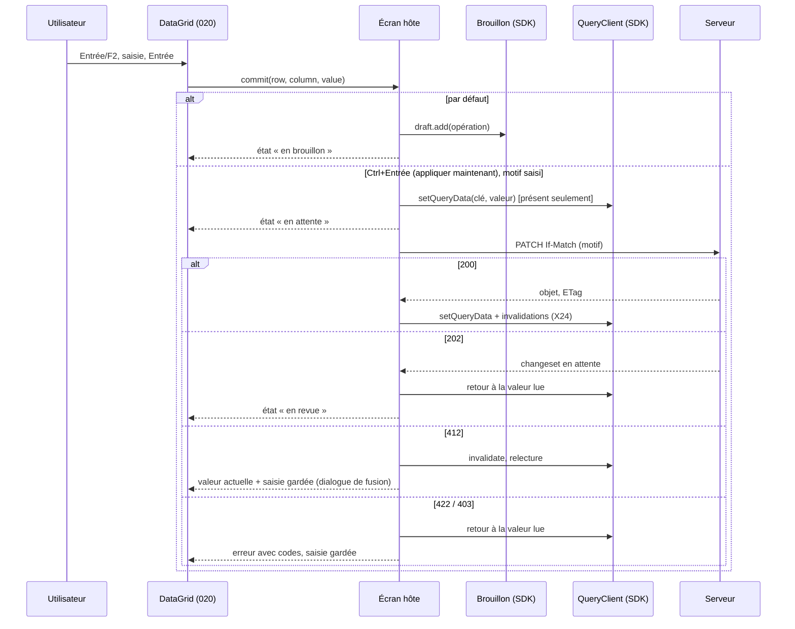

# 021 — Shell v2 : conception

## Vue d'ensemble

Le shell v2 est la même application servie par kartenn-server (007/W2), réécrite sur
`@kartenn/ui` (020) et sur le SDK 2.0. Trois couches :


L'import map désigne `@kartenn/sdk`, le framework **[D-1]**, `@kartenn/ui` et sa feuille ;
le shell et les plugins de première partie les marquent `external` (ADR 0038). Le
`QueryClient` vit dans le SDK, l'adaptateur au framework dans `@kartenn/ui` (ADR 0037).

## Ce qui reste de la 007

La 007 reste la spec du **serveur** et du **contrat des plugins** ; ses exigences client
sont gardées, amendées ou remplacées ainsi.

| 007 | Sort | Par |
|---|---|---|
| REQ-007-1 à 8 (service, en-têtes, configuration, répertoire, manifeste, SRI, capacités, à chaud) | gardées | — ; l'import map gagne trois entrées (REQ-021-26) |
| REQ-007-9 (chargement) | gardée, amendée | plages `ui` et `framework` (REQ-021-26) |
| REQ-007-10 (code de confiance) | gardée | — |
| REQ-007-11 (première partie) | gardée, amendée | DOM léger et `@kartenn/ui` (REQ-021-27) |
| REQ-007-12 (SDK) | amendée | version 2.0 (REQ-021-25) ; « sans framework » gardé |
| REQ-007-13 (points d'extension) | gardée, étendue | espaces, commandes, raccourcis (REQ-021-2, 3, 7) |
| REQ-007-14, 15, 16, 24 (contexte, client, bac à sable, contexte des plugins) | gardées | le client devient la fonction de requête du cache |
| REQ-007-17, 18, 19 (écrans) | remplacées | REQ-021-9, 10, 12 |
| REQ-007-20, 21, 22 (droits, exemple, URL) | gardées | — |
| REQ-007-23 (bandeau) | remplacée | REQ-021-5 (même règle, barre d'état et bande) |
| REQ-007-25 (modification rapide) | amendée | REQ-021-15, 16 (édition en place, optimisme, 202) |
| REQ-007-26, 27, 28, 29 (brouillon, identité, session, i18n) | gardées | présentation : REQ-021-6, 11, 14, 28 |
| REQ-007-30 (jetons) | remplacée | 020 (REQ-020-4 à 11) ; traversée du Shadow DOM gardée |
| REQ-007-31 (listes et arbre) | remplacée | REQ-020-19 |
| REQ-007-32 (budgets) | remplacée | REQ-021-30 |
| REQ-007-33 (WCAG) | gardée, étendue | REQ-021-29 |
| REQ-007-34 à 41 (E2E, émetteur, origine, navigateurs, licences, ajouts à l'API) | gardées | captures de la 020 en plus |
| W1 à W6, W8, W9, W14 à W16, W18 | gardées | — |
| W7 (SDK seule instance partagée) | amendée | ADR 0038 |
| W10 (écriture) | amendée | édition en place (X15) |
| W11 (vue-i18n) | gardée **[D-1]** | bibliothèque i18n du framework retenu |
| W12 (Reka UI, jetons) | remplacée | 020, ADR 0036 |
| W13 (budgets) | remplacée | X30 |
| W17 (état dans l'URL, sans magasin global) | gardée, précisée | le cache du SDK n'est pas un magasin d'application : l'état de vue reste dans l'URL |

## Cadre (REQ-021-1 à 6)

```
┌──────────┬──────────────────────────────────────────────────────────────┐
│ marque   │ fil d'Ariane            pastille de date  Brouillon (n)  ☺ │  barre d'état (40 px)
│ Ctrl+K   ├──────────────────────────────────────────────────────────────┤
│ Espace A │ bande ambre « Lecture au … — Revenir au présent »  (hors présent)
│  entrée  ├────────────────────┬─────────────────────────────────────────┤
│  entrée  │ panneau (arbre)    │ panneau (table, fiche)                  │  surface de travail
│ Espace B │                    │                                         │  (fond --k-bg, panneaux --k-surface)
│  …       │                    │                                         │
│ replier  │                    │                       [panneau brouillon]│
└──────────┴────────────────────┴─────────────────────────────────────────┘
```

- Barre latérale : 208 px, repliée 48 px ; fond `--k-sidebar-bg` ; espaces en
  `Disclosure` ; état replié en `localStorage` (`kartenn.sidebar`).
- **Espaces** : `referential` (Référentiel : domaines, préfixes, plages, adresses,
  entités, sites, anomalies, propriétés), `changes` (Changesets : changesets, à
  instruire, brouillon, imports), `admin` (Administration), plus ceux que déclarent les
  plugins dans une liste fermée extensible : `network` (Réseau : VLAN), `hosts`
  (Machines), `security` (Sécurité : politique, flux). Un espace sans entrée est masqué.
  Libellés dans les catalogues du shell (Q-021-5).
- Barre d'état : `Breadcrumb`, `DatePill`, `DraftCounter`, menu de l'utilisateur
  (langue, thème, densité, raccourcis à une touche, à propos, déconnexion).
- Bande : `TimeBand` sous la barre d'état, pleine largeur, `--k-band-bg` ; la barre et la
  bande sont collantes, et la surface défile dessous avec `scroll-padding-top` égal à leur
  hauteur (2.4.11).
- Panneau du brouillon : `Drawer` non modal, 420 px, à droite, poussant la surface
  (jamais au-dessus d'une cellule en édition).
- `index.html` : squelette statique (barre latérale, barre d'état, deux panneaux vides en
  squelette) stylé par une feuille critique en fichier ; l'application monte dans la même
  géométrie.

## Routes

Les routes de la 007 sont gardées (liens existants valides) ; s'ajoutent :

| Route | Écran | Remarque |
|---|---|---|
| `/` | Référentiel : arbre du domaine et table du nœud choisi | maquette E1 |
| `/:collection` | liste avec filtres typés | E3 |
| `/:collection/:id` | fiche | E2 |
| `/changesets`, `/changesets/:id`, `/proposals` | changesets, différentiel, à instruire | E4 |
| `/draft` | brouillon en page | E5 ; aussi en panneau partout |
| `/admin/*` | administration | E7 |
| `/x/<plugin>/<id>/*` | vue de plugin | E10 |
| `/help/shortcuts` | aide des raccourcis (aussi `?`) | E8 |
| `/_ui/*` | catalogue (hors production, 020) | — |

Chaque route déclare `meta.queries(params, time)` (requêtes à précharger) et
`meta.breadcrumb(params)`.

## Raccourcis (REQ-021-7, 8)

| Touche | Action | Portée |
|---|---|---|
| Ctrl+K / ⌘K | palette | partout, même dans un champ |
| `/` | focus du filtre ou de la recherche de la vue | hors champ |
| `?` | aide des raccourcis | hors champ |
| `g` `d` / `p` / `r` / `a` / `e` / `s` | domaines, préfixes, plages, adresses, entités, sites | hors champ |
| `g` `c` / `i` / `b` | changesets, à instruire, brouillon | hors champ |
| `g` `x` | administration | hors champ |
| `g` `h` | accueil (référentiel) | hors champ |
| `c` | créer dans la collection courante | hors champ, droit d'écriture, présent |
| `e` | modifier l'objet courant ou la cellule active | idem |
| Ctrl+Entrée | appliquer maintenant (édition en place) | dans l'éditeur |
| Échap | fermer la couche, annuler l'édition | partout |
| `[` | replier ou déplier la barre latérale | hors champ |

- Un seul écouteur `keydown` sur `document` (phase de bouillonnement) : ignore
  `event.defaultPrevented`, `event.isComposing`, une cible éditable (`input`, `textarea`,
  `select`, `[contenteditable]`, rôle `textbox`, `combobox`, `searchbox`), une cible dans
  un composant qui déclare consommer les caractères (`data-k-typeahead`), et toute
  combinaison avec Ctrl, Alt ou Méta (sauf Ctrl+K et Ctrl+Entrée). Séquence `g` : 1,5 s.
- Registre des raccourcis (SDK `shortcuts.register`) avec portée (`global`, `view`) ; le
  registre refuse qu'un plugin redéfinisse une touche du shell ; l'aide `?` et les menus
  lisent ce registre (une seule source).
- Réglage « Raccourcis à une touche » (menu de l'utilisateur, `localStorage`) :
  désactivés, seuls Ctrl+K, Ctrl+Entrée et Échap restent (WCAG 2.1.4).
- Lettres choisies sur les mots français et anglais quand ils coïncident ; sinon sur
  l'anglais, la langue des identifiants (Q-021-6).

## Écrans (REQ-021-9 à 14)

Les écrans assemblent des composants de `@kartenn/ui` et n'écrivent pas de CSS hors des
primitives de mise en page. Chaque zone de données est une frontière d'erreur (une erreur
ne vide pas l'écran) avec ses trois états.

- **Référentiel** : `TreeGrid` des préfixes (colonnes : préfixe, occupation, colonnes de
  plugins), enfants paginés ; `DataGrid` des collections ; fiche en panneaux (attributs
  éditables en place, propriétés résolues avec `Popover` d'explication, occupation et
  prochain libre, historique en liste de versions, anomalies) ; onglets de plugins.
- **Changesets** : `DataGrid` filtrée ; fiche : `DiffList`, anomalies, actions de revue
  selon les droits (`MenuButton`), état par `StatusBadge` ; « À instruire » avec compteur
  dans la barre latérale.
- **Brouillon** : `Drawer` et page ; liste des opérations (retirer, modifier), simulation
  débrayée (500 ms, existant), violations par opération avec `CodeBadge`, motif, dates
  d'effet, soumission (clé d'idempotence existante).
- **Administration** : écrans de la 007 sur `DataGrid`, `Dialog`, `FormField` ; permission
  en `CodeBadge` (nom servi) et libellé.
- **Hôte des plugins** : composants hôtes de la 007 (`ExtensionElement`, `PluginView`)
  repris dans le cadre ; vue de plugin sous son espace.

## Édition en place (REQ-021-15, 16, 17)



- Éditabilité d'une cellule : `rights.can(<permission d'écriture du type ou de la
  propriété>)` (`/v1/me`, REQ-007-20) **et** contexte au présent **et** attribut
  modifiable au contrat (schéma du `PATCH`) ; sinon pas d'éditeur, infobulle du motif.
- Opération du brouillon : format `Operation` du contrat (W10, inchangé) ; l'objet garde
  sa version lue comme `expected`.
- Validation locale par les types du contrat ; la validation métier reste la simulation
  du brouillon ou la réponse 422.
- Déplacement (X17) : pour les arbres à parent déclaré (groupes de VLAN ancrés, machines
  hébergées par un cluster, selon les modules), `move` → opération de changement de
  parent ; pour les préfixes (arbre déduit, D34), pas de glisser ; « Changer de domaine… »
  au menu, s'il existe une opération qui le permet (Q-021-2).

## Filtres, libellés, codes (REQ-021-18 à 20)

- **Filtres** : les paramètres de l'URL sont ceux de la route de liste, tels quels (un
  lien est une requête de l'API, REQ-007-22). Le modèle d'une liste est tiré du contrat
  au build, comme `dated.ts` (007) : `filters.ts` liste, par chemin de collection, ses
  paramètres de filtre, leur type (schéma) et leur domaine (`enum`, ou référence à une
  collection : site, entité, domaine, environnement). Les propriétés déclarées
  (`GET /v1/property-declarations`) s'y ajoutent à l'exécution, avec leurs listes fermées
  (016). `FilterPicker` (020) reçoit ce modèle ; les suggestions passent par le cache.
- **Libellés** : `label(kind, key, locale)` cherche, dans l'ordre, le libellé servi par
  l'API pour la langue (quand la 018 l'apportera), le catalogue (`labels.<kind>.<key>` du
  shell ou du plugin), puis rend la clé ; `KeyLabel` (020) affiche le résultat et garde la
  clé accessible.
- **Codes** : `ApiProblem` (SDK, existant) porte `type`, `violations[].code` et
  `requestId` ; tout rendu d'erreur passe par `ErrorState`, `InlineAlert` ou `Toast` de la
  020, qui montrent ces champs en `CodeBadge`. Le slug du `type`
  (`urn:kartenn:problem:<slug>`) est le code affiché.

## Couche de données (REQ-021-21 à 24, ADR 0037)

### Clés et fraîcheur

```ts
// @kartenn/sdk 2.0
keys.object(type, id, time)            // ['v1', type, id, null, timeKey(time)]
keys.list(path, filters, time)         // ['v1', path, null, normalize(filters), timeKey(time)]
keys.sub(type, id, sub, params, time)  // occupation, historique, explication, enfants…
timeKey({ validAt, asOf })             // { valid_at: validAt ?? null, as_of: asOf ?? null }
```

| Famille | `staleTime` | `gcTime` | Revalidation |
|---|---|---|---|
| `as_of` passé (toute requête) | `Infinity` | 30 min | jamais |
| objet, présent ou `valid_at` | 30 s | 10 min | `If-None-Match`, focus, flux |
| liste (pages) | 30 s | 5 min, 10 pages gardées au plus | idem ; `placeholderData` = page précédente |
| enfants d'un nœud d'arbre | 30 s | 10 min | idem |
| capacités, `/v1/me`, déclarations | 5 min | session | flux (`changeset` d'administration), focus |
| simulation du brouillon | 0 | 1 min | à chaque changement (débrayé) |

- Chaque entrée garde `{ data, etag }` ; la fonction de requête envoie `If-None-Match` et,
  sur 304, rend la donnée gardée.
- **Dépendants** : à chaque réponse, le SDK relève les références `{type, id}` que le
  corps montre (résumés de liés, éléments embarqués) et tient un index
  `id → clés` ; un événement qui nomme un objet invalide aussi les clés qui le montrent.
  C'est ce qui rend utile l'ETag composite (006/H19) côté client.
- **Version** : l'égalité « déjà à jour » se teste sur le champ `version` du corps, jamais
  sur l'ETag (opaque, 006/H19) ; sans `version` dans le corps, invalidation sans
  condition (relecture en `If-None-Match`, 304 si rien n'a changé).

### Préchargement (REQ-021-22)

- `KLink` (composant du shell sur `@kartenn/ui`) : au survol après 60 ms ou au focus,
  `queryClient.prefetchQuery` pour chaque requête de `meta.queries` de la cible ; au
  survol d'une entrée de plugin, insertion de ses `modulepreload` avec empreinte (mécanisme
  de la 007, déclenché plus tôt).
- Garde de navigation : lance les mêmes requêtes, attend au plus 100 ms, puis rend ; la
  vue affiche la donnée en cache ou un squelette.
- Listes : page suivante préchargée quand la fenêtre virtualisée approche de la fin
  (2 écrans) ; arbre : enfants d'un nœud fermé survolé.
- Après le premier écran, `requestIdleCallback` précharge les entrées des plugins (007).

### Flux d'événements (REQ-021-23)

- **Un flux par navigateur** : les onglets se disputent un verrou `navigator.locks`
  (`kartenn-events`) ; le détenteur ouvre l'`EventSource` et rediffuse chaque événement sur
  `BroadcastChannel('kartenn-events')` ; à la fermeture de son onglet, le verrou passe à un
  autre, qui rouvre avec le dernier curseur reçu (`last_event_id`). Repli si
  `navigator.locks` manque : un flux par onglet (Q-021-3).
- **Contrat de la 022** (design § « Contrat consommé par les clients ») : flux ouvert avant
  les premières lectures ; `ready` → `invalidateQueries()` une fois ; `changes` → objets
  nommés (version différente), listes de leurs types, dépendants ; `truncated` → toutes
  les requêtes des types et domaines nommés ; `changeset` → le changeset et
  `/v1/proposals` ; `reset` → tout.
- **Reconnexion** : coupure réseau reprise par le navigateur (`Last-Event-ID`) ; statut
  non 200 (401, 429, 503) → `CLOSED` : le SDK vérifie la session, puis rouvre avec attente
  croissante plafonnée et aléatoire (022).
- **Doublons** : identités d'événement déjà vues ignorées (fenêtre de 1 000), révisions
  comparées à l'égalité (022, REQ-022-27).
- **Repli** : sans flux, `refetchOnWindowFocus`, `refetchOnReconnect`, et revalidation au
  `pageshow` persistant (bfcache) ; la base IndexedDB du brouillon se ferme sur `pagehide`.

### Écritures (REQ-021-16, 24)

- `sdk.write.quick({ key, patch, motive, ifMatch })` : annule les lectures de la clé,
  applique l'optimisme si présent, envoie, puis rend `applied`, `proposed` (202),
  `conflict` (412, avec la relecture), `invalid` (422, violations), `forbidden`.
- Après `applied` : invalidation des objets de la réponse, de leurs collections et
  dépendants ; le flux, s'il arrive ensuite, trouve des versions égales et ne relit rien.

## API des plugins (REQ-021-25 à 27)

```ts
// @kartenn/sdk 2.0 (ajouts à la 1.x, design de la 007 § SDK)
export const queryClient: QueryClient;               // @tanstack/query-core, instance unique
export const keys: KeyFactories;                      // § Clés
export const events: { subscribe(l: (e: KartennEvent) => void): () => void; state(): 'open' | 'connecting' | 'closed' };
export const write: { quick(req: QuickWrite): Promise<WriteOutcome> };
export const commands: { register(c: Command): () => void };      // palette
export const shortcuts: { register(s: Shortcut): () => void };    // portée `view`
export function label(kind: string, key: string): string;
```

Manifeste (ajouts) :

```json
{
  "name": "vlan", "version": "2.0.0", "module": "vlan",
  "sdk": "^2.0.0", "ui": "^1.0.0", "framework": "^3.5.0",
  "space": "network",
  "views": [{ "element": "k-vlan-groups", "label": "vlan.nav.groups", "icon": "vlan", "go": "v" }]
}
```

- `framework` **[D-1]** (`^3.5.0` pour Vue, `^19.0.0` pour React) ; un plugin sans framework
  ne déclare ni `ui` ni `framework` s'il n'importe pas `@kartenn/ui`.
- `go` : lettre de navigation `g` + lettre proposée, refusée si elle est prise.
- Import map servie (exemple, empreintes omises) :

```json
{ "imports": {
    "@kartenn/sdk": "/assets/sdk-<hash>.js",
    "@kartenn/ui": "/assets/ui-<hash>.js",
    "<framework>": "/assets/<framework>-<hash>.js" },
  "integrity": { "/assets/sdk-<hash>.js": "sha384-…", "/assets/ui-<hash>.js": "sha384-…", "/assets/<framework>-<hash>.js": "sha384-…" } }
```

  La feuille `@kartenn/ui/style.css` est liée par `index.html` (`<link rel=stylesheet
  integrity>`) ; les plugins tiers en racine d'ombre la lient par `handle.styles()`.
- Hôte d'un plugin de première partie : l'élément personnalisé monte une application du
  framework dans son DOM léger, avec le `QueryClient` du SDK et le contexte ; il la démonte
  à `disconnectedCallback`.

## Budgets (REQ-021-30)

Projet Playwright `budgets` de `bench-web` (existant), Chromium, CPU ralenti ×4 par CDP,
jeu à 10⁶ objets.

| Budget | Seuil | Mesure |
|---|---|---|
| Shell initial | ≤ 300 Ko gzip | `size.mjs` : entrée, imports statiques, CSS, SDK, framework, `@kartenn/ui` |
| Plugin | ≤ 50 Ko gzip | `size.mjs` par plugin, modules partagés exclus |
| Premier écran utile | ≤ 2 s | navigation après le rappel OIDC → marque `k:ready` (existant) |
| Page de 100 lignes | ≤ 100 ms | `responseEnd` → `k:rows`, p95 de 20 pages (existant) |
| INP | ≤ 200 ms, p75 | Event Timing (`PerformanceObserver` `event`, `durationThreshold: 16`) sur 20 répétitions de : ouvrir un nœud, filtrer, éditer une cellule, changer d'onglet, ouvrir la palette |
| Navigation en cache | ≤ 100 ms | clic sur un lien déjà préchargé → marque `k:view` |
| CLS | ≤ 0,05 | `layout-shift` sans entrée récente, premier écran et 10 navigations |
| Arbre de 10⁵ | ≤ 5 % de trames perdues | défilement scénarisé de 10⁴ lignes ; trames comptées par `requestAnimationFrame` contre la cadence attendue (et tâches longues > 50 ms : aucune, existant) |
| Mémoire | ≤ plafond **[D-1]** | CDP `Performance.getMetrics` `JSHeapUsedSize` après 10⁴ lignes défilées et 50 navigations, après `HeapProfiler.collectGarbage` |
| Plugin lent | écarté à 5 s | existant |

## Migration depuis le shell actuel

| Phase | Contenu | Spec | Sortie vérifiable |
|---|---|---|---|
| 0 | Arbitrages, prototype D-1, ADR 0036 à 0039, outillage Claude, Stylelint | 020 (P0), 021 (tâche 1) | ADR acceptées ; agents, skill et hook en place |
| 1 | Jetons, police, icônes, catalogue nu, maquettes E1 à E10 validées | 020 (P1 à P3) | validations consignées ; captures de référence |
| 2 | `@kartenn/ui` complet | 020 (P4, P5) | catalogue, captures, scripts APG, budgets de la bibliothèque |
| 3 | SDK 2.0 : cache, clés, préchargement, écritures, flux (après 022-9, 10), import map étendue, manifeste | 021 (P1) | tests Vitest du cache ; parcours de fraîcheur à deux navigateurs |
| 4 | Écrans du shell par zones : cadre, référentiel, changesets et brouillon, administration, hôte des plugins | 021 (P2) | parcours verts à chaque zone ; captures ; `bench-web` étendu |
| 5 | Portage des plugins VLAN, Machines ; plugin d'exemple passé au SDK 2.0, toujours sans framework | 021 (P3) | parcours `vlan`, `machines`, `example` verts |
| 6 | Plugins Politique et Flux | 017 (amendée) | selon la 017 |

- Bascule **en place**, zone par zone, dans `web/shell` : chaque zone remplace ses vues et
  ses parcours dans le même commit ; entre deux zones, `main` mêle l'ancien et le nouveau
  style, ce qu'admet une branche non livrée (la v0.1 sort avec l'interface actuelle)
  (Q-021-4).
- **Jeté** : `web/shell/src/styles/base.css`, `tokens.css`, `data/DataTable.vue`,
  `admin/PagedTable.vue`, l'arbre actuel, les vues ; le DOM impératif des plugins VLAN et
  Machines. **Gardé** : routeur et routes, `rights/`, `draft/` (logique), `time/`
  (logique), `session`, `plugins/loader.ts` et `registry.ts`, i18n et ses catalogues
  (clés reprises), `web/e2e` (parcours réécrits par zone), `bench-web`, `size.mjs`.

## Dépend de D-1

| Point | Vue 3 | React 19 |
|---|---|---|
| Adaptateur du cache | `@tanstack/vue-query` sur le `QueryClient` du SDK | `@tanstack/react-query` sur le même |
| Routeur et préchargement | vue-router, gardes `beforeResolve`, `meta.queries` | routeur à chargeurs (préchargement à l'intention natif) |
| i18n | vue-i18n (W11, sans `eval`) | bibliothèque équivalente sans `eval` (à choisir) |
| Hôte de plugin | `createApp` par élément, `provide` du contexte | `createRoot` par élément, fournisseur de contexte |
| Plage `framework` | `^3.5` | `^19` |
| Plafond de mémoire | mesuré au prototype | mesuré au prototype |
| D17, ADR 0011 | inchangées | à amender (framework du shell) |

## Erreurs et cas limites

- **Flux refusé (401)** pendant une session valide ailleurs : le SDK relit `/v1/me` ;
  session expirée → dialogue de reconnexion (007) ; brouillon intact.
- **Plafond de flux par identité atteint (429)** : repli sur la revalidation au focus,
  avis discret dans la barre d'état (« Mises à jour en direct indisponibles »).
- **Version absente du corps** (lecture composite) : invalidation sans condition.
- **Préchargement refusé (403)** : ignoré ; la navigation affiche le refus.
- **412 sur une cellule** : dialogue de fusion ancré à la cellule ; Échap garde la saisie
  dans le brouillon de l'éditeur.
- **Bascule hors présent pendant une édition** : l'édition en cours est annulée et sa
  saisie proposée au brouillon (avec `valid_from`).
- **Plugin qui enregistre une touche du shell** : refusé, journalisé en console, plugin
  chargé quand même.
- **Raccourci pendant une composition de saisie** (IME) : ignoré (`isComposing`).

## Alternatives considérées

- **Nouveau paquet `web/shell2`** servi à la bascule : pas de mélange de styles sur
  `main`, mais deux shells à maintenir, des parcours en double et une bascule en un bloc
  (Q-021-4).
- **SharedWorker pour le flux unique** : un seul `EventSource` sans élection, mais absent
  de certains navigateurs mobiles et plus dur à déboguer ; le verrou et le canal suffisent.
- **Édition en place qui applique directement** : plus rapide pour une valeur, mais motif
  obligatoire à chaque cellule (REQ-007-25) et contournement du brouillon (Q-021-1).
- **Bandeau seul, sans pastille** (007) : remplacé par le brief (barre d'état).

## Risques

- **D-1 tardif** : P1 de la 021 (SDK 2.0, cache, flux) ne dépend pas du framework et peut
  avancer ; P2 et P3 attendent.
- **Contrat 022 et ETag composite** : la comparaison sur `version` suppose ce champ dans
  les corps ; à vérifier sur chaque ressource (tâche 3) ; à défaut, relecture
  conditionnelle (304), plus coûteuse mais correcte.
- **Poids** : framework et `@kartenn/ui` comptés dans les 300 Ko ; mesuré dès la phase 2.
- **Raccourcis et technologies d'assistance** : revue `a11y-auditor` avec un lecteur
  d'écran en mode navigation, pas seulement axe.

## Stratégie de test

| Niveau | Quoi |
|---|---|
| Vitest (SDK) | clés et normalisation, fraîcheur par famille, 304, optimisme et retour, 202, 412, index des dépendants, flux (événements simulés : `ready`, `changes`, `truncated`, `reset`, doublons), élection du flux entre onglets (simulée) |
| Vitest (shell) | registre des raccourcis (conflits, portée, désactivation), modèle des filtres tiré du contrat, `label`, éditabilité d'une cellule |
| Playwright parcours | par zone ; fraîcheur à deux navigateurs ; édition en place (brouillon, appliquer, 202, 412) ; raccourcis ; palette ; lecture au passé ; plugins |
| Playwright captures | écrans clés comparés aux maquettes validées (020) |
| axe, clavier | chaque étape ; scripts APG des composants (020) |
| `bench-web` | REQ-021-30 |

## ADR

[0037](../../docs/adr/0037-couche-de-donnees-du-client.md) (couche de données),
[0038](../../docs/adr/0038-partage-des-composants-avec-les-plugins.md) (partage avec les
plugins, amende 0025), proposées ; ADR 0011 et D17 amendées seulement si D-1 change le
framework.

## Références

- Spec 022, design § « Contrat consommé par les clients » ; 006/H19 (ETag composite).
- WHATWG HTML § 9.2 (`EventSource`), § 8.1.5 (import maps, `integrity`).
- Web Locks API : https://w3c.github.io/web-locks/ ; Broadcast Channel : WHATWG HTML
  § 9.5.
- Event Timing et INP : https://w3c.github.io/event-timing/ ; https://web.dev/articles/inp.
- Layout Instability (CLS) : https://wicg.github.io/layout-instability/ ;
  https://web.dev/articles/cls.
- bfcache : https://web.dev/articles/bfcache.
- TanStack Query, valeurs par défaut et mises à jour optimistes :
  https://tanstack.com/query/latest/docs/framework/vue/guides/important-defaults ;
  `…/guides/optimistic-updates`.
- WCAG 2.2, 2.1.4 « Character Key Shortcuts » : https://www.w3.org/TR/WCAG22/#character-key-shortcuts.
