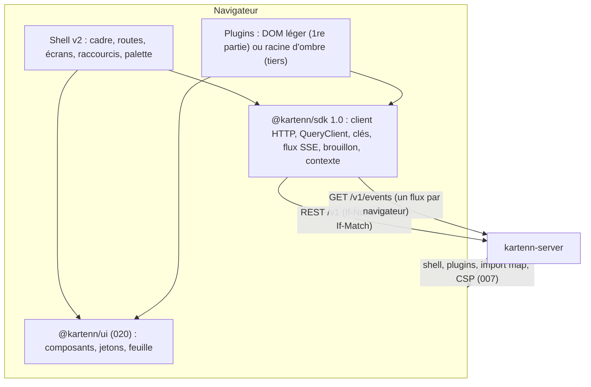
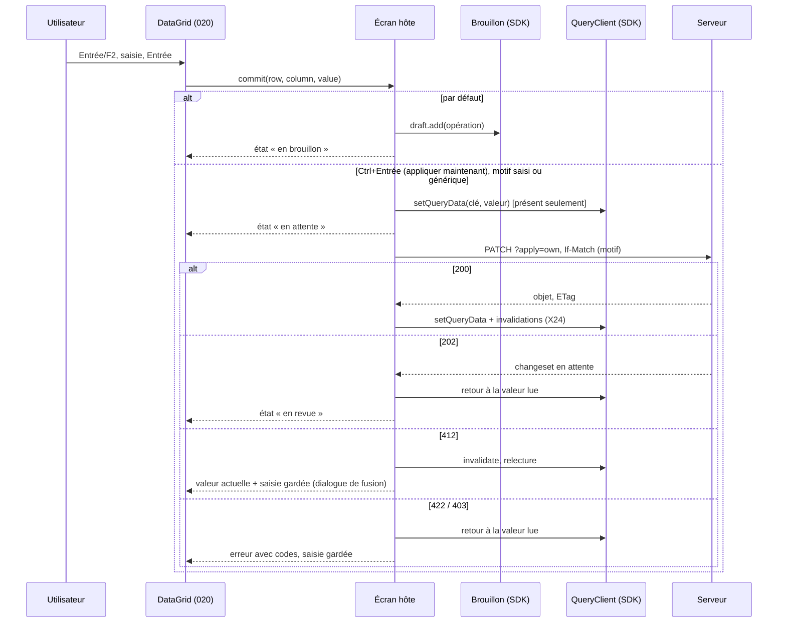

# 021 — Shell v2 : conception

## Vue d'ensemble

Le shell v2 est la même application servie par kartenn-server (007/W2), réécrite sur
`@kartenn/ui` (020) et sur le SDK 1.0. Trois couches :



L'import map désigne `@kartenn/sdk`, `vue` (D-1 : Vue 3, build *runtime* de production sans
compilateur), `@kartenn/ui` et sa feuille ;
le shell et les plugins de première partie les marquent `external` (ADR 0038). Le
`QueryClient` vit dans le SDK, l'adaptateur au framework dans `@kartenn/ui` (ADR 0037).

## Ce qui reste de la 007

La 007 reste la spec du **serveur** et du **contrat des plugins** ; ses exigences client
sont gardées, amendées ou remplacées ainsi.

| 007 | Sort | Par |
|---|---|---|
| REQ-007-1 à 8 (service, en-têtes, configuration, répertoire, manifeste, SRI, capacités, à chaud) | gardées | — ; l'import map gagne trois entrées (REQ-021-26) |
| REQ-007-9 (chargement) | gardée, amendée | plages `ui` et `framework` (REQ-021-26) |
| REQ-007-10 (code de confiance) | gardée | — |
| REQ-007-11 (première partie) | gardée, amendée | DOM léger et `@kartenn/ui` (REQ-021-27) |
| REQ-007-12 (SDK) | amendée | version 1.0 (REQ-021-25) ; « sans framework » gardé |
| REQ-007-13 (points d'extension) | gardée, étendue | espaces, commandes, raccourcis (REQ-021-2, 3, 7) |
| REQ-007-14, 15, 16, 24 (contexte, client, bac à sable, contexte des plugins) | gardées | le client devient la fonction de requête du cache |
| REQ-007-17, 18, 19 (écrans) | remplacées | REQ-021-9, 10, 12 |
| REQ-007-20, 21, 22 (droits, exemple, URL) | gardées | — |
| REQ-007-23 (bandeau) | remplacée | REQ-021-5 (même règle, barre d'état et bande) |
| REQ-007-25 (modification rapide) | amendée | REQ-021-15, 16 (édition en place, optimisme, 202) |
| REQ-007-26, 27, 28, 29 (brouillon, identité, session, i18n) | gardées | présentation : REQ-021-6, 11, 14, 28 |
| REQ-007-30 (jetons) | remplacée | 020 (REQ-020-4 à 11) ; traversée du Shadow DOM gardée |
| REQ-007-31 (listes et arbre) | remplacée | REQ-020-19 |
| REQ-007-32 (budgets) | remplacée | REQ-021-30 |
| REQ-007-33 (WCAG) | gardée, étendue | REQ-021-29 |
| REQ-007-34 à 41 (E2E, émetteur, origine, navigateurs, licences, ajouts à l'API) | gardées | captures de la 020 en plus |
| W1 à W6, W8, W9, W14 à W16, W18 | gardées | — |
| W7 (SDK seule instance partagée) | amendée | ADR 0038 |
| W10 (écriture) | amendée | édition en place (X15) |
| W11 (vue-i18n) | gardée | D-1 : Vue 3 |
| W12 (Reka UI, jetons) | remplacée | 020, ADR 0036 |
| W13 (budgets) | remplacée | X30 |
| W17 (état dans l'URL, sans magasin global) | gardée, précisée | le cache du SDK n'est pas un magasin d'application : l'état de vue reste dans l'URL |

## Cadre (REQ-021-1 à 6)

Révisé par la 024 (M8, M15 ; disposition B arbitrée sur prototype, hors dépôt, le
2026-10-24).

```
┌──────────┬──────────────────────────────────────────────────────────────┐
│ marque   │ fil d'Ariane            pastille de date  Brouillon (n)  ☺ │  barre d'état (40 px)
│ Ctrl+K   ├──────────────────────────────────────────────────────────────┤
│ Espace A │ bande ambre « Lecture au … — Revenir au présent »  (hors présent)
│  entrée  ├──────────────────────────────────┬───────────────────────────┤
│  entrée  │ surface (une vue : tableau de    │ Détail │ Brouillon 3      │  panneau droit
│ Espace B │ bord, table, fiche, arbre)       │ opérations, simulation   │  420 px, en
│  …       │                                  │ ───────────────────────  │  surimpression
│          │                                  │ résumé ___________       │  non modale
│          │                                  │ description ______       │
│ replier  │                                  │ [Appliquer      |▾]      │
└──────────┴──────────────────────────────────┴───────────────────────────┘
```

- Barre latérale : 208 px, repliée 48 px ; fond `--k-sidebar-bg` ; espaces en
  `Disclosure` ; état replié en `localStorage` (`kartenn.sidebar`).
- **Espaces**, dans cet ordre (liste fermée, extensible par amendement) :
  `referential` (Référentiel : accueil, domaines, préfixes, plages, adresses, entités,
  sites, anomalies, propriétés), `changes` (Changesets : changesets, à instruire,
  brouillon, imports), `network` (Réseau : VLAN, groupes), `hosts` (Machines : machines,
  hébergement, interfaces), `policy` (Politique : matrice, règles et motifs, catalogue,
  inférence, conformité, rapports), `flows` (Flux : flux, instruction, non-conformités),
  `admin` (Administration, en dernier). Un espace sans entrée visible est masqué.
  Libellés dans les catalogues du shell.
- **Badges** : « À instruire » (`/v1/proposals`), « Instruction » (demandes de flux en
  attente), « Brouillon » (opérations du brouillon actif), « Anomalies » et « Inférence »
  (`/v1/anomalies` par règle) ; relus par le flux d'événements, jamais par sondage.
- Barre d'état : `Breadcrumb`, `DatePill`, `DraftCounter`, menu de l'utilisateur
  (langue, thème, densité, raccourcis à une touche, à propos, déconnexion).
- Bande : `TimeBand` sous la barre d'état, pleine largeur, `--k-band-bg` ; la barre et la
  bande sont collantes, et la surface défile dessous avec `scroll-padding-top` égal à leur
  hauteur (2.4.11).
- **Panneau droit** (`SidePanel`, 020) : région `complementary` non modale, 420 px par
  défaut, redimensionnable (poignée au clavier), en surimpression de la surface : la vue
  garde sa largeur, le panneau couvre sa droite. La surface est un contexte d'empilement
  isolé (`isolation: isolate`) : ses en-têtes collants ne passent jamais au-dessus du
  panneau. Onglets « Détail » (la sélection courante) et « Brouillon n » ; ouvrir le
  brouillon le met devant. Replié, il ne laisse qu'une languette au bord de fin de la
  surface (option `rail`, dans le flux : elle ne couvre rien, `cover` compris), dont le
  chevron « Ouvrir le panneau » le rouvre sur son dernier onglet ; son état (ouvert,
  onglet, largeur) est gardé en `localStorage` (`kartenn.panel`). Jamais au-dessus d'une
  cellule en édition : la grille fait défiler la cellule active hors de la zone couverte.
- **Compteur du brouillon** (`DraftCounter`) : toujours visible, bascule du panneau
  (`aria-expanded`, `aria-controls`) : fermé, il l'ouvre sur l'onglet Brouillon ; ouvert,
  quel que soit l'onglet, il le ferme, et son icône de brouillon devient une croix
  (revue du 2026-10-25). Son menu (chevron) liste les brouillons de l'utilisateur (REQ-021-11).
- **Pied de l'onglet Brouillon** : résultat de la simulation en une ligne ; `CommitForm`
  (résumé sur une ligne, description facultative) ; `SplitButton`. Action par défaut :
  « Appliquer » (`POST /v1/drafts/{id}/submission?apply=own`) si `/v1/me` donne
  `apply_own` sur tous les objets du brouillon et que la simulation ne signale aucune
  politique qui retient ; « Soumettre en revue » sinon. Le chevron offre aussi
  « Enregistrer le brouillon » (le motif est gardé dans le brouillon). Une entrée
  impossible reste dans le menu, désactivée, avec son motif en infobulle (permission
  manquante, politique). « Appliquer » préremplit le résumé (« Maintenance du
  référentiel », libellé du catalogue du shell) ; Ctrl+Entrée dans le formulaire lance
  l'action choisie. Un 202 de `?apply=own` (droit retiré entre-temps, politique) laisse
  le changeset en revue et montre le motif de la réponse.
- **Emplacements fixes** (024/M15) : barre latérale, barre d'état, surface et panneau sont
  posés par la grille du cadre ; chaque emplacement défile en interne
  (`min-inline-size: 0`, `overflow: auto`) ; aucune page ne défile horizontalement de 1024
  à 1920 px ; à 768 px, la barre latérale passe repliée et le panneau couvre la surface.
- `index.html` : squelette statique (barre latérale, barre d'état, deux panneaux vides en
  squelette) stylé par une feuille critique en fichier ; l'application monte dans la même
  géométrie.

## Routes

Les routes de la 007 sont gardées (liens existants valides) ; s'ajoutent :

| Route | Écran | Remarque |
|---|---|---|
| `/` | Accueil : tableau de bord de tuiles (`GET /v1/stats`, `widget` des plugins) | 024, maquette de l'accueil |
| `/topology`, `/topology?node=<id>` | Topographie : arbre du domaine et contenu du nœud choisi | maquette E1 |
| `/:collection` | liste avec filtres typés | E3 |
| `/:collection/:id` | fiche | E2 |
| `/changesets`, `/changesets/:id`, `/proposals` | changesets, différentiel, à instruire | E4 |
| `/drafts`, `/drafts/:id` | brouillons de l'utilisateur ; un brouillon en page | E5 ; le brouillon actif aussi en panneau partout |
| `/admin/*` | administration | E7 |
| `/x/<plugin>/<id>/*` | vue de plugin | E10 |
| `/help/shortcuts` | aide des raccourcis (aussi `?`) | E8 |
| `/_ui/*` | catalogue (hors production, 020) | — |

Chaque route déclare `meta.queries(params, time)` (requêtes à précharger) et
`meta.breadcrumb(params)`.

## Raccourcis (REQ-021-7, 8)

| Touche | Action | Portée |
|---|---|---|
| Ctrl+K / ⌘K | palette | partout, même dans un champ |
| `/` | focus du filtre ou de la recherche de la vue | hors champ |
| `?` | aide des raccourcis | hors champ |
| `g` `d` / `p` / `r` / `a` / `e` / `s` | domaines, préfixes, plages, adresses, entités, sites | hors champ |
| `g` `c` / `i` / `b` | changesets, à instruire, brouillons (`/drafts`) | hors champ |
| `g` `x` | administration | hors champ |
| `g` `h` | accueil (tableau de bord) | hors champ |
| `g` `o` | Topographie | hors champ |
| `g` `v` / `m` / `t` / `q` / `f` | VLAN, machines, matrice, conformité, flux (lettres déclarées aux manifestes des plugins, refusées si prises) | hors champ |
| `c` | créer dans la collection courante | hors champ, droit d'écriture, présent |
| `e` | modifier l'objet courant ou la cellule active | idem |
| Ctrl+Entrée | appliquer maintenant (édition en place) ; action choisie du bouton scindé | dans l'éditeur ; dans le pied du brouillon |
| Échap | fermer la couche, annuler l'édition | partout |
| `[` | replier ou déplier la barre latérale | hors champ |
| `]` | ouvrir ou fermer le panneau droit | hors champ |

- Un seul écouteur `keydown` sur `document` (phase de bouillonnement) : ignore
  `event.defaultPrevented`, `event.isComposing`, une cible éditable (`input`, `textarea`,
  `select`, `[contenteditable]`, rôle `textbox`, `combobox`, `searchbox`), une cible dans
  un composant qui déclare consommer les caractères (`data-k-typeahead`), et toute
  combinaison avec Ctrl, Alt ou Méta (sauf Ctrl+K et Ctrl+Entrée). Séquence `g` : 1,5 s.
- Registre des raccourcis (SDK `shortcuts.register`) avec portée (`global`, `view`) ; le
  registre refuse qu'un plugin redéfinisse une touche du shell ; l'aide `?` et les menus
  lisent ce registre (une seule source).
- Réglage « Raccourcis à une touche » (menu de l'utilisateur, `localStorage`) :
  désactivés, seuls Ctrl+K, Ctrl+Entrée et Échap restent (WCAG 2.1.4).
- Lettres choisies sur les mots français et anglais quand ils coïncident ; sinon sur
  l'anglais, la langue des identifiants (Q-021-6).

## Écrans (REQ-021-9 à 14)

Les écrans assemblent des composants de `@kartenn/ui` et n'écrivent pas de CSS hors des
primitives de mise en page. Chaque zone de données est une frontière d'erreur (une erreur
ne vide pas l'écran) avec ses trois états.

- **Accueil** : tableau de bord de tuiles sur `Grid` ; tuiles du cœur (objets par sorte,
  changements récents sur 7 et 30 jours avec l'histogramme par jour (`BarChart`), à appliquer, les
  miens en attente, anomalies ouvertes) puis `widget` des plugins ; une tuile a ses trois
  états ; les compteurs viennent de `GET /v1/stats` (`computed_at` en pied : « il y a
  2 min »), relus sur l'événement `stats`.
- **Topographie** : `TreeGrid` des préfixes (colonnes : préfixe, occupation, colonnes de
  plugins), enfants paginés, « + » sur un nœud qui ouvre le panneau d'édition de la sorte
  avec le nœud pour parent ; contenu du nœud choisi à côté.
- **Référentiel** : `DataGrid` des collections ; fiche en panneaux (attributs
  éditables en place, propriétés résolues avec `Popover` d'explication, occupation et
  prochain libre, historique en liste de versions, anomalies) ; onglets de plugins.
- **Changesets** : `DataGrid` filtrée ; fiche : `DiffList`, anomalies, actions de revue
  selon les droits (`MenuButton`), état par `StatusBadge` ; « À instruire » avec compteur
  dans la barre latérale.
- **Brouillons** : onglet du panneau droit et page `/drafts/:id` ; liste des opérations
  (retirer, modifier), simulation débrayée (400 ms, 024 § A ; `POST /v1/drafts/{id}/simulation`),
  violations par opération avec `CodeBadge`, motif, dates d'effet, soumission (clé
  d'idempotence). Page `/drafts` : `DataGrid` des brouillons (titre, opérations, dernière
  modification, suppression annoncée `expires_at`), reprendre, nouveau, supprimer.
- **Panneau d'édition par sorte** (REQ-021-36) : `EditPanel` dans l'onglet Détail, champs
  tirés du schéma de création ou de `PATCH` de la sorte (contrat), mêmes champs d'où qu'on
  vienne (arbre, table, palette, menu) ; ajoute au brouillon, ou applique par le bouton
  scindé.
- **Administration** (droits par groupes, spec 025) : écrans de la 007 sur `DataGrid`,
  `Dialog`, `FormField`. Entrées de l'espace : **Groupes**, **Rôles**, **Identités**,
  **Comptes de service**, **Émetteurs**, **Audit** ; plus d'entrée « Liaisons » : une
  liaison (un rôle sur un périmètre) s'ajoute, se modifie et se retire depuis son groupe
  (025, G4). Listes du panneau droit en colonnes alignées (024-11) : l'entrée à gauche
  (libellé puis clé, qui passe à la ligne avant la clé, jamais dans la clé), la valeur à
  droite (sorte, périmètre, nom servi, avec la fin d'une appartenance ou d'une liaison
  temporaire en seconde ligne), puis une colonne d'actions à place fixe (`IconButton`).
  - Le groupe choisi s'ouvre dans l'onglet Détail : ses membres (identités et groupes de
    l'IdP `émetteur / groupe`, la sorte affichée : personne, compte de service, compte de
    secours, groupe de l'IdP ; action Retirer), puis ses « Rôles sur périmètres » (libellé
    et clé du rôle, périmètre ; actions Modifier, Retirer) ; « Ajouter un membre » et
    « Ajouter un rôle » sous leur liste ; Modifier et Clore le groupe en tête.
  - Pas de mode d'édition à part : chaque action va au brouillon (édition *place*), et la
    ligne le montre au style du brouillon des grilles (fond et barre d'accent) avec son
    signe : un retrait reste à sa place, barré, son action devient « Annuler le retrait » ;
    un ajout vient en fin de liste, son action le retire du brouillon ; le compteur
    « Brouillon n » compte chaque opération.
  - Une action interdite reste visible, refusée par `forbidden` ou `reason` : un groupe lié
    sur un périmètre plus large que celui de l'utilisateur refuse l'ajout et le retrait de
    membres et sa clôture (« Périmètre plus large que le vôtre », `core.group.escalation`)
    et la modification de ses liaisons (`core.binding.escalation`) ; le groupe livré
    `secours` est marqué « Groupe livré », ni modifiable ni clos, ses liaisons non plus
    (`core.group.builtin`), ses membres gérés seulement par un administrateur global.
  - L'identité choisie : état (`StatusBadge`) et actions Désactiver, Révoquer les
    sessions ; en lecture, ses groupes kartenn avec « via » (direct, ou le groupe de l'IdP
    qui l'y fait entrer), ses droits effectifs (rôle, périmètre, groupe qui le donne) et
    les groupes de l'IdP de sa dernière session, datée, avec le groupe kartenn de chacun
    (025, Q-025-1 ; aucun sans session).
  - Le rôle choisi : permissions, une par ligne (libellé à gauche, `CodeBadge` du nom servi
    à droite, action Retirer), « Ajouter une permission » ; puis les groupes qui le
    portent, avec leur périmètre, en lecture.
- **Hôte des plugins** : composants hôtes de la 007 (`ExtensionElement`, `PluginView`)
  repris dans le cadre ; vue de plugin sous son espace.

## Catalogue des écrans (planche des squelettes, 2026-10-23)

Inventaire validé sur la planche des squelettes (données fictives, plages de
documentation). Légende de l'édition : *place* = en place, vers le brouillon (Ctrl+Entrée
applique) ; *form* = panneau d'édition de la sorte dans le panneau droit (`EditPanel`), ou dialogue ; *menu* = action « ⋯ » à cibles valides ;
*glisser* = arbre à parent déclaré ; *lecture*.

### Cœur

| Écran | Route | But | Édition | Codes notables |
|---|---|---|---|---|
| Accueil | `/` | tableau de bord : compteurs de `GET /v1/stats`, tuiles `widget` | lecture | — |
| Topographie | `/topology`, `/topology?node=<id>` | arbre des préfixes d'un domaine, contenu du nœud choisi, « + » sur un nœud | place (usage, nature, propriétés) ; valeur par le brouillon, arbre relu | `core.prefix.duplicate`, `core.prefix.unaligned`, `core.address.outside_network`, `core.range.overlap` |
| Listes des collections | `/domains`, `/prefixes`, `/ranges`, `/addresses`, `/entities`, `/sites` | `DataGrid` par collection, filtres = paramètres de l'API (`domain`, `value`, `within`, `first`, `nature`, `usage`, `slug`, `parent`, `prop.<clé>`, `:between`, `:exists`) | place ; création en form ; parent d'entité ou de site par menu | `core.slug.duplicate`, `core.anchor.cycle`, `core.domain.immutable`, `prop.assignment.invalid_value` |
| Fiche d'objet | `/:collection/:id` | attributs, propriétés résolues et leur explication, occupation, contenu, historique, anomalies, relations, onglets de plugins | place, form | `prop.assignment.required`, `core.anchor.in_use`, `precondition-failed` |
| Historique | `/:collection/:id?tab=history` | versions bitemporelles, comparaison de deux versions, lien au changeset | lecture | `changeset.operation.no_version` |
| Création, modification | form sur toute liste | plusieurs champs d'un coup, même contrat que l'édition en place | form | `core.addr.syntax`, `core.range.bounds` |
| Anomalies et lacunes | `/anomalies`, `?tab=gaps` | avertissements des règles et propriétés attendues manquantes | menu (acquitter, motif) | codes des règles du cœur et des modules |
| Propriétés déclarées | `/property-declarations` | catalogue des propriétés | form (administration) | `prop.declaration.invalid` |
| Changesets et différentiel | `/changesets`, `/changesets/:id` | différentiel, opérations, violations, sections des modules, actions de revue ; actions de plugins sur le type `changeset` | menu | `changeset.approval.self`, `core.review.operation` |
| À instruire | `/proposals` | propositions que l'utilisateur peut valider ; « Instruire dans Flux » sur les demandes de flux | menu | `motive-required`, `changeset-refused` |
| Brouillons | panneau, `/drafts`, `/drafts/:id` | opérations, simulation, soumission en lot avec un motif, liste et reprise des brouillons | form | codes de la simulation, `draft-limit`, `changeset.apply_own.missing` |
| Imports | `/imports`, `/imports/:id` | lot par morceaux, tri, lancement, rapport | form | `invalid-import` |
| Administration | `/admin/groups`, `roles`, `identities`, `accounts`, `issuers`, `audit`, `observability`, `about` | droits par groupes (025), périmètres, journal d'audit ; permissions servies avec libellé | form | `core.group.escalation`, `core.binding.escalation`, `core.group.builtin`, `audit.chain.broken` |

### Plugin VLAN (espace `network`)

| Écran | Route | But | Édition | Codes notables |
|---|---|---|---|---|
| VLAN | `/x/vlan/vlans`, `/x/vlan/vlans/<id>` | trouver un VLAN, VID libres, créer sans collision ; onglet « Interfaces » (plugin Machines) | place, form | `vlan.vid.duplicate`, `vlan.vid.out_of_range` |
| Groupes de VLAN | `/x/vlan/groups`, `…/<id>` | groupes par ancre, plage de VID | form ; ancre par glisser | `vlan.group.anchor` |
| Onglet VLAN d'un préfixe | `/prefixes/:id?tab=vlan` | VLAN porté par un réseau ; panneau de résumé | place | `vlan.prefix.not_network`, `vlan.site.mismatch` |
| Tuile | Accueil | groupes les plus remplis | lecture | — |

### Plugin Machines (espace `hosts`)

| Écran | Route | But | Édition | Codes notables |
|---|---|---|---|---|
| Machines | `/x/machines/machines`, `…/<id>` | inventaire, hébergement, propriétaire, adresses principales | place, form | `machines.name.duplicate`, `machines.host.invalid` |
| Fiche et interfaces | `…/machines/<id>?tab=interfaces` | interfaces, VLAN, adresses rattachées | place, form | `machines.mac.duplicate`, `machines.address.vlan_mismatch` |
| Hébergement et clusters | `/x/machines/clusters`, `…/<id>` | qui héberge quoi ; déplacer une machine | glisser, menu | `machines.host.site_mismatch` |
| Interfaces | `/x/machines/interfaces` | recherche par MAC, adresse, VLAN (réponse à incident) | lecture | `machines.mac.invalid` |

### Plugin Politique (espace `policy`)

| Écran | Route | But | Édition | Codes notables |
|---|---|---|---|---|
| Matrice | `/x/policy/matrix?flow_type=<clé>` | permis entre environnements pour un type de flux (lignes : source, colonnes : destination ; croix de survol et flèches de sens de `MatrixGrid`) ; effet simulé en pied de matrice et dans le panneau du brouillon (cellules changées par source → destination, avant et après, puis effet simulé) | place, vers le brouillon du shell (`policy.matrix.set` avec `if_match`) | `policy.matrix.stale`, `precondition-failed` |
| Règles et motifs | `/x/policy/rules`, `rules/<id>`, `rules/new`, `?tab=patterns` | règles hors matrice et motifs | form | `policy.text.missing` |
| Catalogue | `/x/policy/catalogue/<collection>/<id>` | objets de référence, une forme pour huit collections | form | `invalid-member` |
| Inférence | `/x/policy/inference`, `inference/<id>`, `inference/mismatches` | règles qui déduisent un axe, écarts ; aperçu d'une règle (route S36) | form, menu | `policy.inference.conflict`, `policy.inference.mismatch` |
| Conformité | `/x/policy/compliance` | « ce flux serait-il permis, et pourquoi ? » | lecture | `policy-query-too-large` |
| Effet d'un changement | `/x/policy/changes/<changeset>` | ce qu'un changeset ouvre, ferme, casse, guérit ; action « Effet sur la politique » sur un changeset | lecture | — |
| Rapports d'audit | `/x/policy/reports`, `reports/<id>` | état de conformité à une date, listes à traiter (liste servie par `GET /v1/policy-reports`) | menu (lancer) | `conflict` |
| Tuile | Accueil | écarts d'inférence, dernier rapport | lecture | — |

### Plugin Flux (espace `flows`)

| Écran | Route | But | Édition | Codes notables |
|---|---|---|---|---|
| Flux et fiche | `/x/flow/flows`, `flows/<id>` | flux qui touchent un objet, une entité, une règle ; prolonger, déroger, clore ; onglet « Flux » sur machine et interface | menu, form | `flow.service.closed` |
| Demande | `/x/flow/request?source=<sorte>:<id>&from=<flux>` | demander un flux avec pré-vérification | form | `flow.endpoint.invalid`, `idempotency-key-reused` |
| Instruction | `/x/flow/review`, `review/<changeset>` | décider des demandes et prolongations, règle en cause sous les yeux | menu | `flow.separation` |
| Non-conformités et échéances | `/x/flow/nonconformities`, `/x/flow/flows?tab=expiring` | flux rejetés, non conformes, dérogés, à échéance | menu | `flow.verdict.denied` |
| Tuile | Accueil | à instruire, échéances J-7, mes demandes | lecture | — |

## Édition en place (REQ-021-15, 16, 17)



- Éditabilité d'une cellule : `rights.can(<X.edit du type ou prop.<clé>.edit>)`
  (`/v1/me`, REQ-007-20, verbes de la 024) **et** contexte au présent **et** attribut
  modifiable au contrat (schéma du `PATCH`) ; sinon pas d'éditeur, infobulle qui nomme
  la permission manquante (REQ-021-37). Ctrl+Entrée n'est offert qu'avec `X.apply_own` ;
  sans lui, l'édition va au brouillon et l'infobulle de Ctrl+Entrée nomme la permission.
- Opération du brouillon : format `Operation` du contrat (W10, inchangé) ; l'objet garde
  sa version lue comme `expected`.
- Validation locale par les types du contrat ; la validation métier reste la simulation
  du brouillon ou la réponse 422.

## Déplacements dans les arbres (REQ-021-17, 32 à 34)

- **Parent déduit** (préfixes, D34) : `parentMode: 'derived'`, aucun déplacement. Changer
  la place d'un préfixe = modifier sa valeur par le brouillon (le domaine est immuable :
  pas de « Changer de domaine »). L'arbre au présent n'est jamais retouché
  par le client : il est relu après application (invalidation, X24) ; l'aperçu du
  brouillon est un arbre distinct, marqué « aperçu », construit à partir du différentiel
  de la simulation (`POST /v1/changesets?simulate=true`), jamais d'un calcul CIDR local.
- **Parent déclaré, par glisser** : hébergement d'une machine (machine ou cluster) et
  ancrage d'un groupe de VLAN seulement. **Par menu seulement** : entités et sites,
  « Changer de parent… » (`Combobox` des cibles valides, refus `core.anchor.cycle`).
- **Parent déclaré** : `parentMode: 'declared'` ; `canMove(nœud, cible)` du shell, dans
  l'ordre, rend le premier refus :
  1. cible = nœud ou descendant connu (ancêtres de la cible dans le cache) → « cycle » ;
  2. type de la cible absent des types de parent admis pour le type du nœud (table tirée
     du contrat au build, comme `filters.ts`) → « parent incompatible » ;
  3. `rights.can` faux pour l'écriture du nœud ou de la cible → « droit manquant » ;
  4. contexte hors présent → « lecture datée » ;
  chaque motif porte le code de la règle serveur équivalente quand elle existe (table du
  module, par exemple `machines.host.invalid`).
- **Après un dépôt accepté** : opération de changement de parent ajoutée au brouillon (ou
  changeset immédiat avec Ctrl+Entrée et motif) ; `moveState = 'pending'` ; **aucun**
  `setQueryData` sur les clés de l'arbre (dérogation à l'optimisme, X33) ; le nœud change
  de place seulement quand les enfants relus de l'ancien et du nouveau parent le montrent
  (réponse appliquée) ; pour un brouillon, la simulation valide marque le nœud « déplacé
  dans le brouillon » à sa place d'origine, l'aperçu montrant la nouvelle place ; refus
  (simulation invalide, 422, 403, 412) → `moveState = { refused }` avec code, nœud
  inchangé.
- **Invariant** (REQ-021-34) : la garde du composant (REQ-020-32) est active dans les
  parcours ; le test de propriété de bout en bout (tâche 24) génère des suites aléatoires
  de déplacements et de modifications de valeur à graine fixée, puis lit l'arbre rendu
  (instantané d'accessibilité : niveau et valeur de chaque ligne) et vérifie la
  contenance CIDR et le parent rendu par l'API.

## Filtres, libellés, codes (REQ-021-18 à 20)

- **Filtres** : les paramètres de l'URL sont ceux de la route de liste, tels quels (un
  lien est une requête de l'API, REQ-007-22). Le modèle d'une liste est tiré du contrat
  au build, comme `dated.ts` (007) : `filters.ts` liste, par chemin de collection, ses
  paramètres de filtre, leur type (schéma) et leur domaine (`enum`, ou référence à une
  collection : site, entité, domaine, environnement). Les propriétés déclarées
  (`GET /v1/property-declarations`) s'y ajoutent à l'exécution, avec leurs listes fermées
  (016). `FilterPicker` (020) reçoit ce modèle ; les suggestions passent par le cache.
- **Libellés** (spec 018) : les objets ne portent que des clés ; le dictionnaire
  `GET /v1/labels?lang=<langue>` (paramètre prioritaire sur `Accept-Language`, 018) est une
  requête du cache à clé `['v1', 'labels', langue]`, jamais périmée (`staleTime` infini),
  invalidée par l'événement `labels` du flux quand la révision qu'il nomme diffère de
  celle du dictionnaire gardé (relecture en `If-None-Match`) *(précisé à la réalisation,
  2026-10-24 : la révision n'entre pas dans la clé, sans quoi les écrans abonnés à
  l'ancienne clé ne verraient pas la nouvelle)* ;
  `label(kind, key, locale)` cherche le dictionnaire, puis le catalogue
  (`labels.<kind>.<key>` du shell ou du plugin), puis rend la clé ; `KeyLabel` (020)
  affiche le résultat et garde la clé accessible ; les codes restent toujours visibles.
  Un changement de libellé ne relit aucun objet.
- **Codes** : `ApiProblem` (SDK, existant) porte `type`, `violations[].code` et
  `requestId` ; tout rendu d'erreur passe par `ErrorState`, `InlineAlert` ou `Toast` de la
  020, qui montrent ces champs en `CodeBadge`. Le slug du `type`
  (`urn:kartenn:problem:<slug>`) est le code affiché.

## Couche de données (REQ-021-21 à 24, ADR 0037)

### Clés et fraîcheur

```ts
// @kartenn/sdk 1.0
keys.object(type, id, time)            // ['v1', type, id, null, timeKey(time)]
keys.list(path, filters, time)         // ['v1', path, null, normalize(filters), timeKey(time)]
keys.sub(type, id, sub, params, time)  // occupation, historique, explication, enfants…
timeKey({ validAt, asOf })             // { valid_at: validAt ?? null, as_of: asOf ?? null }
```

| Famille | `staleTime` | `gcTime` | Revalidation |
|---|---|---|---|
| `as_of` passé (toute requête) | `Infinity` | 30 min | jamais |
| objet, présent ou `valid_at` | 30 s | 10 min | `If-None-Match`, focus, flux |
| liste (pages) | 30 s | 5 min, 10 pages gardées au plus | idem ; `placeholderData` = page précédente |
| enfants d'un nœud d'arbre | 30 s | 10 min | idem |
| capacités, `/v1/me`, déclarations | 5 min | session | flux (`changeset` d'administration), focus |
| dictionnaire des libellés (`/v1/labels`) | `Infinity` par révision | session | événement `labels` |
| simulation du brouillon | 0 | 1 min | à chaque changement (débrayé) |
| brouillons (liste, brouillon) | 30 s | 10 min | `If-None-Match`, événement `draft` |
| statistiques (`/v1/stats`) | 30 s | 10 min | `If-None-Match`, événement `stats` |

- Chaque entrée garde `{ data, etag }` ; la fonction de requête envoie `If-None-Match` et,
  sur 304, rend la donnée gardée.
- **Dépendants** : à chaque réponse, le SDK relève les références `{type, id}` que le
  corps montre (résumés de liés, éléments embarqués) et tient un index
  `id → clés` ; un événement qui nomme un objet invalide aussi les clés qui le montrent.
  C'est ce qui rend utile l'ETag composite (006/H19) côté client.
- **Version** : l'égalité « déjà à jour » se teste sur le champ `version` du corps, jamais
  sur l'ETag (opaque, 006/H19) ; sans `version` dans le corps, invalidation sans
  condition (relecture en `If-None-Match`, 304 si rien n'a changé).
- **Relevé de `version` par ressource** (tâche 3, contrat `openapi-v1.json` du
  2026-10-24, mis à jour par 006/H21 le même jour) :

  | Ressources | `version` dans le corps | Effet côté client |
  |---|---|---|
  | objets du cœur (entités, sites, domaines, préfixes, plages, adresses), lus par identifiant ou en page | oui (006/H21) | objet déjà à la révision de l'événement laissé tel quel, sinon relu en `If-None-Match` |
  | objets des modules (VLAN, machines, politique, flux) | oui (006/H21) | idem |
  | changesets, objet montré ailleurs (historique, explication) | non | invalidation sans condition, relecture en `If-None-Match` |
  | `Capabilities`, `Module`, `UiPlugin` | oui, mais version du logiciel, pas une révision | jamais comparée : ces lectures n'ont pas de clé d'objet |

  La comparaison n'est faite que sur une clé d'objet (`keys.object`) ; un corps sans
  `version` (serveur antérieur à 006/H21) est relu en `If-None-Match`. Les références
  d'un corps sont relevées par tout membre `id` qui porte un UUID, à toute profondeur
  (résumés `Summary`, `Reference`, `ObjectRef`, éléments embarqués, éléments d'une liste) :
  les identifiants d'objet sont des UUID uniques entre types, l'index se passe donc du type.

### Préchargement (REQ-021-22)

- `KLink` (composant du shell sur `@kartenn/ui`) : au survol après 60 ms ou au focus,
  `queryClient.prefetchQuery` pour chaque requête de `meta.queries` de la cible ; au
  survol d'une entrée de plugin, insertion de ses `modulepreload` avec empreinte (mécanisme
  de la 007, déclenché plus tôt).
- Garde de navigation : lance les mêmes requêtes, attend au plus 100 ms, puis rend ; la
  vue affiche la donnée en cache ou un squelette.
- Listes : page suivante préchargée quand la fenêtre virtualisée approche de la fin
  (2 écrans) ; arbre : enfants d'un nœud fermé survolé.
- Après le premier écran, `requestIdleCallback` précharge les entrées des plugins (007).

### Flux d'événements (REQ-021-23)

- **Un flux par navigateur** : les onglets se disputent un verrou `navigator.locks`
  (`kartenn-events`) ; le détenteur ouvre l'`EventSource` et rediffuse chaque événement sur
  `BroadcastChannel('kartenn-events')` ; à la fermeture de son onglet, le verrou passe à un
  autre, qui rouvre avec le dernier curseur reçu (`last_event_id`). Repli si
  `navigator.locks` manque : un flux par onglet (Q-021-3).
- **Contrat de la 022** (design § « Contrat consommé par les clients ») : flux ouvert avant
  les premières lectures ; `ready` → `invalidateQueries()` une fois ; `changes` → objets
  nommés (version différente), listes de leurs types, dépendants ; `truncated` → toutes
  les requêtes des types et domaines nommés ; `changeset` → le changeset et
  `/v1/proposals` ; `labels` → le dictionnaire de la langue ; `draft` → le brouillon nommé
  et la liste des brouillons (un brouillon supprimé ou repris par un administrateur
  quitte l'onglet avec un avis) ; `stats` → `GET /v1/stats` ; `reset` → tout.
- **Reconnexion** : coupure réseau reprise par le navigateur (`Last-Event-ID`) ; statut
  non 200 (401, 429, 503) → `CLOSED` : le SDK vérifie la session, puis rouvre avec attente
  croissante plafonnée et aléatoire (022).
- **Doublons** : identités d'événement déjà vues ignorées (fenêtre de 1 000), révisions
  comparées à l'égalité (022, REQ-022-27).
- **Repli** : sans flux, `refetchOnWindowFocus`, `refetchOnReconnect`, et revalidation au
  `pageshow` persistant (bfcache).

### Écritures (REQ-021-16, 24)

- `sdk.write.quick({ key, patch, motive, ifMatch })` : annule les lectures de la clé,
  applique l'optimisme si présent, envoie avec `?apply=own` (024), puis rend `applied`, `proposed` (202),
  `conflict` (412, avec la relecture), `invalid` (422, violations), `forbidden`.
- Après `applied` : invalidation des objets de la réponse, de leurs collections et
  dépendants ; le flux, s'il arrive ensuite, trouve des versions égales et ne relit rien.
- `sdk.drafts` (024 § A) : `list`, `get`, `create`, `update`, `addOperations`, `remove`,
  `simulate` (débrayée, 400 ms), `submit({ applyOwn })` ; écritures avec `If-Match`, et
  sur 412 relecture puis nouvel essai de l'ajout ; le brouillon actif d'un onglet est son
  identifiant en `sessionStorage` ; le stockage IndexedDB disparaît. `draft.add` (API des
  plugins) ajoute au brouillon actif, en crée un s'il n'y en a pas.
- `sdk.stats` : `GET /v1/stats` en requête du `QueryClient`, invalidée par l'événement
  `stats`.

## API des plugins (REQ-021-25 à 27)

```ts
// @kartenn/sdk 1.0 (ajouts à la 0.1, design de la 007 § SDK)
export const queryClient: QueryClient;               // @tanstack/query-core, instance unique
export const keys: KeyFactories;                      // § Clés
export const events: { subscribe(l: (e: KartennEvent) => void): () => void; state(): 'open' | 'connecting' | 'closed' };
export const write: { quick(req: QuickWrite): Promise<WriteOutcome> };
export const commands: { register(c: Command): () => void };      // palette
export const shortcuts: { register(s: Shortcut): () => void };    // portée `view`
export function label(kind: string, key: string): string;
```

Manifeste (ajouts) :

```json
{
  "name": "vlan", "version": "1.0.0", "module": "vlan",
  "sdk": "^1.0.0", "ui": "^1.0.0", "framework": "^3.5.0",
  "space": "network",
  "views": [{ "element": "k-vlan-groups", "label": "vlan.nav.groups", "icon": "vlan", "go": "v" }]
}
```

- `framework` : plage de `vue` (`^3.5.0`) ; un plugin sans framework
  ne déclare ni `ui` ni `framework` s'il n'importe pas `@kartenn/ui`.
- `go` : lettre de navigation `g` + lettre proposée, refusée si elle est prise.
- Import map servie (exemple, empreintes omises) :

```json
{ "imports": {
    "@kartenn/sdk": "/assets/sdk-<hash>.js",
    "@kartenn/ui": "/assets/ui-<hash>.js",
    "vue": "/assets/vue-<hash>.js" },
  "integrity": { "/assets/sdk-<hash>.js": "sha384-…", "/assets/ui-<hash>.js": "sha384-…", "/assets/vue-<hash>.js": "sha384-…" } }
```

  La feuille `@kartenn/ui/style.css` est liée par `index.html` (`<link rel=stylesheet
  integrity>`) ; les plugins tiers en racine d'ombre la lient par `handle.styles()`.
- Hôte d'un plugin de première partie : l'élément personnalisé monte une application du
  framework dans son DOM léger, avec le `QueryClient` du SDK et le contexte ; il la démonte
  à `disconnectedCallback`.

## Budgets (REQ-021-30)

Projet Playwright `budgets` de `bench-web` (existant), Chromium, CPU ralenti ×4 par CDP,
jeu à 10⁶ objets. Les seuils de trames perdues, de flèches et de mémoire viennent du
prototype D-1 (sans ralenti : 0,2 % de trames perdues, Flèche bas p75 ≈ 15 ms, tas de 19 à
25 Mo par écran) : 2 % et 100 ms laissent la marge du ralenti ×4 ; 64 Mo couvrent
l'écran le plus lourd et le cache de 50 navigations. Ils se resserrent après le premier
passage complet.

| Budget | Seuil | Mesure |
|---|---|---|
| Shell initial | ≤ 300 Ko gzip | `size.mjs` : entrée, imports statiques, CSS, SDK, framework, `@kartenn/ui` |
| Plugin | ≤ 50 Ko gzip | `size.mjs` par plugin, modules partagés exclus |
| Premier écran utile | ≤ 2 s | navigation après le rappel OIDC → marque `k:ready` (existant) |
| Page de 100 lignes | ≤ 100 ms | `responseEnd` → `k:rows`, p95 de 20 pages (existant) |
| INP | ≤ 200 ms, p75 | Event Timing (`PerformanceObserver` `event`, `durationThreshold: 16`) sur 20 répétitions de : ouvrir un nœud, filtrer, éditer une cellule, changer d'onglet, ouvrir la palette |
| Navigation en cache | ≤ 100 ms | clic sur un lien déjà préchargé → marque `k:view` |
| CLS | ≤ 0,05 | `layout-shift` sans entrée récente, premier écran et 10 navigations |
| Arbre de 10⁵ | ≤ 2 % de trames perdues, aucune tâche longue | défilement scénarisé de 10⁴ lignes ; trames perdues = 1 − trames observées / (durée ÷ 16,67 ms), boucle `requestAnimationFrame` (protocole du prototype) ; tâches longues > 50 ms par `PerformanceObserver` |
| Flèche bas (arbre, grille) | ≤ 100 ms, p75 | 50 appuis ; du `timeStamp` du `keydown` au premier `requestAnimationFrame` après le focus attendu |
| Mémoire | ≤ 64 Mo | CDP `Performance.getMetrics` `JSHeapUsedSize` après 10⁴ lignes défilées et 50 navigations, après `HeapProfiler.collectGarbage` |
| Plugin lent | écarté à 5 s | existant |

## Migration depuis le shell actuel (bascule en un bloc, décidée le 2026-10-23)

Le nouveau shell s'écrit **en entier** à côté de l'ancien, sur `main`, puis le remplace en
un commit.

```
web/                 ancien shell, SDK 0.1, plugins, e2e : servis ; correctifs seulement
web/v2/              espace pnpm distinct (pnpm-workspace.yaml, lockfile propres) ; non servi
  sdk/               @kartenn/sdk 1.0 (repris de web/sdk)
  ui/                @kartenn/ui (020)
  shell/             nouveau shell (catalogue /_ui compris)
  plugins/           vlan, machines, example, puis policy et flow (017)
  e2e/               parcours portés, captures, budgets
  stylelint.config.js
```

- **Pourquoi un espace distinct** : le SDK 1.0 et l'import map étendue (ADR 0037, 0038)
  sont incompatibles avec l'ancien shell et ses plugins ; deux paquets `@kartenn/sdk` de
  versions majeures différentes ne cohabitent pas dans un même espace pnpm.
- **Intégration continue** : `scripts/ci.sh` gagne une étape `web/v2` (Prettier, ESLint,
  Stylelint, vue-tsc, Vitest, captures, parcours) ; devenv gagne `k-web2-check` et
  `k-web2-e2e` (pendants de `k-web-check`, `k-web-e2e`, sous `k-heavy`). Les parcours du
  nouveau shell tournent contre kartenn-server avec `[web] root` et `[web] plugins_dir`
  pointés sur les builds de `web/v2/` (configuration de test), jamais en production.
- **Ancien shell** : correctifs seulement ; un correctif qui touche un comportement est
  reporté dans la liste de parité.
- **Liste de parité** (`web/v2/PARITE.md`, tâche 26) : chaque route, écran, action, point
  d'extension et parcours de l'ancien shell et de ses plugins, avec son équivalent dans
  le nouveau, son parcours porté et son état ; la bascule exige qu'elle soit entièrement
  cochée.
- **Bascule** (tâche 27) : un seul commit qui déplace `web/v2/*` à la place de `web/*`,
  branche le build dans `[web] root`, les paquets Nix et OCI (015) et `bench-web`, et
  supprime l'ancien shell, l'ancien SDK et les anciens plugins ; parcours, captures et
  `bench-web` verts sur ce commit.

| Phase | Contenu | Spec | Sortie vérifiable |
|---|---|---|---|
| 0 | Arbitrages, prototype D-1 (fait : Vue 3), ADR 0036 à 0039, outillage Claude, Stylelint, espace `web/v2/` et son étape d'intégration continue | 020 (P0), 021 (tâches 1, 25) | ADR acceptées ; `web/v2` vert en CI |
| 1 | Jetons, police, icônes, catalogue nu, maquettes E1 à E10 validées | 020 (P1 à P3) | validations consignées ; captures de référence |
| 2 | `@kartenn/ui` complet | 020 (P4, P5) | catalogue, captures, scripts APG, budgets de la bibliothèque |
| 3 | SDK 1.0 : cache, clés, préchargement, écritures, flux (après 022-9, 10), import map étendue, manifeste | 021 (P1) | tests Vitest du cache ; parcours de fraîcheur à deux navigateurs |
| 4 | Écrans du nouveau shell : cadre, référentiel, changesets et brouillon, administration, hôte des plugins | 021 (P2) | parcours portés verts dans `web/v2/e2e` ; captures ; budgets |
| 5 | Plugins VLAN, Machines, exemple dans `web/v2/plugins` | 021 (P3) | parcours `vlan`, `machines`, `example` portés et verts |
| 6 | Plugins Politique et Flux dans `web/v2/plugins` (avant ou après la bascule) | 017 (amendée) | selon la 017 |
| 7 | Liste de parité cochée, puis commit de bascule | 021 (tâches 26, 27) | ancien shell supprimé ; tout vert |

- **Repris de l'existant** (copié dans `web/v2/` puis adapté) : routeur et routes,
  `rights/`, `draft/` (logique), `time/` (logique), `session`, `plugins/loader.ts` et
  `registry.ts`, i18n et ses catalogues (clés reprises), le client HTTP du SDK, les
  parcours de `web/e2e` (portés), `bench-web`, `size.mjs`. **Non repris** : `base.css`,
  `tokens.css`, `DataTable.vue`, `PagedTable.vue`, l'arbre actuel, les vues, le DOM
  impératif des plugins VLAN et Machines.

## Pile retenue (D-1 tranché le 2026-10-23 : Vue 3)

Prototype : [`docs/spikes/005-framework-web.md`](../../docs/spikes/005-framework-web.md) ;
React 19 et React Aria rejetés (poids double, tas de 116 Mo sur la table de 10⁴ lignes,
tri et filtre de 130 à 260 ms).

| Point | Retenu |
|---|---|
| Adaptateur du cache | adaptateur propre sur les observateurs de `@tanstack/query-core` (`useQuery`, `useInfiniteQuery`, `useMutation`, fin à la portée d'effets) et le `QueryClient` du SDK, dans `@kartenn/ui` (ADR 0037, amendée le 2026-10-24 : plus de `@tanstack/vue-query`) |
| Routeur et préchargement | vue-router ; `meta.queries` ; garde `beforeResolve` qui attend au plus 100 ms |
| i18n | vue-i18n (W11, build sans compilateur de messages à l'exécution, sans `eval`) |
| Hôte de plugin | `createApp` par élément, `provide` du contexte et du `QueryClient`, démontage à `disconnectedCallback` |
| Import map | `vue` en build *runtime* de production (pas de compilateur de gabarits : CSP sans `unsafe-eval`) ; plage `framework: "^3.5.0"` |
| Données d'arbre et de grille | `shallowRef`/`markRaw` : la réactivité est portée par le cache, pas par les nœuds |
| Composants | `@kartenn/ui` : Reka UI encadré, grille maison (020, REQ-020-33) |
| D17, ADR 0011 | inchangées |

## Erreurs et cas limites

- **Message d'une erreur** (REQ-021-20, 024/M16) : une phrase courante par type de
  problème, tirée des libellés de la 018 (« L'objet a changé depuis votre lecture »), le
  code à côté en `CodeBadge` ; jamais le titre technique seul.
- **Brouillon supprimé, expiré ou repris** pendant que l'onglet l'a pour brouillon actif
  (événement `draft` `deleted`, ou 404) : l'onglet le quitte, avis avec le motif ;
  l'éditeur en cours garde sa saisie, proposée dans un nouveau brouillon.
- **Plafond de brouillons** (`draft-limit`) : avis qui renvoie à `/drafts` pour en
  supprimer.
- **Flux refusé (401)** pendant une session valide ailleurs : le SDK relit `/v1/me` ;
  session expirée → dialogue de reconnexion (007) ; brouillon intact.
- **Plafond de flux par identité atteint (429)** : repli sur la revalidation au focus,
  avis discret dans la barre d'état (« Mises à jour en direct indisponibles »).
- **Version absente du corps** (lecture composite) : invalidation sans condition.
- **Préchargement refusé (403)** : ignoré ; la navigation affiche le refus.
- **412 sur une cellule** : dialogue de fusion ancré à la cellule ; Échap garde la saisie
  dans le brouillon de l'éditeur. Le motif du refus s'y montre en ton d'erreur (`ko` :
  icône, bordure et fond teintés, code `core.precondition.failed`), le reste du dialogue
  restant neutre (024-11).
- **Déplacement refusé par le serveur après acceptation du client** : nœud jamais déplacé, état « refusé » avec code ; l'écart entre `canMove` et la règle serveur est consigné (table des codes à compléter).
- **Bascule hors présent pendant une édition** : l'édition en cours est annulée et sa
  saisie proposée au brouillon (avec `valid_from`).
- **Plugin qui enregistre une touche du shell** : refusé, journalisé en console, plugin
  chargé quand même.
- **Raccourci pendant une composition de saisie** (IME) : ignoré (`isComposing`).

## Alternatives considérées

- **Bascule en place, zone par zone** (recommandation initiale) : une seule application,
  mais un `main` qui mêle deux styles et un SDK 0.1/1.0 impossible à faire cohabiter ;
  rejetée par l'utilisateur au profit de la bascule en un bloc depuis `web/v2/` (X31).
- **SharedWorker pour le flux unique** : un seul `EventSource` sans élection, mais absent
  de certains navigateurs mobiles et plus dur à déboguer ; le verrou et le canal suffisent.
- **Édition en place qui applique directement** : plus rapide pour une valeur, mais motif
  obligatoire à chaque cellule (REQ-007-25) et contournement du brouillon (Q-021-1).
- **Bandeau seul, sans pastille** (007) : remplacé par le brief (barre d'état).

## Risques

- **Reka UI** : contournements de comportements non documentés (020, REQ-020-33) ; une
  montée de version de Reka casse au plus des scripts clavier, jamais un écran en silence.
- **Contrat 022 et ETag composite** : la comparaison sur `version` suppose ce champ dans
  les corps : servi par tout objet depuis 006/H21 ; à défaut, relecture conditionnelle
  (304), plus coûteuse mais correcte.
- **Poids** : framework et `@kartenn/ui` comptés dans les 300 Ko ; mesuré dès la phase 2.
- **Raccourcis et technologies d'assistance** : revue `a11y-auditor` avec un lecteur
  d'écran en mode navigation, pas seulement axe.

## Stratégie de test

| Niveau | Quoi |
|---|---|
| Vitest (SDK) | clés et normalisation, fraîcheur par famille, 304, optimisme et retour, 202, 412, index des dépendants, flux (événements simulés : `ready`, `changes`, `truncated`, `reset`, doublons), élection du flux entre onglets (simulée) |
| Vitest (shell) | registre des raccourcis (conflits, portée, désactivation), modèle des filtres tiré du contrat, `label`, éditabilité d'une cellule |
| Playwright parcours (`web/v2/e2e`) | déplacements : cibles refusées, refus du serveur après acceptation du client, attente sans optimisme ; test de propriété de l'arbre (graine fixée, rejouable) ; parcours de l'ancien shell portés (liste de parité) ; fraîcheur à deux navigateurs ; édition en place (brouillon, appliquer, 202, 412) ; raccourcis ; palette ; lecture au passé ; plugins |
| Playwright captures | écrans clés comparés aux maquettes validées (020) |
| axe, clavier | chaque étape ; scripts APG des composants (020) |
| `bench-web` | REQ-021-30 |

## ADR

[0037](../../docs/adr/0037-couche-de-donnees-du-client.md) (couche de données),
[0038](../../docs/adr/0038-partage-des-composants-avec-les-plugins.md) (partage avec les
plugins, amende 0025), acceptées le 2026-10-23 ; ADR 0011 et D17 inchangées.

## Références

- Spec 022, design § « Contrat consommé par les clients » ; 006/H19 (ETag composite).
- WHATWG HTML § 9.2 (`EventSource`), § 8.1.5 (import maps, `integrity`).
- Web Locks API : https://w3c.github.io/web-locks/ ; Broadcast Channel : WHATWG HTML
  § 9.5.
- Event Timing et INP : https://w3c.github.io/event-timing/ ; https://web.dev/articles/inp.
- Layout Instability (CLS) : https://wicg.github.io/layout-instability/ ;
  https://web.dev/articles/cls.
- bfcache : https://web.dev/articles/bfcache.
- TanStack Query, valeurs par défaut et mises à jour optimistes :
  https://tanstack.com/query/latest/docs/framework/vue/guides/important-defaults ;
  `…/guides/optimistic-updates`.
- WCAG 2.2, 2.1.4 « Character Key Shortcuts » : https://www.w3.org/TR/WCAG22/#character-key-shortcuts.
