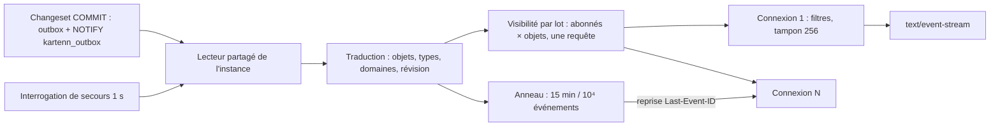

# 022 — Événements poussés (SSE) : conception

## Vue d'ensemble

Un **lecteur partagé** par instance suit l'outbox (ADR 0018) : réveillé par `NOTIFY`,
avec une interrogation de secours, il lit les événements validés au-dessus de son
**plancher**, les traduit en événements SSE minimaux (clés et révisions), les range dans
un **anneau** borné et les distribue aux connexions de l'instance. Chaque connexion
filtre par ses paramètres, puis par les **droits** de son abonné, calculés **par lot et
par instance** (une requête de visibilité pour toutes les connexions), et écrit dans son
tampon borné. Le client relit les objets par l'API REST avec leurs ETag.

> Décision centrale : le flux n'est **pas** un consommateur de l'outbox au sens de
> l'ADR 0018 (pas de livraison enregistrée dans `outbox_delivery`) : c'est une **vue
> volatile** de l'outbox, rejouable depuis l'anneau. La garantie « sans trou » vient du
> plancher (comme `pass_floor`) et d'un curseur qui le porte ; la base reste la seule
> autorité (D9).



## Changements

### Point d'accès (REQ-022-1, 2, 15, 19, 23)

`GET /v1/events` dans `kartenn-rest` (nouveau module `events.rs`), monté seulement si
`[events] enabled = true` (défaut : vrai) ; sinon la route n'existe pas (404) et
`/v1/capabilities` dit `events: null`.

| Élément | Valeur |
|---|---|
| Paramètres | `types`, `domains`, `objects`, `kinds` (listes séparées par des virgules, bornes de REQ-022-2) ; `last_event_id` (secours quand l'en-tête ne peut être posé) |
| En-têtes lus | `Accept`, `Last-Event-ID` (prioritaire sur le paramètre), authentification, `Sec-Fetch-Site` |
| En-têtes écrits | `Content-Type: text/event-stream`, `Cache-Control: no-store`, `X-Accel-Buffering: no`, `Incremental: ?1` (si `[events] incremental`, RFC 10036), `Kartenn-Request-Id` |
| Erreurs avant ouverture | 400 filtre, 401, 403, 406, 429 (identité), 503 (instance, arrêt) — Problem Details |
| Après ouverture | jamais d'erreur HTTP : `reset` ou fermeture |

Pile de middlewares : comme `/v1` (authentification, quota, corrélation), **sauf** le
délestage `quota::shed` et la compression (`compression.rs`), remplacés par le plafond
de flux (REQ-022-22). Pour une session par cookie, le contrôle d'`Origin` et de
`Sec-Fetch-Site` réutilise `csrf.rs` (règle de REQ-006-28 appliquée à ce `GET`,
REQ-022-15) : 403 sinon. Pas de CORS : la route ne répond jamais
`Access-Control-Allow-Origin` ; la CSP du shell (`connect-src 'self'`, 007) couvre
`EventSource` et `fetch` (CSP3 § 6.1.2).

### Format (REQ-022-3 à 6, 9 à 11)

Lignes UTF-8, champs WHATWG (§ 9.2.6) ; donnée JSON sur une ligne.

```text
retry: 2140
event: ready
id: k1.Qm9n…
data: {"instance":"<uuid>","heartbeat":15,"ring_seconds":900}

event: changes
id: k1.Ym9u…
data: {"changeset":"<C>","objects":[{"type":"core.prefix","id":"<P>"}],"domains":["<D>"]}

event: changes
id: k1.ZXV…
data: {"changeset":"<C2>","truncated":true,"types":["core.address"],"domains":["<D>"]}

event: changeset
id: k1.Y2Fy…
data: {"changeset":"<C3>","state":"rejected"}

: ping

id: k1.cG9p…

event: reset
id: k1.bWFy…
data: {"reason":"overflow"}
```

- `changes` : `changeset` est la révision (ETag fort, 006 `object_version`) de chaque
  objet listé ; une tâche de fond sans changeset (REQ-016-15) donne `"task":"<module>:
  <tâche>"`, `"event":"<id CloudEvents>"` et pas de révision : le client relit sans
  condition. `domains` : domaines
  visibles de l'événement. `truncated` : invalidation large (REQ-022-5), avec `types`.
- `changeset` : état d'un changeset en attente (`pending`, `applied`, `rejected`,
  `withdrawn`, `expired`, `stale`), l'événement `org.kartenn.changeset.<état>` de la 004.
- Point de reprise : `id:` seul suivi d'une ligne vide. Selon WHATWG § 9.2.6 (« dispatch
  the event »), le dernier identifiant de la source est mis à jour **avant** le test du
  tampon de données vide : le client natif avance son `Last-Event-ID` sans recevoir
  d'événement. *(À vérifier mot à mot : note de référence, § SSE.)*
- Maintien : `: ping` toutes les 15 s de silence (§ 9.2.7, conseil informatif).
- `retry:` tiré dans [1 000, 3 000] ms à l'ouverture, dans [500, 5 000] ms à l'arrêt.

Traduction outbox → SSE (lecteur, pur, testable sans base) :

| CloudEvents `type` (outbox) | Sorte SSE | Objets |
|---|---|---|
| `org.kartenn.changeset.applied` | `changes` | `data.objects` (UUID), typés par `changeset_operation` et les sections du différentiel (ADR 0026, clause 13) ; effets dérivés (héritage 003, reclassification D34, flux 011) → `types` |
| `org.kartenn.changeset.<état>` | `changeset` | le changeset (visibilité : auteur et valideurs possibles) |
| `org.kartenn.<module>.<nom>` | `changes` si le module déclare l'objet (`subject`) et son type, sinon **non remis** | `subject` |

Le typage des objets est la seule lecture supplémentaire du lecteur : une requête par
passe, groupée sur tous les changesets de la passe (`changeset_operation` par
`changeset_id = ANY($1)`). *(À l'implémentation : vérifier que `data.objects` couvre les
objets dont seules les affectations ont changé ; sinon les ajouter à l'événement de la
004, ajout compatible.)*

### Curseur (REQ-022-6 à 8)

L'outbox numérote ses lignes par une identité PostgreSQL, **pas dans l'ordre de
validation** entre clés d'ordre différentes (ADR 0018, amendements 1 et 2) : un curseur
« dernier numéro vu » sauterait l'événement d'une transaction lente. Le curseur porte
donc le **plancher** du lecteur :

- état : `(f, s)`, `f` = plancher du lecteur au moment de l'écriture (tout numéro ≤ `f`
  est validé et déjà passé par le lecteur, ou n'existera jamais), `s` = plus grand numéro
  remis à cette connexion (indication, sert au dédoublonnage) ;
- forme : `k1.` + base64url d'un chiffrement authentifié (AES-256-GCM) de `(f, s,
  identité, émission)` avec une clé dérivée du trousseau serveur (005, « Trousseau » ;
  même mécanisme que le curseur signé de REQ-006-8). Opaque : le client ne lit pas de
  numéro et ne mesure pas le volume d'écriture des autres (R6, D3) ;
- reprise : l'instance rejoue de l'anneau tous les événements de numéro `> f` (filtres et
  droits appliqués), puis enchaîne sur le direct ; si `f` est sous le bas de l'anneau,
  `reset` `too_old`. Les événements entre `f` et `s` déjà reçus reviennent : le client
  les ignore par la révision (son ETag est déjà celui-là).

#### Doublons (REQ-022-27, arbitrage A2)

Garantie : **aucun événement perdu, quelques doublons possibles.**

| Cas | Pourquoi | Ampleur |
|---|---|---|
| Reprise sur la même instance | Le curseur porte le plancher `f`, pas l'ensemble des numéros remis ; l'anneau rejoue tout ce qui est `> f`, dont les événements entre `f` et `s` déjà reçus | Les événements validés pendant que le plancher était retenu (transaction longue) |
| Reprise sur une autre instance | Même rejeu ; l'autre instance ne sait pas ce que la première a remis | Idem ; jamais plus que l'anneau |
| Même connexion, sans reprise | Impossible : le lecteur ne publie chaque numéro qu'une fois (ensemble des numéros vus au-dessus de son plancher, balayage de secours compris) | Aucun |
| `reset` (trop ancien, débordement, droits) | Ne rejoue rien : invalidation complète | Aucun doublon, aucune perte d'information |

Reconnaissance par le client : (1) doublon exact — l'identité de l'événement
(`changeset`, ou `event` pour une tâche) est dans l'ensemble des 1 000 dernières vues :
ignoré sans requête ; (2) changement déjà appliqué — la révision d'un objet égale son
ETag en cache : rien à relire ; (3) sinon, relecture conditionnelle (`If-None-Match`),
au pire un 304. Les identifiants de changeset ne sont pas ordonnés : le client ne
compare pas deux révisions, il compare seulement à l'égalité.

Test (tâche 10) : propriété sur deux instances, transaction longue qui retient le
plancher, coupures et reprises tirées au hasard : reçus ⊇ validés visibles ; tout
doublon porte une identité déjà vue ; aucun doublon sans reprise.

#### Plancher

Le plancher du lecteur monte comme `pass_floor` (migration 0027), **en mémoire** : à
chaque passe, noter `pending_max` et `pg_snapshot_xmax` ; quand `pg_snapshot_xmin` les a
dépassés, monter au premier numéro non vu. Le balayage horaire de secours (numéro tiré
avant l'identifiant de transaction) relit la fenêtre de l'anneau. Le code de
`kartenn-store-pg/src/floor.rs` est réutilisé par une variante sans écriture.

### Lecteur partagé (REQ-022-20, 25)

Tâche Tokio unique par instance (`kartenn-server`, à côté des relais de `app.rs`) :

1. Connexion dédiée hors du pool : `LISTEN kartenn_outbox` (validé avant la première
   lecture, PostgreSQL 18, LISTEN, notes).
2. Réveil sur notification **ou** toutes les 1 s ; une passe lit `outbox` `WHERE seq >
   plancher AND seq <> ALL(vus)` `ORDER BY seq LIMIT 1 000`, type les objets, met à jour
   le plancher, publie le lot.
3. Écriture : une ligne `pg_notify('kartenn_outbox', '')` dans la transaction qui écrit
   l'outbox (`write.rs`, `pending.rs`), charge utile vide (les notifications identiques
   d'une transaction sont fusionnées ; livrées à la validation seulement ; PostgreSQL 18,
   NOTIFY). Le coût est mesuré par le banc (REQ-022-26, verrou de la file de
   notification à la validation).
4. Connexion d'écoute perdue : reconnexion avec attente croissante ; l'interrogation de
   secours couvre l'intervalle.
5. Au démarrage, l'anneau est rechargé par une requête (15 dernières minutes, 10⁴
   événements au plus) pour servir les reprises dès la première connexion.

Distribution : un `tokio::sync::broadcast` est exclu (un récepteur lent fait perdre à
lui seul des messages sans signal exploitable, et le filtrage par droits doit précéder
la remise). Le lecteur publie le lot traduit à un **répartiteur** qui calcule la
visibilité, puis pousse dans le `mpsc` borné de chaque connexion par `try_send` ; un
`try_send` en échec marque la connexion « débordée » (REQ-022-21).

### Visibilité par lot (REQ-022-16 à 18)

- Les connexions sont regroupées par **sujet d'autorisation** (identité et groupes
  effectifs, comme `PgAuthorizer`). Pour un lot d'événements, le répartiteur pose
  **une requête** : pour chaque sujet distinct et chaque objet du lot, la permission
  `<type>.read` est-elle accordée maintenant ? Elle réutilise les prédicats de
  `kartenn-store-pg/src/rbac.rs` (`readable`, `authorize_many`) sous forme de jointure
  sujets × objets (ADR 0021). Un sujet qui a la lecture globale d'un type court-circuite.
- Un objet invisible est retiré ; un événement vide n'est pas remis ; le curseur de la
  connexion n'avance qu'avec un événement remis ou un point de reprise (au plus toutes
  les 30 s), ce qui efface le rythme des événements cachés (REQ-022-16).
- `changeset` : remis à l'auteur, et aux sujets qui détiennent la permission de
  validation dans le périmètre du changeset (REQ-004-41, 42).
- Révocation : le lecteur voit passer les changesets d'administration (005, REQ-005-25 :
  identités, sessions, liaisons, rôles, comptes de service). Il marque les sujets
  touchés ; le répartiteur revérifie leur état (cache de 5 s de l'ADR 0020) et ferme
  (identité désactivée, session révoquée, compte révoqué) ou envoie `reset`
  `rights_changed` (liaison, rôle). Filet : revérification groupée de tous les sujets
  connectés toutes les 10 s (une requête). Échéances : jeton Bearer à `exp`, session
  cookie à `min(connexion + reste de la durée absolue, dernière activité + inactivité)`
  lus dans le cookie à l'ouverture ; le flux ne rafraîchit pas le cookie (R17).

### Connexions, tampons, plafonds (REQ-022-12, 21, 22)

- `mpsc` borné (256) par connexion ; le corps HTTP est un flux qui lit ce canal, un
  minuteur de maintien et un minuteur d'échéance.
- Débordement : vider le canal, mettre `reset` `overflow` en tête dès que l'écriture
  reprend, fermer après 30 s de blocage (`kartenn.events.dropped`).
- Plafonds : compteur atomique par instance (5 000) et table en mémoire par identité
  (16), libérés par `Drop` du corps ; refus 503 / 429 avec `Retry-After` avant toute
  requête à la base. Le `InFlight` du délestage (`lib.rs`, `quota::shed`) n'englobe pas
  la route.
- Arrêt : le signal d'arrêt (`kartenn-server/src/http.rs`, `GracefulShutdown`) ferme
  d'abord le plafond (503), puis diffuse « fin » aux connexions, qui écrivent `retry:`
  et terminent leur corps ; sans cela, l'arrêt propre attendrait des flux sans fin.

### Transport (REQ-022-13, 14)

- HTTP/1.1 : les navigateurs limitent le nombre de connexions par origine (pratique
  d'implémentation ; RFC 9112 § 9.4 dit seulement qu'un client « ought to limit ») : un
  flux par onglet épuise vite la limite. Le contrat du SDK impose **un flux par
  navigateur** (onglet meneur, `SharedWorker` ou `BroadcastChannel`) et le guide
  recommande HTTP/2.
- HTTP/2 : `SETTINGS_MAX_CONCURRENT_STREAMS` ≥ 100 (RFC 9113 § 6.5.2, valeur
  recommandée), réglé sur le serveur `hyper` de `kartenn-server`.
- Mandataires inverses : `X-Accel-Buffering: no` (désactive la mise en tampon d'un
  mandataire courant, documentation de `proxy_buffering`), délai de lecture > 2 ×
  maintien ; ajouté au guide de déploiement (015).

### Contrat OpenAPI (REQ-022-23)

kartenn sert OpenAPI 3.1 (REQ-006-34) : la réponse 200 de `GET /v1/events` est décrite
avec le type de média `text/event-stream` (schéma `string`) et une extension
`x-kartenn-events` qui associe chaque sorte à un schéma de `components/schemas`
(`EventReady`, `EventChanges`, `EventChangeset`, `EventReset`). Ces schémas entrent dans
le contrat de référence comparé par le test de REQ-006-34. OpenAPI 3.2 décrit les flux
d'éléments (`itemSchema`, types de média séquentiels dont `text/event-stream`) : passer
à 3.2 quand le générateur le permettra (Q-022-9).

### Audit et télémétrie (REQ-022-24, 25)

| Événement | Sévérité | Criticité | Détails |
|---|---|---|---|
| `events.stream.opened` | INFO | low | `criteria` (filtres), `resumed` (bool) |
| `events.stream.closed` | INFO | low | `cause` (`client`, `shutdown`, `revoked`, `expired`, `overflow`), `duration_ms`, `delivered`, `resets`, cibles = identifiants remis bornés par `audit.read_ids_max`, `targets_omitted` |

À ajouter au catalogue (`docs/spec/evenements-audit.md`, schéma JSON). Pourquoi pas un
événement par remise : le flux ne porte que des notifications ; toute lecture de contenu
et toute écriture passent par l'API REST, auditées par requête, donc chaque action reste
rattachée à son acteur (A4).

Au-delà de la borne, chaque remise est écrite dans les **logs techniques** (012), pas
dans le journal d'audit : enregistrement DEBUG `events.delivery` (connexion, acteur,
sorte, identifiants), émis seulement quand la borne de la connexion est atteinte, filtré
et retenu par la configuration de la sortie (rétention courte, 7 jours recommandés dans
`docs/exploitation/observabilite.md`). Il ne passe pas par l'outbox d'audit ni le
scellement. Métriques de
REQ-022-25 ; span `events.reader.pass` (lot, durée, plancher), span
`events.visibility` (sujets, objets).

## Contrat consommé par les clients

Décrit pour les specs à venir (020, 021 : réécriture du shell web et SDK ; bibliothèque
cliente et commandes `watch`), qui le reprendront.

- **Ouverture** : ouvrir le flux **avant** de charger les données ; à `ready`, tout
  invalider une fois (ce qui a été lu avant `ready` peut être périmé).
- **`changes`** : pour chaque objet, invalider la requête de l'objet (`[type, id]`) si
  la `version` lue dans son corps diffère de `changeset` (jamais l'ETag, opaque et
  composite depuis 006/H19 ; sans `version`, relire en `If-None-Match`), les requêtes
  qui montrent cet objet (résumés de liés, fiches composites), et les listes de son type
  (*amendé par la 021, 2026-10-23*) ; `truncated` :
  invalider toutes les requêtes des `types` (et domaines) nommés et les relire sans
  `If-None-Match` (valeurs héritées, Q-022-12). Avec TanStack Query
  (cœur, sans dépendance au framework) : `queryClient.invalidateQueries({ queryKey })`
  ; la relecture passe par l'API REST avec `If-None-Match` (304 si inchangé).
- **`changeset`** : rafraîchir la vue du changeset et la liste des propositions.
- **`reset`** : `invalidateQueries()` sans filtre ; continuer sur le même flux.
- **Shell web : `EventSource`** (cookie BFF envoyé nativement, même origine). Une
  coupure réseau est reprise par le navigateur avec `Last-Event-ID`. Un statut autre que
  200 (401, 429, 503) ferme l'objet sans reconnexion (WHATWG § 9.2.2) : le SDK observe
  l'état `CLOSED`, vérifie la session, puis rouvre un `EventSource` avec attente
  croissante plafonnée et aléatoire, en passant le dernier curseur reçu par le paramètre
  `last_event_id` (un nouvel objet n'envoie pas l'en-tête).
- **CLI, bibliothèque Python, connecteurs** : requête `GET` lue en continu, en-tête
  `Authorization` (Basic ou Bearer), `Last-Event-ID` posé par le client ; ils lisent le
  statut et `Retry-After` et appliquent la même attente.
- **Navigateur** : un seul flux par navigateur partagé entre onglets.
- **Doublons** : ignorer les identités d'événement déjà vues, comparer les révisions à
  l'égalité (§ Doublons).
- Un connecteur qui doit recevoir le contenu de chaque événement sans perte utilise un
  relais d'outbox dédié (ADR 0018), pas ce flux.

Dépendances : les specs 020 et 021 (à venir) reprennent ce contrat ; elles relèvent du
débat web D-1, et D17 n'est pas modifiée par la 022 (A8).

## Futur adaptateur MCP (R23)

Un serveur MCP sera un **adaptateur séparé**, `POST /mcp`, au transport Streamable HTTP
de la révision 2026-07-28 : `subscriptions/listen` ouvre une réponse
`text/event-stream` liée à la requête, dont le premier message est
`notifications/subscriptions/acknowledged` ; pas de reprise par `Last-Event-ID` dans
cette révision : un flux perdu se traite par réabonnement et relecture (l'équivalent du
`reset`). Il se branche sur la même source (lecteur partagé et visibilité par lot), avec
les droits de son appelant. `/v1/events` n'est jamais le point d'accès MCP : les deux
contrats diffèrent (reprise, méthode, enveloppe JSON-RPC). Spec à venir.

## Exigences envers le noyau et les autres specs

| N° | Exigence | Spec touchée |
|---|---|---|
| E1 | `pg_notify('kartenn_outbox','')` dans toute transaction qui écrit l'outbox | 004 (amendement additif) |
| E2 | `data.objects` de `org.kartenn.changeset.applied` couvre les objets dont seules les affectations ont changé (à vérifier) | 004, 003 |
| E3 | Un module qui émet un événement (REQ-016-15) déclare le type de son `subject` pour qu'il soit poussé | 016, ADR 0026 |
| E4 | `/v1/events` hors délestage et hors compression | 006 (REQ-006-30, 32) |
| E5 | Audit par connexion, pas par événement remis | 012 (REQ-012-18, INV-50) |
| E6 | Variante sans écriture de `floor.rs` | 004, 012 |

## Erreurs et cas limites

| Cas | Comportement | REQ |
|---|---|---|
| Curseur trop ancien, invalide, d'une autre identité | `reset` puis flux courant | 8 |
| Transaction longue (sauvegarde) | Le plancher ne monte plus : les curseurs restent bas, plus de doublons à la reprise ; au-delà de l'anneau, `reset` | 7, 8 |
| Base indisponible | Les flux ouverts restent (maintien), pas d'événement ; nouvelles ouvertures 503 (authentification impossible) | 20 |
| Connexion d'écoute perdue | Interrogation de secours ; latence ≤ 1 s | 20 |
| Changeset de 10⁶ objets | Un événement `truncated` | 5 |
| Abonné qui perd la lecture d'un objet | Plus d'événement sur lui ; sa relecture donne 404 | 16 |
| Liaison retirée | `reset` `rights_changed` | 18 |
| Instance arrêtée | `retry:` étalé, fermeture ; reprise ailleurs | 12 |
| Mandataire qui met en tampon | Latence non tenue ; détecté par l'événement `ready` attendu en < 1 s (sonde du guide) | 13 |

## Alternatives considérées

- **WebSocket** : bidirectionnel inutile ici ; pas de reprise standard ; traverse moins
  bien les mandataires ; la CSP le couvre aussi, mais le contrat est à inventer.
- **Interrogation longue (long polling) ou périodique** : c'est ce qu'on remplace ;
  reste le secours d'un client qui ne peut pas tenir un flux (Q-022-4).
- **Consommateur d'outbox par connexion** (`outbox_delivery`) : une écriture par
  événement et par connexion ; l'outbox n'est pas faite pour des abonnés éphémères.
- **Décodage logique (réplication)** : rejeté par l'ADR 0018 pour la même raison.
- **`id:` = numéro d'outbox brut** : saute l'événement d'une transaction lente
  (ADR 0018) et révèle le volume d'écriture (R6).
- **Événements porteurs des objets** : coût de sérialisation par abonné et par droits
  (valeurs sensibles, REQ-005-21), doublon du contrat REST.

## Risques et migration

- `NOTIFY` prend un verrou global à la validation des transactions qui notifient :
  mesuré au banc (50 écritures/s) ; repli : interrogation seule (latence ≤ 1 s).
- La requête de visibilité croît avec sujets × objets : bornée par le lot (1 000) et le
  court-circuit de lecture globale ; mesurée au banc.
- Pas de migration de données : l'outbox existe ; les événements antérieurs restent hors
  de l'anneau.

## Stratégie de test

| REQ | Test |
|---|---|
| 1 à 6, 9 à 11 | Intégration `kartenn-rest` : client SSE de test (analyseur WHATWG) ; un test par sorte |
| 7, 8 | Transaction longue concurrente (comme `a_running_transaction_is_never_skipped`) ; reprise sur une seconde instance ; curseur altéré |
| 12 | Deux instances (`server/tests`), arrêt de l'une, reprise sans trou |
| 13, 14 | En-têtes ; HTTP/2 et `SETTINGS_MAX_CONCURRENT_STREAMS` |
| 15, 19 | Matrice cookie × `Sec-Fetch-Site`, Basic, Bearer ; pas de CORS |
| 16, 17 | Test de propriété : objets remis = décision unitaire de lecture ; opérateur externe |
| 18 | Révocation, liaison retirée, jeton expiré, échéance de session |
| 20, 21, 22 | Compte des requêtes du lecteur ; client qui ne lit plus ; plafonds |
| 23 | Contrat OpenAPI de référence |
| 24, 25 | Événements d'audit et métriques |
| 26 | Banc `bench-events` |

## ADR

Proposée : **0034 — Événements poussés par SSE, vue volatile de l'outbox** (R1, R6,
R18, R19, R20, R23).

## Références

Note de lecture : [`docs/reference/push-serveur.md`](../../docs/reference/push-serveur.md)
(SSE, MCP, mandataires, alternatives, `LISTEN`/`NOTIFY` ; points « à vérifier »).

- WHATWG HTML Living Standard, § 9.2 « Server-sent events »,
  <https://html.spec.whatwg.org/multipage/server-sent-events.html> : § 9.2.2 (interface
  `EventSource` ; statut ≠ 200 ou type ≠ `text/event-stream` → échec sans reconnexion ;
  `withCredentials`), § 9.2.3 (reconnexion, `Last-Event-ID`), § 9.2.4 (en-tête
  `Last-Event-ID`), § 9.2.5 (UTF-8 obligatoire), § 9.2.6 (interprétation : `id` sans
  NUL, `retry` en chiffres, commentaires), § 9.2.7 (notes d'auteur, informatives :
  commentaire toutes les 15 s environ), § 9.2.1 (introduction, informative : 204 arrête
  les reconnexions). Le standard écrit « must » en minuscules.
- RFC 9110, § 10.2.3 (`Retry-After`), § 15.6.4 (503, `Retry-After` MAY) :
  <https://www.rfc-editor.org/rfc/rfc9110.html>.
- RFC 6585, § 4 (429, détails SHOULD, `Retry-After` MAY) :
  <https://www.rfc-editor.org/rfc/rfc6585.html#section-4>.
- RFC 9112, § 9.4 (concurrence : « ought to limit », aucun maximum imposé) :
  <https://www.rfc-editor.org/rfc/rfc9112.html#section-9.4>.
- RFC 9113, § 6.5.2 (`SETTINGS_MAX_CONCURRENT_STREAMS`, ≥ 100 recommandé), § 5.1.2 :
  <https://www.rfc-editor.org/rfc/rfc9113.html>.
- CSP Level 3, § 6.1.2 `connect-src` (couvre `EventSource`) :
  <https://www.w3.org/TR/CSP3/#directive-connect-src>.
- Fetch Standard, en-têtes « no-CORS-safelisted » et interdits (`Last-Event-ID` n'est
  dans aucune des deux listes) : <https://fetch.spec.whatwg.org/>.
- PostgreSQL 18, `NOTIFY` (charge < 8 000 octets, remise à la validation, fusion des
  doublons, file de 8 Go) et `LISTEN` :
  <https://www.postgresql.org/docs/18/sql-notify.html>,
  <https://www.postgresql.org/docs/18/sql-listen.html>.
- Documentation du module mandataire, `proxy_buffering` et `X-Accel-Buffering` :
  <https://nginx.org/en/docs/http/ngx_http_proxy_module.html#proxy_buffering>.
- RFC 10036, § 3-4 (`Incremental`) : <https://www.rfc-editor.org/rfc/rfc10036.html>.
- MCP, transports 2025-03-26, 2025-11-25, 2026-07-28 et SEP-2575 :
  <https://modelcontextprotocol.io/specification/versioning>,
  <https://modelcontextprotocol.io/seps/2575>.
- OpenAPI 3.2.0 (flux d'éléments, `itemSchema`) : <https://spec.openapis.org/oas/v3.2.0>
  *(à vérifier, note de référence)*.
- ADR 0018, 0020, 0021, 0022 ; specs 004, 005, 006, 012, 016.
