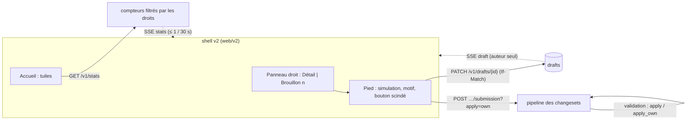

# 024 — Retours sur les maquettes : conception

Statut : **validée le 2026-10-24**.

## Vue d'ensemble



Quatre ajouts au serveur (A à D), indépendants entre eux, puis la révision de l'interface
(E), qui consomme A, B et C. L'ordre des tâches : B d'abord (il change le catalogue des
permissions que tout le reste teste), puis A, C, D en parallèle, puis E.

## A. Brouillons (REQ-024-1 à 8)

Table `draft` (migration du cœur, `crates/kartenn-store-pg/migrations/0064_drafts.sql`) :
`id uuid`, `author uuid` (identité), `title text`, `reason jsonb` (résumé, description),
`operations jsonb` (tableau d'`Operation`, validé à l'écriture par le désérialiseur du
contrat), `version bigint`, `created_at`, `updated_at` ; index `(author, updated_at desc)`.
Pas d'historique bitemporel : un brouillon n'est pas une donnée du référentiel.

Routes (`crates/kartenn-rest/src/drafts.rs`, à l'image de `changesets.rs`) :

| Route | Effet |
|---|---|
| `GET /v1/drafts` | les brouillons de l'appelant, sans opérations (titre, nombre, dates) |
| `POST /v1/drafts` | crée (titre, opérations facultatives) → 201, `ETag` |
| `GET /v1/drafts/{id}` | le brouillon complet, `ETag` |
| `PATCH /v1/drafts/{id}` | titre, motif, opérations (remplacement de la liste), `If-Match` |
| `POST /v1/drafts/{id}/operations` | ajoute des opérations, `If-Match` |
| `DELETE /v1/drafts/{id}` | supprime, `If-Match` |
| `POST /v1/drafts/{id}/simulation` | comme `POST /v1/changesets?simulate=true` |
| `POST /v1/drafts/{id}/submission[?apply=own]` | crée le changeset (REQ-024-5, 13) |
| `GET /v1/identities/{id}/drafts` | sous `core.draft.admin` global, audité (REQ-024-7a) |
| `POST /v1/drafts/{id}/takeover` | sous `core.draft.admin` : l'appelant devient l'auteur, audité |

Sous `core.draft.admin`, `GET` et `DELETE /v1/drafts/{id}` acceptent aussi le brouillon
d'un autre (audités, avec l'auteur d'origine) ; sans elle, 404.

Un brouillon d'un autre répond 404. La rétention (90 jours) est un job du planificateur
existant (`kartenn-server`, jobs), quotidien. Événement SSE `draft` : `{id, version}` ou
`{id, deleted: true}`, filtré par auteur dans le distributeur de la 022 (règle de
visibilité nouvelle : `author == identity`).

Shell : `@kartenn/sdk` gagne `drafts` (liste, lecture, écriture avec If-Match et nouvel
essai sur 412 après relecture, simulation débrayée à 400 ms comme aujourd'hui) ; le
brouillon actif d'un onglet est son identifiant en `sessionStorage` ; la base IndexedDB du
brouillon disparaît (pas de migration, rien à garder avant le gel).

## B. Permissions d'édition et d'application (REQ-024-9 à 13)

Catalogue (`docs/spec/permissions.md`, catalogues des modules) : pour chaque
`X.write`/`X.propose`, trois permissions `X.edit`, `X.apply`, `X.apply_own` ;
`core.changeset.approve` disparaît. Le nommage de la 018 tient (`vlan.edit`,
`core.prefix.apply_own`, `prop.<clé>.edit`, Q-024-6) ; nouvelle permission globale
`core.draft.admin` (Q-024-4).

Pipeline (`crates/kartenn-service/src/pipeline.rs`, `rights.rs`, `review.rs`) :

- Soumission : le contrôle « write sinon propose » devient « edit sur tout » ; le
  changeset est toujours enregistré **en attente** (l'état `pending` de la 004), la
  branche « appliqué tout de suite » disparaît du pipeline de soumission.
- Validation (`validate_pending_with`) : pour chaque objet et effet, `apply` si
  l'appelant n'est pas l'auteur, `apply_own` s'il l'est ; une politique qui retient le
  changeset interdit l'auteur (`changeset.approval.self`, code inchangé).
- `?apply=own` : soumission et validation dans la même transaction ; si la validation
  échoue pour un droit ou une politique, la transaction garde la soumission et répond
  202 avec `{state: "pending", reason: {code}}`.
- Imports (`import.rs`) et annulation (`undo.rs`) : un import est un changeset soumis
  avec `apply=own` implicite pour son auteur s'il détient `apply_own`, en attente sinon ;
  même règle pour l'annulation.
- Comptes de service : même règle ; un compte de service qui doit écrire sans revue
  reçoit `edit` et `apply_own`.

Migration (`0063_permission_verbs.sql` + changeset système, comme 018/0058) : dans les
rôles, `X.write` → `X.edit` + `X.apply_own`, `X.propose` → `X.edit`,
`core.changeset.approve` → `X.apply` pour chaque X du catalogue. L'audit et l'historique
gardent les anciens noms (018/R6).

Ce que la 024 ne change pas : les politiques d'approbation (déclencheurs, cible par
auteur), les états des changesets, la revalidation à l'application.

## C. Statistiques (REQ-024-14 à 16)

`GET /v1/stats` (`crates/kartenn-rest/src/stats.rs`) :

```json
{
  "objects": {"core.prefix": 1520, "core.address": 48211, "vlan": 312},
  "changesets": {"applied_7d": 41, "applied_30d": 188, "by_day": [ … 30 entiers … ]},
  "pending": {"to_apply": 3, "mine": 1},
  "anomalies": {"open": 12},
  "modules": {"flow": {"requests_pending": 4}, "machines": {"machines": 930}}
}
```

Chaque compteur est une requête `count(*)` filtrée par le prédicat de lecture du
périmètre déjà utilisé par les listes (`reads.rs`) ; les modules exposent un port
`StatsContributor` (comme les sections de différentiel). Cache serveur par
(empreinte des droits de l'appelant, révision de l'outbox) pendant 30 s : deux
utilisateurs aux mêmes liaisons partagent le résultat. ETag = empreinte du corps.
L'événement `stats` est émis par le relais de l'outbox, regroupé (au plus un toutes les
30 s), sans contenu : le client relit.

Budget : p95 ≤ 200 ms au banc complet (`bench-core`, nouveau scénario `stats`), cache
froid ; au-delà, compteurs approchés pour les sortes de plus d'un million de lignes
(question à rouvrir si le banc échoue, pas avant).

## D. Simulation de toute écriture (REQ-024-17)

Le kit des ressources (`crates/kartenn-rest/src/kit.rs`, `resources.rs`, `cycle.rs`)
construit déjà un changeset par requête d'écriture ; `?simulate=true` le passe au
pipeline en mode simulation (le chemin de `POST /v1/changesets?simulate=true`) et rend
la même réponse 200. Les routes d'action (`…/validation`, `…/rejection`, imports…)
simulent leur effet quand c'est un changeset (annulation, import) et répondent 400
`simulate.unsupported` sinon (validation, rejet, secrets). `x-kartenn` annonce
`simulate: true|false` par opération ; la CLI en tire `--dry-run`.

## E. Interface (REQ-024-18 à 29)

Révision des specs 020 et 021, écrite dans leurs designs à la validation de la 024 :

| Sujet | Changement | Où |
|---|---|---|
| Thème clair | jetons `--k-sidebar-*` clairs (fait le 2026-10-24) ; audit des surfaces restantes | `ui/src/tokens/tokens.css` |
| Cadre | panneau droit unique (`SidePanel` : onglets, repli, surimpression non modale, largeur 420 px redimensionnable, empilement isolé de la surface) ; compteur du brouillon en bascule | 021 « Cadre » ; `ui/src/components/` |
| Soumission | `CommitForm` (résumé, description) et `SplitButton` (action, chevron, entrées grisées avec motif) | 020 « Inventaire » |
| Brouillons | liste et reprise (menu du compteur, page `/drafts`) | 021 « Écrans » |
| Accueil | tableau de bord de tuiles ; vue `Topographie` (`/topology`) ; « + » sur un nœud | 021 « Catalogue des écrans » |
| Tables | en-tête et lignes dans **une seule** grille CSS (`grid-template-columns` sur la grille, lignes en `subgrid`), en-tête collant dans le même conteneur de défilement : la barre de défilement et les colonnes `fill` ne peuvent plus décaler l'en-tête ; tri et filtre de colonne ; `Skeleton` animé dans les cellules | `ui/src/components/DataGrid/` |
| Double entrée | `MatrixGrid` : en-têtes de lignes et de colonnes de même composant, figés | 020 « Inventaire » |
| Édition | un panneau d'édition par sorte (`EditPanel` + schéma de la sorte), ouvert par l'arbre, la table, la palette ou le menu | 021 « Édition en place » |
| Droits | `Tooltip` sur action grisée : « Il faut `core.prefix.apply` » | 020 `Button`, `Menu` |
| Mise en page | emplacements fixes ; défilement interne ; menus et période en surimpression ; `Toolbar` qui replie ses actions dans « … » (ResizeObserver) | 020 « Architecture CSS » |
| Erreurs | phrase courante par type de problème (libellés de la 018) et code à côté | 021 « Erreurs » |
| Captures | 1440, 1280, 1024, 768 px × clair, sombre ; règle Stylelint ou test qui refuse un défilement horizontal de page | 020 « Régression visuelle » |

Le skill `kartenn-ui` gagne une section « Structure avant style » : grilles partagées
pour les tables, conteneurs `min-inline-size: 0` dans les pistes `fr`, contenu long qui
défile dans son emplacement, surimpressions isolées (`isolation: isolate` sur la
surface), vérification à quatre largeurs avant de rendre une maquette.

## Erreurs et cas limites

| Cas | Réponse |
|---|---|
| Brouillon d'un autre | 404 |
| Brouillon modifié dans un autre onglet | 412 ; le shell relit et rejoue la modification |
| 51ᵉ brouillon, 10 001ᵉ opération | 422 `draft.limit` |
| Soumission refusée (violations) | 422, le brouillon reste |
| `?apply=own` sans `apply_own` ou sous politique | 202 en attente, motif |
| L'auteur valide son changeset sans `apply_own` | 403 `changeset.approval.self` |
| `?simulate=true` sur une action sans changeset | 400 `simulate.unsupported` |
| Statistiques d'une sorte illisible | sorte absente du corps |

## Risques

- Le renommage des permissions touche ~45 noms dans 37 fichiers Rust, les catalogues, les
  tests et la CLI : même méthode que la 018 (table de correspondance, `k-check` vert à
  chaque étape).
- « Rien ne s'applique sans validation » change les tests qui supposaient un 201 direct :
  les aides de test soumettent avec `apply=own`.
- Compteurs filtrés par les droits sur de grosses tables : budget mesuré avant de
  promettre plus.

## Stratégie de test

- Serveur : tests d'intégration par route (droits, 404 d'un autre, 412, limites,
  rétention), matrice des droits d'application (auteur/autre × apply/apply_own ×
  politique), transaction de `apply=own` (échec de validation → 202), simulation sur
  chaque route d'écriture (rien d'écrit, aucun événement), SSE `draft` filtré par
  auteur, `stats` filtré par les droits ; banc `stats`.
- CLI : le xfail `--dry-run` disparaît ; `kartenn drafts …`.
- Web : composants nouveaux au catalogue avec leurs états ; captures aux quatre largeurs ;
  parcours e2e « éditer, appliquer » et « éditer, soumettre en revue, appliquer par un
  autre ».

## ADR

Aucun nouvel ADR : M7 amende C1 dans le journal de la 004 (renvoi vers la 024).
